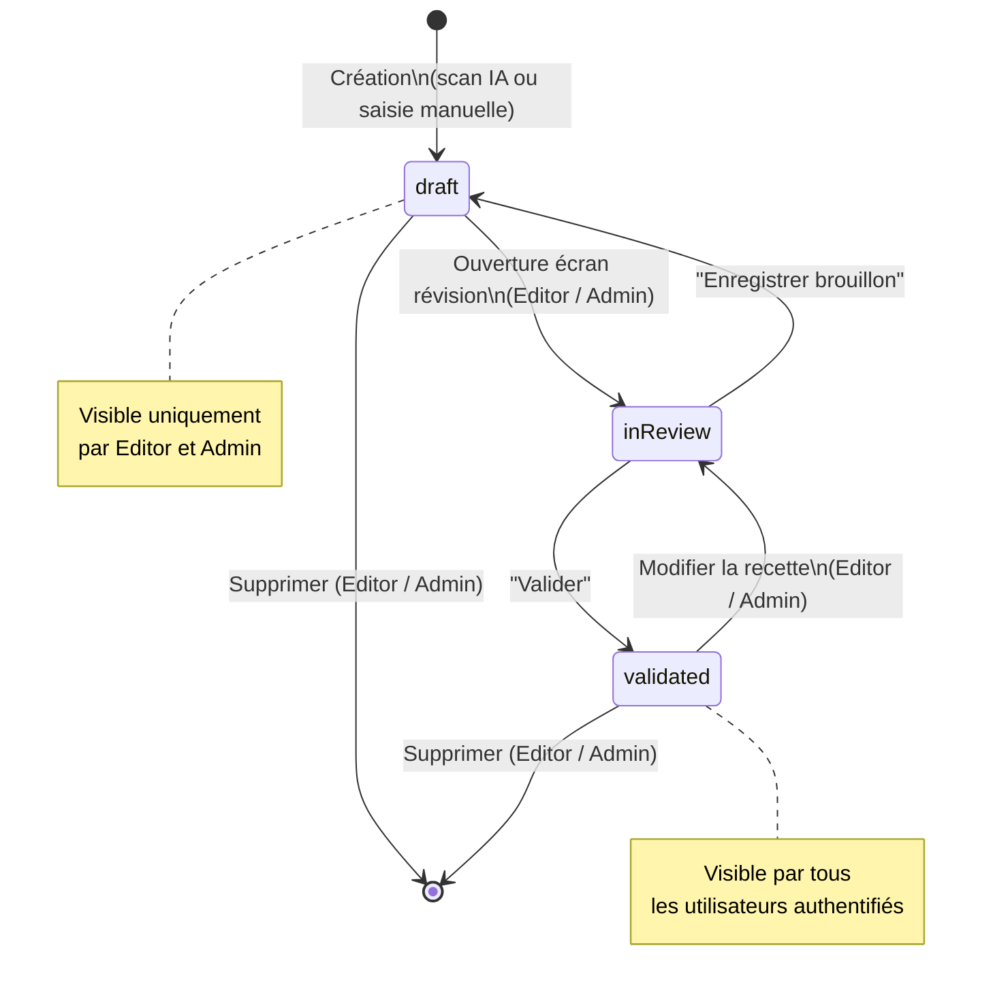
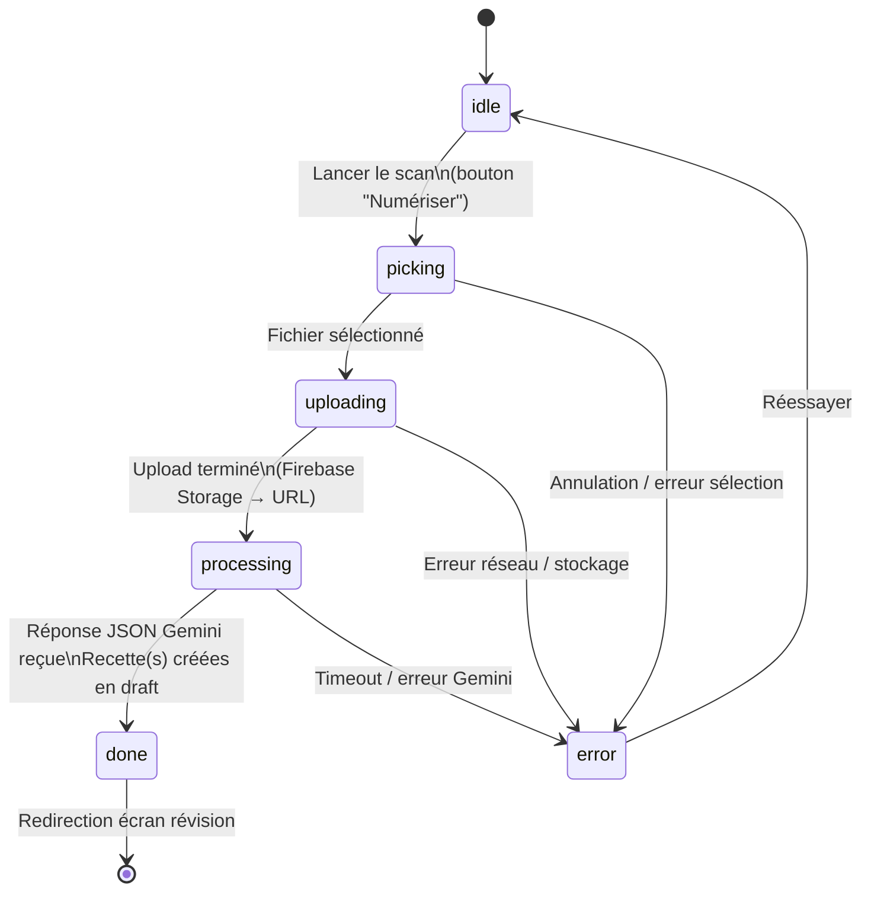
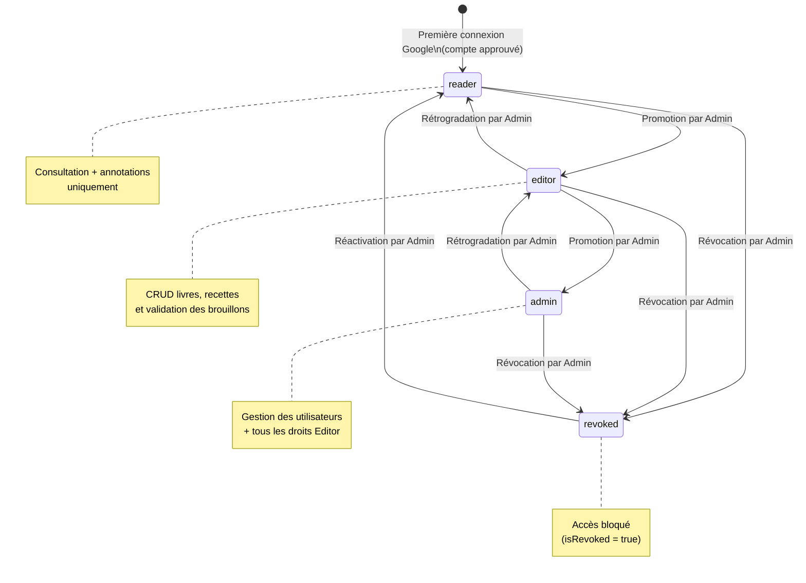
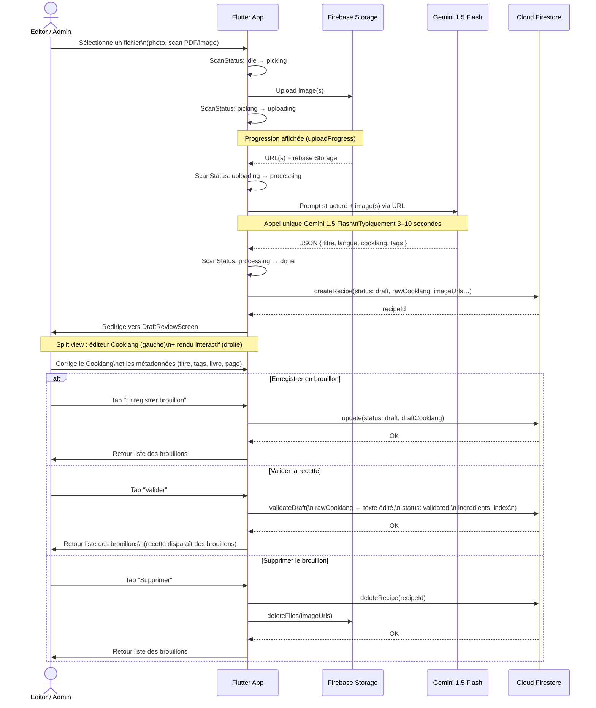

# Spécifications Fonctionnelles — Kass'dalle
## Livre de Cuisine Digital (Flutter + Firebase)

> Version : 2.0 — 17 Mai 2026

### Mise à jour release (17/05/2026 — v0.13.53)

- **Images agrandissables dans l'Aperçu des pages non-recette** : les illustrations affichées dans l'onglet Aperçu d'une page non-recette sont limitées à 280 px de hauteur par défaut. Un tap sur l'image ou sur le bouton fullscreen (visible en bas à droite de chaque photo) permet d'agrandir l'image en pleine hauteur ou de la réduire. Chaque image garde son état agrandi/réduit indépendamment des autres.

- **Suivi de la version d'import (admin)** : lors de chaque import ou scan d'une recette ou page, la version de l'application est enregistrée dans le champ `import_version` du document Firestore de la recette. Dans l'écran de révision d'un brouillon, les administrateurs voient s'afficher en dessous de « Analysé le… » une ligne « Importé avec vX.Y.Z » (icône clé, texte italique). Ce champ est invisible pour les Editors et Readers. Les anciennes recettes importées avant cette version ne possèdent pas ce champ ; la ligne n'est alors pas affichée.

### Mise à jour release (17/05/2026 — v0.13.52)

- **Extraction d'illustration depuis l'original** : dans l'onglet Photos d'un brouillon disposant d'un scan image source, un bouton « Depuis l'original » est affiché à côté du bouton « Ré-extraire ». Ce bouton télécharge le fichier source, ouvre l'outil d'amélioration d'image en mode recadrage et permet au propriétaire de sélectionner manuellement une zone du scan pour l'ajouter comme nouvelle illustration. Le résultat est ajouté à la liste des illustrations sans remplacer les existantes.

- **Suppression directe des illustrations** : l'icône poubelle est désormais visible en permanence sur chaque illustration dans l'onglet Photos, dans la prévisualisation Cooklang et dans l'Aperçu des pages non-recette. Un appui long n'est plus nécessaire. La suppression n'est disponible que pour le propriétaire du brouillon.

- **Icône poubelle unifiée** : l'icône de suppression de photo est harmonisée (`delete_outline`) sur l'ensemble de l'application, en remplacement de l'icône ✕ précédemment utilisée.

### Mise à jour release (17/05/2026 — v0.13.51)

- **Onglet « Aperçu » pour les pages non-recette** : les brouillons de type page de technique culinaire, méthode ou autre contenu textuel non structuré bénéficient d'un onglet « Aperçu » dédié. Cet onglet affiche le texte de la page formaté typographiquement (titres en gras, listes à puces, paragraphes) et intercale chaque illustration à sa position déclarée par un marqueur `[schéma : …]` dans le texte. Le propriétaire peut supprimer chaque illustration directement depuis cet onglet. Pour les brouillons de recettes structurées (avec ingrédients Cooklang), l'Aperçu existant basé sur le rendu Cooklang interactif est conservé.

### Mise à jour release (17/05/2026 — v0.13.50)

- **Correction de navigation après l'éditeur d'image** : fermer ou valider l'outil d'amélioration d'image (recadrage, correction de couleur) depuis un brouillon ramène désormais systématiquement à l'onglet Photos du brouillon, quelle que soit la façon dont l'outil a été ouvert.

- **Correction des icônes Material sur le web (build release)** : les icônes Material Design étaient absentes dans les builds web release en raison du tree-shaking Flutter. Tous les builds web utilisent désormais l'option `--no-tree-shake-icons` pour garantir l'affichage correct de l'ensemble des glyphes.

### Mise à jour release (15/05/2026 — v0.13.35)

- **Refactoring interne (aucun changement fonctionnel)** : nettoyage global de la qualité de code. Toutes les API dépréciées (`withOpacity` → `withValues(alpha:)`) ont été mises à jour, les `debugPrint` retirés du code de production, les avertissements `use_build_context_synchronously` corrigés, et les règles du linter Dart strictement respectées. Résultat : analyse statique propre (0 warning, 0 erreur ; 2 infos inévitables liées à `dart:html` legacy). Aucun comportement visible n'est modifié.

### Mise à jour release (15/05/2026 — v0.13.27)

- **Batch planning hebdomadaire** : depuis l'écran Planning, un bouton "Nouveau planning" ouvre `BatchPlanningScreen`. L'écran génère automatiquement les créneaux du prochain cycle (ex : 7 jours) à partir des préférences configurées. Pour chaque créneau, l'utilisateur peut : laisser l'IA suggérer une recette (bouton ✨), choisir manuellement une recette (icône loupe → picker avec recherche textuelle + suggestion IA), saisir un repas libre (texte libre), ou laisser le créneau vide. Une suggestion IA globale génère d'un coup tout le planning en respectant les contraintes. L'heure de chaque repas est réglable indépendamment via un sélecteur. Un bouton "Enregistrer" ajoute tous les repas non-vides en lot dans Firestore.

- **Configuration du planning (Préférences)** : un écran dédié `PlanningConfigScreen` est accessible depuis l'icône engrenage de l'écran Planning. Il permet de configurer : le nombre de repas par cycle (défaut : 7), le jour de démarrage du cycle (Lundi–Dimanche), l'heure et les minutes par défaut des repas, les contraintes globales en langage naturel (ex : "Pas de poisson deux fois dans la semaine"), et les contraintes par jour de la semaine (durée max de préparation en minutes, flag "batch cooking / réchauffage", note libre). Le calendrier Google cible (parmi les calendriers du compte) peut également être sélectionné depuis cet écran.

- **Export calendrier global** : dans l'écran Planning, un bouton calendrier dans l'AppBar exporte en lot tous les repas visibles vers Google Calendar (calendrier configuré dans les préférences). Chaque repas est créé comme événement individuel. Un bouton calendrier est également disponible sur chaque tuile de repas pour un export individuel.

- **Heure repas cliquable** : dans l'écran Planning, l'heure affichée sur chaque repas est cliquable et ouvre un sélecteur d'heure pour modifier le créneau directement.

- **Changer / vider une recette depuis le planning** : un menu contextuel (kebab) sur chaque tuile de repas propose "Changer la recette" (ouvre le picker) et "Vider le créneau" (supprime la recette sans supprimer le créneau).

- **Liste de courses multi-recettes** : dans la liste de courses (bottom sheet), chaque ingrédient agrégé affiche en sous-titre la ou les recettes sources, permettant de savoir d'où provient chaque quantité.

- **Sélection multiple dans livres et recettes libres** : un appui long sur un livre ou une recette libre active le mode sélection multiple. L'AppBar contextuelle propose "Tout sélectionner" et "Supprimer" (avec confirmation). La sélection est limitée aux éléments de l'utilisateur connecté.

- **Affichage toutes les pages d'un livre** : dans l'écran "Recettes d'un livre", toutes les recettes (pages normales) sont désormais visibles par défaut, sans toggle. Le regroupement par sections reste disponible pour les membres du groupe.

- **Compteur d'énergie estimée (token usage)** : l'écran "Usage IA" affiche désormais une estimation de l'énergie consommée (en Wh) calculée à partir du nombre total de tokens, pour sensibiliser à l'empreinte énergétique des appels IA.

### Mise à jour release (14/05/2026 — v0.13.5)

- **Écran "Planning des repas"** : un nouvel écran est accessible depuis la barre de navigation principale (5e entrée, icône calendrier, entre Recherche et Brouillons). Il affiche la liste chronologique des repas planifiés de l'utilisateur connecté, groupés par date. Chaque repas affiche l'heure, le titre de la recette et la durée totale. Un appui sur un repas ouvre directement la fiche recette associée. Un bouton poubelle permet de supprimer un repas planifié après confirmation. Les repas passés sont affichés en mode atténué (opacité réduite). Si aucun repas n'est planifié, un écran vide avec message explicatif est affiché.
- **Sauvegarde locale en Firestore** : lors de chaque planification depuis la fiche recette (via le bottom sheet Google Calendar), le repas est désormais également sauvegardé dans Firestore (collection `planned_meals`) avec : identifiant utilisateur, identifiant et titre de la recette, date/heure planifiée, durée totale. Cette sauvegarde alimente l'écran Planning en temps réel via un stream Firestore.

### Mise à jour release (13/05/2026 — v0.13.4)

- **Bouton "Planifier" dans la fiche recette** : un bouton avec icône calendrier (`calendar_month_outlined`) apparaît dans l'en-tête de la section Ingrédients de la fiche recette, uniquement si la recette possède des ingrédients structurés. Il s'affiche côte à côte avec le bouton "Liste de courses" existant.
- **Bottom sheet de planification** : un appui sur le bouton Planifier ouvre un bottom sheet permettant de : choisir la date (sélecteur de date, par défaut aujourd'hui), choisir l'heure (sélecteur d'heure, par défaut 19h00), configurer le rappel en minutes (pré-rempli avec le temps de préparation de la recette). La durée est calculée automatiquement à partir des champs `prepTime` et `cookTime` de la recette. Un bouton "Ajouter à Google Calendar" déclenche la création de l'événement.
- **Intégration Google Calendar (API REST OAuth)** : la planification crée un événement "Préparer : [titre]" dans le calendrier Google principal de l'utilisateur, avec description contenant les ingrédients, les temps de préparation/cuisson et un rappel popup configurable. Sur web : OAuth via `FirebaseAuth.signInWithPopup` avec le scope `calendar.events`. Sur mobile/desktop : via `GoogleSignIn.instance.authorizationClient`.

- **Filtre par livre dans la page Brouillons** : dans l'écran "Brouillons", une barre de filtres défilable horizontalement apparaît lorsque les brouillons appartiennent à plusieurs livres différents. Les chips disponibles sont : "Tous" (vue par défaut), "Sans livre" (brouillons non rattachés à un livre), et un chip par livre distinct présent dans la liste. La barre est masquée si tous les brouillons appartiennent au même contexte (zéro ou un seul livre distinct). La sélection d'un chip filtre immédiatement la liste affichée.
- **Suppression d'un livre depuis la liste de ses recettes** : dans l'AppBar de l'écran "Recettes d'un livre", un bouton poubelle apparaît pour les Editors et Admins. Il déclenche un dialogue de confirmation à trois options : Annuler, "Détacher les recettes" (supprime le livre mais conserve toutes les recettes, qui deviennent des recettes libres), "Supprimer aussi les recettes" (supprime le livre ET toutes ses recettes de façon irréversible). Après suppression, l'utilisateur est redirigé vers l'écran d'accueil avec un message de confirmation.

### Mise à jour release (13/05/2026 — v0.12.85)

- **Onglet "Photos" dans le brouillon** : un quatrième onglet "Photos" est disponible dans l'écran de révision des brouillons (`DraftReviewScreen`), visible pour tous. Il affiche les illustrations associées à la recette dans une grille. Le propriétaire peut supprimer individuellement chaque photo. Si la recette possède un fichier source image (scan), un bouton "Extraire les illustrations" (ou "Ré-extraire" si des illustrations existent déjà) permet de lancer l'extraction automatique via l'IA.
- **Bouton IA dans l'AppBar du brouillon** : le propriétaire d'un brouillon dispose d'un bouton ✨ ("Améliorer avec l'IA") dans l'AppBar de l'écran de révision. Un appui ouvre un dialogue permettant de saisir des instructions libres (ex : "Reformate en style Cooklang strict", "Corrige les quantités"). Si la recette a un scan image source, une case à cocher optionnelle "Extraire les illustrations" est proposée. L'IA raffine alors le CookLang + titre + ingrédients selon les instructions, et met à jour le brouillon en place.

### Mise à jour release (13/05/2026 — v0.12.84)

- **Suivi des tokens IA** : chaque appel Gemini (extraction de recette, détection d'illustrations, recherche, génération, raffinement, etc.) est enregistré dans Firestore sous la collection `ai_usage`. Chaque enregistrement contient : uid utilisateur, fonctionnalité (feature), nombre de tokens en entrée/sortie/total, modèle utilisé, et horodatage.
- **Page "Usage IA"** : accessible depuis le menu compte (icône graphique), elle affiche un tableau récapitulatif de la consommation de tokens, filtrable par fonctionnalité. Les Admins peuvent également filtrer par utilisateur et voir la consommation globale de tous les membres. La page affiche le total d'appels, tokens d'entrée, de sortie et total, agrégés par feature.
- **Suppression du cache** : un bouton "Vider le cache" est disponible dans les paramètres, permettant de forcer la recharge des données depuis Firestore.

### Mise à jour release (13/05/2026 — v0.12.83)

- **Illustrations dans le brouillon** : les illustrations extraites par l'IA lors du scan (ou extraites manuellement depuis l'onglet Photos) sont stockées dans Firebase Storage sous `illustrations/{uid}/` et associées à la recette via le champ `image_urls`. Elles sont visibles dans l'onglet Photos du brouillon et persistent après validation.
- **Extraction IA depuis le scan** : depuis l'onglet Photos du brouillon, si la recette possède un scan image source, Gemini détecte automatiquement les zones de photographies culinaires dans l'image, découpe chaque région et l'uploade comme illustration séparée. Les illustrations existantes sont remplacées lors d'une ré-extraction.

### Mise à jour release (13/05/2026 — v0.12.74)

- **Fusion "Brouillons & Traitements" en WorkQueue** : les anciens onglets séparés "Brouillons" et "Traitements" sont fusionnés en une seule vue unifiée `WorkQueueScreen`. Cette vue affiche, dans une liste chronologique, à la fois les jobs de traitement en cours/terminés/en erreur et les brouillons de recettes non validés. Trois modes de filtrage sont disponibles : "Mes éléments" (vue par défaut), "Famille" (éléments des membres du groupe), "Tous" (admin uniquement — tous les utilisateurs). En mode famille et admin, les éléments sont regroupés par propriétaire dans des sections rétractables. La sélection multiple reste disponible pour les actions groupées (valider, réessayer, supprimer).

### Mise à jour release (12/05/2026 — v0.12.67)

- **Détection automatique des coins de document** : à l'ouverture de l'écran de recadrage (amélioration d'image), les 4 coins de la page ou du livre visible sont automatiquement détectés par analyse de gradient (Sobel + régression PCA). Une barre de progression orange apparaît en haut de l'image pendant l'analyse (~0,5 s). L'utilisateur peut ensuite affiner manuellement chaque coin. Un bouton ⊕ permet de relancer la détection à tout moment. Si le document n'est pas détectable (fond homogène, faible contraste), les coins reviennent à la position par défaut.
- **Sélection multiple de brouillons** : dans la liste des brouillons, un appui long sur un brouillon active le mode de sélection multiple. L'AppBar contextuelle affiche le nombre de sélections, avec actions "tout sélectionner", "valider" (✓) et "supprimer" (🗑). La validation nécessite une confirmation par dialogue ; la suppression idem (bouton rouge). Le FAB est masqué en mode sélection. Les brouillons des autres membres du groupe restent non sélectionnables (lecture seule).
- **Correction de la déduplication d'ingrédients** : les apostrophes typographiques (' ') et les caractères accentués français (é, è, ê, à, ç, ù, ô, î, â, û) sont normalisés avant le calcul de la clé d'ingrédient, évitant les doublons comme "tronçon d'asperge" × 2 causés par des apostrophes Unicode différentes retournées par Gemini.

### Mise à jour release (12/05/2026)

- **Téléchargement du scan original** : un bouton de téléchargement est disponible à côté du bouton de prévisualisation dans l'en-tête de toute recette disposant d'un fichier source.
- **Scan multi-pages** : lors de l'import d'une recette, l'utilisateur arrive dans un mode "Pages en attente" plutôt qu'un déclenchement immédiat. Il peut accumuler autant de pages qu'il souhaite (via fichier ou caméra), puis lancer l'analyse de toutes les pages en un seul appel Gemini multi-part.
- **Extraction automatique d'illustrations** : pour les scans image (JPEG/PNG), Gemini détecte automatiquement les zones de photographies culinaires. Chaque zone est découpée et uploadée sur Firebase Storage (`illustrations/`), puis associée à la recette créée.
- **Progression détaillée** : dans l'écran "Traitements", le job affiche l'étape courante ("Extraction du texte…", "Extraction des illustrations…") en italique pendant le traitement.
- **Texte collé conservé comme source** : lorsqu'un utilisateur colle un texte dans l'écran "Nouvelle recette" et le met en forme avec l'IA, le texte original est automatiquement uploadé sur Firebase Storage (`scans/`) et attaché à la recette comme fichier source (`sourceFileUrl`). Le bouton de téléchargement de l'original est alors disponible sur la fiche recette, exactement comme pour un scan.

### Mise à jour release (08/05/2026)

- **Copie cross-utilisateur de recettes/brouillons** : un utilisateur peut copier la recette validée ou le brouillon d'un membre de son groupe dans sa propre collection. La copie d'une recette validée est immédiatement disponible dans les recettes, sans validation nécessaire. La copie d'un brouillon crée un brouillon dans ses brouillons, à valider. La redirection est automatique vers la copie créée.
- **Affichage de l'origine** (auteur + livre) : dans l'AppBar de l'écran brouillon (DraftReviewScreen) et de l'écran détail recette, le nom de l'auteur (icône 👤) et le titre du livre source sont affichés sous le titre si la recette n'appartient pas à l'utilisateur connecté.
- **Protection des validations** : seul le propriétaire d'un brouillon peut le valider ou le supprimer (garde UI + vérification côté dépôt avant écriture). Un non-propriétaire voit uniquement le bouton "Copier".
- **Brouillons des membres du groupe** : l'écran Brouillons propose un toggle 👥 pour afficher les brouillons des membres du groupe, organisés par sections collapsibles par membre.
- **Cover automatique "Mes créations Kass'Dalle ✨"** : le livre IA est créé automatiquement au premier scan. Sa couverture est générée programmatiquement (dart:ui) et uploadée sur Firebase Storage. La migration silencieuse est déclenchée à l'ouverture de la bibliothèque.

### Mise à jour release (03/05/2026)

- Groupes familiaux : chaque utilisateur gère ses propres livres et recettes. Un utilisateur peut créer un groupe familial, y inviter d'autres membres (recherche par nom/email). Une fois dans un groupe, les livres et recettes validés des autres membres sont visibles par sections dans la bibliothèque et dans les recettes libres.
- Bibliothèque : sections "Mes livres" + "Livres de [membre]" avec toggles par section. Chaque section affiche une grille de livres.
- Recettes libres : sections "Mes recettes" + "Recettes de [membre]" avec toggles par section.
- Brouillons : visibles uniquement pour l'utilisateur connecté (inchangé).
- Traitements (admin) : l'admin voit tous les traitements de tous les utilisateurs avec filtre par utilisateur et affichage du propriétaire sur chaque tuile.
- Téléchargement APK : bouton "Télécharger l'APK Android" dans le menu compte, visible uniquement sur web/desktop. Pointe vers la dernière version intégrée au déploiement Firebase Hosting.
- Déploiement web : l'APK est désormais inclus dans chaque déploiement Firebase Hosting (`app-release.apk` servi sur le même domaine).

### Mise a jour release (02/05/2026)

- Ajout d'un mode de scan multi-intentions : recettes, couverture de livre, livre complet.
- Creation de brouillons livre a partir d'une photo de page de garde avec validation explicite.
- Ajout d'un traitement asynchrone en file d'attente : plusieurs imports peuvent etre lances sans attendre la fin du precedent.
- Ajout d'une page "Etat des traitements" pour suivre les scans en cours, termines et en erreur.
- Rattachement automatique des recettes extraites d'un document complet au livre cible, y compris en statut brouillon.
- Ajout/edition des champs structures en brouillon recette : portions, difficulte, temps preparation/cuisson, ingredients structures.
- Ajout/edition des champs structures en brouillon livre : sous-titre, editeur, serie, ISBN, description, tags.

### Mise a jour release (01/05/2026)

- Activation complete du parcours Android Google Sign-In (certificats debug/release et configuration Firebase Android).
- Ajout d'un profil utilisateur detaille (role, permissions, identite, activite, deconnexion).
- Ajout d'un visualiseur de source recette (image zoomable ou ouverture externe PDF/DOCX).
- Stabilisation du flux d'import scan (correction d'un crash Riverpod lors de la fermeture d'ecran).
- Uniformisation des icones applicatives a partir de l'asset `assets/icon.jpg` pour Android, iOS, Web, Windows et macOS.

---

## 1. Contexte et Objectif

**Kass'dalle** est une application privée à usage familial permettant de digitaliser une collection personnelle de livres de cuisine physiques et de notes d'ateliers culinaires (ex : Sasasa, recettes du terroir belge). L'application transforme des photos de pages de recettes en fiches numériques structurées, consultables et interactives, grâce à l'IA de reconnaissance visuelle (Gemini Vision) et au format de balisage Cooklang.

L'application est destinée à un cercle familial restreint :
- quelques personnes peuvent **modifier** et enrichir le contenu ;
- tous les membres authentifiés peuvent **consulter** et **annoter** les recettes ;
- un administrateur gère les accès.

---

## 2. Plateformes Cibles

| Plateforme | Usage principal | Particularités |
|---|---|---|
| **Mobile (iOS / Android)** | Scan, saisie, consultation | Accès caméra pour la capture des recettes; possibilités d'uploader des scans |
| **Web** | Consultation, correction, gestion | Pas de scan caméra ; interface plein écran ; possibilités d'uploader des scans pour suivre le meme process que la version mobile |
| **Desktop (Windows / macOS)** | Consultation, correction, gestion | Identique au Web ; fenêtre redimensionnable |

Les trois plateformes partagent le même backend Firebase et la même codebase Flutter. Seul le module de scan est conditionné à la plateforme mobile.

---

## 3. Authentification et Rôles

### 3.1 Connexion

L'authentification est exclusivement basée sur **Google Sign-In** (Firebase Auth). Aucune création de compte par email/mot de passe n'est prévue.

- À la première ouverture, l'utilisateur est invité à se connecter avec son compte Google.
- Le premier compte qui se connecte sur l'application est automatiquement désigné **Admin**.
- Les connexions suivantes obtiennent par défaut le rôle **Reader** (lecture seule) jusqu'à attribution explicite d'un rôle par un Admin.

### 3.2 Rôles

| Rôle | Accès |
|---|---|
| **Admin** | Tout : gestion des utilisateurs, des rôles, des livres, des recettes, des annotations. Peut promouvoir d'autres utilisateurs en Admin ou Editor. |
| **Editor** | Création, modification et suppression de livres et de recettes. Validation des brouillons IA. Peut annoter. |
| **Reader** | Consultation uniquement. Peut annoter les recettes (notes personnelles) mais ne peut pas modifier le contenu des recettes. |

> Règle de sécurité clé : un **Reader non authentifié** ne peut pas accéder à l'application. L'accès en lecture nécessite une connexion Google active et un compte approuvé dans la base.

### 3.3 Gestion des utilisateurs (Admin)

Un écran dédié (Web / Desktop / Mobile) permet à l'Admin de :
- voir la liste des utilisateurs connectés au moins une fois ;
- attribuer ou modifier un rôle (Reader → Editor, Editor → Admin) ;
- révoquer l'accès d'un utilisateur.

---

## 4. Parcours Utilisateur

### 4.1 Gestion d'un Livre

**Qui :** Editor ou Admin.

1. L'utilisateur crée un nouveau livre via un formulaire.
2. Il saisit :
   - Titre du livre
   - Auteur(s)
   - Année de publication (optionnel)
   - Langue principale des recettes (liste déroulante)
   - Tags/thèmes associés au livre (ex : Terroir belge, Pâtisserie)
3. Il peut scanner ou importer une photo de la couverture (mobile : caméra ou galerie ; web/desktop : import de fichier).
4. Le livre est enregistré et apparaît dans la bibliothèque.

Creation automatique via scan de couverture :
- L'utilisateur peut photographier ou importer la page de garde.
- L'IA extrait les champs structures du livre (titre, auteur, sous-titre, editeur, serie, annee, langue, ISBN, description, tags).
- Un brouillon livre est cree avec statut `draft`.
- L'utilisateur valide ensuite ce brouillon depuis l'ecran d'edition du livre via l'action "Valider le livre".

**Modification / Suppression :** accessible via le détail du livre. La suppression d'un livre demande une confirmation explicite car elle entraîne la dissociation des recettes liées (les recettes ne sont pas supprimées, elles deviennent "sans livre").

---

### 4.2 Capture d'une Recette (Mobile uniquement)

**Qui :** Editor ou Admin.

**Étape 1 — Sélection de la source**
- L'utilisateur sélectionne le livre source depuis la bibliothèque (ou crée un nouveau livre à la volée).
- Il indique optionnellement le numéro de page dans le livre.

**Étape 2 — Capture photo**
- L'utilisateur prend une ou plusieurs photos de la page de recette via la caméra intégrée.
- L'interface propose un outil de recadrage et de correction de perspective avant envoi.
- Il est possible d'ajouter plusieurs images pour une recette qui s'étale sur plusieurs pages.

Comportement asynchrone :
- Chaque import cree un job de traitement IA en file d'attente.
- L'utilisateur peut lancer un second scan pendant qu'un premier est encore en cours.
- Les brouillons generes apparaissent automatiquement a la fin de chaque job.

**Étape 3 — Traitement IA (passe unique Gemini)**
- Les images sont uploadées sur Firebase Storage.
- Un appel unique à **Gemini 1.5 Flash** est déclenché avec un prompt structuré.
- Gemini retourne une réponse JSON contenant :
  - Le titre détecté de la recette
  - La langue détectée
  - Le contenu de la recette formaté directement en **Cooklang**
  - Des suggestions de tags (thèmes, type de cuisine, difficulté, temps de préparation, temps de cuisson)
- Cette étape dure typiquement 3 à 10 secondes. Un indicateur de chargement est affiché.

**Étape 4 — Écran de Révision (Split View)**
- L'utilisateur arrive sur un écran divisé en deux panneaux :
  - **Panneau gauche** : éditeur de texte Cooklang brut (modifiable directement, avec coloration syntaxique basique).
  - **Panneau droit** : rendu interactif en temps réel de la recette (liste d'ingrédients + instructions formatées).
- L'utilisateur peut corriger le Cooklang directement dans le panneau gauche ; le rendu se met à jour en temps réel.
- Un bouton **"Voir l'original"** (icône scanner) est toujours présent dans la barre d'actions :
  - Si le fichier source est une image (jpg/png) : affiche une visionneuse plein écran zoomable.
  - Si le fichier est un PDF ou un DOCX : ouvre le document dans le navigateur ou le lecteur système.
  - Sur mobile (vue en onglets), un onglet dédié **"Original"** affiche l'image directement dans l'écran.
- Le document source est **lié à vie à la recette** : il ne peut jamais être dissocié ni supprimé tant que la recette existe.
- Il complète / corrige les métadonnées suggérées par Gemini : titre, tags, numéro de page.
- Deux actions disponibles :
  - **Enregistrer en brouillon** (`draft`) : la recette est sauvegardée mais pas marquée comme validée.
  - **Valider** : la recette passe au statut `validated`.

---

### 4.3 Saisie Manuelle d'une Recette (Web / Desktop / Mobile)

**Qui :** Editor ou Admin.

Pour les recettes sans photo source (recettes mémorisées, recettes tapées manuellement) :
- L'utilisateur accède à un formulaire de création de recette.
- Il saisit directement le contenu en Cooklang dans l'éditeur avec rendu split view.
- Les métadonnées sont saisies manuellement.
- Un bouton **"Mettre en forme avec l'IA"** permet de coller un texte brut (texte web, note, etc.) et de le convertir automatiquement en CookLang via Gemini.
- **Le texte original collé est automatiquement conservé** : il est uploadé sur Firebase Storage et attaché à la recette comme fichier source. Le bouton de téléchargement de l'original apparaît ensuite dans l'en-tête de la recette, comme pour un scan.
- Si l'IA n'est pas utilisée (saisie CookLang directe), aucun fichier source n'est attaché.

---

### 4.4 Consultation d'une Recette

**Qui :** Tout utilisateur authentifié (Reader, Editor, Admin).

1. L'utilisateur navigue dans la bibliothèque (vue par livre ou vue globale).
2. Il peut filtrer/rechercher par : titre, ingrédient, tag, livre, type de cuisine.
3. Il clique sur une recette et accède à la fiche détaillée :
   - **En-tête** : titre, livre source, page, langue, tags.
   - **Portions** : affichées sous forme de chip (ex : « 4 portions ») si renseignées dans les métadonnées CookLang (`>> portions: 4`). Ce champ est également stocké comme donnée structurée dans Firestore (`portions: int?`).
   - **Ingrédients** : liste structurée extraite du Cooklang, avec quantités et unités bien formatées. Chaque ingrédient est stocké dans Firestore sous forme d'objet `{ name, qty, unit }` (champ `ingredients`).
   - **Instructions** : étapes numérotées, avec mise en valeur des ingrédients et du matériel (rendu Cooklang interactif).
   - **Document original** : bouton "Voir l'original" (icône scanner) toujours visible dans la barre d'actions. Ouvre l'image en plein écran zoomable ou le PDF dans le navigateur.
   - **Annotations** : section en bas de fiche pour consulter et ajouter des notes personnelles.

---

### 4.5 Annotation d'une Recette

**Qui :** Tout utilisateur authentifié (Reader, Editor, Admin).

- Chaque recette dispose d'une section d'annotations visible en bas de la fiche.
- Un utilisateur peut ajouter une annotation de type :
  - `note` : observation personnelle
  - `tip` : conseil de préparation
  - `correction` : signalement d'une erreur dans la recette numérisée
- L'annotation affiche le nom de l'auteur et la date.
- Un utilisateur peut modifier ou supprimer **ses propres** annotations.
- Un Admin ou Editor peut supprimer n'importe quelle annotation.

---

## 5. Modules Fonctionnels

### 5.1 Module Bibliothèque (tous les clients)

- Vue en grille des livres avec couverture, titre, auteur et compteur de recettes.
- Si l'utilisateur appartient à un ou plusieurs groupes familiaux, la bibliothèque est divisée en sections :
  - **Mes livres** : tous les livres de l'utilisateur connecté (validés et brouillons).
  - **Livres de [Prénom]** : une section par membre du groupe, affichant uniquement ses livres validés.
- Chaque section dispose d'un toggle pour la masquer/afficher.
- Accès à la liste des recettes d'un livre.
- Vue globale "Toutes les recettes" (sans filtre de livre).

### 5.2 Module Scan (Mobile uniquement)

- Accès caméra natif.
- Recadrage et correction de perspective avant envoi.
- **Mode multi-pages** : après sélection de la première image, l'utilisateur entre en mode "Pages en attente". Il peut ajouter d'autres pages (fichier ou caméra) avant de lancer l'analyse globale. Toutes les pages sont envoyées en un seul appel Gemini multi-part.
- Déclenchement de l'appel Gemini.
- **Extraction automatique d'illustrations** : pour les scans image, Gemini identifie les photographies culinaires, les découpe et les uploade sur Firebase Storage comme illustrations de la recette.
- **Progression affichée** : l'écran Traitements affiche l'étape courante du traitement en cours.

### 5.3 Module Révision et Édition (tous les clients)

- Éditeur Cooklang brut avec coloration syntaxique basique.
- Rendu interactif Cooklang en temps réel (panneau split).
- Visualisation du scan original.
- Gestion des métadonnées (titre, tags, page, langue, statut).
- Edition directe des champs structures recette (portions, difficulte, temps, ingredients structures) en brouillon.
- Validation explicite des brouillons livre crees par IA.
- Sur Web / Desktop : accessible pour modifier des recettes existantes (pas de nouveau scan).

### 5.6 Module Traitements IA (tous les clients)

- Liste des traitements recents avec statut (`queued`, `processing`, `done`, `error`).
- Indicateur de traitements actifs visible dans la zone Brouillons.
- Navigation directe vers les brouillons recettes ou le brouillon livre cree a la fin du traitement.
- **Vue Admin** : l'admin voit tous les traitements de tous les utilisateurs. Un filtre par utilisateur (dropdown) permet de restreindre l'affichage. Chaque tuile affiche le nom du propriétaire du traitement.

### 5.4 Module Recherche et Filtres (tous les clients)

- Recherche textuelle full-text sur : titre, ingrédients (champ `ingredients_index`).
- Filtres combinables : livre, type de cuisine, thème, difficulté, statut.
- Tri par : date de création, titre alphabétique.

### 5.5 Module Administration (Admin uniquement)

- Gestion des utilisateurs : liste, attribution de rôle, révocation.
- Vue sur les recettes en statut `draft` (brouillons non validés).
- Accès à l'ensemble des annotations de toutes les recettes.

### 5.7 Module Groupes Familiaux (tous les clients)

- Un utilisateur peut créer un ou plusieurs groupes familiaux (avec un nom libre).
- Le créateur est propriétaire du groupe. Il peut renommer ou supprimer le groupe.
- Invitation de membres : recherche d'utilisateurs par nom ou email (parmi les comptes existants). Ajout en un clic.
- Retrait de membres : le propriétaire peut retirer n'importe quel membre. Un non-propriétaire peut quitter le groupe.
- Accès depuis le menu compte (icône en haut à droite) → "Groupes familiaux".
- Une fois membre d'un groupe, les livres et recettes validés des autres membres deviennent visibles dans la bibliothèque et les recettes libres, organisés par sections.

### 5.8 Module Planning des Repas (tous les clients)

- Écran dédié "Planning des repas" accessible depuis la navigation principale (5e entrée, icône calendrier).
- Affichage chronologique des repas planifiés de l'utilisateur, groupés par journée.
- Chaque entrée affiche l'heure (cliquable pour modifier), le titre de la recette et la durée totale.
- Navigation directe vers la fiche recette en appuyant sur un repas.
- Menu contextuel sur chaque repas : "Changer la recette", "Vider le créneau", "Supprimer".
- Bouton calendrier sur chaque repas pour export individuel vers Google Calendar.
- Export global vers Google Calendar (tous les repas du planning courant en un clic).
- Suppression d'un repas avec dialogue de confirmation.
- Affichage atténué des repas passés.
- Alimentation en temps réel via un stream Firestore.
- **Batch planning** : bouton "Nouveau planning" pour générer un cycle complet de repas, avec suggestion IA ou assignation manuelle par créneau.
- **Configuration des préférences** : accès depuis l'icône engrenage — nombre de repas par cycle, jour de démarrage, heure par défaut, contraintes quotidiennes et globales en langage naturel, choix du calendrier Google cible.

---

## 6. Règles Métier

| Règle | Détail |
|---|---|
| Accès conditionnel | Toute consultation requiert une authentification Google active. |
| Premier admin | Le premier UID enregistré dans la collection `users` reçoit automatiquement le rôle `admin`. |
| Conservation du scan | L'image ou le fichier source (PDF/image) est toujours conservé dans Firebase Storage et lié à vie à la recette (`sourceFileUrl`). Il ne peut pas être supprimé tant que la recette existe. |
| Brouillons visibles | Les recettes en statut `draft` sont visibles uniquement par leur propriétaire (si Editor/Admin). Les brouillons d'un groupe sont visibles en lecture seule via le toggle 👥 dans l'écran Brouillons. |
| Isolation des données | Chaque utilisateur possède ses propres livres et recettes (champ `created_by`). La visibilité cross-utilisateur est contrôlée exclusivement par l'appartenance aux groupes familiaux. |
| Validation exclusive | Seul le propriétaire d'un brouillon peut le valider ou le supprimer. Cette règle est enforced à la fois dans l'UI (boutons masqués) et dans le dépôt (vérification Firestore avant écriture). |
| Copie cross-utilisateur | Tout membre d'un groupe peut copier une recette ou un brouillon d'un autre membre. La copie d'une recette validée hérite du statut `validated`. La copie d'un brouillon crée un brouillon indépendant (`draft`). Dans les deux cas la copie n'hérite pas des images. |
| Annotations non modifiables par autrui | Un Reader ne peut modifier/supprimer que ses propres annotations. |
| Multi-pages | Une recette peut avoir plusieurs images sources (scan multi-pages). |

---

## 7. Périmètre V1 / V2

### V1 (présent document)
- Authentification Google + gestion des rôles
- CRUD livres et recettes
- Scan + OCR Gemini → Cooklang (mobile)
- Écran de révision split view
- Rendu interactif Cooklang
- Recherche et filtres
- Annotations
- Planning des repas + intégration Google Calendar
- Liste de courses depuis une recette
- Plateformes : Mobile, Web, Desktop

### V2 (hors périmètre actuel)
- Partage externe d'une recette (lien public, export PDF)
- Mode hors-ligne (cache local des recettes)
- Vue calendrier mensuel du planning

---

## 8. Diagrammes d'états et de séquence

### 8.1 États d'une recette (`ReviewStatus`)

Une recette passe par trois états définis dans l'enum `ReviewStatus` : `draft`, `inReview`, `validated`.

### 8.2 États du processus de scan (`ScanStatus`)

Le scan est le process d'acquisition d'un fichier image, de son envoi vers Firebase Storage puis de son analyse par Gemini. Ces états sont gérés dans `ScanState`.

### 8.3 États d'un utilisateur (`UserRole` + `isRevoked`)

---

### 8.4 Diagramme de séquence — Capture et validation d'une recette

Ce diagramme couvre le flux complet depuis la sélection du fichier jusqu'à la validation de la recette par un Editor ou Admin.

