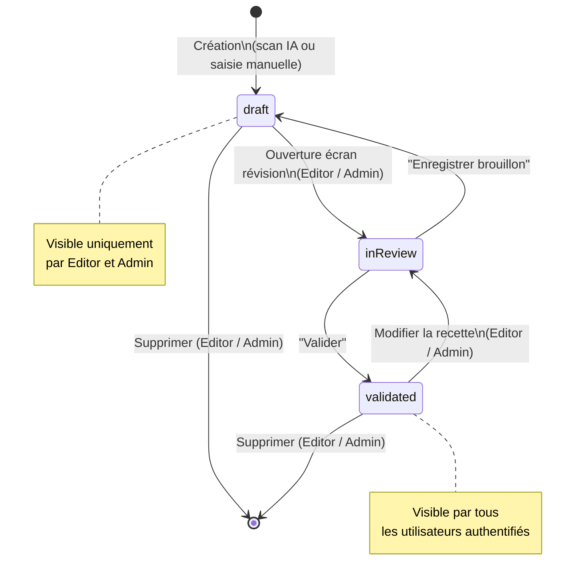
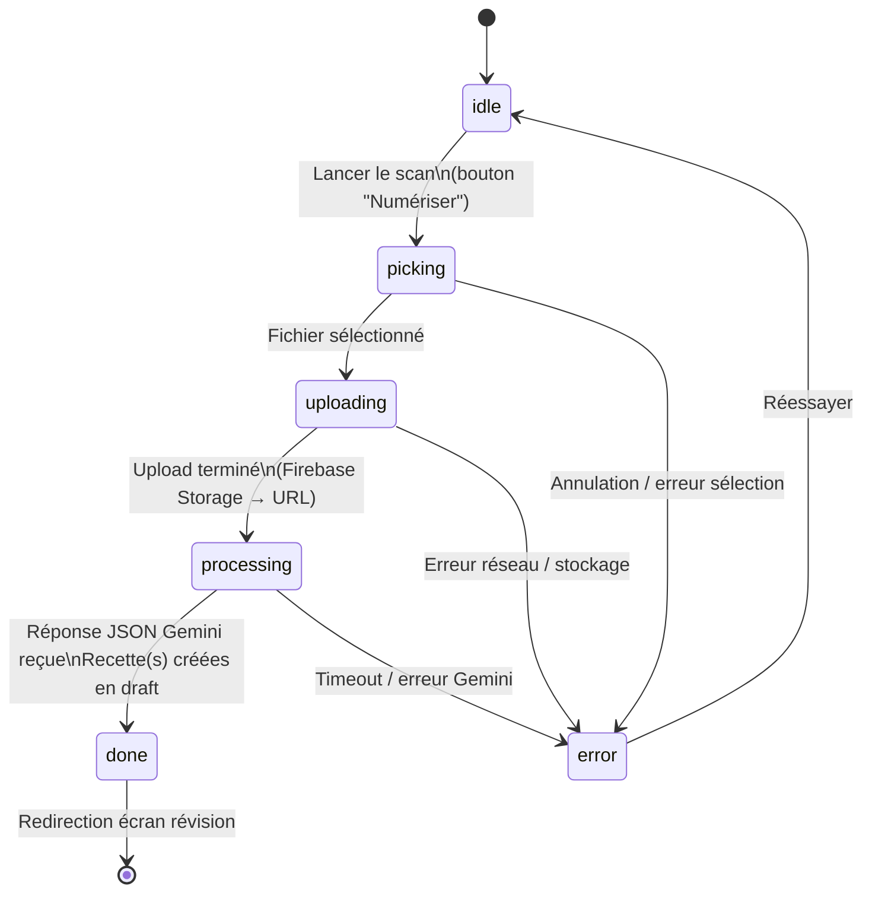
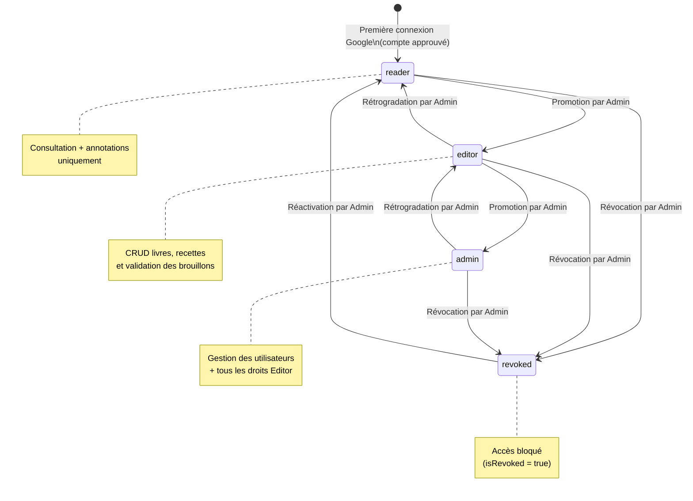
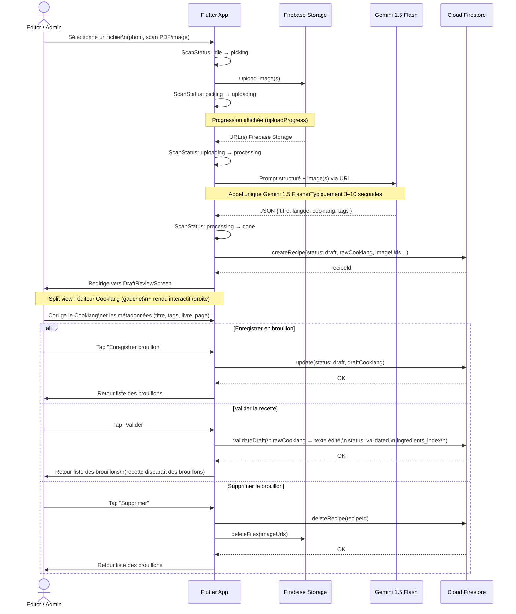

# Spécifications Fonctionnelles — Kass'dalle
## Livre de Cuisine Digital (Flutter + Firebase)

> Version : 1.1 — Mai 2026

### Mise a jour release (01/05/2026)

- Activation complete du parcours Android Google Sign-In (certificats debug/release et configuration Firebase Android).
- Ajout d'un profil utilisateur detaille (role, permissions, identite, activite, deconnexion).
- Ajout d'un visualiseur de source recette (image zoomable ou ouverture externe PDF/DOCX).
- Stabilisation du flux d'import scan (correction d'un crash Riverpod lors de la fermeture d'ecran).
- Uniformisation des icones applicatives a partir de l'asset `assets/icon.jpg` pour Android, iOS, Web, Windows et macOS.

---

## 1. Contexte et Objectif

**Kass'dalle** est une application privée à usage familial permettant de digitaliser une collection personnelle de livres de cuisine physiques et de notes d'ateliers culinaires (ex : Sasasa, recettes du terroir belge). L'application transforme des photos de pages de recettes en fiches numériques structurées, consultables et interactives, grâce à l'IA de reconnaissance visuelle (Gemini Vision) et au format de balisage Cooklang.

L'application est destinée à un cercle familial restreint :
- quelques personnes peuvent **modifier** et enrichir le contenu ;
- tous les membres authentifiés peuvent **consulter** et **annoter** les recettes ;
- un administrateur gère les accès.

---

## 2. Plateformes Cibles

| Plateforme | Usage principal | Particularités |
|---|---|---|
| **Mobile (iOS / Android)** | Scan, saisie, consultation | Accès caméra pour la capture des recettes; possibilités d'uploader des scans |
| **Web** | Consultation, correction, gestion | Pas de scan caméra ; interface plein écran ; possibilités d'uploader des scans pour suivre le meme process que la version mobile |
| **Desktop (Windows / macOS)** | Consultation, correction, gestion | Identique au Web ; fenêtre redimensionnable |

Les trois plateformes partagent le même backend Firebase et la même codebase Flutter. Seul le module de scan est conditionné à la plateforme mobile.

---

## 3. Authentification et Rôles

### 3.1 Connexion

L'authentification est exclusivement basée sur **Google Sign-In** (Firebase Auth). Aucune création de compte par email/mot de passe n'est prévue.

- À la première ouverture, l'utilisateur est invité à se connecter avec son compte Google.
- Le premier compte qui se connecte sur l'application est automatiquement désigné **Admin**.
- Les connexions suivantes obtiennent par défaut le rôle **Reader** (lecture seule) jusqu'à attribution explicite d'un rôle par un Admin.

### 3.2 Rôles

| Rôle | Accès |
|---|---|
| **Admin** | Tout : gestion des utilisateurs, des rôles, des livres, des recettes, des annotations. Peut promouvoir d'autres utilisateurs en Admin ou Editor. |
| **Editor** | Création, modification et suppression de livres et de recettes. Validation des brouillons IA. Peut annoter. |
| **Reader** | Consultation uniquement. Peut annoter les recettes (notes personnelles) mais ne peut pas modifier le contenu des recettes. |

> Règle de sécurité clé : un **Reader non authentifié** ne peut pas accéder à l'application. L'accès en lecture nécessite une connexion Google active et un compte approuvé dans la base.

### 3.3 Gestion des utilisateurs (Admin)

Un écran dédié (Web / Desktop / Mobile) permet à l'Admin de :
- voir la liste des utilisateurs connectés au moins une fois ;
- attribuer ou modifier un rôle (Reader → Editor, Editor → Admin) ;
- révoquer l'accès d'un utilisateur.

---

## 4. Parcours Utilisateur

### 4.1 Gestion d'un Livre

**Qui :** Editor ou Admin.

1. L'utilisateur crée un nouveau livre via un formulaire.
2. Il saisit :
   - Titre du livre
   - Auteur(s)
   - Année de publication (optionnel)
   - Langue principale des recettes (liste déroulante)
   - Tags/thèmes associés au livre (ex : Terroir belge, Pâtisserie)
3. Il peut scanner ou importer une photo de la couverture (mobile : caméra ou galerie ; web/desktop : import de fichier).
4. Le livre est enregistré et apparaît dans la bibliothèque.

**Modification / Suppression :** accessible via le détail du livre. La suppression d'un livre demande une confirmation explicite car elle entraîne la dissociation des recettes liées (les recettes ne sont pas supprimées, elles deviennent "sans livre").

---

### 4.2 Capture d'une Recette (Mobile uniquement)

**Qui :** Editor ou Admin.

**Étape 1 — Sélection de la source**
- L'utilisateur sélectionne le livre source depuis la bibliothèque (ou crée un nouveau livre à la volée).
- Il indique optionnellement le numéro de page dans le livre.

**Étape 2 — Capture photo**
- L'utilisateur prend une ou plusieurs photos de la page de recette via la caméra intégrée.
- L'interface propose un outil de recadrage et de correction de perspective avant envoi.
- Il est possible d'ajouter plusieurs images pour une recette qui s'étale sur plusieurs pages.

**Étape 3 — Traitement IA (passe unique Gemini)**
- Les images sont uploadées sur Firebase Storage.
- Un appel unique à **Gemini 1.5 Flash** est déclenché avec un prompt structuré.
- Gemini retourne une réponse JSON contenant :
  - Le titre détecté de la recette
  - La langue détectée
  - Le contenu de la recette formaté directement en **Cooklang**
  - Des suggestions de tags (thèmes, type de cuisine, difficulté, temps de préparation, temps de cuisson)
- Cette étape dure typiquement 3 à 10 secondes. Un indicateur de chargement est affiché.

**Étape 4 — Écran de Révision (Split View)**
- L'utilisateur arrive sur un écran divisé en deux panneaux :
  - **Panneau gauche** : éditeur de texte Cooklang brut (modifiable directement, avec coloration syntaxique basique).
  - **Panneau droit** : rendu interactif en temps réel de la recette (liste d'ingrédients + instructions formatées).
- L'utilisateur peut corriger le Cooklang directement dans le panneau gauche ; le rendu se met à jour en temps réel.
- Un bouton **"Voir l'original"** (icône scanner) est toujours présent dans la barre d'actions :
  - Si le fichier source est une image (jpg/png) : affiche une visionneuse plein écran zoomable.
  - Si le fichier est un PDF ou un DOCX : ouvre le document dans le navigateur ou le lecteur système.
  - Sur mobile (vue en onglets), un onglet dédié **"Original"** affiche l'image directement dans l'écran.
- Le document source est **lié à vie à la recette** : il ne peut jamais être dissocié ni supprimé tant que la recette existe.
- Il complète / corrige les métadonnées suggérées par Gemini : titre, tags, numéro de page.
- Deux actions disponibles :
  - **Enregistrer en brouillon** (`draft`) : la recette est sauvegardée mais pas marquée comme validée.
  - **Valider** : la recette passe au statut `validated`.

---

### 4.3 Saisie Manuelle d'une Recette (Web / Desktop / Mobile)

**Qui :** Editor ou Admin.

Pour les recettes sans photo source (recettes mémorisées, recettes tapées manuellement) :
- L'utilisateur accède à un formulaire de création de recette.
- Il saisit directement le contenu en Cooklang dans l'éditeur avec rendu split view.
- Les métadonnées sont saisies manuellement.
- Pas d'appel à Gemini dans ce flux.

---

### 4.4 Consultation d'une Recette

**Qui :** Tout utilisateur authentifié (Reader, Editor, Admin).

1. L'utilisateur navigue dans la bibliothèque (vue par livre ou vue globale).
2. Il peut filtrer/rechercher par : titre, ingrédient, tag, livre, type de cuisine.
3. Il clique sur une recette et accède à la fiche détaillée :
   - **En-tête** : titre, livre source, page, langue, tags.
   - **Portions** : affichées sous forme de chip (ex : « 4 portions ») si renseignées dans les métadonnées CookLang (`>> portions: 4`). Ce champ est également stocké comme donnée structurée dans Firestore (`portions: int?`).
   - **Ingrédients** : liste structurée extraite du Cooklang, avec quantités et unités bien formatées. Chaque ingrédient est stocké dans Firestore sous forme d'objet `{ name, qty, unit }` (champ `ingredients`).
   - **Instructions** : étapes numérotées, avec mise en valeur des ingrédients et du matériel (rendu Cooklang interactif).
   - **Document original** : bouton "Voir l'original" (icône scanner) toujours visible dans la barre d'actions. Ouvre l'image en plein écran zoomable ou le PDF dans le navigateur.
   - **Annotations** : section en bas de fiche pour consulter et ajouter des notes personnelles.

---

### 4.5 Annotation d'une Recette

**Qui :** Tout utilisateur authentifié (Reader, Editor, Admin).

- Chaque recette dispose d'une section d'annotations visible en bas de la fiche.
- Un utilisateur peut ajouter une annotation de type :
  - `note` : observation personnelle
  - `tip` : conseil de préparation
  - `correction` : signalement d'une erreur dans la recette numérisée
- L'annotation affiche le nom de l'auteur et la date.
- Un utilisateur peut modifier ou supprimer **ses propres** annotations.
- Un Admin ou Editor peut supprimer n'importe quelle annotation.

---

## 5. Modules Fonctionnels

### 5.1 Module Bibliothèque (tous les clients)

- Vue en grille ou liste des livres avec couverture, titre, auteur et compteur de recettes.
- Accès à la liste des recettes d'un livre.
- Vue globale "Toutes les recettes" (sans filtre de livre).

### 5.2 Module Scan (Mobile uniquement)

- Accès caméra natif.
- Recadrage et correction de perspective avant envoi.
- Gestion de plusieurs photos pour une même recette.
- Déclenchement de l'appel Gemini.

### 5.3 Module Révision et Édition (tous les clients)

- Éditeur Cooklang brut avec coloration syntaxique basique.
- Rendu interactif Cooklang en temps réel (panneau split).
- Visualisation du scan original.
- Gestion des métadonnées (titre, tags, page, langue, statut).
- Sur Web / Desktop : accessible pour modifier des recettes existantes (pas de nouveau scan).

### 5.4 Module Recherche et Filtres (tous les clients)

- Recherche textuelle full-text sur : titre, ingrédients (champ `ingredients_index`).
- Filtres combinables : livre, type de cuisine, thème, difficulté, statut.
- Tri par : date de création, titre alphabétique.

### 5.5 Module Administration (Admin uniquement)

- Gestion des utilisateurs : liste, attribution de rôle, révocation.
- Vue sur les recettes en statut `draft` (brouillons non validés).
- Accès à l'ensemble des annotations de toutes les recettes.

---

## 6. Règles Métier

| Règle | Détail |
|---|---|
| Accès conditionnel | Toute consultation requiert une authentification Google active. |
| Premier admin | Le premier UID enregistré dans la collection `users` reçoit automatiquement le rôle `admin`. |
| Conservation du scan | L'image ou le fichier source (PDF/image) est toujours conservé dans Firebase Storage et lié à vie à la recette (`sourceFileUrl`). Il ne peut pas être supprimé tant que la recette existe. |
| Brouillons visibles | Les recettes en statut `draft` sont visibles uniquement par les Editors et Admins. |
| Annotations non modifiables par autrui | Un Reader ne peut modifier/supprimer que ses propres annotations. |
| Multi-pages | Une recette peut avoir plusieurs images sources (scan multi-pages). |

---

## 7. Périmètre V1 / V2

### V1 (présent document)
- Authentification Google + gestion des rôles
- CRUD livres et recettes
- Scan + OCR Gemini → Cooklang (mobile)
- Écran de révision split view
- Rendu interactif Cooklang
- Recherche et filtres
- Annotations
- Plateformes : Mobile, Web, Desktop

### V2 (hors périmètre actuel)
- Extraction automatique des photos/illustrations dans les scans (découpe d'image)
- Partage externe d'une recette (lien public, export PDF)
- Mode hors-ligne (cache local des recettes)
- Planificateur de menus
- Liste de courses générée depuis une recette Cooklang

---

## 8. Diagrammes d'états et de séquence

### 8.1 États d'une recette (`ReviewStatus`)

Une recette passe par trois états définis dans l'enum `ReviewStatus` : `draft`, `inReview`, `validated`.

### 8.2 États du processus de scan (`ScanStatus`)

Le scan est le process d'acquisition d'un fichier image, de son envoi vers Firebase Storage puis de son analyse par Gemini. Ces états sont gérés dans `ScanState`.

### 8.3 États d'un utilisateur (`UserRole` + `isRevoked`)

---

### 8.4 Diagramme de séquence — Capture et validation d'une recette

Ce diagramme couvre le flux complet depuis la sélection du fichier jusqu'à la validation de la recette par un Editor ou Admin.

