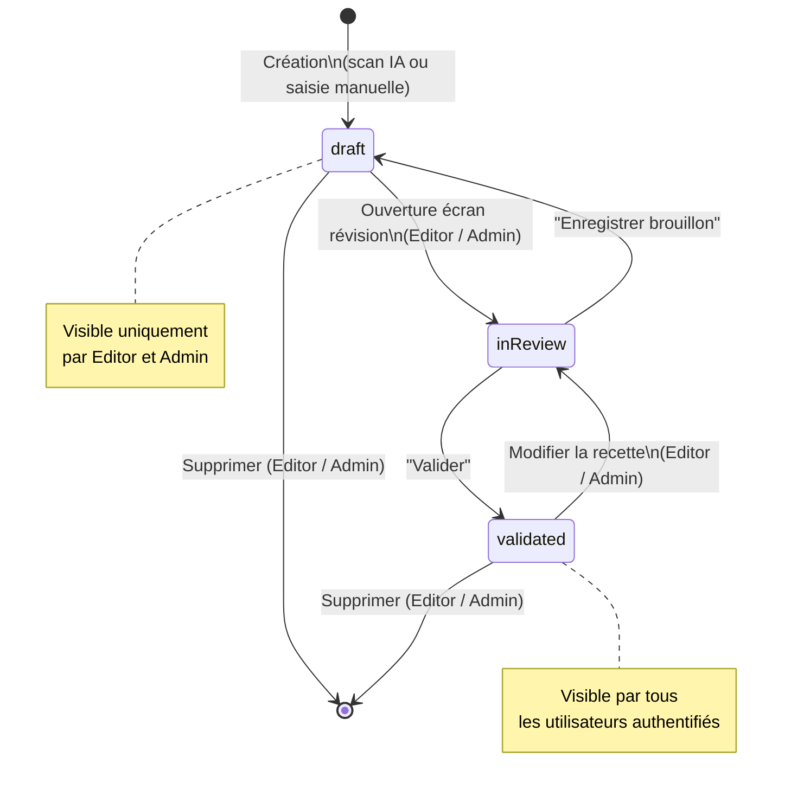
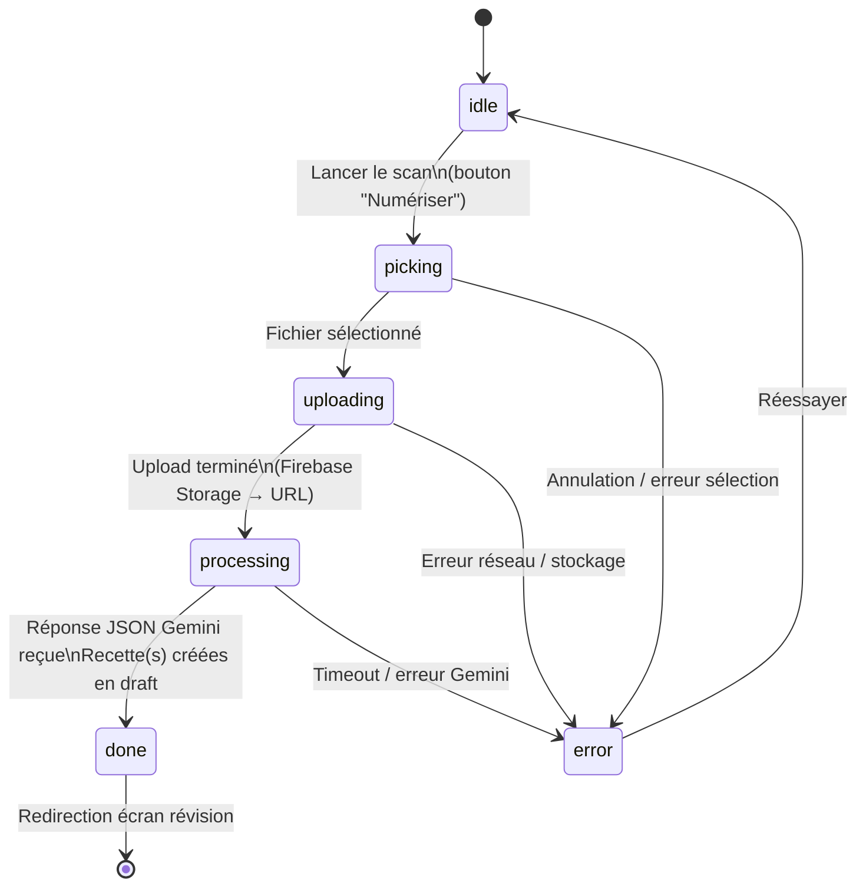
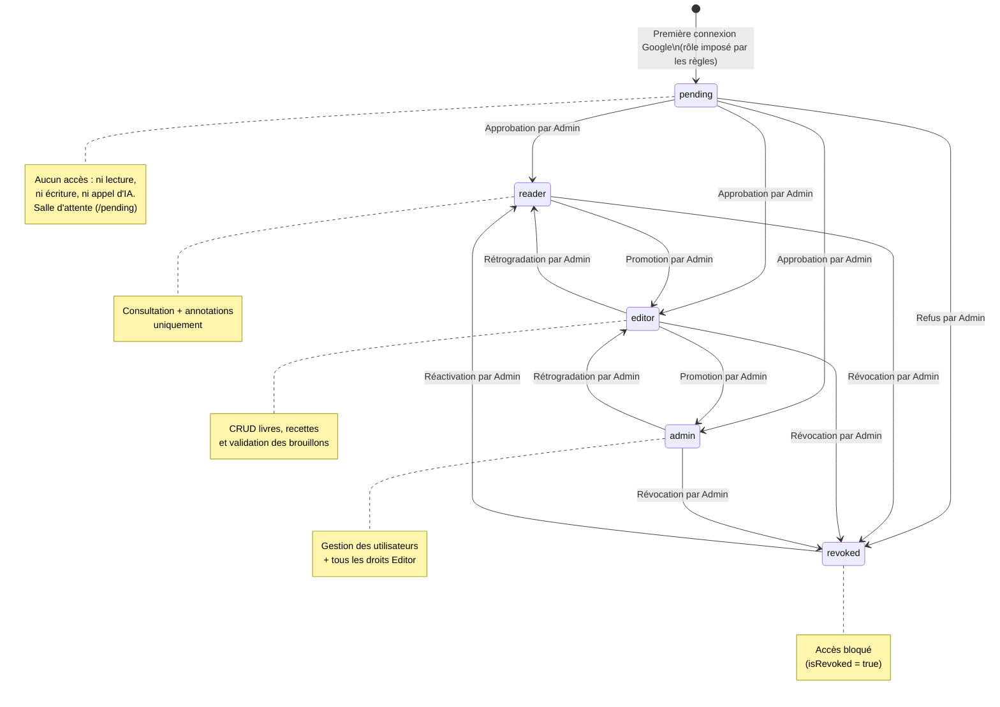
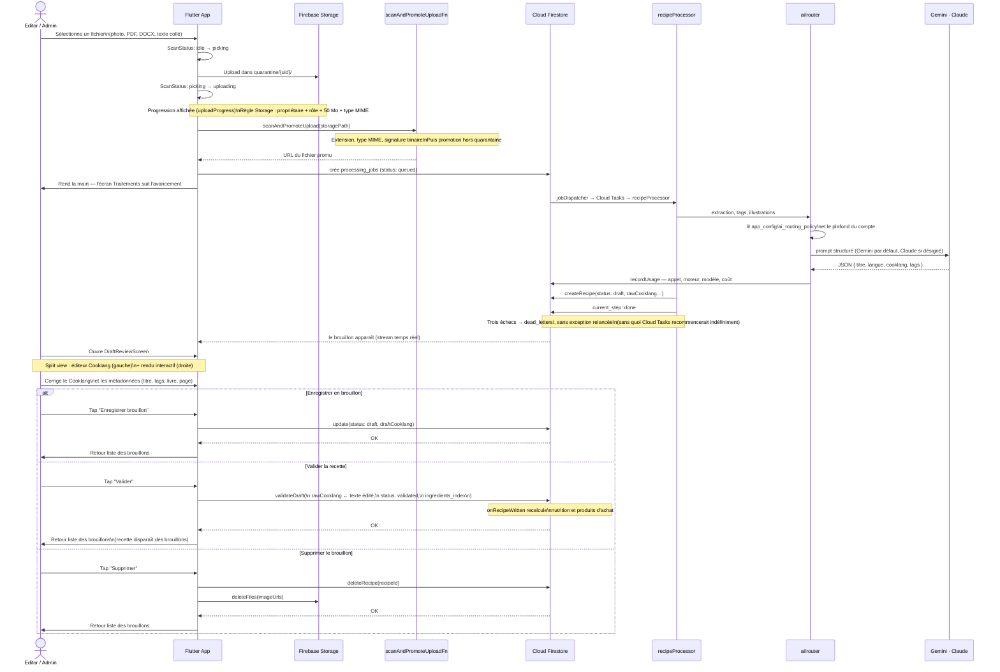

# Spécifications Fonctionnelles — Kass'dalle
## Livre de Cuisine Digital (Flutter + Firebase)

> Version : 2.3 — 19 août 2026

## Spécification — Modération des images

> **Implémentée.** Moteur : **Google Cloud Vision** (SafeSearch + labels). Cette
> section remplace `Future devs/moderation_images_prompt.md`, dont elle révise
> deux décisions.
>
> **Prérequis d'exploitation** : l'API Cloud Vision doit être activée sur le
> projet Google Cloud. Tant qu'elle ne l'est pas, aucune image n'obtient de
> verdict : elles attendent, ce qui est le comportement voulu — mais elles ne se
> publient pas.

### Pourquoi

Une image publiée est vue par toute la famille, enfants compris, et rien ne l'examine
aujourd'hui. Le risque n'est pas l'intrus — Storage n'accepte que des comptes nommés et
approuvés — c'est l'erreur ordinaire : la mauvaise photo dans la galerie, un appareil
prêté, une session restée ouverte. Et une image ne se retire pas comme un mot : quand on
la supprime, elle a déjà été vue.

### Ce qui existe, et ce qui manque

- **La quarantaine existe déjà**, mais pour le seul import de scans : le fichier atterrit
  dans une zone privée, le serveur le regarde, puis le promeut. Ce qu'il regarde est le
  **format** — extension, type MIME, signature binaire. Jamais le contenu.
- **Quatre portes publient une image sans passer par là** : la couverture d'un livre,
  l'illustration d'une recette, les illustrations extraites d'un scan, la couverture d'une
  recette libre. Ce sont elles, et non l'import, qui mettent une image sous les yeux de la
  famille.
- **Tant qu'elles restent ouvertes, modérer l'import ne protège de rien.** Les faire
  passer par la quarantaine est le vrai chantier ; l'analyse du contenu vient après.

### Trois états, et le doute ne publie pas

| État | Ce qui se passe |
|---|---|
| **Approuvée** | Publiée, en quelques secondes. C'est le cas de presque toutes les images. |
| **Refusée** | Jamais publiée. L'envoyeur l'apprend, avec le motif — et l'image est **conservée**, lisible des seuls administrateurs. |
| **À revoir** | Reste en attente jusqu'à la décision d'un administrateur. |

### Le contexte culinaire l'emporte sur la violence

Une découpe de poulet, une volaille entière, un couteau sur une planche : c'est de la
cuisine. **Violence détectée + contexte culinaire fort = approuvée**, directement, sans
file d'attente.

C'est un arbitrage assumé, et il se défend des deux côtés : une file qui se remplit de
photos de viande n'est pas relue, elle est expédiée d'un clic — et la relecture ne vaut
alors plus rien pour les cas qui la méritaient. À l'inverse, faire attendre un
administrateur pour publier une photo de rôti, c'est une panne pour celui qui l'a
envoyée. Reste en revue ce qui est violent **sans** contexte culinaire : là, on ne sait
pas, et ne pas savoir n'autorise pas à publier.

**Le contenu sexuel explicite ne bénéficie d'aucun contexte** : refus direct, sans file
d'attente. Aucune recette n'en a besoin.

**Une scène de violence certaine, sans contexte culinaire, est refusée elle aussi** — et
pour ce motif-là, pas un autre. L'envoyer en revue obligerait un administrateur à la
regarder pour conclure ce que les signaux disaient déjà.

**Le suggestif ne refuse jamais seul.** « Explicite » et « suggestif » sont deux choses :
une épaule nue, un maillot de bain, un débardeur déclenchent le second en permanence. Les
confondre revient à refuser une famille au barbecue — et, sur une photo de violence où
quelqu'un porte un débardeur, à annoncer un motif sexuel pour une scène qui n'en est pas
une. Le suggestif marqué fait au plus passer l'image en revue.

### Ce que voit celui qui envoie

- **Approuvée** — rien ne change pour lui, hormis quelques secondes d'attente. C'est le
  cas courant, et il doit rester invisible.
- **À revoir** — l'image apparaît en attente, à sa place, avec la mention de ce qui est
  attendu. Ni échec, ni disparition : une image qui s'évanouit sans un mot est pire qu'un
  refus.
- **Refusée** — dit franchement, avec le motif.
- **Moteur en panne** — l'image reste en attente et l'écran le dit. **Pas de repli** :
  publier par défaut, c'est modérer pour rien ; refuser par défaut, c'est accuser à tort.
  C'est la règle qui vaut déjà pour la grille tarifaire.

### La revue — Administration › Modération

**Les administrateurs seuls** décident. Un editor publie des images ; il ne peut pas être
son propre arbitre.

**L'écran montre toutes les images, pas seulement les refusées.** Une page qui ne
montrerait que les rejets ne dirait rien du plus important : ce que la modération laisse
passer. On y voit les approuvées, les refusées, celles en attente de décision et celles
qu'aucun verdict n'a pu atteindre — filtrables par état et par date. C'est un **journal**,
pas une corbeille.

**Sous chaque image, la lecture est écrite en français.** Ce que le moteur a vu ne
s'affiche jamais brut : chaque critère porte son libellé (contenu adulte, suggestif,
violence, médical, montage) et son palier (très peu probable → très probable), et la
décision porte sa phrase — *« refusée : contenu sexuel explicite »*, *« approuvée :
contexte culinaire reconnu malgré une alerte de violence »*, *« à revoir : violence sans
contexte culinaire »*, *« sans verdict : moteur injoignable »*. Un administrateur doit
pouvoir dire pourquoi une image a été refusée sans ouvrir le code.

**Une image se voit, sinon elle ne se juge pas.** Une image **à revoir** s'affiche
d'office : on ne demande à personne de trancher sur une photo qu'il n'a pas vue. Le
dossier de quarantaine, où elle attend, est lisible par l'administrateur en plus de son
envoyeur — sans quoi le seul écran qui compte se décidait sur des scores.

**Une image refusée se voit aussi, à la demande.** Elle est conservée sous
`rejected/`, que seul un administrateur peut lire, et l'écran la montre **à la
demande** — un clic, pas d'office : parcourir un journal ne doit pas exposer sans
prévenir ce qui a été jugé impubliable.

La supprimer était le premier réflexe, et c'était une erreur. Sans l'image, on ne
peut pas dire si le refus était fondé, et une modération qu'on ne peut pas évaluer
ne se corrige jamais. Ce sont surtout les **faux refus** qu'on a besoin de voir :
une photo de rôti prise pour une scène violente ne se découvre pas dans des
scores, elle se découvre en regardant la photo.

Aucun lien n'est stocké : l'écran lit le fichier avec les droits de celui qui le
consulte. Retirer le rôle administrateur retire l'accès dans la seconde, ce qu'un
lien de téléchargement déjà émis ne permettrait pas.

**Approuver** publie ; **Refuser** demande un motif — c'est ce que lira l'envoyeur. Le
**journal des décisions est conservé** : qui, quand, quoi, pourquoi. Une décision de
modération sans trace n'est pas une décision, c'est une humeur.

### Le badge

**L'entrée Administration porte le nombre d'images en attente de décision**, comme
l'entrée Brouillons porte celui des brouillons. Il disparaît à zéro, et ne compte que les
images qui attendent réellement quelqu'un — pas le journal entier.

Ce n'est pas un ornement : personne n'ouvre une file d'attente pour vérifier qu'elle est
vide. Sans badge, une image en attente y reste des semaines, et la modération devient une
suppression lente.

### La modération se voit dans les comptes

Elle n'est pas un service à part : elle entre dans la comptabilité existante, aux trois
endroits où l'on regarde déjà la dépense.

- **Coûts de l'application** — la modération apparaît comme un poste de dépense à part
  entière, mois par mois, à côté de l'extraction ou de la nutrition. Son moteur est nommé,
  comme Gemini et Claude le sont.
- **Dépense par utilisateur** — on voit combien d'images chaque compte a fait analyser, et
  ce que cela a coûté. C'est la seule façon de repérer un envoi massif.
- **Mais elle ne consomme pas le plafond quotidien.** Un plafond atteint doit empêcher de
  *dépenser*, jamais de *publier une image légitime* : sinon le contrôle punit celui qu'il
  protège. Elle est comptée et affichée, hors plafond, et l'écran le dit.
- **Le quota offert est une ligne, pas un silence.** Le fournisseur offre mille unités par
  mois ; à notre volume, la facture réelle sera nulle la plupart du temps. Le coût brut
  reste affiché, et le quota apparaît en déduction. Un mois à zéro euro doit se lire comme
  *« mille unités offertes ont couvert la dépense »*, pas comme *« rien n'a été analysé »*.

### Le moteur figure au choix des moteurs d'IA

Le poste apparaît dans *Admin › Moteur d'IA* comme les trente et un autres, avec un seul
choix possible aujourd'hui — **Google Cloud Vision** — et la raison affichée. Ce n'est pas
décoratif : le jour où un second moteur devient acceptable, il se sélectionne depuis cet
écran, sans déploiement. Un poste absent de cette table est un poste qu'il faudra
redéployer pour faire bouger.

### Ce qui n'est pas modéré

- **Les images produites par l'IA** — dressage, couvertures générées. Elles sortent d'un
  moteur qui applique déjà ses propres garde-fous ; les repasser au contrôle double le
  coût pour rien. **Décision prise : elles ne passent pas.**
- **Le texte** — titres, étapes, annotations. Autre sujet, autres outils.
- **Les images déjà en ligne.** La modération ne vaut que pour ce qui arrive après elle.
  Reprendre l'existant est un backfill, à décider séparément — l'écran Backfills existe.

### Le coût, en un mot

Le volume est familial : quelques dizaines d'images par mois, quand le fournisseur en
offre mille. Le coût réel sera **nul la plupart des mois**. Ce qui se paie ici n'est pas
l'analyse, c'est la latence à l'envoi et le travail de relecture — deux raisons de plus
pour que la file reste courte.

### Mise à jour release (22/08/2026 — v0.21.60)

#### L'atelier s'ouvrait sur un outil déjà choisi

« Cadre » était sélectionné dès l'ouverture. Le premier geste possible était donc de cliquer sur une puce déjà active, qui ne faisait rien.

L'écran s'ouvre maintenant sans panneau. L'image d'abord, les outils quand on les demande.

#### « Cadre » arme le recadrage

La puce ouvrait un panneau, qui offrait un bouton « Recadrer ». Deux clics pour un geste. Et le premier ne montrait rien, puisque la puce était déjà sélectionnée.

La puce arme maintenant le cadre directement. La désélectionner l'abandonne : le même geste, dans l'autre sens.

Le bouton « Recadrer » reste dans le mode recadrage seul, qui n'a pas de puces. Là, c'est lui qui arme.

#### La coche gênait l'icône

Les puces affichaient une coche à la sélection, par-dessus leur propre icône. Deux signes pour la même information, et le plus utile des deux caché.

La coche est retirée. Le fond coloré suffit à dire ce qui est actif.

### Mise à jour release (22/08/2026 — v0.21.59)

#### Le bas de l'onglet Photos était hors d'atteinte

Sur téléphone, l'état vide dépasse la hauteur disponible : icône, titre, deux lignes de texte et deux boutons. Le bas passait sous la barre de navigation, et rien ne défilait.

Les boutons existaient et étaient cliquables. Ils n'étaient simplement pas atteignables.

Le bloc est maintenant dans un `SingleChildScrollView`, avec un `ConstrainedBox(minHeight)` qui garde le centrage quand la place suffit.

#### « Cadrez-les vous-même » sans dire par où

Le message annonçait trois photos sur la page et invitait à les cadrer soi-même. Mais « Ajouter » ouvre la galerie du téléphone, pas le scan du livre. Une consigne sans porte.

Un bouton **Cadrer depuis le scan** ouvre l'atelier de retouche directement sur la page scannée. Il apparaît dans la barre d'actions et, sur l'état vide, en action principale — devant « Ajouter une photo », puisque c'est là que sont les photos annoncées.

Le chemin existait déjà dans le code. Son bouton était parti avec l'extraction automatique, alors que ce n'est pas la même chose : l'extraction décidait du cadrage, celui-ci le laisse à qui regarde la page.

Le bouton ne s'affiche pas si le scan est un PDF : l'atelier ne l'ouvrirait pas, et le clic échouerait sans rien dire.

### Mise à jour release (21/08/2026 — v0.21.58)

#### La note se corrige

Elle était transportée sans être modifiable. Le motif : elle vient du livre, la retoucher inviterait à la réécrire.

Le motif était faux. La note ne vient pas du livre. Elle est **déduite** de la ligne du livre, par un découpage qui se trompe. « concassées » pour des grains de coriandre, « mélangée » sans son complément. Une valeur devinée qu'on ne peut pas corriger est pire qu'un champ vide.

L'éditeur d'ingrédients porte donc une ligne de plus sous chaque ingrédient. Sans bordure, en italique : c'est une légende, pas un champ de formulaire. Elle est toujours visible, même vide — cet écran sert à confronter la recette à la page, et ce qui doit se corriger doit d'abord se voir.

La flèche à gauche porte la ligne du livre en infobulle. De quoi vérifier la précision sans rouvrir le livre.

#### Les astérisques disparaissent

La note se lisait en renvoi, à la façon des livres de cuisine : un astérisque sur la puce, la note en bas du groupe. Trois défauts à l'usage.

Les marqueurs s'empilent — `*`, `**`, `***`, `****` — et deviennent illisibles au quatrième. Ils repartent de zéro à chaque section, si bien qu'un même astérisque désigne deux choses sur la même page. Et lire la recette demande un aller-retour entre la puce et le bas du bloc, pour quatre mots.

Les notes sont courtes. « concassés », « hachées », « avec la peau ». Elles tiennent sous le libellé, dans la puce, en plus petit et en italique.

Le bloc « À savoir sur les ingrédients » est retiré. Il répétait ce que la puce dit maintenant.

### Mise à jour release (21/08/2026 — v0.21.57)

#### « à 3 » n'est pas une précision du livre

Le miel portait une note : `à 3`. Reste de « 2 à 3 cuil. à café de miel », un intervalle dont le parseur n'a gardé que la borne basse — le modèle a rendu la queue comme précision. Elle ne précise rien, et une note qui ne dit rien fait douter de celles qui disent quelque chose.

Une note doit désormais porter **au moins un mot de trois lettres**, sinon elle est écartée avant même le calcul de repli. Le seuil est d'un mot et non de deux : « concassés », « hachées », « dégermées » tiennent en un mot et disent l'essentiel. C'est le calcul — plus exigeant parce qu'il devine — qui en réclame deux.

#### Ce que la moutarde et le miel ne rendront pas

Le livre écrit une seule ligne : « 2 cuil. à café de moutarde à l'ancienne mélangée à 2 à 3 cuil. à café de miel ». La transcription en fait **deux entrées** — et c'est juste, ce sont deux ingrédients, deux quantités, deux entrées de courses. Mais la relation entre eux se coupe au découpage : la moutarde garde « mélangée », le miel ne garde rien.

Ce n'est pas un défaut d'affichage, et aucune règle de lecture ne le répare : l'information n'existe plus dans la ligne rattachée. La rendre demanderait que la transcription conserve la ligne entière **en plus** des deux entrées. C'est identifié, ce n'est pas fait.

### Mise à jour release (21/08/2026 — v0.21.56)

#### La note était écrite, et jetée à l'ouverture

Trois versions à la chercher dans l'import, dans le prompt, dans le balisage. Elle y était. Le document `recipes/2XPkj61VmU4l07Xeh99k` porte les seize ingrédients, seize `source` et six `note` :

```
filet de saumon  1.8 kg   note: "avec la peau, mais écaillée"
grains de poivre 1.5 c.s. note: "concassés"
moutarde         2   c.c. note: "mélangée"
```

Elle se perdait au dernier mètre. `_dedupeStructuredIngredients`, appelée par `Recipe.fromFirestore`, **reconstruit** chaque ingrédient pour n'en garder que la version rognée — et recopiait quatre champs sur six. `note` et `source` tombaient là, entre Firestore et l'écran, sans erreur et sans trace.

D'où le bloc « À savoir » invisible : la liste qu'il consulte n'avait plus rien à dire. Et d'où la ligne de constat qui annonçait *« 0 avec une précision du livre »* — elle lisait le même objet amputé. Cette ligne a fait son travail : la question était insoluble en raisonnement, elle s'est tranchée d'un chiffre. Elle est retirée.

La leçon dépasse ce cas : **une recopie champ par champ est une liste qui vieillit mal**. Tout champ ajouté au modèle et oublié dans une de ces reconstructions disparaît en silence. `test/recipe_model_test.dart` verrouille la traversée.

#### Une consigne n'est pas une alerte

Le bandeau portait un triangle orange sur « 3 photos repérées — à extraire à la main ». Le contrôle n'avait pourtant **rien** à redire du texte : c'était une consigne, présentée comme une faute de lecture. Elle s'affiche désormais en bleu, sous une icône de photothèque, titrée « Photos de cette page ». Confondre les deux apprend à ignorer les vraies alertes.

### Mise à jour release (21/08/2026 — v0.21.55)

#### Le bandeau prenait toute la place

Il s'ouvrait en grand, au motif qu'une réserve qu'il faut aller chercher n'est pas une réserve. C'était juste tant qu'il tenait en trois lignes. Il porte depuis le compte des photos, l'état de la donnée, cinq constats et leurs puces : déplié, il occupait l'écran entier **avant qu'on ait vu un ingrédient**.

Il part maintenant replié, et son titre porte le signal : *« Écart constaté avec la page du livre · 4 points »*. Le nombre décide si l'on ouvre — « écart constaté » seul ne distingue pas un titre de section raccourci, qu'on peut ignorer, d'une recette amputée.

#### Un reproche à tort de moins

> • miel (ingrédient 10) : cuil, melangee

Faux positif. Le miel est nommé en **fin** de sa ligne — « 2 cuil. à café de moutarde à l'ancienne mélangée à 2 cuil. à café de miel » — et les mots réclamés appartiennent à la moutarde, qui les porte déjà dans sa propre note.

Le contrôle comparait **tous** les mots de la ligne. Il ne regarde plus que ce qui **suit** l'ingrédient, exactement comme la déduction de la note : les deux partagent désormais la même fonction, et ne peuvent plus diverger. Un reproche à tort finit par faire ignorer le bandeau entier — y compris les constats qui comptent.

### Mise à jour release (21/08/2026 — v0.21.54)

#### La donnée se lit à l'écran, au lieu de se raisonner

Trois versions passées à chercher pourquoi une note ne s'affichait pas, **sans jamais pouvoir dire si elle existait**. Le code l'écrit — on peut le lire ligne à ligne — mais personne ne pouvait le constater depuis l'application, et un raisonnement qu'on ne peut pas confronter à la donnée finit par tourner en rond.

Le bandeau de relecture porte désormais une ligne de constat :

> *Sur 12 ingrédients : 2 avec une précision du livre, 12 avec la ligne d'origine.*

Si elle annonce zéro, la chaîne d'import est en cause. Si elle annonce deux et qu'on ne voit rien, c'est l'affichage. Une question tranchée d'un coup d'œil, au lieu d'un aller-retour.

#### « À savoir sur les ingrédients »

Ce que le livre dit en plus des quantités est rassemblé sous la liste, dans un bloc à part :

> **Filet de saumon** avec la peau mais écaillée
> **Moutarde à l'ancienne** mélangée à 2 cuil. à café de miel

La quantité se compte, la précision se lit — et elle se lit **avant** d'aller acheter, pas au milieu de la recette. Le discriminant est sans ambiguïté : un ingrédient dont le champ `note` n'est pas vide. Rien n'est déduit à l'affichage, rien n'est demandé à un modèle — la note a été calculée à l'import, depuis la ligne du livre.

Le bloc disparaît quand aucun ingrédient n'en porte : une rubrique vide occupe la place et apprend à ne plus regarder.

### Mise à jour release (21/08/2026 — v0.21.53)

#### « Extraction des illustrations » annonçait un travail supprimé

L'étape s'affichait encore sous ce nom alors que l'extraction avait été retirée. Vérification faite, **aucune extraction ne subsistait** : la liste d'images de l'import est une constante vide, et tout ce qui la suivait tournait à vide. C'était l'étiquette qui mentait — mais une étiquette qui annonce un travail supprimé fait attendre un résultat qui ne viendra pas, et c'est une raison suffisante de douter du reste.

Elle dit maintenant ce qui se passe : **« Recherche de photos sur la page… »**.

#### Et le code qui la faisait croire est parti

Trois morceaux tournaient encore à vide, et le prochain lecteur y aurait vu la preuve qu'une extraction se produit :

- la **copie des illustrations** pour la seconde recette d'une même page — un soin réel tant que deux recettes ne pouvaient pas partager un objet Storage sans que la suppression de l'une vide l'autre, sans objet depuis que l'import ne publie rien ;
- la mise en quarantaine et la génération de vignettes, déjà retirées ;
- les imports qui les servaient.

Du code mort n'est pas neutre quand il raconte une histoire fausse.

### Mise à jour release (21/08/2026 — v0.21.52)

#### La note manquait parce qu'elle était demandée au modèle

Trois versions à chercher au mauvais endroit. La cause est une erreur de conception, et elle tient en une phrase : **la ligne du livre était demandée au modèle.**

La note se déduit de cette ligne — c'est ce que la page dit après avoir nommé l'aliment et sa quantité. Mais le champ qui la portait, `brut`, faisait partie de ce que la passe de balisage devait **recopier dans sa réponse**. Quand elle ne le faisait pas — et elle ne le faisait pas toujours — la ligne était perdue, la note ne pouvait plus s'en déduire, et l'écran n'avait rien à montrer. Aucune erreur, aucun signal : un champ vide, indistinguable d'une ligne qui ne disait rien.

**Or cette ligne, nous l'avons déjà : c'est la transcription.** La demander au modèle était l'erreur. Elle est désormais rattachée par le code, et la note calculée ensuite.

Deux précautions, parce qu'un rattachement faux serait pire que l'absence :

- **Le rang est vérifié avant d'être cru.** Des comptes égaux ne prouvent pas l'alignement : une ligne qui nomme deux aliments et une autre que le modèle a fondue donnent le même total sans le même ordre. L'aliment doit se retrouver dans la ligne qu'on s'apprête à lui attribuer — sans quoi la moutarde héritait de la ligne du sel, avec une note plausible et personne pour s'en douter.
- **Un nom que deux lignes réclament ne s'attache à aucune.** « Aneth » pour le saumon et « aneth » pour la sauce ne se départagent pas par le nom seul. Une note attachée au mauvais ingrédient serait pire qu'aucune note, parce qu'on la croirait.

La note proposée par le modèle reste prioritaire quand il en fait une : il sait reformuler un lien — « mélangée au miel » — là où la soustraction rend une bribe. Mais son silence ne fait plus perdre le texte.

### Mise à jour release (21/08/2026 — v0.21.51)

#### Le modèle Claude se choisit poste par poste

Le **fournisseur** se choisissait poste par poste ; le **modèle**, non. Basculer un poste sur Claude imposait donc le même modèle à tous les autres — le mauvais grain, parce que les postes n'ont pas les mêmes exigences.

Transcrire une page de livre demande de la précision et se paie à la page. Estimer les calories d'une carotte est un rappel de connaissances, répété quinze fois par recette. Un seul modèle pour les deux, c'était soit payer Opus pour la carotte, soit lire le livre avec Haiku.

**Admin → Moteur d'IA** propose désormais, sous chaque poste routé vers Claude, le choix entre **Opus 5**, **Sonnet 5** et **Haiku 4.5** — avec, sous le sélecteur, ce à quoi chacun sert. Le choix ne se devine pas depuis un identifiant technique, et le mauvais choix ne se voit ni dans un sens ni dans l'autre : un modèle trop petit rend une page abîmée qui a l'air correcte, un modèle trop grand rend une facture qui a l'air normale.

Trois décisions dans le détail :

- **Le sélecteur n'apparaît que sous un poste effectivement routé vers Claude.** L'afficher inactif ailleurs ferait croire qu'il manque un réglage, alors qu'il manque une bascule.
- **Un poste réglé sur le modèle par défaut n'écrit rien.** Garder l'exception figerait ce poste le jour où le défaut change, sans que personne s'en souvienne. Le défaut porte d'ailleurs la mention « défaut » : la différence entre *ce poste suit le réglage général* et *ce poste a choisi la même chose* compte le jour où le général bouge.
- **Seuls les modèles de la grille tarifaire sont acceptés**, à l'écriture comme à l'écran. Un identifiant hors grille se facturerait sans montant et gonflerait `total_unpriced_calls` — un coût invisible, exactement ce que ce projet refuse. Un test le vérifie modèle par modèle.

### Mise à jour release (21/08/2026 — v0.21.50)

#### La ligne du livre suit l'ingrédient jusqu'en base

Trois tours de recherche pour la même note : d'abord dans l'affichage, puis dans le modèle, puis dans la persistance. À chaque fois, la même impasse — **une note vide était indistinguable d'une ligne qui ne disait rien de plus.**

La ligne du livre est désormais stockée avec l'ingrédient (`source`). Elle n'est pas calculée, elle est la pièce à conviction : la note s'en déduit, et quand la note manque, c'est elle qui dit si le livre avait quelque chose à ajouter.

Conséquence immédiate à l'écran : **l'éditeur affiche la note si elle existe, la ligne du livre sinon.** Il ne peut plus rien y avoir de vide sans qu'on sache pourquoi.

#### « Extraire » quitte l'onglet Photos

Les deux boutons appelaient la même détection que le pipeline d'import, avec les mêmes résultats : un cadrage qui rend le bureau avec le plat. Un bouton qui ne tient pas sa promesse coûte plus qu'il ne rend — on le presse, on attend, on jette.

L'import dit combien de photos la page porte ; « Ajouter » et l'atelier de retouche font le reste, en dix secondes et sans surprise.

#### Deux réparations d'écran

- **Le conseil renvoyait vers « Raffiner », qui n'existe pas.** La fonction s'appelle « Améliorer » et ne fait que de la mise en forme CookLang : elle ne relance ni la lecture de la page ni le balisage. Envoyer quelqu'un vers un bouton qui ne répare pas ce qu'on lui reproche, c'est lui faire perdre son temps deux fois. Le bandeau dit maintenant : *corrigez à la main ci-dessous, en confrontant à la page du livre.*
- **Sur mobile, les dernières actions de l'onglet Photos sortaient de l'écran.** Elles existaient, elles étaient cliquables, elles n'étaient simplement pas visibles — la pire des trois situations, parce qu'on ne cherche pas ce qu'on ne soupçonne pas. Elles passent à la ligne.

### Mise à jour release (21/08/2026 — v0.21.49)

#### Deux écrans qui se contredisaient sur le même scan

Le bandeau annonçait « 5 photos repérées », l'onglet Photos affichait « Aucune photo détectée ». Deux affirmations contraires, sur la même page.

Ils ne parlaient pas de la même chose : l'onglet constatait qu'aucune image n'était **attachée**, et en concluait qu'il n'y en avait pas à prendre. Depuis le retrait de l'extraction automatique, les deux n'ont plus rien à voir — l'import **repère**, il n'attache plus. L'onglet lit maintenant le même compte que le bandeau, et dit quoi faire : *le scan en contient, cadrez-les vous-même depuis l'original*.

#### Deux faux positifs dans les écarts

- **« Conseil du chef » signalé comme section manquante alors qu'il était là.** L'inventaire du modèle appelle « section » tout ce qui porte un intertitre sur la page — y compris ce qui est transcrit comme une **note**. Ne comparer qu'aux sections faisait passer chaque note pour une section perdue : un reproche à tort, sur ce qui était précisément présent.
- **« SAUCE À L'ANETH ET À LA MOUTARDE » signalée comme titre raccourci.** Un livre groupe souvent ses **ingrédients** sous un intertitre sans que la méthode, elle, ait une partie séparée. Exiger ce titre dans le texte balisé reprochait au balisage une section que la page ne porte pas dans ses étapes — un faux positif systématique sur toute recette dont la liste est plus découpée que la méthode. Seules les sections d'**étapes** sont désormais attendues.

Un reproche à tort coûte plus cher qu'une absence de contrôle : il apprend à ne plus lire le bandeau.

#### Et la note, enfin : elle est bien produite

Vérifiée de bout en bout sur les cas réels — « 2 cuil. à café de moutarde à l'ancienne mélangée à 2 cuil. à café de miel » donne bien *mélangée à 2 cuil. à café de miel*, et « 1 filet de saumon de 1,8 kg avec la peau mais écaillée » donne *avec la peau mais écaillée*. Le journal d'enregistrement compte désormais **combien d'ingrédients portent une note** : cherchée deux fois au mauvais endroit — dans l'affichage, puis dans le modèle — faute de savoir si elle existait.

### Mise à jour release (21/08/2026 — v0.21.48)

#### Pourquoi votre recette est repartie sans balise

Le bandeau disait tout. La page portait **une** ligne : « 2 cuil. à café de moutarde à l'ancienne mélangée à 2 cuil. à café de miel ». La transcription l'a **coupée en deux** — ingrédient 9 et ingrédient 10 — tandis que le balisage a gardé la ligne **entière** dans son champ d'origine.

Aucune des deux moitiés n'était égale à l'ensemble. Le rapprochement, qui exigeait l'égalité, a conclu que les deux lignes n'avaient pas d'ingrédient correspondant. Verdict : rupture, et tout le balisage jeté — alors que les deux ingrédients étaient bel et bien là.

Deux défauts, deux corrections :

- **Le rapprochement tolère la coupure et la fusion.** Une ligne est couverte dès qu'une entrée la contient, ou qu'elle la contient.
- **Et il ne rompt plus.** Ce contrôle rapproche des **chaînes de caractères** : il constate une correspondance manquante, pas une perte de contenu. La perte réelle est prouvée par un autre — celui qui compare les mots de la page à ceux du texte balisé. C'est lui qui a le droit de jeter, parce qu'il démontre. Le premier signale, et laisse relire.

#### L'extraction automatique des images est retirée

Elle enchaînait détection, découpage, trois filtres de qualité, correction de perspective, modération Cloud Vision et publication — et rendait des images que personne ne gardait. Chaque maillon a été corrigé tour à tour : l'orientation EXIF, le seuil de subdivision, le cadrage, le repère de coordonnées, l'homographie. Le résultat restait en deçà de ce qu'un recadrage à la main donne en dix secondes.

**Ce qui reste vaut, lui, son appel : savoir qu'il y a une photo.** Sans cette ligne, une recette part sans image et rien ne dit qu'il y en avait une à prendre. L'écran de relecture l'annonce :

> *2 photos repérées sur cette page — à extraire à la main depuis l'onglet Photos.*

Et quand la détection elle-même échoue, elle le dit — c'est une autre situation, qui appelle une autre réaction.

L'atelier de retouche manuel, qui n'a jamais démérité, fait le reste. Le pipeline d'import perd au passage le découpage, les filtres, la modération de découpes et la génération de vignettes : moins de code, moins d'appels, et une promesse qu'on tient.

### Mise à jour release (21/08/2026 — v0.21.47)

#### Un constat dit toujours OÙ regarder

Une seule ligne portait sa position — « peau en dessous **(étape 1)** » — et c'est celle qui servait. Un écart sans emplacement oblige à relire la page entière pour le retrouver, et une vérification coûteuse ne se fait pas. C'est devenu la règle, partout :

| Constat | Ce qu'il dit maintenant |
|---|---|
| Ligne d'ingrédient perdue | « 1 bouquet d'aneth » (ingrédient 3, Pour le saumon) — 1 sur 2 attendue(s) |
| Précision perdue | filet de saumon (ingrédient 1, Pour le saumon) : peau, écaillée |
| Note perdue | Le conseil du chef — « Se conserve trois jours au frais. » |
| Écart d'étapes | Pour le saumon : 3 étape(s) sur la page — section par section |
| Mot mal lu | le modèle doit désormais terminer chaque doute par sa position : *(étape 3)*, *(ingrédient 2)*, *(titre de section)*… |

#### Et les accents reviennent

Le titre de section s'affichait sous sa forme **comparable** — « sauce a l aneth et a la moutarde », qu'on lit comme une faute de frappe et non comme le titre du livre. Cette forme est mise à plat pour que « POUR LA SAUCE » et « Pour la sauce » se reconnaissent : elle sert à **comparer**, jamais à afficher. Le message rend maintenant le titre tel que le livre l'écrit.

### Mise à jour release (21/08/2026 — v0.21.46)

#### La note d'un ingrédient ne dépend plus du modèle : elle se calcule

Constater qu'une précision manquait ne suffisait pas. « Avec la peau mais écaillée » est écrit dans le livre, et devait finir dans la recette — signaler son absence, c'était s'accommoder de la perte.

**Or elle se calcule.** C'est ce que la ligne dit après avoir nommé l'aliment et sa quantité : une soustraction, pas un jugement, et une soustraction ne se demande pas à un modèle.

| Ligne du livre | Ingrédient | Note déduite |
|---|---|---|
| 1 filet de saumon de 1,8 kg avec la peau mais écaillée | filet de saumon | avec la peau mais écaillée |
| 2 cuil. à café de moutarde à l'ancienne mélangée à 2 cuil. à café de miel | moutarde à l'ancienne | mélangée à 2 cuil. à café de miel |
| 250 g de porc haché | porc haché | *(aucune, et c'est le cas normal)* |

**Ce que la fonction ne fait pas : inventer.** Chaque mot rendu vient de la ligne, dans son ordre — un test le vérifie mot à mot. Une note inventée serait pire que pas de note, parce qu'on la croirait.

**La proposition du modèle reste prioritaire** quand il en fait une : il sait reformuler un lien — « mélangée au miel » — là où la soustraction rend une bribe. Mais son silence ne fait plus perdre le texte.

Deux détails qui décident du résultat : on prend ce qui **suit** le dernier élément identifié, et non ce qui reste après découpage — recoller les morceaux rendait « 1 de avec la peau mais écaillée », les trous du milieu se refermant sur des articles orphelins. Et la ponctuation n'est retirée qu'aux bords : « cuil. à café » garde son point, parce qu'une note se lit comme le livre l'écrit.

### Mise à jour release (21/08/2026 — v0.21.45)

#### Les illustrations sont redressées, pas seulement découpées

Une page de livre photographiée à main levée n'est pas un rectangle, c'est un **trapèze**. Un cadre rectangulaire, aussi serré soit-il, garde forcément deux coins de papier et de table : c'est une limite de la forme, qu'aucun prompt ne lève. Seule une projection l'efface.

- **Le détecteur rend désormais les quatre coins** de chaque photographie — haut-gauche, haut-droit, bas-droit, bas-gauche — et non un rectangle englobant. La consigne est explicite : *ne redresse rien toi-même, donne les coins tels que tu les VOIS, de travers s'ils le sont ; c'est le programme qui redressera.*
- **La correction de perspective vit maintenant côté serveur** (`gemini/perspective.ts`) : le même algorithme que l'atelier de retouche manuel — normalisation de Hartley, résolution du système 8×8, interpolation bilinéaire. La chaîne automatique rend enfin ce que l'outil manuel rendait.
- **Pourquoi une homographie et pas une rotation** : une rotation redresse l'inclinaison mais laisse la déformation en trapèze, celle qui vient de photographier une page depuis un angle. Les deux bords opposés n'ont alors pas la même longueur, et seule une projection les égalise.
- **Une zone déjà droite n'est pas redressée** — un scan à plat, une capture d'écran. La transformation ne changerait rien de visible, et le découpage préserve la netteté d'origine sans ré-échantillonner.
- **Les deux formes de réponse sont acceptées** : quatre coins, ou une boîte convertie en son rectangle. Un modèle rend parfois la boîte englobante par habitude, et la refuser reviendrait à perdre une photo correctement repérée pour une question de forme.
- **Le coût mesuré** : 122 ms pour une photo de téléphone de douze mégapixels. La boucle est en clair — Sharp redimensionne, tourne et découpe, mais ne projette pas.

Deux détails qui font la différence entre une image juste et une image nette mais fausse : l'**ordre des coins** décide quel côté sera le haut (deux coins intervertis donnent un résultat impeccable et retourné), et les dimensions de sortie prennent la **moyenne géométrique** des bords opposés — retenir le plus grand étirerait l'image dans un sens.

### Mise à jour release (21/08/2026 — v0.21.44)

#### Le détecteur croyait regarder une page ; il regarde une photo de page

La détection fonctionne enfin — et la découpe rendait le bureau et le clavier avec la photo. Le prompt disait « cette image de livre », et le modèle cadrait en conséquence : large, comme on cadre une page.

Or ce qu'il reçoit est **une photo de page** : le livre a été posé sur un bureau et photographié à main levée. Autour de la page il y a du décor — le plateau de la table, un clavier, une souris, une ombre, souvent la page d'en face — et le livre est de travers, ses bords non parallèles à ceux de l'image.

Le prompt le dit maintenant, et énumère ce qui doit rester dehors : pas un centimètre de bureau, pas la marge blanche du papier, pas la page voisine, pas la reliure. Avec la conséquence, qui est le vrai argument : **une boîte trop large est inutilisable, puisqu'elle sera publiée telle quelle, décor compris.** Et un repère de vraisemblance : sur une photo de page prise à main levée, la photographie imprimée occupe rarement plus des deux tiers du cadre — une boîte qui couvre presque tout est presque toujours fausse.

**Ce qui reste à faire, et qui n'est pas fait :** redresser la perspective. Une page photographiée de biais est un trapèze ; un cadre rectangulaire, aussi serré soit-il, garde deux coins de papier. Le corriger demande les quatre coins de la photographie et une transformation homographique — l'outil manuel « Améliorer » le fait déjà, la chaîne automatique non.

### Mise à jour release (21/08/2026 — v0.21.43)

#### La note d'ingrédient : arrêter de deviner, la rendre constatable

La note ne s'affichait toujours pas — et la bonne question n'était pas « où l'afficher » mais **« est-elle produite ? »**. Le chemin de données était vérifié de bout en bout : le modèle ne la remplissait tout simplement pas.

- **Un contrôle mécanique le dit maintenant.** Pour chaque ingrédient, les mots de la ligne du livre sont confrontés à ceux du nom, de l'unité et de la note. Ce qui reste n'est allé nulle part : « 1 filet de saumon de 1,8 kg avec la peau mais écaillée » sans note laisse « peau », « écaillée » orphelins — et rien ne le signalait, puisque la ligne compte pour une, le nom est correct et la quantité aussi. Seuil à **deux mots** : un mot isolé est presque toujours un article, et le bruit fait ignorer le signal.
- **La règle du prompt était formulée à l'envers.** Elle insistait sur « n'invente jamais une note », et le modèle jouait la sécurité en la laissant vide. Elle est désormais positive et donne une méthode : *tu as écrit la quantité, l'unité et le nom — relis la ligne, et tout ce qui reste va dans la note*. Avec les trois cas, dont celui où il ne reste rien, qui est fréquent et normal.
- **Et la note occupe sa propre ligne** dans l'éditeur, avec sa marge et sa flèche de renvoi. Glissée dans l'interligne, elle passait inaperçue au milieu des champs bordés.

### Mise à jour release (21/08/2026 — v0.21.42)

#### La détection d'images marche avec les deux moteurs

Les cinq postes de détection étaient passés sur Claude, et ne rendaient plus rien. La cause n'est pas le moteur : **le repère `[y_min, x_min, y_max, x_max]` sur mille est la convention native de Google**, et le prompt se contentait de l'énoncer — « entiers 0-1000 ». Cela suffit à un modèle qui l'a apprise, pas à un autre.

La réponse facile aurait été de réserver ce poste à Gemini. Elle était mauvaise : un moteur ne doit pas être privilégié par un détail de format resté implicite.

- **Le prompt décrit le repère au lieu de l'énoncer** : haut = 0, bas = 1000, gauche = 0, droite = 1000, la verticale d'abord, avec deux exemples — une demi-page à droite, une pleine page. Et il porte les **dimensions réelles de l'image**, pour que le modèle sache ce qu'il regarde.
- **La lecture accepte les trois unités** qu'un modèle peut spontanément employer : millièmes, valeurs entre 0 et 1, et **pixels** — ces derniers ramenés avec les dimensions, en respectant que la verticale se rapporte à la hauteur. Intervertir les deux axes produit un rectangle plausible et faux, donc invisible.
- **Sans dimensions, on borne au lieu de deviner.** Un facteur imaginaire donnerait une découpe précise et fausse ; une découpe bornée sera écartée par le contrôle de qualité, ce qui se voit.
- **Une limite, nommée plutôt que masquée** : sous mille, pixels et millièmes sont indiscernables — aucune heuristique ne peut trancher. C'est précisément pourquoi le prompt décrit le repère et donne les dimensions. Le code fait ce qu'il peut ; le prompt fait le reste. Un test le dit noir sur blanc.
- **Situer des rectangles demande du soin** : la détection passe en effort élevé, comme la transcription. Le réglage par défaut venait de la chaîne nutrition, où deviner des calories ne réclame aucun raisonnement.
- **Le repli « photo principale » ne se tait plus** non plus : il ne sert que si la détection principale n'a rien rendu, et l'échec des deux ensemble est justement ce qu'il faut pouvoir constater.

### Mise à jour release (21/08/2026 — v0.21.41)

#### « Aucune photo détectée » cachait un `catch` vide

En cherchant pourquoi une page riche en photographies n'en rendait aucune, la vraie cause est apparue — et ce n'était pas la détection : **le code avalait l'erreur.**

```
} catch {
  return [];
}
```

Un refus du modèle, un plafond de dépense atteint, un délai dépassé, une réponse illisible, un format de coordonnées inconnu : tout se présentait à l'identique, sous la forme « aucune photographie détectée ». C'est la règle la plus stricte de ce projet, prise en défaut à l'endroit exact où elle comptait — **impossible de distinguer une page sans photo d'un appel qui a échoué**, alors que les deux demandent des réactions opposées.

- **L'erreur est journalisée et remonte.** La réponse brute du détecteur l'est aussi, avec son moteur et son modèle.
- **Une piste que cela rend enfin vérifiable** : le repère `[y_min, x_min, y_max, x_max]` sur mille est une convention **Google**. Un autre moteur ne la connaît pas et répond à côté, sans lever d'erreur. Une réponse non vide qui ne donne aucune boîte exploitable est désormais signalée comme telle, moteur nommé — si le poste `detect_illustrations` a basculé sur Claude, cela se verra au premier scan.
- **Une page qui échoue n'emporte plus les autres** : l'échec est absorbé page par page, sans quoi la panne de la seconde ferait perdre les découpes de la première.

#### Et l'écran le dit, au lieu de laisser deviner

Le bilan suit la recette et s'affiche à la relecture, avec la réaction qui convient :

| Ce qui s'est passé | Ce que l'écran dit |
|---|---|
| rien repéré | « Aucune photo repérée sur cette page. Si le livre en porte une, ajoutez-la à la main. » |
| repérées puis toutes écartées | « 3 photo(s) repérée(s), aucune retenue — trop petite, mal découpée, ou refusée à la modération. » |
| la détection a échoué | « La recherche a échoué sur 2 page(s). Ce n'est pas la page qui est en cause : réessayez. » |
| au moins une publiée | rien — elle se voit, l'annoncer serait du bruit |

### Mise à jour release (21/08/2026 — v0.21.40)

#### La réserve se lit en puces, et se replie

- **Sept mots mal lus concaténés dans une phrase forment un pavé qu'on ne relit pas** — et une alerte qu'on ne relit pas ne sert à rien. Chaque constat porte désormais ses éléments à part, rendus en liste à puces.
- **Le bandeau se replie d'un chevron.** Il occupe le haut de l'écran de relecture, et l'on vient d'abord y relire la recette. Ouvert au premier affichage : une réserve qu'il faut aller chercher n'est pas une réserve.
- Les brouillons importés avant ce changement portent l'ancien format — une simple liste de phrases — et restent lisibles.

#### La note d'un ingrédient se voit enfin

« Mélangée au miel » existait bien en base, mais nulle part à l'écran.

- **Dans l'éditeur** : en italique sous le nom qu'elle précise. Elle ne se saisit toujours pas — la mettre dans un champ inviterait à la réécrire, et l'entrer dans le nom la ferait passer au référentiel des ingrédients et à la liste de courses.
- **Dans la recette** : un astérisque sur la pastille, et le renvoi sous le groupe — la convention des livres de cuisine eux-mêmes. La glisser sous chaque pastille cassait l'alignement : les puces cessaient de former des lignes régulières dès qu'une seule portait une note.

#### Une pleine page n'est pas une grille

La détection tentait encore de découper une photo pleine page en cases, et les tranches tombaient sur la nappe et le coin de bureau qui entourent le livre photographié.

**La subdivision ne s'applique plus quand le modèle n'a vu qu'une seule zone.** Il a compté une photo : on le croit. Une grille, il en voit les cases du premier coup — c'est précisément ce que son prompt lui demande. Chercher des cases dans une pleine page, c'est en trouver.

### Mise à jour release (21/08/2026 — v0.21.39)

#### Le découpage des illustrations tombait à côté — l'orientation

**Le défaut, et il explique presque tout.** Un modèle de vision reçoit l'image telle qu'elle **s'affiche** : le décodeur applique l'orientation EXIF. Il rend donc des coordonnées dans ce repère-là. Sharp, lui, découpe la grille de pixels **stockée**. Pour une photo prise en portrait avec un capteur paysage — le cas de tout téléphone — les deux repères sont tournés de quatre-vingt-dix degrés l'un par rapport à l'autre.

On demandait le plat, on obtenait un bout de bureau. Et rien ne le signalait, parce que la découpe était techniquement valide : bonne taille, bon rapport de forme. Elle passait les filtres, puis se faisait refuser à la modération — d'où le « toutes les photos ont été rejetées », qui n'était pas un excès de sévérité mais la conséquence : **un bout de table est clair et uniforme, donc écarté comme page blanche.**

L'image est désormais redressée **une fois**, puis sert à la détection ET au découpage : les deux repères ne peuvent plus diverger. Corrigé dans le pipeline d'import comme dans l'extraction manuelle.

#### « Enregistrement » ne dure plus sept minutes

L'étiquette couvrait le balisage par l'IA, le contrôle de fidélité, la normalisation des référentiels et l'écriture. Un mot qui promet une seconde posé sur sept minutes, sans aucun moyen de savoir ce qui tournait.

Les étapes disent maintenant ce qui se passe : **Lecture de la page par l'IA**, **Extraction des illustrations**, **Balisage de la recette par l'IA**, **Enrichissement des ingrédients par l'IA**, puis **Enregistrement** — la dernière, et la plus brève.

Le calcul nutritionnel n'y figure pas volontairement : il a lieu **après** l'écriture, sur une recette déjà consultable. L'annoncer comme une étape laisserait croire qu'il faut l'attendre.

#### Atelier de retouche

- **Le cadre de recadrage s'imposait d'emblée.** Venu simplement pivoter une photo, on repartait avec un recadrage qu'on n'avait pas demandé — et rien ne le disait, puisque le cadre couvrait toute l'image et paraissait inoffensif. Il faut désormais l'**armer** par un bouton ; tant qu'il ne l'est pas, la validation n'applique que ce qui a été touché.
- **Le bouton de validation ne promet plus « Recadrer »** mais « Appliquer » : il valide ce qui a été fait, quoi que ce soit.
- **Les panneaux portent des icônes** : cadre, lumière, détails, presets.

### Mise à jour release (21/08/2026 — v0.21.38)

#### La réserve de fidélité appartient au brouillon

- **Elle s'affichait sur la recette elle-même.** C'est un outil de **relecture** : il sert à décider si la recette est fidèle au livre, pas à cuisiner. Le bandeau vit désormais dans l'écran de relecture d'un brouillon, et nulle part ailleurs.
- **Et il disparaît à la validation.** La réserve a fait son office : elle a dit où regarder, quelqu'un a regardé et a tranché — c'est le sens même de valider. La rappeler ensuite reviendrait à contester cette décision chaque fois que le plat s'ouvre, et une alerte qui ne s'éteint jamais cesse d'être lue, y compris sur les brouillons où elle compte.
- **La réserve est levée, pas seulement masquée.** `validateDraft` efface `fidelity_level` et `fidelity_findings`. Les garder en base reviendrait à conserver un doute que plus personne ne peut lever, et à rouvrir le débat au premier écran qui déciderait de l'afficher.

#### Le chapeau de la recette se perdait

« Une méthode scandinave pour fumer le saumon dans le sel… » : beaucoup de recettes s'ouvrent par un paragraphe qui dit d'où vient le plat et pourquoi il vaut la peine.

- **Il tombait sous la consigne de ne pas recopier les en-têtes de page.** La distinction manquait : un titre courant ou un folio se répètent de page en page et ne parlent pas du plat ; le chapeau n'appartient qu'à cette recette.
- **Il a désormais son champ**, transcrit mot pour mot, transmis au balisage, et écrit en note **avant la première étape** — parce que le livre le met en premier. Dans le doute, la consigne est de le recopier : une phrase de trop se supprime en un geste, une phrase perdue ne se retrouve pas.
- **Et sa perte est constatée** : il compte dans le texte confronté au balisage. Sans cela, un chapeau oublié disparaîtrait comme avant — aucune étape en moins, aucun ingrédient en moins, aucun signal.

### Mise à jour release (20/08/2026 — v0.21.37)

#### Une ligne du livre peut nommer deux ingrédients

- **« 2 cuil. à café de moutarde à l'ancienne mélangée à 2 cuil. à café de miel » : le miel disparaissait.** Ma règle disait « une ligne du livre, une entrée — ni plus, ni moins ». Elle est fausse : cette ligne, c'est deux aliments, deux quantités, **deux achats**. La règle du compte exact obligeait à en choisir un, et le miel sortait de la liste de courses comme du calcul nutritionnel, sans un mot.
- **Deux entrées, et le lien vit dans la note** — « mélangée au miel », « mélangé à la moutarde à l'ancienne ». C'est exactement à cela que sert ce champ.
- **Le contrôle vérifie désormais une couverture, pas une égalité.** Aucune ligne ne peut rester orpheline ; deux entrées pour une ligne sont légitimes. Et il **compte les occurrences** : « 1 bouquet d'aneth » figurant dans deux sections, c'est deux achats — se contenter de vérifier que la ligne « existe quelque part » laisserait passer leur fusion, celle-là même que ce contrôle existe pour attraper.

#### Une légende de photo n'est ni une étape ni un conseil

« Gravlax (en haut) et gravlax à la betterave et à la moutarde » décrit l'image, pas le plat à faire. C'est du **mobilier de page**, au même titre qu'un folio ou un titre courant — et cela rejoint la liste de ce qu'on ne recopie pas.

#### L'en-tête du brouillon coupait sa dernière ligne

La barre gardait la hauteur d'une barre à une ligne — cinquante-six pixels — pour un titre qui en compte de deux à quatre : le titre, la pastille « Brouillon », le livre et sa page, le propriétaire. La hauteur se calcule maintenant sur ce qui est réellement affiché. Une valeur fixe généreuse ne vaudrait pas mieux : elle laisserait un vide sous les brouillons courts.

#### Les illustrations : un défaut trouvé, et de quoi trancher

- **Toute boîte dépassant 8 % de la page était soupçonnée d'être une grille** et découpée en morceaux. C'est la taille d'une photographie ordinaire dans un livre de cuisine : presque chaque photo réelle passait à la découpe, et une pleine page ressortait en tranches. Le seuil passe à **un quart de page** — la taille à laquelle les vraies grilles d'étapes se présentent.
- **Le prompt était écrit pour les grilles d'étapes seulement.** Il nomme maintenant les trois cas, en commençant par le plus fréquent : une grande photo demi-page ou pleine page (**une** boîte, pas quatre), une photo en bandeau, et seulement ensuite la grille.
- **Et surtout, on saura enfin où elles se perdent.** Une page revenait « sans illustration » sans qu'on puisse dire si le modèle n'avait rien vu, si les filtres avaient tout écarté, ou si la modération avait refusé — trois causes, trois corrections opposées, aucune trace pour choisir. Un décompte des quatre étapes est journalisé : détectées, retenues par les filtres, publiées après modération, avec les raisons des refus. C'est ce chiffre qui dira si ces appels valent leur prix.

### Mise à jour release (20/08/2026 — v0.21.36)

#### Le modèle transcrivait en mode économique

« Avant modifications cela fonctionnait » était le renseignement décisif. Il ne s'agissait ni de la qualité de la photo, ni du prompt : **Claude transcrivait avec `effort: "low"`**.

- **Ce réglage était figé pour tout le monde**, avec une justification qui ne vaut que pour la nutrition : estimer les calories d'un ingrédient est un rappel de connaissances, pas un problème de raisonnement, et les jetons de réflexion se facturent au tarif de sortie. C'était juste — là.
- **Transcrire une page de livre est l'exact contraire.** Il faut suivre une mise en page, rattacher « en poudre » au bon ingrédient, ne pas résumer « les grains de poivre et les graines de coriandre » en « les épices ». Un modèle pressé fait précisément cela : il rend une phrase élégante et fausse.
- **Et la panne n'est apparue qu'en v0.21.33.** Jusque-là Claude échouait sur la transcription — le défaut de streaming — et Gemini prenait le relais. En réparant l'appel, on a confié la lecture à un moteur réglé pour aller vite. Le correctif précédent a révélé celui-ci.
- **Le soin se choisit désormais par poste.** `low` reste le défaut ; transcription et balisage passent à `high`. Côté Gemini, le levier équivalent existait déjà et se règle depuis Admin → Moteur d'IA (budget de réflexion par poste).

Deux abrègements silencieux sont par ailleurs nommés dans le prompt, avec leurs contre-exemples réels : **l'énumération résumée** (« les épices » fait disparaître deux ingrédients de la liste de courses) et **le qualificatif recollé au mauvais mot** (« en poudre » portait sur les épices, pas sur l'aneth, qui est frais). Un mot déplacé d'un cran change l'ingrédient.

**Sur la photo : il n'y a plus rien à gagner.** La capture est déjà à `imageQuality: 100` — aucune recompression — et aucune réduction de taille n'est appliquée : c'est la résolution complète du capteur qui part. Au-delà, le format ne propose rien de plus.

### Mise à jour release (20/08/2026 — v0.21.35)

#### « peau en dessous » lu « peu profonde en dessous » : la panne que rien ne pouvait prouver

Un scan a rendu « étalez sur une plaque ou une assiette **peu profonde** en dessous » là où le livre écrit « une assiette, **peau** en dessous ». Ce n'est pas un défaut de restructuration : c'est une erreur de **lecture**, et elle appartient à une classe que tout l'appareil de contrôle ne pouvait pas voir.

**Pourquoi aucun contrôle ne l'attrape.** Les sept vérifications comparent la passe 2 à la passe 1. Quand la passe 1 a mal lu, **elle est la référence corrompue** : la phrase rendue est impeccable, le décompte des étapes intact, la couverture des mots parfaite. Tout concorde, avec le mauvais mot. Le seul moyen de le prouver serait de relire l'image — un appel de plus.

Trois corrections, du plus concret au plus honnête :

- **La qualité de capture était à l'envers.** Les couvertures de livre étaient photographiées à qualité 100, les **pages de recette** à 92. Une couverture se lit de loin, une page de recette se lit au mot près — et les artefacts JPEG s'installent d'abord sur les petits caractères. C'est ainsi qu'un « peau » devient un « peu ». Les pages passent à 100, sans recompression.
- **Le modèle ne doit plus « réparer » un mot qu'il lit mal.** C'est le second temps de la panne : ayant lu « peu », il complète en « peu profonde » — une expression plus courante, qui a l'air juste. Le prompt porte désormais l'interdiction et ce contre-exemple exact : écris ce que tu VOIS, même si le résultat te paraît étrange.
- **Et quand un doute subsiste, il est affiché.** La transcription déclare ses `lectures_incertaines`, qui remontent sur la recette. Ce n'est pas une garantie — un modèle sûr de lui ne signalera rien — mais un doute affiché se vérifie en dix secondes, là où le même doute tu se découvre en ratant le plat.

### Mise à jour release (20/08/2026 — v0.21.34)

#### Le contrôle de fidélité voyait trois choses ; il en voit sept

Un premier scan a montré ce que le contrôle ne pouvait pas attraper : une section entière absente, un ingrédient devenu un autre produit, une clause disparue d'une étape. Trois défauts, trois angles morts.

- **Le trou principal : le contrôle comparait la passe 2 à la passe 1.** Il était donc aveugle à ce que la **passe 1** avait perdu. Une page dont la première section n'aurait jamais été recopiée produit une chaîne parfaitement cohérente de bout en bout — et personne ne s'en aperçoit avant de rouvrir le livre. La passe 1 **déclare maintenant son inventaire** avant de recopier : les titres de groupe qu'elle voit, le nombre de lignes d'ingrédients, le nombre d'étapes. Le code compare l'annonce au résultat. Un modèle qui déclare trois sections et en rend deux est pris en défaut par sa propre déclaration. Aucun appel de plus.
- **Le décompte des étapes ne dit rien de leur contenu.** « la moutarde mélangée à deux cuillères à café de miel » réduite à « la moutarde » ne change pas le nombre de lignes, et fait disparaître un ingrédient de la recette comme des courses. Les mots porteurs de sens de la transcription sont désormais confrontés à ceux du texte balisé.
- **Un ingrédient que sa propre ligne dément est nommé.** « 4 cuil. à soupe d'aneth frais » ne peut pas donner « aneth en poudre » : ce n'est pas une reformulation, c'est un autre produit, qui ne s'achète pas au même rayon et ne pèse pas la même chose. Chaque mot du nom doit figurer dans la ligne du livre, conservée à cette fin.
- **Une note perdue est signalée.** Rien d'autre ne la porte : ni les étapes, ni les ingrédients. Une « Astuce » que le balisage oublie disparaissait sans laisser de trace — et c'est souvent la seule phrase du livre qui dit comment réussir le plat.

**Sur les seuils, une leçon.** La première version de la comparaison de texte jetait le contenu des accolades — et accusait un balisage parfaitement fidèle d'avoir perdu un tiers de la page, parce que les quantités quittent légitimement la phrase pour y entrer. Les accolades sont conservées, les nombres écrits en lettres et les mesures abrégées écartés du comptage. Une accusation à tort finit par se faire ignorer, ce qui coûte plus cher que de ne rien vérifier.

### Mise à jour release (20/08/2026 — v0.21.33)

#### Claude n'échoue plus sur la transcription

- **« Streaming is required for operations that may take longer than 10 minutes »** n'était pas une durée constatée. Le SDK Anthropic refuse un appel non-streamé dès que `max_tokens` dépasse **128 000 / 6 ≈ 21 333** : au-delà, il estime que la réponse *pourrait* demander plus de dix minutes, et lève avant même d'envoyer quoi que ce soit.
- La transcription d'une page en réclame **24 000** — pour ne pas tronquer un JSON verbeux. Elle échouait donc **systématiquement** sur Claude, et se repliait sur Gemini à chaque import. Le repli fonctionnait ; il masquait la panne.
- **Baisser le plafond aurait été la mauvaise réponse** : `max_tokens` ne réserve rien, il borne. Le réduire n'aurait pas accéléré l'appel, il aurait tronqué les pages longues. Les réponses Claude sont donc **streamées**, comme le SDK le demande ; `finalMessage()` rend exactement l'objet attendu, jetons et `stop_reason` compris.

#### Les journaux du déclencheur d'écriture

- **« Premier calcul » ne disait pas de quoi.** Nutrition ? courses ? les deux ? Les précisions nomment maintenant le travail : « Nutrition et courses à calculer », « Ingrédients modifiés », « Rien à recalculer ». Elles sont traduites, accents compris — « Ingredients modifies » se lisait comme une faute.
- **Deux réveils sur trois ne disaient rien et le disaient longuement.** Ce déclencheur se réveille lui-même en écrivant les courses, puis la nutrition : trois groupes de journaux par recette, dont deux pour constater qu'il n'y a rien à faire — chacun traînant douze mille caractères de recette, parce que la trace du texte était posée **avant** la garde. Elle est passée après : un journal qui répète le texte pour dire qu'il ne s'est rien passé rend illisibles ceux qui parlent.

### Mise à jour release (20/08/2026 — v0.21.32)

#### Le déploiement ne rate plus sa première tentative

- **Ce n'était pas une panne du code, c'était une attente trop courte.** Avant de déployer, la CLI charge le bundle dans un processus à part pour savoir quelles fonctions il déclare. Ce chargement a **dix secondes** par défaut — et la première tentative les dépassait à chaque déploiement, invariablement suivie d'une relance qui, elle, passait. La différence entre les deux n'est pas le code : ce sont les cinquante fichiers que `tsc` vient de réécrire, encore froids sur le disque.
- **Le budget de découverte passe à deux minutes** (`FUNCTIONS_DISCOVERY_TIMEOUT`). Un échec systématique qu'on rattrape par une relance finit par masquer le jour où l'échec est réel.
- **Et le bundle s'allège vraiment**, pour ne plus frôler la limite : **547 ms → 328 ms**, quatre dixièmes de moins. Trois SDK lourds ne se chargent plus au démarrage mais au premier usage — Cloud Logging côté écriture (gRPC et protobuf, le plus coûteux du lot), Cloud Logging côté lecture, et BigQuery, qui ne sert qu'aux écrans de comptabilité. Même règle que le SDK Vision : ce qu'on ne charge pas au démarrage ne ralentit ni le déploiement ni le premier appel des autres fonctions.

#### Un écart avec le livre se voit maintenant sur la recette

- **Le contrôle de fidélité écrivait son verdict et personne ne le lisait.** C'est exactement le défaut que ce projet traque ailleurs : une donnée produite et jamais affichée finit par mentir sans que quiconque s'en aperçoive.
- **Un bandeau le dit, à l'endroit où l'on relit la recette.** En cas de **rupture** : « Texte du livre conservé, sans balise » — la recette est exacte, mais ses ingrédients et ustensiles ne sont pas mis en évidence, et l'on sait enfin pourquoi les puces manquent. En cas d'**avertissement** : le constat, et le balisage est conservé.
- **Dans les deux cas, la réponse est écrite** : relancer « Raffiner » depuis l'éditeur, ou corriger à la main.

### Mise à jour release (20/08/2026 — v0.21.31)

#### La chaîne d'extraction est refaite : deux passes, et la fidélité est vérifiée

**Le défaut.** Le prompt de scan demandait deux travaux incompatibles dans un seul appel — transcrire fidèlement *et* restructurer en CookLang — et perdait le premier au profit du second. Une règle faisait tout le dégât : « la liste d'ingrédients ne se transcrit jamais, chaque ingrédient apparaît une seule fois, à sa première mention dans les étapes ». Elle oblige le modèle à **décider** où placer chaque ingrédient, donc à fusionner des phrases, à en déplacer, à en abréger. Et rien ne vérifiait le résultat : cent cinquante lignes de prompt demandaient la fidélité, aucune ligne de code ne la constatait.

**Passe 1 — transcription.** Un appel rend le type de la page *et* son contenu recopié, en JSON : sections d'ingrédients (une ligne du livre = une ligne), sections d'étapes (phrase par phrase), notes typées (astuce, conseil du chef, variante, conservation). Aucune balise, aucune décision de placement. Elle remplace à elle seule `classify_page`, `scan_extraction` et `document_extraction`.

**Passe 2 — balisage et normalisation.** Elle ne voit jamais l'image : elle travaille sur ce que la passe 1 a recopié. Elle rend le CookLang balisé, la liste normalisée, et les tags — ces derniers coûtaient un appel à eux seuls.

**Le contrôle de fidélité, sans un appel de plus.** Autant d'ingrédients que de lignes dans le livre ? autant d'étapes qu'à la transcription ? titres de section entiers ? Une **rupture** — ingrédients fusionnés, étapes disparues — écarte le balisage et retombe sur le texte verbatim : mieux vaut une recette exacte et non balisée qu'une recette balisée et fausse. Un **avertissement** — un titre raccourci, un ingrédient de trop — se journalise et laisse passer. L'écart est écrit sur la recette elle-même, pas seulement dans les journaux d'un import déjà oublié.

**La note explicative d'un ingrédient.** « 1 filet de saumon de 1,8 kg avec la peau mais écaillée » devient un ingrédient de 1,8 kg **et** une note « avec la peau mais écaillée ». La quantité se compte, la précision se lit. Elle ne vivait nulle part : aucune accolade ne pouvait la porter, et le modèle réécrivait la phrase du livre pour la caser. Elle survit au redimensionnement et à l'édition des quantités.

**Une seule écriture de la recette.** La normalisation contre les référentiels a lieu **avant** l'écriture, sur un identifiant réservé. Le déclencheur d'écriture ne part donc qu'une fois, et le texte de la recette n'est plus jamais retouché après la passe 2.

**Cinq passes d'IA disparaissent**, toutes devenues sans objet :

| Passe | Pourquoi elle disparaît |
|---|---|
| `classify_page` | champ de la passe 1 |
| `suggest_tags` | champ de la passe 2 |
| singularisation des unités | la passe 2 écrit l'unité au singulier |
| complétion des quantités | la passe 2 lit la liste du livre, où la quantité est écrite |
| détection de doublons | elle rattrapait les doublons créés par le balisage inline ; une entrée par ligne de livre, il n'y a plus rien à dédoublonner |
| consolidation des courses | regrouper est devenu une addition — et une addition ne se demande pas à un modèle |

**Le décompte**, pour une page à quinze ingrédients neufs : de **14–23 appels** à **4–8**, et **3** sur un référentiel mûr (transcription, balisage, illustrations).

### Mise à jour release (20/08/2026 — v0.21.30)

#### Un import, un titre — et le calcul ne se fait plus deux fois

- **« Mise en file du traitement » nommait le couloir, pas le voyage.** Le fil s'appelait `disp`, du nom du déclencheur qui l'ouvre — mais il est **transmis** au processeur, qui journalise dessous l'extraction, la normalisation et l'enregistrement. La partie « importation » n'était donc pas absente : elle était rangée sous un titre qui ne la nommait pas. Le fil s'appelle désormais **Import d'une recette**, du début à la fin.
- **Ce déclencheur part à chaque écriture du job** — `queued`, `processing`, `done` — et n'a presque jamais rien à faire. Chacun de ces constats ouvrait son propre fil : trois groupes d'un message pour un import mis en file une seule fois. Ils se rattachent maintenant au fil que le job porte déjà.
- **La recette n'est plus calculée deux fois.** L'import écrit la recette dès l'extraction — pour que le brouillon soit consultable tout de suite — puis normalise et réécrit la liste d'ingrédients. Le déclencheur d'écriture partait donc **deux fois** : une première sur les ingrédients bruts (courses consolidées, nutrition calculée, doublons détectés par IA), une seconde sur les ingrédients normalisés, qui jetait tout le travail de la première. D'où les `refreshShoppingProducts` et `detectDuplicateIngredientsWithAI` en double.
- **Un drapeau `nutrition_hold`** posé à la création demande au déclencheur d'attendre la liste définitive. Il est retiré dans tous les cas, succès **comme échec** de la normalisation : c'est ce retrait qui déclenche le calcul, une fois. Sans cette précaution, une normalisation ratée aurait laissé la recette sans nutrition à jamais, en silence.
- **« Après écriture d'une recette » dit maintenant laquelle** : `— Ingredients modifies`, `— Premier calcul`, `— Sans changement`. On voit d'un coup d'œil quel réveil a travaillé et lequel n'a fait que constater.
- **La détection de doublons montre ce qu'elle lit.** Elle ne journalisait qu'un verdict — « 2 reprises sur 14 lignes » — sans dire sur quoi, et sous un fil à elle. Elle rejoint le fil du traitement et trace la liste soumise. Précision utile : cette passe ne voit pas la recette, elle ne voit que la **liste** ; c'est donc la liste qui est tracée, et non le texte, qui laisserait croire qu'elle en dispose.
- **Les journaux se paginent.** L'écran n'affichait qu'une page et rien ne le disait : au-delà, les entrées manquaient en silence, et un import bavard semblait s'arrêter en chemin. Un pied de liste annonce désormais le nombre d'entrées lues, dit si la suite existe, et la charge sur demande.

### Mise à jour release (20/08/2026 — v0.21.29)

#### Les journaux disent enfin quel travail ils racontent

- **Un groupe titré « generate » ou « call » ne nomme rien.** L'écran regroupait correctement — toutes les entrées d'un même traitement ensemble — mais titrait le groupe avec le nom que le code s'était donné.
- **« call » était pire qu'obscur : c'était le nom par défaut.** Toute fonction appelable qui n'en choisissait pas un s'appelait ainsi. Quatre ou cinq groupes « call » n'étaient donc pas quatre exécutions d'un même travail, mais **quatre travaux différents et anonymes** — lecture de la grille tarifaire, calcul nutritionnel, consultation des journaux, normalisation. Dix-sept fonctions nomment désormais leur traitement, et un test échoue si l'une d'elles l'oublie.
- **Chaque nom technique est traduit en français à l'affichage** : « Génération d'une recette par l'IA », « Mise en file du traitement », « Poids des unités inconnues ». La traduction vit côté écran, pas côté serveur : l'identifiant doit rester stable et filtrable — c'est lui qu'on colle pour isoler un traitement — un libellé peut changer sans rien casser. Une racine inconnue est rendue telle quelle : un nom technique reste cherchable, « traitement inconnu » ne l'est pas.
- **Pourquoi trois ou quatre « generate ».** Ce n'est pas une boucle : l'écran Explorer lance **trois** générations indépendantes — Fidèle, Rapide, Créative — puis en relance une quand deux propositions se ressemblent trop. Trois ou quatre appels, donc trois ou quatre fils, donc autant de groupes. Ils portent maintenant leur variante : « Génération d'une recette par l'IA — Creative ».
- **Un traitement peut désormais se qualifier** par une précision après un deux-points (`generation_recette:creative`), que l'écran affiche après le libellé. C'est ce qui rend lisibles plusieurs départs simultanés d'un même travail.
- **Deux fils qui se perdaient sont rebranchés** : la normalisation demandée à la *sauvegarde* d'une recette et le calcul nutritionnel à la demande jetaient le fil reçu et en fabriquaient un par passe interne.
- **Nouveau diagramme de séquence** — `documentation/diagrammes-de-sequence.html`, section 11 : naissance d'un fil, propagation, regroupement et nommage à l'écran.

### Mise à jour release (19/08/2026 — v0.21.28)

#### Le double enrichissement est supprimé

- **Deux chemins posaient au modèle exactement la même question, au même instant.** `enrichUnknownUnitsWithAI` — le poids d'une unité inconnue — et `enrichUnknownIngredientsWithAI` — les valeurs pour 100 g d'un ingrédient — vivaient à la fois dans la normalisation et dans le déclencheur `onRecipeWritten`.
- **La justification écrite tenait sur le papier, pas à l'horloge.** Ces fonctions ne traitent que ce qui n'a pas encore de valeur, donc le second passage était censé ne rien trouver à faire. Sauf qu'à l'import il n'y a pas de « second » : l'écriture de la recette réveille le déclencheur, la normalisation part en parallèle, et les deux lisent le référentiel au même moment, également vide. Chaque unité et chaque ingrédient inconnu étaient payés deux fois.
- **Le déclencheur les garde, seul.** Il part sur *toutes* les écritures de recette — import, saisie manuelle, modification — là où la normalisation n'est qu'un chemin parmi d'autres ; et c'est lui qui a besoin de ces valeurs, quelques lignes plus bas, pour convertir les quantités et calculer la nutrition. Enrichir ailleurs, c'est enrichir trop tôt ou deux fois.
- **La nutrition reste juste dès le premier affichage**, puisque enrichissement et calcul se suivent dans la même exécution.
- **Ce que la normalisation continue de faire** : résoudre unités et identités, estimer le poids d'une pièce, celui d'un couple ingrédient/unité, repérer les ingrédients qui ne finissent pas dans l'assiette, compléter les quantités manquantes. Quatre passes au lieu de six, aucune en double.
- **Effet visible dans les journaux** : la même passe n'apparaît plus deux fois sous un même import. Ce qui reste en double y est délibéré et documenté — la relance insistante sur une unité revenue sans poids.

### Mise à jour release (19/08/2026 — v0.21.27)

#### Un import produisait huit journaux sans lien entre eux

- **Chaque passe d'enrichissement fabriquait son propre identifiant de traitement** — « enrich-units-… », « enrich-ing-… », « piece-weights-… », « complete-qty-… » et quatre autres. Un seul scan produisait donc huit groupes de journaux, sans lien entre eux ni avec le job qui les avait déclenchés. Suivre un import de bout en bout était impossible, ce qui donnait à juste titre l'impression d'un traitement hors de contrôle.
- **Le fil reçu prime désormais sur celui qu'on fabrique.** L'import passe le sien à la normalisation, qui le passe aux enrichissements ; le déclencheur passe le sien de la même façon. Un identifiant, un scan.
- **Le déclencheur trace enfin le texte de la recette à son entrée.** Ses journaux ne portaient que des compteurs — treize ingrédients, douze références mises à jour — et pas une ligne de recette : impossible de dire si le texte arrivait déjà abîmé ou s'il l'était plus loin. Ce traitement ne touchant pas au texte, ce qu'on lit à son seuil est exactement ce que l'étape précédente a produit.
- **Et le plafond d'appels expliquait le reste.** Les répétitions observées ne sont pas une boucle : ce sont deux chemins qui font le même travail — la normalisation pendant l'import, puis le déclencheur à l'écriture — et une relance délibérée quand une unité revient sans poids. Elles se lisent maintenant sous le même fil, et se comptent.

### Mise à jour release (19/08/2026 — v0.21.25)

#### On voit enfin ce que le modèle répond

- **Les journaux disaient qu'un appel avait eu lieu, jamais ce qu'il avait produit.** Poste, moteur, jetons, durée — tout, sauf le texte. Quand une recette s'écarte du livre, ces journaux-là prouvent que l'appel a réussi ; ils ne disent pas quelle étape a interprété.
- **Chaque texte est désormais tracé à sa sortie**, sous le même identifiant de corrélation que l'import : la réponse de classification, le texte d'extraction tel quel, le texte finalement écrit en base, et l'avant / après de chaque retouche demandée à la main (polissage, raffinement). Les entrées d'un même scan se lisent dans l'ordre, et l'on voit le texte évoluer d'un traitement au suivant — ou ne pas évoluer, ce qui est souvent l'information qu'on cherche.
- **Un seul endroit décide de ce qu'on garde** : douze mille caractères, de quoi couvrir une page de livre entière ; au-delà le texte est coupé, et l'entrée le dit plutôt que de laisser croire à une réponse courte.
- **Le plafond d'IA du compte fondateur passe de cinq à dix fois le plafond commun.** Il est **par compte et par jour** : personne d'autre n'était bloqué. Mettre au point l'extraction demande de rescanner la même page des dizaines de fois, et la coupure tombait au milieu d'une session d'essais — le seul moment où l'on a besoin d'appeler beaucoup, et le seul où être coupé ne protège de rien.
- **Le diagramme de séquence de l'import** montre maintenant chaque appel de modèle, chaque trace de texte, et le fait que la normalisation n'écrit plus que la liste d'ingrédients.

### Mise à jour release (19/08/2026 — v0.21.24)

#### Le texte de la recette appartient au livre, plus personne ne le réécrit

- **La normalisation des référentiels réécrivait la recette**, automatiquement, à chaque import et à chaque enregistrement. Ce n'était ni le polissage ni le raffinement — ceux-là ne partent que sur un bouton. C'était un traitement que rien n'annonçait, et qui écrasait le texte dès qu'un seul ingrédient ou une seule unité avait été renommé, c'est-à-dire presque toujours.
- **Trois façons de faire dire au livre ce qu'il n'a pas écrit** : le nom de l'auteur remplacé DANS ses phrases par le nom canonique du référentiel ; des quantités estimées par l'IA insérées là où le livre n'en donnait aucune ; un titre de section remplacé par une catégorie calculée — « Pour la sauce à l'aneth et à la moutarde » perdant la moitié de son nom.
- **Son travail est la LISTE, pas la prose.** Les noms canoniques et les quantités complétées vivent dans la liste d'ingrédients résolue, celle qui nourrit la nutrition et les courses. C'est là qu'ils servent. Le texte, lui, reste celui du livre.
- **Une centaine de lignes disparaissent avec la réécriture** — elles relisaient le référentiel une seconde fois, par ingrédient, pour produire un texte que plus personne ne doit produire.
- **Ce qu'on perd, et c'est assumé** : une quantité absente du livre reste absente du texte affiché, tout en étant présente dans la liste. Et une catégorie créée depuis l'éditeur n'est plus recopiée dans le CookLang. L'honnêteté du texte passe avant le confort de l'affichage.

### Mise à jour release (19/08/2026 — v0.21.23)

#### La transcription fidèle avait pris la liste d'ingrédients pour du texte

- **Trois symptômes, une seule cause.** La règle « transcris tout, ne retire rien » de la version précédente ne disait pas sur QUOI elle portait. Le modèle s'est mis à transcrire aussi la **liste d'ingrédients** du livre — et comme une autre règle interdit de baliser deux fois le même aliment, il a cessé de les baliser dans les étapes. D'où les ingrédients en double ou en triple, le bloc incompréhensible en fin de recette, et les ingrédients absents du texte des étapes.
- **La règle porte désormais sur les ÉTAPES, explicitement.** Une page a deux parties : une liste et une méthode. La liste ne se transcrit jamais — elle sert à connaître les quantités. Les étapes se transcrivent mot pour mot, et c'est **dans elles** que chaque ingrédient est balisé, une seule fois.
- **Un ingrédient listé mais utilisé dans aucune étape** reçoit une ligne unique en fin de section — « Prévoir également … » — au lieu de laisser le modèle improviser un bloc.
- **Les titres de section étaient raccourcis parce que le prompt l'enseignait.** Son exemple de référence montrait « POUR LA SAUCE DE TREMPAGE » rendu en « == Pour la sauce == » : le modèle a appris à couper. « Pour la sauce à l'aneth et à la moutarde » devenait « sauce à la moutarde ». L'exemple est corrigé, et le nom d'une section se recopie maintenant mot pour mot — raccourcir un titre, c'est perdre l'ingrédient qui distingue cette sauce de toutes les autres.
- **Six questions de vérification** ferment le prompt au lieu de trois : les trois premières sur la fidélité des étapes, les trois nouvelles sur les ingrédients balisés, les doublons, et les titres de section entiers.

### Mise à jour release (19/08/2026 — v0.21.22)

#### L'extraction transcrit le livre, elle ne le réécrit plus

- **Une étape de sept phrases en rendait deux.** Le livre fait blanchir la poitrine à l'eau, la rince, la découpe, l'égoutte, glace les oignons au beurre et au sucre jusqu'à évaporation ; l'extraction rendait « faites revenir la poitrine dans une poêle, ajoutez les oignons et le sucre ». Ce n'est pas une recette plus propre, c'est une **recette fausse** : elle ne donne pas le plat du livre.
- **La consigne de fidélité existait, mais elle demandait « aussi proche que possible »** — une formulation qui autorise la dérive, noyée sous cent cinquante lignes de règles de mise en forme que le modèle, lui, applique à la lettre. Elle devient un contrat vérifiable : phrase par phrase, étape par étape, même nombre d'étapes que le livre, aucune méthode de cuisson remplacée.
- **Le seul changement autorisé sur le texte du livre est l'ajout des balises.** Rien à retirer, rien à fusionner, rien à raccourcir.
- **Un contre-exemple, tiré du cas réel**, montre la sortie interdite à côté de la sortie attendue — le prompt en utilisait déjà pour les balises, pas pour la fidélité.
- **Trois questions avant de répondre** : autant d'étapes que le livre ? toutes les phrases de la plus longue ? chaque geste figure-t-il dans le livre ? Placées en toute fin, là où la consigne pèse le plus.

### Mise à jour release (19/08/2026 — v0.21.21)

#### Un import marchait sur les pieds du suivant, et une vinaigrette volait la vedette au plat

- **Régression de la v0.21.20, corrigée.** Depuis que l'écran reste disponible pendant l'envoi, la file des pages était partagée entre l'import qui part et celui qu'on prépare : les pages ajoutées ensuite s'empilaient derrière celles déjà en vol, et le vidage de fin d'envoi — qui arrive après le contrôle de sécurité — les effaçait sans un mot. Les pages quittent maintenant la file **au départ** de leur import ; celles qui restent appartiennent au suivant, et rien ne les touche.
- **Une sous-préparation n'est plus prise pour une recette.** Une vinaigrette, une sauce, une marinade, une pâte ou une garniture qui sert le plat de la page en fait **partie** : elle reste dans le même bloc, sous une section. Le prompt définissait ce qu'est une recette — des étapes, des verbes d'action — et une vinaigrette coche ces cases. Rien ne disait qu'elle appartient au plat.
- **Et surtout : interdiction d'extraire la sauce en oubliant le plat.** C'est ce qui s'était produit — la vinaigrette enregistrée comme recette, le ceviche nulle part. Le titre du bloc est désormais celui du plat servi, jamais celui de sa sauce, et dans le doute une seule recette : deux ne se justifient que si la page présente visiblement deux plats.

### Mise à jour release (19/08/2026 — v0.21.20)

#### L'envoi d'un scan ne confisque plus l'écran

- **« Analyser » faisait disparaître les boutons** le temps de l'envoi et du contrôle de sécurité, puis les rendait. Quelques secondes, mais elles interdisaient de préparer l'import suivant — alors que le vrai travail, l'extraction, se fait déjà en file sans bloquer personne.
- **L'écran revient immédiatement à sa position de départ**, et l'envoi se poursuit **sous** les boutons : une ligne par envoi, avec son nom de fichier, sa phase et sa progression. On peut enchaîner les imports sans attendre.
- **Plusieurs envois peuvent voler ensemble** : chacun a sa ligne. Un envoi en vol survit à toute remise à zéro de l'écran — l'effacer afficherait un écran au repos pendant que des octets montent encore.
- **L'annonce « mis en file » suit le job, plus le statut de l'écran.** Un import peut désormais aboutir alors que l'écran prépare déjà le suivant : c'est le job qui vient d'entrer en file qui mérite le message, pas un état d'écran qui n'a pas bougé.
- **Et le succès n'efface plus ce qu'on préparait** : les pages empilées pour l'import suivant restaient effacées sous les doigts quand le précédent aboutissait.

### Mise à jour release (19/08/2026 — v0.21.19)

#### Les recettes déjà orphelines rentrent au bercail

- **Le rattachement tournait déjà, à chaque ouverture de la bibliothèque** — et sans rien dire. Un traitement automatique et muet ne se vérifie pas : on ne sait ni s'il a tourné, ni combien il a déplacé. Il est désormais lançable à la main depuis *Admin › Backfills*, et rend un compte.
- **Il lui manquait la moitié des orphelines.** Il cherchait les recettes dont le champ `book_id` est **absent** ; une recette écrite avec un champ **vide** n'est pas la même chose pour Firestore, et lui échappait — pour toujours, tout en s'affichant exactement comme les autres. Les deux formes d'absence sont maintenant cherchées.
- **L'échec cesse d'être silencieux.** La migration avalait son erreur et rendait la main comme si tout allait bien. Elle la laisse remonter à celui qui l'a demandée ; l'exécution automatique, elle, reste tolérante — ouvrir la bibliothèque ne doit pas échouer parce qu'une recette n'a pas pu être rattachée.

### Mise à jour release (19/08/2026 — v0.21.18)

#### Toute recette a un livre — et les livres système ne se suppriment pas

- **Les recettes conçues par l'IA pour le planning atterrissaient sans livre**, donc en recette libre. Elles rejoignent « Mes créations Kass'Dalle », comme celles de la recherche : la bibliothèque distingue de nouveau ce que la maison a inventé de ce qu'on y a soi-même écrit, et le livre prévu pour ça cesse d'être vide à côté de ses propres recettes.
- **Une recette sans livre n'existe plus.** Le choix « Aucun livre » disparaît des formulaires : sans choix, la recette rejoint « Mes recettes libres ». La règle est posée à l'entonnoir de création, dans le repository — un défaut appliqué à un seul écran n'est pas une règle, c'est une habitude. Elle vaut donc aussi pour une copie de recette d'un proche et pour un import de scan.
- **Pour l'import, le livre est résolu côté client** et voyage avec le job. Le serveur reçoit un livre et n'a pas à savoir qu'il existe des livres système : c'est ce qui évite d'écrire une seconde fois, en TypeScript, la logique qui trouve ou crée ce livre.
- **Les livres système se renomment, jamais ne se suppriment.** Le menu masquait déjà « Supprimer », mais une règle qui ne vit que dans un menu est à un appel de distance d'être enfreinte : le refus est maintenant dans le repository **et** dans les Security Rules, la seule barrière qu'un client ne peut pas contourner. Renommer reste possible — c'est le tag interne qui identifie le livre, pas son titre.
- **L'import d'un livre entier garde son « Aucun livre »** : il en crée un, le laisser vide y a un sens.

### Mise à jour release (19/08/2026 — v0.21.17)

#### Sept conceptions aveugles les unes aux autres — et quatre autres manques du planning

- **« Je veux de la variété » donnait six poulets et deux tajines.** Quand l'IA *conçoit* les plats d'un cycle, elle est appelée **une fois par créneau** — et chaque appel ne voyait que son jour. Sept fois la même question, sept fois le même réflexe : une contrainte de variété que chaque appel respectait pourtant, isolément. Chaque conception reçoit désormais la liste de ce qui est déjà prévu, et doit s'en distinguer par la protéine, le féculent **et** le style de cuisine. Le garde-fou serveur ne voyait rien non plus : il dédoublonnait par identifiant de recette, or sept recettes inventées sont sept identifiants différents.
- **Le « pourquoi ce plat, ce jour-là » survit maintenant à la validation.** Il était écrit à chaque suggestion, affiché pendant la planification, puis jeté au moment d'enregistrer — l'écran qu'on relit ensuite n'en gardait rien. Il appartient au **repas** et non à la recette : il parle de cette date, de la contrainte de ce jour et de la variété du cycle ; écrit sur la recette, il aurait menti au prochain qui la planifie.
- **Un plat cuisiné à l'avance arrive avec sa consigne de conservation.** Le conseil — comment le garder, comment le réchauffer — ne se produisait qu'à la demande, d'un bouton que rien n'invitait à presser. Il est désormais produit à la validation, pour les seuls repas qui ont un jour de préparation, et une seule fois par recette.
- **L'historique du planning se consulte enfin.** Rien n'effaçait les repas passés : c'est leur *lecture* qui s'arrêtait à quatre-vingt-dix jours, la borne du flux temps réel — sans elle, l'écran relit à chaque ouverture la totalité des repas jamais planifiés. Le calendrier remonte maintenant jusqu'à deux ans, en lisant un mois à la demande, une seule fois par mois visité.
- **Une icône pour ce que la machine a produit, une autre pour l'action de le demander.** Le petit robot marque un contenu écrit par l'IA — une raison de recherche, une valeur nutritionnelle estimée, une recette conçue, le pourquoi d'un repas. Les étoiles et la baguette restent des **verbes** : générer, suggérer, affiner. Les deux se confondaient, et l'on ne savait plus si une étoile annonçait un bouton ou un constat.

### Mise à jour release (19/08/2026 — v0.21.16)

#### Une heure de repas par jour, et un libellé qui cesse d’être coupé

- **Chaque jour peut avoir son heure.** Le samedi à midi, le vendredi à 20 h : le planning ne connaissait qu'une heure unique, appliquée aux sept jours. L'heure du jour s'ouvre dans la contrainte quotidienne, à côté du temps de préparation et des parts.
- **Changer l'heure globale ramène tous les jours à elle**, et l'écran le dit avant de le faire — « remet les 2 jour(s) personnalisé(s) à cette heure ». Sans cette remise à zéro, régler l'heure par défaut n'aurait plus d'effet visible dès qu'un seul jour aurait été personnalisé, et il faudrait deviner lesquels des sept résistent.
- **Un jour qui suit le défaut ne stocke rien.** Recopier l'heure globale sur les sept jours aurait figé sept valeurs que plus rien ne ramènerait ensemble. Le résumé du jour n'affiche l'heure que si elle lui est propre, et une flèche de retour n'apparaît que là où il y a quelque chose à annuler.
- **Le planning obéit à ces heures** : un créneau prend l'heure de son jour de semaine, y compris un jour ajouté après coup ou comblé au milieu du cycle.
- **Le libellé « Temps de préparation max (min) » n'est plus coupé en deux.** Le champ bordé fait flotter son libellé au-dessus de sa bordure ; le bloc n'avait aucune marge haute, et l'en-tête du jour le tranchait net.

### Mise à jour release (19/08/2026 — v0.21.15)

#### Planifier une semaine pose enfin la même question que planifier un jour

- **Le bouton global ignorait les sources.** Générer un créneau isolé demandait où chercher — mes recettes validées, mes brouillons, celles de la famille, et faut-il inventer si rien ne convient. Générer le cycle entier ne demandait rien et cherchait toujours dans les seules recettes validées. Deux comportements pour une même action, dont un que rien à l'écran n'annonçait.
- **La même feuille est désormais posée dans les deux cas**, par le même widget : c'est le même choix, il n'avait aucune raison d'avoir deux versions.
- **La question vient avant tout effacement.** *Tout regénérer* vidait l'écran d'abord ; annuler la feuille laissait donc un écran vide, sans le moindre moyen de revenir en arrière.
- **« Conception IA (si aucun résultat) » est honorée pour le cycle**, et pas seulement pour un jour : chaque créneau que rien n'a pu remplir reçoit une recette inventée, enregistrée en brouillon pour exister ailleurs que dans l'écran. Une case cochée qui ne fait rien est pire qu'une case absente.
- **Un cycle sans la moindre suggestion le dit** au lieu d'annoncer un succès devant un écran resté vide.

### Mise à jour release (19/08/2026 — v0.21.14)

#### L'action principale du planning cesse de se cacher dans une baguette

- **Sur grand écran, une icône dans un coin de la barre de titre n'apprend rien.** C'était pourtant l'action principale de l'écran *Nouveau planning* : sans elle, les créneaux restent vides et il n'y a rien à valider. Elle devient un bouton nommé — *Planifier avec l'IA* — posé là où se prennent les décisions de cet écran, juste au-dessus de *Valider le planning*.
- **Le bouton annonce ce qui reste à faire** : « 3 créneaux vides ». Quand tout est rempli, il ne compte plus rien — un zéro affiché n'aiderait personne.
- **Sur mobile, la baguette reste** : la barre basse y porte déjà le bouton de validation, et un second bouton pleine largeur mangerait la liste des créneaux, qui est ce qu'on vient lire.
- **Les deux façons de générer restent distinctes**, quel que soit l'écran : compléter les créneaux vides, ou tout regénérer. La seconde efface le travail déjà fait à l'écran — ce choix ne doit pas se faire par mégarde, et il ne se fait donc pas d'un simple appui.
- **Pendant la génération, le bouton le dit** au lieu de disparaître.

### Mise à jour release (19/08/2026 — v0.21.13)

#### Deux recettes sur une page ne se partagent plus une seule photo

- **Elles pointaient le même fichier.** Une page de livre qui porte deux recettes leur donnait les mêmes illustrations — non pas deux images identiques, mais **un seul objet** désigné deux fois. Rien ne casse aujourd'hui, parce que supprimer une illustration se contente d'oublier son adresse ; mais la première ligne de code qui supprimera vraiment le fichier viderait l'image de l'autre recette, sans erreur, sans coupable, et c'est l'ordre des suppressions qui déciderait laquelle perd sa photo.
- **Chaque recette au-delà de la première reçoit désormais sa copie**, faite côté serveur — aucun octet ne transite, et les métadonnées de la décision de modération suivent l'objet.
- **Un seul verdict pour toutes les copies** : c'est la même image, jugée une fois. La repasser au moteur doublerait la facture pour la même réponse.
- **Si la copie échoue, la recette garde l'adresse partagée** plutôt que de perdre sa photo, et l'échec est journalisé. Un partage est un risque futur ; une illustration manquante est une perte immédiate.

### Mise à jour release (19/08/2026 — v0.21.12)

#### Les photos découpées dans un scan passent enfin devant la modération

- **Le pipeline d'import publiait sans verdict.** Il découpait les photographies d'une page de livre et les écrivait en direct dans le dossier publié, avec les droits de l'Admin SDK : ni règles Storage, ni quarantaine, ni Cloud Vision. Nous venions de fermer les quatre portes clientes ; celle-ci restait ouverte, et c'est pourtant la même chose qui y passe — une photo choisie par une personne.
- **Un seul chemin, désormais, pour les deux appelants.** Le cœur de la modération a quitté le callable pour un module que le client et le pipeline empruntent tous les deux. Un second chemin de publication serait, tôt ou tard, un chemin sans verdict.
- **Une découpe refusée n'apparaît pas dans la recette**, et une découpe laissée en attente non plus — moteur injoignable, on ne publie pas. Le journal dit combien et pourquoi.
- **Trois filtres locaux écartent ce qui n'est pas une photographie**, avant même la modération : moins de 120 pixels de côté ou moins de 1,5 % de la page, rapport de forme au-delà de 4:1, ou presque blanc **et** sans couleur — du papier, ou du texte sur du papier. Les boîtes viennent d'un modèle, pas d'un détecteur géométrique : une boîte fantaisiste produisait jusqu'ici une bande de texte, téléversée comme photo du plat et conservée pour toujours.
- **Les deux conditions du dernier filtre sont exigées ensemble**, et c'est délibéré : une photographie en noir et blanc a bien une couleur nulle, mais jamais une luminance moyenne de papier. Un filtre qui l'aurait jetée aurait coûté plus qu'il ne rapporte.
- **Toutes les pages sont examinées.** Le texte d'un scan multi-pages était lu en entier ; ses photographies, elles, ne l'étaient que sur la première page — une recette étalée sur trois pages perdait les photos des deux suivantes, sans un mot. Chaque page coûte une détection : c'est le prix de ne pas les perdre.

### Mise à jour release (19/08/2026 — v0.21.11)

#### Le calendrier tenait l'écran entier, il tient maintenant dans une bande

- **Les cases faisaient deux cents pixels de côté.** La grille s'étirait sur toute la largeur disponible : sur un écran de bureau, une seule semaine occupait la moitié de la page et le détail du jour se trouvait hors champ. Une grille qu'on doit faire défiler pour voir le mois n'est plus un calendrier, c'est une liste très aérée.
- **Une bande, trois mois** : le mois courant au centre, le précédent et le suivant à ses côtés en plus petit. Un mois de contexte de chaque côté, c'est ce qu'on regarde en préparant une fin de mois ou un début de vacances.
- **La bande occupe le tiers haut de l'écran, l'agenda du jour occupe le reste.** Le calendrier est un repère, le détail est ce qu'on lit.
- **La taille d'une case se déduit des deux contraintes** — la hauteur reçue et la largeur qui reste une fois les flèches posées — jamais d'une seule. Ne regarder que la largeur donnait les cases géantes ; ne regarder que la hauteur faisait déborder le téléphone de seize pixels.
- **Sous une certaine largeur, seul le mois central reste.** Les flèches mènent toujours aux autres.
- **Choisir un jour dans un mois latéral ne fait plus sauter la bande** : le regard vient d'y aller, la recentrer le perdrait.

### Mise à jour release (19/08/2026 — v0.21.10)

#### Le planning se lit aussi au mois

- **Un second onglet, *Calendrier*, à côté de la liste** — qui, elle, ne bouge pas. Une liste chronologique répond à « qu'est-ce qu'on mange bientôt » ; elle ne répond pas à « à quoi ressemble le mois », question qu'on se pose en préparant des courses ou un week-end. Deux questions, deux lectures, les mêmes repas.
- **Les jours porteurs de repas sont surlignés**, avec une pastille par repas. Trois au plus par case : au-delà, un « +2 » dit qu'il y a plus sans prétendre le montrer — une ligne de sept points dans une case de quarante pixels ne se compte pas.
- **Un appui ouvre l'agenda du jour, sous la grille**, avec les mêmes actions que dans la liste : changer la recette, vider le créneau, l'heure, l'export calendrier, le conseil de conservation. Aucune feuille modale : on choisit un jour et on lit, sans quitter l'écran.
- **Les jours de préparation comptent aussi.** Un plat cuisiné le mardi pour le jeudi marque le mardi d'une pastille creuse et se retrouve dans l'agenda de ce jour-là, sous « À préparer ce jour-là ». Une grille qui ne montrerait que les jours de service mentirait sur la charge réelle de la semaine.
- **Les pastilles ne rejouent aucune règle.** Elles se lisent entièrement dans des champs stockés — la recette est là ou non, la date de préparation est là ou non. Colorier midi et soir aurait demandé de ramener côté client les règles de créneau, que le serveur porte seul depuis qu'elles ont quitté le client.
- **Aucun document créé, aucune requête nouvelle** : la vue range par jour les repas déjà chargés. Un mois est une position de lecture, pas une donnée du planning.
- **La flèche vers le passé s'arrête où s'arrête l'historique** — quatre-vingt-dix jours, la borne du stream. Sans ce refus, un mois vide faute de chargement se lirait comme un mois sans repas.

### Mise à jour release (19/08/2026 — v0.21.9)

#### Les outils d'amorçage quittent la maison

- **Trois entrées n'existaient que pour un travail déjà fait** : l'amorçage des rôles dans les jetons, l'audit des identifiants du référentiel d'ingrédients, et le versement de la table des poids à la pièce. Chacune a tourné, a rendu son compte, et n'avait plus d'appelant. Elles restaient déployées, gardées `admin`, à portée d'un clic — et un outil qui fusionne des documents du référentiel ne demande qu'à être relancé par distraction.
- **Une fonction déployée est une surface, pas un souvenir.** Ce qu'elles ont réparé est dans les données, pas dans le code : le garder revenait à conserver l'échafaudage après la façade.
- **L'écran *Admin › Backfills* ne propose plus que ce qui sert encore** — les KPIs du référentiel et l'enrichissement des unités et ingrédients, qui, eux, ont un usage régulier.
- La documentation qui les nommait a suivi dans le même commit : une doc qui décrit une fonction disparue envoie chercher une porte qui n'existe plus.

### Mise à jour release (19/08/2026 — v0.21.8)

#### Un filtre textuel sur le poste

- **Un champ de recherche au-dessus du tableau** ne garde que les postes dont le libellé contient ce qu'on tape. Insensible à la casse **et aux accents** : « generation » trouve « Génération de recette ». Personne ne tape les accents dans un filtre, et l'exiger transformerait l'aide en obstacle.
- **Le total sous le tableau n'additionne que ce qui est affiché**, et le dit : « Total filtré », avec le nombre de lignes retenues. Laisser le total de la période sous une liste filtrée afficherait une somme que les lignes au-dessus ne font pas — un chiffre faux qu'on ne remarque jamais, parce qu'il reste plausible.
- **Le chiffre en tête d'écran, lui, ne bouge pas.** C'est le coût de la période, sa référence ; un filtre de lecture ne réécrit pas ce qu'on a dépensé.
- **Sans correspondance, le champ reste affiché** avec un message qui nomme la recherche. C'est lui qu'il faut corriger : le masquer enfermerait dans le vide qu'on cherche à quitter.
- Une croix efface le filtre d'un geste.

### Mise à jour release (19/08/2026 — v0.21.7)

#### Le tableau des coûts d'IA se trie par ses en-têtes

- **Chaque colonne est cliquable** : poste, appels, coût unitaire, total, pour Claude, pour Gemini et pour l'ensemble. Un second clic inverse le sens. Par défaut, le plus cher en tête — c'est la question qu'on se pose en ouvrant cet écran.
- **Une colonne vide reste en bas, dans les deux sens.** Un poste qui n'a jamais appelé Claude affiche « — », et « — » ne veut pas dire zéro : il n'a pas de coût unitaire, il n'en a aucun. Le trier comme un zéro l'aurait placé en tête d'un tri croissant, c'est-à-dire présenté comme le moins cher — exactement le contraire de la vérité.
- **Les égalités se départagent par le libellé.** Deux postes au même montant gardaient sinon un ordre arbitraire, qui changeait à chaque rafraîchissement de l'écran.
- **La ligne de total reste en bas**, quel que soit le tri : c'est une somme, pas une ligne comme les autres.
- Le tri survit au passage de « Par poste » à « Par processus » : on change d'axe de lecture, pas de question.

### Mise à jour release (18/08/2026 — v0.20.28)

#### L'écran ne s'éteint plus pendant qu'on cuisine

- **Une recette ouverte garde l'écran allumé.** On cuisine les mains occupées, farineuses ou mouillées : la fiche restait affichée sans qu'on la touche, l'écran s'éteignait au milieu d'une étape, et c'est le seul moment où on ne peut pas le rallumer.
- **Le maintien vaut pour toute la fiche**, pas seulement pour le mode cuisine : on lit aussi les ingrédients, la nutrition et les commentaires sans toucher l'appareil.
- **Il s'arrête en quittant la recette** — et pas avant. Deux recettes ouvertes l'une sur l'autre le demandent chacune ; refermer celle du dessus n'éteint pas l'écran de celle qui reste.
- **Revenir d'un appel ou d'un autre onglet le rétablit** : navigateurs et Android relâchent ce verrou dès que l'application passe en fond, sans jamais le rendre d'eux-mêmes.
- Android, iOS, web et Windows. Si la plateforme refuse — un navigateur peut le faire — la recette s'affiche normalement, l'écran s'éteint comme avant, et le refus est remonté une fois.

### Mise à jour release (18/08/2026 — v0.20.27)

#### L'envoi vers Tasks ouvre les tâches

- **Un onglet s'ouvre sur vos tâches** dès que la liste est partie — c'est là qu'on va ensuite. Sur mobile, l'application Google Tasks capte le lien si elle est installée.
- **Le bandeau garde un bouton « Ouvrir »**, parce qu'un navigateur peut refuser une ouverture qui ne suit pas immédiatement un geste : après une trentaine d'appels réseau, le lien n'est plus considéré comme déclenché par vous. Ce bouton-là, lui, l'est.
- Il n'existe pas d'adresse stable vers une liste précise — l'identifiant rendu par l'API n'est pas celui de l'interface. On ouvre donc les tâches, où la liste du jour figure en tête du sélecteur.

### Mise à jour release (18/08/2026 — v0.20.26)

#### La liste de courses part dans Google Tasks, cochable et rangée

- **Keep n'a pas d'API d'écriture.** L'envoi passait donc par le presse-papier : à vous de créer la note, de la convertir en cases à cocher, et de refaire les rayons — que Keep aplatit en une ligne par article, en-têtes compris. Ce n'était pas un défaut de l'application, c'était la seule chose que Keep permet.
- **Google Tasks, lui, reçoit exactement ce qu'on veut lui donner** : un **rayon par tâche**, un **article par sous-tâche**, tout cochable. Une liste prête, sans une manipulation.
- **L'ordre des rayons est conservé** — celui de la liste, donc celui du magasin. Sans précaution, l'API place chaque insertion en tête et rend la liste à l'envers.
- **Seuls les articles non cochés partent** : ce qui est déjà dans le panier n'a rien à faire sur une liste de courses.
- **Le bouton Keep reste**, en second, pour qui vit dans Keep — et il dit maintenant franchement ce qu'il faudra faire à la main.
- L'autorisation suit la même mécanique que l'export vers Google Agenda : un consentement au premier envoi, puis un jeton gardé le temps de la session.

#### La correction orthographique par IA est retirée

- **Elle ne tenait pas ses promesses**, et une fonction qui échoue à chaque essai vaut moins que pas de fonction. Retirée entièrement : module, prompt, entrée HTTPS, bouton, et la fonction déployée elle-même — aucun code mort, ni dans le dépôt, ni dans le projet Firebase.
- **Le poste reste au catalogue des coûts**, marqué « retiré ». C'est la règle du projet : des appels ont été comptabilisés sous cette clé, et un mois déjà chiffré ne doit pas perdre le nom de ce qu'il a payé.
- Le défaut de lecture qui l'avait motivée — « les carotte » sur une fiche imprimée — est réglé autrement, par les badges du PDF.

### Mise à jour release (18/08/2026 — v0.20.25)

#### Le PDF porte les mêmes badges que l'écran

- **Le PDF imprimait le CookLang débarrassé de sa syntaxe.** « Émincer finement le poivron, les carotte » : rien ne disait au lecteur que « carotte » n'était pas un mot de la phrase, mais une **référence structurée** reprise de la liste d'ingrédients. Deux gênes d'un coup — une faute d'accord apparente, et une syntaxe devenue invisible.
- **Les jetons sont désormais des badges**, comme les puces de l'application : ingrédients sur fond d'accent clair, matériel et minuteurs sur fond gris. « les ⟦2 carottes⟧ » se lit sans heurt, parce qu'un badge s'annonce comme une donnée et non comme un mot accordé.
- **Le badge porte la même chose que la puce** : la quantité accordée pour un ingrédient, le nom pour un ustensile, la durée en clair pour un minuteur — « 12 minutes », plus « 0:12:00 ».
- **Les notes aussi**, dans leur ton propre.

#### Et la correction de prose lit enfin la réponse du moteur

- **« Réponse pas exploitable » à chaque essai.** La passe appelait `JSON.parse` sur la réponse brute : un simple bloc de code Markdown suffisait à tout faire échouer. Elle passe désormais par `askJson`, le seul endroit du projet qui sait lire une réponse de modèle — enrobage, phrase d'introduction, virgule finale.
- **Les fragments sont numérotés dans la réponse**, et non plus attendus dans l'ordre : un modèle qui fusionnait deux fragments minuscules faisait abandonner toute la passe. Un fragment manquant ne coûte plus que lui-même.
- **Un abandon laisse une trace** dans les journaux, avec sa cause. Sans elle, « pas exploitable » restait un message d'écran sans explication.

C'est la réponse la moins coûteuse au problème d'accord : là où l'écran ne posait de question à personne, le papier en posait une — parce qu'il avait perdu la distinction entre le texte et les données. Le badge la lui rend.

### Mise à jour release (18/08/2026 — v0.20.24)

#### Une correction orthographique qui ne peut pas casser une recette

Le rendu ne corrigera jamais une faute écrite **dans** le texte — « Chauffer l'poêle » est dans la recette, pas dans son affichage. D'où cette passe, et d'où sa forme.

- **Un nouveau bouton dans l'éditeur** (icône correcteur, à côté du bouton IA) : *Corriger l'orthographe du texte des étapes*.
- **Le modèle ne voit jamais la recette.** Il reçoit une liste numérotée de **fragments de texte** extraits d'entre les balises, et rend la même liste corrigée. Le réassemblage est mécanique : chaque `@ingrédient{}`, `#matériel{}`, `~minuteur{}`, chaque métadonnée `>>`, chaque en-tête de section et chaque image ressort **identique, octet pour octet**. La sûreté ne vient pas d'une consigne de prudence donnée au modèle, mais du fait qu'on ne lui met aucun balisage entre les mains.
- **Trois garde-fous, tous vérifiables.** Une liste d'une autre longueur est rejetée en bloc. Un fragment qui revient avec `@`, `#`, `~`, `{` ou `}` alors qu'il n'en avait pas est ignoré — le modèle a inventé une balise. Un fragment qui double ou disparaît est ignoré : une correction orthographique ne réécrit pas une phrase. Un fragment refusé garde sa version d'origine.
- **Rien n'est appliqué sans que vous l'ayez vu.** Une fenêtre montre les lignes concernées, avant et après, et vous appliquez ou non. Une correction automatique qu'on découvre à l'impression n'est plus une correction, c'est une surprise.
- **Une passe qui ne change rien le dit**, et une passe abandonnée aussi — plutôt qu'un succès silencieux qui laisserait croire la recette relue.

**Pourquoi ne pas avoir réutilisé la relecture existante** : `polishCooklang` réécrit le document entier, noms d'ingrédients compris. C'est utile sur un brouillon brut, et destructeur ensuite — le nom d'un ingrédient est son identité, celle dont dépendent la nutrition, la liste de courses, la recherche et les catégories. Et la correction ne tiendrait pas : la normalisation référentielle réécrit chaque balise depuis le référentiel au prochain enregistrement.

Le poste **Orthographe de la prose** apparaît dans les coûts et bascule entre Gemini et Claude depuis *Admin › Moteur d'IA*, comme tous les autres.

### Mise à jour release (18/08/2026 — v0.20.23)

#### C'est l'article qui donne le nombre, et les minuteurs se lisent

- **« les carotte » survivait à la correction précédente.** Celle-ci accordait le nom d'après la quantité du jeton — or dans la prose, un ingrédient s'écrit le plus souvent **sans quantité** : `les @carotte{}`, la quantité vivant dans la liste. Sans quantité, pas d'accord. C'est désormais **l'article qui précède** qui commande : « les » met au pluriel, « le », « la », « l' » gardent le singulier, et un numéral compte comme un pluriel. C'est le signal que lit un humain — il tient dans les deux mots d'avant, et il est toujours là.
- **L'article l'emporte sur la quantité.** Une recette peut annoncer deux poivrons dans sa liste et n'en mettre qu'un dans une étape : c'est la phrase qui a raison.
- **Les minuteurs se lisent enfin dans le PDF** : « Cuire 12 minutes » au lieu de « Cuire 0:12:00 ». La valeur brute du jeton y était imprimée telle quelle, alors que l'application la met en forme depuis toujours. Le formatage a quitté la couche présentation pour que les deux s'en servent.

**Ce que le rendu ne corrigera jamais** : une faute d'écriture dans la prose libre. « Chauffer l'poêle » est dans le texte de la recette, pas dans son affichage — et choisir entre « le » et « la » demande un genre que l'application ne connaît pas. Cela se corrige à la main dans l'éditeur, ou par une passe d'IA limitée aux segments de texte **entre** les jetons.

### Mise à jour release (18/08/2026 — v0.20.22)

#### Les ingrédients s'accordent enfin

Une fiche imprimée disait « 3 Cuillère à soupe sauce soja », « 1 pièces poivron », « 2 gousse ail », et dans une étape « Émincer finement le poivron, les carotte ». Aucune de ces lignes n'était une faute de l'IA : c'étaient des **identifiants affichés comme du texte**.

- **`Cuillère à soupe` est un libellé de référentiel**, écrit pour un tableau d'administration — majuscule et singulier. Dans une phrase, il se lit désormais « 3 cuillères à soupe **de** sauce soja ».
- **`carotte` est le nom canonique de l'ingrédient**, celui qui sert à l'appariement nutritionnel, à la liste de courses et à la recherche. Il s'accorde maintenant à l'affichage — « les carottes » — sans que rien ne change en base.
- **L'unité qui compte disparaît** : on écrit « 2 carottes », jamais « 2 pièces carotte ». C'est le nom qui porte le nombre.
- **La liaison est faite** : « 2 gousses **d'**ail », « 500 g **d'**émincé de bœuf », mais « 200 g **de** haricots verts » — le h aspiré ne s'élide pas.
- **Un symbole reste un symbole** : « 500 g », jamais « 500 gs ».
- **Le singulier tient jusqu'à deux**, comme en français : « 1,5 litre ». Une quantité illisible — « quelques » — laisse le singulier plutôt que de deviner.

**Rien n'est réécrit dans la recette.** Corriger le CookLang aurait cassé l'identité dont dépendent quatre chaînes — nutrition, courses, index de recherche, catégories — et aurait de toute façon été effacé au prochain enregistrement, puisque la normalisation référentielle réécrit chaque `@nom{}` à partir du référentiel. C'est **le rendu** qui a été corrigé : la fiche, les étapes, la liste de courses et l'export PDF partagent la même règle, et **toutes les recettes déjà en base sont corrigées d'un coup**, réimpression comprise.

Règles d'affichage, donc **client uniquement** : le serveur n'affiche rien, et en écrire un jumeau TypeScript n'ajouterait qu'une divergence possible.

### Mise à jour release (18/08/2026 — v0.20.21)

#### La dépense par utilisateur a son écran, et le plafond passe en euros

- **Un écran à part**, *Admin › Dépense par utilisateur*, au lieu d'une carte posée en haut des coûts mensuels. Les deux questions ne se posent pas au même moment : les coûts mensuels disent **combien l'application coûte**, celui-ci dit **qui dépense, à quoi, et jusqu'où il peut aller**. La seconde a besoin de place — une ligne par compte, un détail par poste.
- **Le détail par service, compte par compte.** Chaque personne se déplie sur la liste de ses postes — scan, nutrition, dressage, planning — du plus cher au moins cher. Cette ventilation n'existait nulle part : l'agrégat mensuel savait dire le total d'un compte et le total d'un poste, jamais lequel des deux enfants fait tourner le générateur d'images.
- **Le même sélecteur de période que les deux autres onglets** — ce mois, 3, 6, 12 mois, depuis le début — et le même réglage : une période choisie ici se retrouve là-bas.
- **Les mois antérieurs n'ont pas ce détail** et l'écran le dit, plutôt que d'afficher un vide qui se lirait « rien dépensé ». Une reconstruction des agrégats les rattrape.
- **Le plafond se règle désormais en euros**, la monnaie du foyer, et non plus en dollars. Les fournisseurs facturant en dollars, la comparaison passe par le taux relevé sur la facture. **Sans taux, le plafond en euros ne s'applique pas** : le projet refuse d'inventer un taux, et c'est le plafond en nombre d'appels qui protège seul — l'écran l'annonce en clair, et le journal aussi.
- **Le compte fondateur dispose de cinq fois le plafond.** Règle écrite dans le code et non en base : elle dit que le propriétaire du projet est aussi celui qui l'éprouve — c'est lui qui importe des livres entiers et régénère des séries de visuels. La poser en base en ferait un privilège transmissible par n'importe quel administrateur. Le multiplicateur porte sur **les deux** plafonds, sans quoi le compteur d'appels bloquerait précisément celui qui a le droit d'en faire cinq fois plus. Et il reste un plafond : cinq fois plus haut, pas illimité.
- **L'identité du fondateur est lue dans Auth**, jamais dans le champ `email` du document utilisateur — qu'un administrateur peut écrire. Un privilège ne se fonde pas sur une donnée qu'un tiers peut poser.
- **L'alerte mensuelle est en euros** elle aussi, et se tait en le disant quand aucun taux ne permet de la calculer : un silence se lirait « rien à signaler ».

### Mise à jour release (17/08/2026 — v0.20.20)

#### La dépense d'IA a enfin un plafond

- **Le projet mesurait au centime sans jamais limiter.** Le contrôle d'accès dit *qui* appelle, l'attestation dit *quel programme* appelle ; aucun des deux ne dit **combien de fois**. Restaient entiers : un jeton égaré sur l'appareil d'un membre de la famille, un membre qui s'amuse, et surtout une boucle dans notre propre code — celle-là, aucune attestation ne l'arrêtera jamais.
- **Deux plafonds par compte et par jour**, et non un seul. Le plafond en dollars est le naturel ; mais quand la grille tarifaire est illisible, le projet refuse de chiffrer et les appels sont enregistrés **sans montant**. Un plafond uniquement monétaire s'ouvrirait donc en grand exactement pendant la panne où plus rien n'est chiffré. Le second plafond compte les **appels**, et ne dépend d'aucun prix. Le premier des deux atteint ferme la porte.
- **Le refus arrive avant la dépense**, aux deux seuls endroits d'où l'argent part : le routeur de texte — donc aussi tout ce que déclenche le pipeline d'import, que les gardes HTTPS ne voient pas — et la production d'image. Le message dit ce qui est atteint et quand cela se rouvre, sans jargon.
- **Un plafond atteint ne touche que ce compte.** Les autres continuent de cuisiner.
- **Un import coupé par le plafond ne se réessaie pas** : il part directement en dead letter, avec le motif, d'où un administrateur le relance demain — ou après avoir relevé la limite. Réessayer trois fois refait tout le travail qui précède l'appel d'IA pour se heurter au même mur.
- **Les réglages vivent dans Firestore**, pas dans le code : *Admin › Coûts* affiche ce que chaque compte a consommé aujourd'hui, la part de plafond déjà mangée, et permet de relever la limite en une minute — le jour où un import massif se fait couper au milieu, il ne faut pas attendre un déploiement. Un interrupteur coupe les deux plafonds sans les effacer.
- **Les défauts protègent avant tout réglage** : deux dollars et quatre cents appels par compte et par jour. Une soixantaine de visuels de dressage, des milliers d'appels de texte — personne ne les atteindra en cuisinant, une boucle les atteint en quelques secondes. C'est un défaut assumé : un plafond est une *décision*, pas une mesure, et l'absence de document ne doit pas vouloir dire « aucune limite ».
- **Une alerte mensuelle**, vérifiée chaque matin plutôt que le mois suivant : une alerte qui arrive après la facture n'est pas une alerte. Elle se déclenche une fois par mois au franchissement du seuil, et signale au passage combien d'appels sont restés sans montant — un mois traversé par une panne de grille paraîtrait sinon simplement économe.

### Mise à jour release (17/08/2026 — v0.20.19)

#### L'interrupteur d'arrêt ne dépend plus de ce qu'il coupe

- **L'écran d'attestation passait lui-même par le contrôle d'attestation.** En mode *Exigé*, un client non attesté — le téléphone, le desktop — ne pouvait donc plus ni lire le mode ni le changer : il affichait « Politique illisible ». Tant qu'un autre client atteste, il reste une issue ; le jour où l'attestation refuse à tort — reCAPTCHA en panne, clé expirée —, *Exigé* devenait définitif pour tout le monde. La clé était enfermée dans la pièce.
- **Les deux postes qui lisent et écrivent le mode sont désormais exemptés**, en toutes circonstances. Ils exigent toujours le rôle administrateur, ne coûtent rien, et n'exposent qu'un mot parmi trois. L'appel reste journalisé : savoir qu'un client non attesté vient changer le mode a de la valeur.
- **Passer en *Exigé* reste impossible depuis un client non attesté.** L'exemption ouvre la marche arrière, pas la marche avant.

### Mise à jour release (17/08/2026 — v0.20.18)

#### Trois portes de dépense refermées

- **Générer une illustration redevient un geste d'éditeur.** Le poste coûte 0,0336 $ l'image et se contentait d'un compte connecté, alors que le visuel de dressage exigeait déjà le rôle éditeur et que l'amélioration de photo est réservée aux administrateurs. Un lecteur pouvait donc dépenser en boucle ce que la même famille de postes lui refusait à côté. Le bouton disparaît aussi de l'onglet Illustrations pour qui n'est pas éditeur : proposer une action que le serveur refusera ne donne qu'un message d'erreur sans explication.
- **Chaque entrée HTTPS est plafonnée à dix instances simultanées.** Sans plafond, une boucle — la nôtre autant qu'une malveillante — ouvrait autant d'instances que le projet l'autorise, cent par défaut, chacune servant quatre-vingts requêtes qui partent toutes chez Gemini ou Anthropic. Dix tiennent largement une famille. Ce plafond borne le *parallélisme*, pas le total dépensé : le plafond par compte reste à écrire.
- **La quarantaine n'accepte plus que ce qu'un import produit** — photo, PDF, document Word, texte collé. Elle prenait n'importe quel fichier jusqu'à cinquante mégaoctets : le bucket servait d'hébergement gratuit à qui possédait un compte, et rien dans le suivi de stockage n'aurait distingué ces octets-là des recettes de la famille. Le fichier reste inspecté par le serveur avant d'être promu ; ce contrôle-ci évite seulement que le dépôt serve à autre chose.

### Mise à jour release (17/08/2026 — v0.20.17)

#### La clé était dans le code, pas dans le déploiement

- **Le bundle web publié en v0.20.16 ne contenait pas la clé reCAPTCHA.** Le compilateur web incrémental n'avait pas repris la modification : `flutter build web` a rendu un `main.dart.js` antérieur à l'édition, sans le signaler, et le déploiement l'a publié. Le client ne pouvait donc produire aucun jeton — le serveur voyait `app: MISSING`, et l'écran d'attestation restait rouge sans raison apparente.
- **Le symptôme s'était pourtant laissé lire dans le binaire** : la constante de clé était absente du bundle, ainsi que toute trace du fournisseur reCAPTCHA. Une constante qui disparaît d'un build alors que le code qui l'entoure y figure signale que personne ne la lit — ici, que l'attestation n'était pas compilée du tout.
- **Le déploiement était sain, le build ne l'était pas.** `flutter clean` échouait lui-même sur un dossier verrouillé (`windows/flutter/ephemeral`) et laissait le cache de build intact : la reconstruction « réussissait » en 1,7 seconde sans rien recompiler. Il a fallu supprimer `build/web` et `.dart_tool/flutter_build` à la main.
- **Vérification retenue** : après un build, la présence de la clé dans `build/web/main.dart.js` se contrôle en une commande. Un bundle qui compile n'est pas un bundle à jour.

### Mise à jour release (17/08/2026 — v0.20.16)

#### Le client web atteste pour de bon

- **La clé reCAPTCHA est posée.** Le mécanisme d'attestation était complet depuis la version précédente, mais inerte sur le web faute de clé de site : tous les appels partaient non attestés. Le client web produit désormais un jeton d'attestation à chaque appel.
- **La clé vit dans le code, et c'est correct.** Une clé de *site* s'affiche dans la page, comme celle de n'importe quel formulaire protégé par reCAPTCHA — la mettre en secret n'aurait rien caché, et aurait ajouté un `--dart-define` au déploiement pour une donnée que le navigateur reçoit de toute façon. La clé *secrète*, elle, n'existe pas dans ce mode : reCAPTCHA Enterprise n'en délivre pas.
- **Rien n'est encore exigé.** Le mode reste *Observation* : les journaux vont maintenant dire lesquels des clients attestent — web, Android, desktop — avant toute décision de refuser.

### Mise à jour release (17/08/2026 — v0.20.15)

#### L'application s'atteste — App Check

- **Le contrôle d'accès savait qui appelle, pas quoi appelle.** Une Cloud Function callable est une URL HTTPS publique et devinable ; la seule chose qu'elle exigeait était un jeton d'identité, lequel s'obtient avec la clé web — publique par conception — ou se recopie depuis le navigateur d'un membre de la famille. L'application et une boucle dans un terminal étaient indiscernables côté serveur, et chaque appel part chez Gemini ou Anthropic. La liste d'origines CORS ne protège de rien ici : c'est une règle que les navigateurs s'imposent, et un script n'en a pas.
- **Le client atteste désormais son authenticité** : reCAPTCHA Enterprise sur le web, Play Integrity sur Android, DeviceCheck sur iOS. Le jeton d'attestation accompagne chaque appel, et les trois gardes des Cloud Functions le vérifient — donc les vingt-sept entrées d'un coup, administration comprise.
- **Trois modes, pilotés depuis *Admin › Attestation de l'application*, pas par un déploiement.** *Désactivé* ne vérifie rien ; *Observation* — le défaut — ne refuse rien mais journalise chaque appel non attesté, avec le poste et l'agent utilisateur ; *Exigé* refuse. Le silence des traces d'observation est la condition pour exiger : ce sont elles qui disent ce qu'on couperait. Une bascule prend effet en moins d'une minute, dans les deux sens — le jour où l'attestation refuse à tort, il faut rouvrir tout de suite, et un interrupteur qui demande un déploiement n'est pas un interrupteur.
- **L'écran refuse de vous verrouiller dehors.** Il affiche si l'appel qui l'a chargé était lui-même attesté, et le serveur rejette le passage en *Exigé* demandé depuis un client non attesté. C'est la leçon de la clé Anthropic : une bascule sans effet reste une énigme pour celui qui l'a demandée.
- **Le client Windows desktop n'atteste pas**, et le dit franchement : sa seule voie serait un jeton de débogage, c'est-à-dire un secret partagé dans un binaire distribué. Passer en *Exigé* le prive donc de l'IA. Cette limite ne se contourne pas par une exemption de plateforme — la plateforme est déclarée par le client, donc par un attaquant aussi.
- **Rien n'est encore exigé.** Le mode par défaut observe : un déploiement qui se mettrait à refuser des appels sans que personne l'ait demandé serait une panne, pas une sécurisation. L'attestation web attend par ailleurs sa clé reCAPTCHA, à créer dans la console Firebase.
- **Ce qu'App Check ne fait pas** : il vérifie *quel programme* appelle, jamais *combien de fois*. Un plafond de dépense par compte reste à faire, et c'est lui qui protégerait aussi de nos propres bugs.

### Mise à jour release (17/08/2026 — v0.20.14)

#### Le rôle ne se choisit plus soi-même, et la bibliothèque a une porte

- **N'importe qui pouvait devenir administrateur.** Le rôle d'un compte neuf était décidé par l'application — elle comptait la collection `users` et s'attribuait `admin` si elle la trouvait vide — et les règles Firestore ne contrôlaient aucun champ à la création. Il suffisait donc de se connecter avec un compte Google et d'écrire soi-même son propre document avec `role: "admin"`, hors application, pour obtenir tous les droits : le déclencheur qui recopie le rôle dans le jeton faisait confiance au document. Les règles imposent désormais `pending` à la création, ainsi que l'adresse du jeton, et **seul un administrateur nomme**.
- **Le compte fondateur est le seul administrateur d'origine.** Un déclencheur serveur lui rend le rôle `admin` en vérifiant l'adresse du compte *Auth* — jamais celle inscrite dans le document, qu'un client a pu écrire. Il le rétablit aussi s'il est rabaissé ou révoqué, et les règles interdisent à quiconque d'autre de toucher à son rôle : un administrateur adoubé ne peut pas destituer celui qui l'a nommé.
- **Être connecté ne donne plus accès à rien.** Tout compte Google qui se connectait lisait aussitôt l'intégralité des livres et des recettes de la famille. Un compte neuf attend maintenant d'être nommé : il voit une salle d'attente qui affiche son adresse, et rien d'autre. L'écran se referme de lui-même dès l'approbation. L'écran d'administration met ces demandes en tête de liste, sous un bandeau qui les compte.
- **Révoquer un éditeur ou un administrateur ne faisait rien.** Le contrôle de révocation n'était appliqué qu'aux lecteurs : un éditeur révoqué continuait d'écrire livres, recettes et référentiels, et un administrateur révoqué gardait l'administration. La révocation vaut désormais pour tous les rôles, côté règles comme côté Cloud Functions.
- **Les vingt-sept entrées d'IA ne sont plus gardées par la seule présence d'un compte.** Elles dépensent de l'argent à chaque appel : un compte en attente ou révoqué les atteignait aussi bien qu'un membre de la famille. Chaque appel vérifie maintenant le rôle porté par le jeton, et relit le document quand le jeton n'en porte pas encore — une lecture Firestore vaut moins qu'un appel d'IA laissé passer.
- **Les lignes de coût d'IA ne peuvent plus être fabriquées par un client.** Seules les Cloud Functions les écrivent, mais la règle de création leur était ouverte : n'importe quel compte pouvait inscrire des dépenses imaginaires que la réconciliation mensuelle aurait présentées comme réelles. Un montant faux ne se voit pas.
- **Les dépôts de fichiers suivent la même règle.** Les règles Storage laissaient écrire tout jeton sans claim de rôle — précaution du temps de la migration, aujourd'hui périmée, et qui aurait suffi à un compte en attente pour déposer des images dans les dossiers partagés. Les envois exigent désormais un rôle explicite. Les *lectures*, elles, restent ouvertes à tout compte actif : les fermer ferait clignoter les images de qui n'a pas encore renouvelé son jeton, pour un gain nul.

### Mise à jour release (17/08/2026 — v0.20.13)

#### Toutes les sections de la fiche se replient

- **Nutrition, Dressage et Communauté** portent désormais le même en-tête que Catégorisation, Ingrédients et Préparation : icône, titre, chevron, et un appui qui les replie. Elles étaient les seules à s'imposer en entier — sur un téléphone, quatre sections dépliées font un écran qu'on parcourt au pouce sans jamais retrouver la préparation.
- **Chacune s'ouvre dépliée**, comme les autres : replier reste un geste, jamais un état imposé à l'ouverture.
- **« Voir tout » de la section Communauté reste dans l'en-tête**, donc joignable même repliée.

### Mise à jour release (17/08/2026 — v0.20.12)

#### L'affichage compact cesse d'être une version amoindrie

- **La recette d'abord, puis nutrition, dressage et communauté.** En affichage compact, la fiche s'ouvrait sur le détail nutritionnel — avant même les ingrédients — et le **dressage n'existait tout simplement pas** hors mode cuisine, où il prenait la place de la communauté. Les quatre sections sont désormais empilées dans l'ordre de lecture : la recette, puis Nutrition, Dressage et Communauté, chacune sous son titre, et **aucune ne dépend plus du mode cuisine**. C'est le même contenu que les quatre onglets du grand écran.
- **Le document original est de nouveau joignable.** Le bouton « Voir / télécharger l'original » vivait dans la barre du grand format ; sous 700 px de large, le scan d'où venait la recette n'apparaissait nulle part. Il est maintenant dans la barre compacte, comme sur la page de livre et sur le brouillon, qui l'avaient toujours gardé.
- **La couverture d'une recette libre se change depuis le menu.** Le geste n'existait que sur la vignette de la barre large, absente en compact : son propriétaire ne pouvait plus la remplacer. Une entrée de menu le permet, et annonce l'envoi en cours.
- **Les puces de note, de remarques, d'astuces et de corrections reviennent à côté du titre.** Elles disaient d'un coup d'œil ce que la recette avait accumulé ; en compact, il fallait ouvrir la feuille communauté pour le découvrir. Un appui sur une puce y mène toujours.

### Mise à jour release (17/08/2026 — v0.20.11)

#### Le conseil de conservation ne s'écrit plus en double

- **La section en fin de recette disparaît.** Le conseil y était recopié sous « Conservation et réchauffage ». Depuis que le bandeau le montre là où la question se pose, cette copie n'apportait rien — et elle s'affichait mal : le rendu numérotait son titre et son résumé comme les étapes **6** et **7** de la préparation, à la suite de la vraie recette.
- **Il ne vit plus qu'à un seul endroit**, sur la recette, et se lit dans le bandeau et dans la feuille du planning. Deux copies d'un même conseil, c'était deux versions à tenir d'accord qu'une régénération pouvait faire diverger.
- **Les recettes qui portent encore la section s'en débarrassent seules**, à leur première ouverture par quelqu'un qui a le droit de les modifier. Une section « Conservation » que vous auriez écrite à la main n'est jamais touchée : seul le titre exact posé par l'application est reconnu.
- **Générer la conservation depuis la planification** ne modifie plus le texte de la recette : le conseil est produit, stocké, affiché, et c'est tout.

### Mise à jour release (17/08/2026 — v0.20.10)

#### La recette d'un plat cuisiné à l'avance le dit dès son ouverture

- **Le contexte du repas suivait la recette à moitié.** Le planning marquait bien « Préparé le dimanche 23 · réfrigérateur », mais ouvrir la recette depuis ce créneau donnait la fiche ordinaire : ni refroidissement, ni durée de garde, ni réchauffage, ni ce qu'il faut garder pour le dernier moment. Toute la question de la conservation restait sur l'écran précédent, celui qu'on a justement quitté pour aller cuisiner.
- **Un bandeau ouvre désormais la fiche** quand elle vient d'un repas préparé un autre jour : le jour de préparation, le jour du repas, le mode imposé par le délai réel — réfrigérateur jusqu'à trois jours, congélateur au-delà — et la consigne complète. Cette partie est **calculée**, comme dans le planning : elle s'affiche même si l'IA ne répond pas.
- **Le conseil propre au plat se produit tout seul**, à la première ouverture depuis un tel créneau, et se déplie sous le bandeau : contenant, ce qui se dégrade en premier, congélation possible ou non, méthode et température de réchauffage, ce qu'il vaut mieux ajouter au dernier moment, signes qu'il ne faut plus le manger. Il n'était jusqu'ici accessible que par le menu d'un repas au planning.
- **Il ne se repaie jamais.** Le conseil décrit le plat et non le créneau : produit une fois, il sert à toutes les planifications de cette recette et à toutes ses lectures.
- **Rien n'est écrit sur la recette partagée.** Les deux dates voyagent dans l'adresse, exactement comme les portions du repas : la même recette ouverte depuis un livre, ou depuis le repas d'un autre membre de la famille prévu un autre jour, reste ce qu'elle est.
- **En panne d'IA, le bandeau le dit** et propose de réessayer, sans jamais remplacer le conseil manquant par un texte générique — la consigne calculée, elle, reste affichée.

### Mise à jour release (15/08/2026 — v0.20.7)

#### Trois duplications de moins, et le dernier chiffre figé dans le code

- **Le taux de change n'a plus de valeur de secours.** Un `0.92` dormait dans le code, prêt à convertir des dollars en euros dès que le taux réel manquerait — le même défaut que les prix, appliqué à la devise. Il est supprimé. Sans taux relevé, les montants restent affichés **en dollars**, ce qui est vrai. C'était le dernier chiffre de facturation figé dans le code.
- **Le planning ne rejoue plus les règles du serveur.** Quand l'IA laissait un créneau vide, l'application le comblait elle-même en rejouant les règles de variété, de dessert et de jour de préparation. Ce filet coûtait la duplication entière de ces règles pour un service douteux : il **masquait** qu'aucune suggestion n'avait été rendue, et la recette qu'il choisissait s'affichait comme une décision de l'IA. Un créneau reste désormais vide — et le menu ✨ sait le compléter à la demande.
- **Le calcul du mois de facturation n'existe plus qu'une fois côté serveur.** Il vivait en quatre exemplaires : consommation, coûts Anthropic, agrégats mensuels, périodes de facturation. Quatre copies de trois lignes dont personne n'aurait remarqué la divergence — un mois décalé ne casse rien, il compare simplement deux périodes différentes et présente l'écart comme un fait.

### Mise à jour release (15/08/2026 — v0.20.6)

#### Un prix faux ne vaut pas mieux qu'un prix absent

- **Plus aucun tarif de secours.** La version précédente affichait les prix livrés avec le code quand la grille était illisible. C'était un mauvais réflexe : un tarif périmé présenté comme le tarif réel produit un montant crédible et faux, exactement ce que le suivi des coûts existe pour empêcher. Désormais, une grille illisible affiche **« Tarifs en panne »**, avec un bouton pour réessayer, et aucun prix.
- **Les appels passés pendant une panne sont enregistrés sans montant.** Leurs jetons sont connus, leur coût ne l'est pas : ils sont comptés séparément plutôt qu'ajoutés à zéro. Un mois traversé par une panne affichait sinon un total plus bas — et parfaitement crédible.
- **La confirmation avant dépense le dit aussi.** Avant une série de visuels de dressage, si la grille est indisponible, l'écran annonce qu'il ne peut pas chiffrer plutôt que d'avancer un montant inventé.
- **La reconstruction des agrégats refuse de tourner** sans grille : elle réécrirait des montants déjà publiés à partir de rien.
- **Les prix ne sont plus écrits qu'à un seul endroit.** L'application ne porte plus aucune table de tarifs : elle lit celle du serveur. La table du code ne sert qu'une fois, à créer le document la première fois. C'était la dernière duplication de prix du projet, et la plus sournoise.

### Mise à jour release (15/08/2026 — v0.20.5)

#### Les tarifs d'IA se corrigent sans redéployer

- **La grille tarifaire quitte le code.** Les prix des modèles vivaient en dur, en deux exemplaires — un côté application, un côté serveur. Corriger un tarif après un changement de fournisseur demandait un déploiement, et jusque-là le reporting chiffrait faux sans que rien ne le signale. La grille en vigueur est désormais un document Firestore, éditable depuis *Admin › Moteur d'IA*, comme le routage entre Gemini et Claude.
- **Un tarif modifié prend effet en moins d'une minute**, et ne chiffre que les appels à venir. Les montants déjà enregistrés restent figés au tarif qui avait cours au moment de l'appel : un historique de dépense ne se réécrit pas.
- **Les prix livrés avec le code deviennent le repli.** Table injoignable, document absent, modèle jamais renseigné : le calcul continue avec la valeur d'origine. Un coût tombé à zéro dans le silence serait pris pour une bonne nouvelle.
- **Une saisie invalide est refusée, jamais devinée.** Un tarif non numérique ou négatif fait rejeter l'entrée entière et écrire un avertissement dans les logs, avec le nom du modèle concerné. Retenir la moitié d'une entrée reviendrait à facturer l'autre moitié à zéro.
- **Une promotion sans date de fin lisible est ignorée** : sans borne, une remise devient un tarif permanent le jour où elle expire.
- **L'écran distingue ce qui a été modifié** de ce qui vient du code, et un bouton rend la main au tarif d'origine. On peut aussi ajouter un modèle absent de la grille — utile le jour où un fournisseur en sort un nouveau.
- **L'annonce de coût avant dépense lit la même grille** : la confirmation qui précède une série de visuels de dressage ne peut plus citer un ancien prix.

### Mise à jour release (15/08/2026 — v0.20.4)

#### Vos portions n'écrasent plus celles des autres

- **Changer le nombre de parts réécrivait la recette de tout le monde.** Le recalcul nutritionnel écrivait son résultat sur le document de la recette, estampillé du nombre de parts de celui qui avait bougé le curseur en dernier. Sur une recette de famille, vous passiez à 8 parts, quelqu'un repassait à 2, et votre fiche affichait les valeurs pour 2. Aucune erreur, aucune alerte : la valeur changeait simplement de propriétaire.
- **Il n'y avait rien à déplacer, seulement à cesser d'écrire.** Sur tout le bloc nutritionnel — totaux, poids, couverture, fiabilité, ingrédients manquants, huile absorbée — **une seule valeur** dépendait du nombre de parts : la division des totaux. Elle se fait désormais à l'affichage, pour le contexte qui la demande : votre lecture, ou votre repas de mercredi prévu pour 8.
- **La recette ne porte plus que ce qui la décrit** : ses totaux, calculés à ses propres portions, vrais pour tous ses lecteurs. Votre choix de parts reste enregistré sous votre compte, comme avant.
- **Bouger le curseur ne coûte plus rien.** Chaque changement de portions déclenchait un appel de Cloud Function et une écriture. Il n'en déclenche plus aucun : l'affichage se met à jour instantanément, et le recalcul reste disponible à la demande quand le contenu de la recette a changé.
- **Les recettes déjà en base restent justes** sans migration : les valeurs affichées sont dérivées des totaux, qui n'ont jamais dépendu de personne.

### Mise à jour release (15/08/2026 — v0.20.3)

#### Deux corrections signalées à l'usage

- **Valider un planning n'empile plus les repas.** Enregistrer un nouveau cycle ajoutait ses repas par-dessus ceux déjà planifiés sur les mêmes jours : le planning en affichait deux par créneau, sans rien dire. La validation regarde désormais ce que le cycle recouvre et propose de **remplacer** les repas existants ou de les **compléter** — le nombre de repas remplacés est annoncé.
- **« Tout regénérer » dit ce qu'il fait.** Le menu annonçait « efface les choix en cours », ce qui laissait croire qu'il effaçait le planning enregistré. Il vide les créneaux de l'écran, et le libellé le dit.
- **La conservation était introuvable.** Le bouton n'apparaissait que sur un créneau ayant un jour de préparation calculé — donc uniquement avec un jour de batch cooking configuré **et** un jour coché « Réchauffage ». Il s'affiche maintenant dès qu'une recette est posée sur un créneau : on décide souvent de garder un plat après avoir choisi la recette, pas avant.
- **Le conseil est accessible depuis le planning**, par le menu d'un repas — l'écran où l'on se trouve trois jours plus tard, au moment de réchauffer. Il s'ouvre dans une feuille qui distingue nettement la consigne **calculée** (délai réel, réfrigérateur ou congélateur) du conseil produit par l'IA.
- **Un conseil déjà produit n'est jamais repayé** : il est relu avant toute génération, des deux écrans.

### Mise à jour release (15/08/2026 — v0.20.2)

#### On cuisine la quantité prévue, et on sait ce que devient le plat en attendant

- **La recette s'ouvre à l'échelle du repas.** Depuis le planning, une recette prévue pour 8 parts s'affichait avec ses portions d'origine : le nombre saisi ne servait qu'à la liste de courses et disparaissait au moment de cuisiner. La fiche s'ouvre désormais aux parts du repas, ingrédients recalculés. **Rien n'est écrit** : ni sur la recette, ni sur vos préférences de portions. Ajuster les parts depuis cette ouverture reste volant et ne devient pas votre réglage permanent pour cette recette.
- **Un plat préparé à l'avance dit comment il se garde.** Le planning affiche, pour chaque créneau préparé un autre jour, le délai réel et ce qu'il impose : réfrigérateur jusqu'à trois jours, congélateur au-delà. Cette consigne est **calculée, pas générée** — elle s'affiche toujours, sans le moindre appel d'IA, parce qu'un plat gardé trop longtemps au froid n'a pas mauvais goût et n'alerte personne.
- **Le jour de préparation ne se perd plus.** Il était calculé pendant la planification, affiché, puis oublié à l'enregistrement. Il est maintenant conservé avec le repas, et c'est lui qui porte toute la question de la conservation.
- **Un conseil propre au plat, à la demande** : contenant et conditionnement, ce qui se dégrade en premier, durée réelle quand elle est plus courte que la règle générale (riz cuit, poisson, viande hachée), congélation possible ou déconseillée et pourquoi, méthode et température de réchauffage, ce qu'il vaut mieux ajouter au dernier moment, et les signes qu'il ne faut plus le manger. Un bouton le produit depuis le créneau concerné.
- **Il s'écrit en conclusion de la recette**, sous une section « Conservation et réchauffage », à côté du dressage. Le relire trois jours plus tard ne demande donc pas de rouvrir le planning. Une seconde génération remplace la section au lieu de l'empiler.
- **Produit une fois, valable pour tous les repas.** Le conseil décrit le plat, pas un créneau : il donne le réfrigérateur *et* le congélateur d'un coup, et le planning retient la moitié qui s'applique. Replanifier la même recette ne le repaie pas.
- **Le poste « Conservation et réchauffage » apparaît dans les coûts** et peut basculer entre Gemini et Claude depuis *Admin › Moteur d'IA*, comme tous les autres.

### Mise à jour release (15/08/2026 — v0.20.1)

#### Moteur d'IA : l'écran laissait croire que Claude retouchait les images

- **La famille « Illustrations » s'appelle désormais « Illustrations — détection ».** Ses cinq postes *lisent* une image — repérer la photo principale, délimiter les illustrations, mesurer une grille — et Claude les sert très bien. Sous l'ancien titre, les voir tous basculés sur Claude donnait à penser que la retouche d'image y était partie aussi.
- **Les trois postes qui produisent une image apparaissent enfin**, dans une section qui ne se bascule pas : illustration de recette, visuel de dressage, amélioration de photo. Ils affichent le moteur qui les sert — Nano Banana 2 Lite — sous forme de puce et non de commutateur, parce qu'il n'y a rien à choisir : aucun modèle Claude ne fabrique d'image. Leur absence pure et simple était l'incohérence, pas leur non-basculement.
- **Aucun troisième fournisseur n'a été ajouté.** Ces postes sont du Gemini, comme la colonne de gauche, sur un modèle différent de celui du texte — et leur coût se lit dans Comptabilité aux mêmes clés qu'avant.

### Mise à jour release (15/08/2026 — v0.20.0)

#### Les images changent de moteur, et le compteur suit

- **Nano Banana 2 Lite remplace l'ancien modèle d'image.** Illustrations de recette, visuels de dressage et amélioration de photo passent de `gemini-2.5-flash-image` à `gemini-3.1-flash-lite-image` : **0,0336 $ l'image au lieu de 0,04 $**, et une génération annoncée autour de quatre secondes. Claude, pour mémoire, ne produit aucune image — la génération visuelle reste chez Google par nécessité, pas par habitude.
- **L'ancien tarif reste au catalogue.** Les mois déjà consommés portent l'ancien identifiant de modèle : le retirer aurait relu leur coût au tarif par défaut, c'est-à-dire images gratuites. Un historique de dépense ne se réécrit pas quand on change de fournisseur.
- **Le modèle facturé ne peut plus diverger du modèle appelé.** L'identifiant vivait en trois exemplaires : deux modules choisissaient le modèle appelé, un troisième choisissait le modèle *facturé*. Un oubli dans ce dernier aurait imputé la dépense à l'ancien tarif sans qu'aucun écran ne bronche. Il n'existe désormais qu'une seule déclaration.
- **L'écran des coûts annonce le bon prix avant de dépenser.** La confirmation qui précède une série de visuels de dressage chiffrait encore l'ancienne grille.

### Mise à jour release (15/08/2026 — v0.19.99)

#### Planification : les contraintes que vous saisissiez n'arrivaient nulle part

- **La contrainte du jour, dans l'écran de planning, n'était jamais transmise.** Le champ « Contrainte spécifique » ne s'enregistrait qu'à la validation clavier — impossible sur un champ multiligne. « Repas léger, sport le soir » restait à l'écran et ne quittait jamais le téléphone. Les champs *Prépa max* et *Parts à préparer* se perdaient de la même façon dès qu'on cliquait ailleurs. Chaque frappe compte désormais.
- **« Parts à préparer » n'existait pas côté serveur.** Le nombre était bien enregistré et servait à mettre la liste de courses à l'échelle, mais l'IA ne le voyait pas : elle pouvait proposer une recette individuelle pour un dîner de huit. Le créneau annonce maintenant ses parts, et l'IA signale quand elle a dû redimensionner.
- **Une réponse illisible du modèle passait pour « aucune idée ».** Le serveur avalait l'erreur sans un mot ; l'application comblait alors tous les créneaux avec un « complément automatique », et l'on croyait à une IA qui choisit mal — alors qu'elle n'avait rien choisi du tout. Ces échecs sont désormais tracés, nommés, et visibles dans les logs.
- **La régénération globale n'écrase plus vos choix.** Elle envoyait au modèle vos sélections manuelles comme « à éviter », puis les remplaçait quand même. Le bouton ✨ propose maintenant **Compléter les créneaux vides** ou **Tout regénérer**, qui prévient qu'il efface.
- **Les contraintes redeviennent modifiables après une génération.** Elles se figeaient définitivement, sans moyen d'ajuster puis de relancer.
- **Un cycle de plus de sept jours ne s'écrase plus lui-même** : deux créneaux tombant le même jour de semaine gardent chacun leurs contraintes.
- **Le calendrier choisi est enfin utilisé partout.** Deux des trois chemins d'export écrivaient toujours dans l'agenda principal en ignorant le calendrier configuré, sa durée par défaut et l'heure de repas. L'événement retrouve aussi son intitulé « Préparer : … », réduit à une espace par un accident d'encodage.
- **La liste de courses ne perd plus de repas.** Elle ne connaissait que vos recettes validées : un repas planifié depuis un brouillon ou une recette de la famille en disparaissait sans un mot. Elle est aussi limitée aux repas à venir — elle listait jusqu'ici les courses de repas déjà mangés.
- **Vos préférences ne sont plus écrasées par les valeurs par défaut.** L'écran de configuration pouvait s'ouvrir sur un état vide venu du cache, puis réenregistrer ces défauts par-dessus vos vrais réglages.
- **Le cycle peut démarrer aujourd'hui.** Ouvrir l'écran un vendredi quand le cycle commence le vendredi proposait le vendredi suivant.
- **Le planning charge les 90 derniers jours** au lieu de la totalité de l'historique à chaque ouverture.

### Mise à jour release (15/08/2026 — v0.19.98)

#### La chaîne nutrition dépensait sous des noms de code

- **Quinze postes de coût s'affichaient sous leur identifiant technique**, tous rangés dans « Autres » : `detect_not_consumed`, `estimate_piece_weights`, `nutrition_ingredients_enrichment_batch`… soit toute la chaîne nutritionnelle, c'est-à-dire les appels les plus fréquents de l'application — une seule écriture de recette peut en déclencher une dizaine. Le montant était juste ; il était simplement impossible de savoir ce qu'on payait. Ils forment désormais le processus **« Valeurs nutritionnelles »**, chaque poste portant son nom et sa description.
- **Deux autres postes rentrent dans le rang** : la relecture d'un document Markdown et l'illustration de recette, oubliées elles aussi.
- **Les variantes par lot se distinguent de leur version unitaire.** Un lot coûte bien moins qu'une série d'appels isolés : les confondre revenait à s'interdire de vérifier que le groupage sert à quelque chose.
- **La règle est écrite et testée** : un poste d'IA vit à trois endroits — l'appel, le routage, le catalogue de lecture — et s'ajoute aux trois dans le même commit. Aucun de ces oublis ne lève d'erreur, ce qui est précisément le problème.
- **Diagrammes à jour** : le diagramme de classes porte `RecipeAbsorbedOil`, et le diagramme de séquence du recalcul nutritionnel montre l'appel de friture et son garde-fou gratuit.

### Mise à jour release (15/08/2026 — v0.19.97)

#### Le bain et ce qu'il laisse derrière lui se lisent ensemble

- **L'huile absorbée se range sous le bain dont elle sort**, en « ↳ dont absorbée », au lieu de fermer le tableau à dix lignes de distance. Le bain dit ce qu'on jette, la ligne en dessous dit ce qu'on garde : deux lignes, une seule idée. Reléguée en fin de liste, l'huile absorbée ressemblait à un ingrédient qu'on aurait oublié de ranger.
- **Elle ne ferme le tableau que si la recette ne nomme aucun bain** — huile absente de la liste, ou nommée autrement. Dans ce cas elle reprend son nom complet, puisqu'elle n'a plus de parent pour la présenter.

### Mise à jour release (15/08/2026 — v0.19.96)

#### On ne mange pas le bain de friture, mais on mange ce qu'on y trempe

- **Un poulet pané frit déclarait les lipides d'un poulet pané cru.** Le bain de friture est écarté du calcul — un litre d'huile pèse 8280 kcal, le compter rendrait toute recette illisible — mais ce qu'on y plonge en ressort plus gras : environ 10 % de son poids en huile. Sur 600 g de poulet pané, ce sont **55 g de lipides et 500 kcal** que la recette n'annonçait nulle part, avec une couverture affichée « complète » et un bon score de fiabilité.
- **Le taux d'absorption suit l'aliment, pas le bain.** Garder un pourcentage de l'huile déclarée aurait fait dépendre le résultat de la rédaction de la ligne : « 1 L pour la friture » n'a aucun rapport avec ce qui est mangé. Le calcul part du poids des ingrédients frits, panure comprise, et se plafonne à l'huile que la recette met réellement dans la poêle.
- **Une ligne dérivée dit d'où viennent ces lipides** : « huile de tournesol absorbée · 55 g », en italique et marquée estimée, sous les ingrédients. Au survol, son taux et le poids frit dont il découle. Le bain garde sa mention « non consommé » : les deux lignes coexistent et racontent la vérité — on jette le litre, on mange les 55 g.
- **Seules les recettes qui sentent la friture paient un appel d'IA.** Un test gratuit sur le texte et les ingrédients sert de portier ; une panure seule ne déclenche rien, le four existe. Le verdict est conservé et n'est redemandé que si la recette change.

### Mise à jour release (14/08/2026 — v0.19.93)

#### Un total nommé, et un écart qui cesse de crier au loup

- **« Invoice » n'est pas le total de l'infrastructure**, malgré son nom : c'est une ligne de facturation Google comme les autres — taxes et ajustements de facture. L'arithmétique le montre : sur juillet, 3,65 € d'« Invoice » plus les autres services font les 3,96 € de la section. Un **« Total infrastructure »** en gras est donc ajouté en fin de liste : la somme méritait d'être nommée plutôt que devinée.
- **Un écart dont la cause est connue et irréparable n'est plus signalé en rouge.** Les mois clos avant le 14 août sont antérieurs au comptage des jetons de raisonnement : Gemini les facture, l'application ne les lisait pas, et aucune reconstruction ne fera apparaître une donnée qui n'a jamais été enregistrée. L'écran le dit en une phrase, au lieu de demander indéfiniment d'enquêter sur une cause déjà établie — et de noyer le jour où un vrai écart se produira.
- **Le mois d'août est signalé comme à cheval** : ses premiers appels ne portent pas le raisonnement, les derniers oui. L'écart s'y résorbera de lui-même en septembre.

### Mise à jour release (14/08/2026 — v0.19.92)

#### L'écart affiché comparait deux instants différents

- **Un montant facturé est une photographie ; nos compteurs sont vivants.** Le relevé Anthropic est mis en cache six heures ; pendant ce temps, les appels continuent d'être comptés. L'écran soustrayait donc un total à jour d'un total périmé, et attribuait la différence à la grille tarifaire — alors qu'elle ne mesurait qu'un décalage d'horloge.
- **L'âge du relevé est désormais affiché** à côté du montant facturé : « relevé il y a 12 min ».
- **Au-delà de deux heures, l'écart n'est plus signalé en rouge** mais accompagné d'une phrase : les appels comptés depuis ne figurent pas dans le relevé, il faut relire le mois pour comparer deux chiffres du même instant.

### Mise à jour release (14/08/2026 — v0.19.91)

#### La lecture Anthropic marche, et elle a immédiatement trouvé une erreur

- **Nous surestimions Claude de 50 %.** La confrontation à la vraie facture d'août — 0,80 € facturés contre 1,20 € estimés — l'a montrée en une lecture. La cause : **Claude Sonnet 5 bénéficie d'un tarif d'introduction** (2,00 / 10,00 au lieu de 3,00 / 15,00) jusqu'au 31 août 2026, que la grille ignorait volontairement — l'idée étant qu'une surestimation valait mieux qu'une sous-estimation. C'était une erreur de raisonnement : un écart de moitié rend le rapprochement inutilisable **dans les deux sens**, et masquerait un vrai défaut de comptage le jour où il s'en produirait un. Une marge de sécurité posée sur un instrument de mesure ne le sécurise pas, elle le casse.
- **La grille est désormais datée** : un tarif promotionnel s'applique tant qu'il court, le tarif plein reprend automatiquement le jour où il expire. Et un appel est facturé au tarif **du jour où il a eu lieu**, jamais à celui du jour où l'on relit le rapport.
- **Le message d'écart se lit dans les deux sens.** Il n'expliquait que le cas « le fournisseur facture plus que nous ne comptons » et envoyait chercher des jetons manquants là où il n'en manquait aucun. Il distingue maintenant la consommation invisible d'une grille trop chère.
- **« Rechiffrer aussi les appels »**, case à cocher de la reconstruction : applique la grille corrigée aux mois déjà enregistrés. C'est la seule façon de réparer août — et parce qu'elle réécrit des montants déjà publiés, elle reste un choix explicite, jamais coché d'avance.

### Mise à jour release (14/08/2026 — v0.19.90)

#### La lecture Anthropic avance par tranches au lieu d'échouer en entier

- **Le blocage était une boucle fermée.** Douze mois faisaient douze requêtes d'un bloc ; l'échec empêchait d'écrire quoi que ce soit ; l'affichage suivant repartait donc de zéro et rallumait la limite de débit. Rien ne pouvait en sortir.
- **Ce qui est lu est désormais conservé**, même quand la lecture s'arrête en chemin. Chaque ouverture de l'écran relève **quatre mois**, **les plus récents d'abord** — le mois en cours étant le seul qu'on regarde vraiment. En trois ouvertures, l'année est complète.
- **Cinq minutes de pause après un refus.** Sans elle, chaque ouverture relançait la lecture et repoussait d'autant le retour à la normale : le remède entretenait la panne. Le bouton « Relire ce mois » passe outre.
- **Le message ne parle plus de panne** quand il n'y en a pas : « les mois sont relevés par tranches, ce qui est affiché est acquis, le reste se complètera ».

### Mise à jour release (14/08/2026 — v0.19.89)

#### Anthropic : la vraie cause du refus, et un bouton pour vérifier un mois

- **Le 429 venait d'abord de la taille de page.** Le rapport de coûts d'Anthropic rend des **journées**, et une page en vaut **7 par défaut** — pour un maximum autorisé de **31**. Une année d'historique coûtait donc près de **soixante** requêtes là où elle en coûte désormais **treize**. Pire : notre garde-fou s'arrêtait à quarante pages, ce qui aurait tronqué la lecture sans le dire.
- **Anthropic recommande une interrogation par minute** en régime établi, et conseille explicitement de mettre les résultats en cache pour un tableau de bord. C'est exactement ce que fait désormais l'écran.
- **Un bouton « Relire ce mois chez Anthropic »**, placé dans le mois plutôt qu'en tête d'écran : c'est ce montant-là qu'on veut vérifier. Il ne relit **qu'un mois** — une requête, au lieu de treize pour l'année. Sans lui, un avoir ou une correction rétroactive resterait masqué par le cache indéfiniment.

### Mise à jour release (14/08/2026 — v0.19.88)

#### La clé Anthropic fonctionnait : c'est l'écran qui demandait trop

- **Le « facturé par Anthropic : — » n'était pas un refus de clé, mais un `HTTP 429`** — limite de débit atteinte. L'API d'administration d'Anthropic rend des **journées** : afficher une année en demandait des dizaines de pages, à chaque ouverture de l'écran.
- **Les montants sont désormais mémorisés.** Un mois clos est lu une fois pour toutes — sa facture ne bougera plus. Seul le mois courant est redemandé, et au plus toutes les six heures. Ouvrir l'écran dix fois ne coûte plus dix lectures, mais zéro.
- **Un 429 n'est plus traité comme une panne** : c'est une demande d'attendre. L'appel patiente le temps indiqué par Anthropic et retente deux fois.
- **Un échec ne fait plus disparaître ce qu'on savait déjà.** Les montants du dernier relevé réussi restent affichés, signalés comme tels. Auparavant, une seconde de trop effaçait une facture de plusieurs euros.
- **Le message distingue enfin les trois cas** — clé absente (Secret Manager), clé refusée (console Anthropic), débit limité (rien à faire, sinon attendre) — parce qu'ils se règlent à trois endroits différents.

### Mise à jour release (14/08/2026 — v0.19.87)

#### Un chiffre, un seul endroit

- **La ventilation par poste disparaît de l'écran mensuel.** Elle faisait doublon avec l'onglet « Par service IA », qui la donne en mieux — nombre d'appels et coût unitaire, moteur par moteur. Deux lectures du même chiffre dans deux formats différents finissent par diverger, et c'est toujours la plus pauvre qu'on lit en premier.
- **« Par service IA » a désormais son propre filtre de période**, avec les mêmes puces que l'écran mensuel (Ce mois / 3 / 6 / 12 mois / Depuis le début). Il fallait auparavant revenir sur l'autre onglet pour changer la période de celui-ci : le geste le plus fréquent était devenu le plus long. Deux onglets réglés sur la même profondeur se partagent toujours une seule lecture serveur.
- Le filtre reste affiché quand le tableau est vide — une période trop courte étant la première cause d'un tableau vide, la masquer enfermait dans l'écran qu'on cherchait à quitter.

### Mise à jour release (14/08/2026 — v0.19.86)

#### L'écart se chiffre, se règle, et l'écran cesse de mentir par omission

- **L'écart est désormais chiffré en jetons, pas seulement en euros.** La facture Google indique 2 457 734 jetons de sortie pour août ; l'application en comptait 323 900. Les 2 133 834 manquants — du raisonnement — valent 4,67 €, pour un écart affiché de 4,62 €. **La cause explique la totalité de l'écart.** L'écran le dit maintenant lui-même, en rapprochant ses compteurs des lignes de la facture.
- **Un réglage pour le résorber** — *Admin → Moteur d'IA → Raisonnement de Gemini* : « le modèle décide » (défaut, inchangé), coupé, ou plafonné à 512 / 2 048 / 8 192 jetons. Le raisonnement représentait près de neuf dixièmes de la ligne la plus chère de la facture Gemini. Beaucoup de postes n'en ont aucun besoin — classer une page, deviner les dimensions d'une grille, proposer des tags ne demandent pas de délibération. Si l'API refuse le plafond, l'appel est rejoué sans lui : une facture plus lourde vaut mieux qu'un poste qui ne répond plus.
- **Claude dit enfin pourquoi il ne se confronte à rien.** « La clé n'est pas posée **ou** la lecture a échoué » laissait chercher du mauvais côté. L'écran distingue les deux et affiche l'erreur exacte renvoyée par Anthropic.
- **L'onglet « Contrôle Gemini » disparaît.** Il ne comparait que la part que Google facture : on y cherchait Claude et l'infrastructure sans les trouver, et un contrôle portant sur la moitié de la dépense se lit comme un contrôle sur la totalité. La confrontation à la facture vit dans « Mois par mois », où les deux moteurs ont la même forme et l'infrastructure sa section.

### Mise à jour release (14/08/2026 — v0.19.85)

#### L'écart de facturation avait une cause, et ce n'était pas le tarif

- **Le suivi comptait 2,13 € là où Google facturait 17,06 €.** La cause n'est ni un tarif ni un arrondi : **Gemini 2.5 Flash réfléchit avant de répondre**, et ces jetons de réflexion sont facturés au prix de la sortie — huit fois l'entrée — sans jamais apparaître dans la réponse. Le backend ne lisait que les jetons du texte rendu. Sur un appel d'extraction ordinaire, le raisonnement représente plusieurs fois le texte produit : le coût affiché valait donc une fraction du coût réel. Aucune erreur nulle part, juste un chiffre plausible et faux.
- **Ils sont désormais comptés**, et affichés à part : chaque moteur montre ses jetons d'entrée, de sortie **et de raisonnement**. Un poste qui coûte cher parce qu'il fait beaucoup réfléchir ne se corrige pas comme un poste qui produit beaucoup.
- **Un appel échoué est un appel facturé.** Un dépassement de délai n'arrête pas le calcul chez le fournisseur, et le repli sur l'autre moteur en ajoute un second. Ces appels étaient invisibles ; ils apparaissent maintenant, et le nombre d'appels en échec est affiché sur le mois.
- **La facture Google est décomposée ligne par ligne** sous la section Gemini — jetons d'entrée, jetons de sortie, génération d'images — avec les quantités facturées. Un écart réduit à un seul nombre rouge ne se diagnostique pas ; en regard des lignes de la facture, il désigne le poste en cause.
- **L'onglet « Réconciliation » s'appelle « Contrôle Gemini »** et dit ce qu'il couvre. On y cherchait Claude et l'infrastructure sans les trouver : il ne compare que la part que Google facture. Claude, facturé par Anthropic, et l'infrastructure se lisent dans « Mois par mois », qui les confronte eux aussi à leur facture.

> Les mois passés resteront sous-estimés même après reconstruction : les jetons de raisonnement n'ont pas été enregistrés à l'époque, il n'y a rien à relire. L'écart se referme à partir de maintenant.

### Mise à jour release (14/08/2026 — v0.19.84)

#### Coûts : des euros, deux moteurs à égalité, et le coût d'un appel

- **Tout est en euros, en notation européenne** : virgule pour les décimales, espace pour les milliers. La conversion utilise **le taux du mois concerné**, celui que Google a lui-même appliqué à sa facture — et non un cours du jour plaqué sur tout l'historique, qui donnerait pour l'an dernier un total que personne n'a payé. Les petits montants gardent quatre décimales : à deux, la plupart des appels d'IA s'afficheraient « 0,00 € ».
- **Trois blocs par mois : Claude, Gemini, infrastructure.** Gemini était jusqu'ici une ligne parmi les services Google, parce que c'est Google qui le facture. Il a désormais sa section, dans le même format que Claude — estimé par l'application, facturé par le fournisseur, écart en montant et en pourcentage. Deux moteurs présentés dans deux formats différents ne se comparent pas ; c'était pourtant la seule question qui compte au moment de basculer un poste de l'un vers l'autre.
- **Le total du mois retient le facturé quand il existe**, l'estimation seulement à défaut. Les deux ne sont jamais additionnés.
- **Un nouvel onglet « Par service IA »** : pour chaque poste — ou chaque processus, au choix — le **nombre d'appels**, le **coût unitaire** et le **total**, en trois colonnes distinctes : Claude, Gemini, et l'ensemble. Deux postes de même montant n'ont pas le même remède : l'un appelé mille fois pour trois fois rien se corrige en appelant moins, l'autre appelé trois fois pour un montant lourd en changeant de modèle. Le total seul ne les distingue pas.
- **L'estimation d'empreinte énergétique est de retour**, disparue avec l'ancien écran d'usage des tokens : nombre de jetons et énergie estimée (~0,001 Wh pour mille jetons) sur le total de la période, sur chaque mois, et sur chaque moteur. C'est un ordre de grandeur, pas une mesure — mais une consommation qu'aucun écran ne montre est une consommation qui ne baisse jamais.
- **Un écart entre estimé et facturé au-delà de 10 % est mis en évidence** au lieu de rester un chiffre parmi d'autres.

> Un mois d'août affichant « estimé 0,00 € » face à un montant facturé par Anthropic n'est pas un bug de tarification : ce sont des appels enregistrés avant la mise en place des agrégats mensuels. Le bouton **Reconstruire les agrégats** les rattrape depuis les lignes d'appel.

### Mise à jour release (13/08/2026 — v0.19.83)

#### Coûts : Anthropic entre dans le tableau, et l'historique s'ouvre

- **Où était Anthropic ? Nulle part, et pour une raison structurelle** : la facturation Google ne contient pas les appels Claude — Anthropic les facture directement. L'écran ne pouvait donc pas les montrer comme facturés, seulement estimés.
- **Le facturé Claude est désormais lu chez Anthropic** : chaque mois affiche l'estimation de l'application, le montant réellement facturé, et l'écart entre les deux. Un écart supérieur à un dollar est mis en évidence.
- **Cette lecture demande une clé d'administration Anthropic** (`sk-ant-admin…`), distincte de la clé d'inférence, à poser dans Secret Manager sous le nom `ANTHROPIC_ADMIN_KEY`. Sans elle, l'écran affiche l'estimation et dit franchement qu'elle n'est confrontée à rien — il n'invente pas un zéro.
- **Quatre profondeurs** : ce mois, 3 mois, 6 mois, 12 mois, et **depuis le début** — qui remonte au premier appel jamais enregistré.
- **Deux lectures** : par mois, ou par année repliée avec ses mois à l'intérieur.
- **Une répartition en tête d'écran** : ce que coûtent Gemini, Claude, les postes internes et l'infrastructure, sur toute la période choisie.
- **Une limite dite plutôt que masquée** : la facturation Google ne remonte que sur sa fenêtre d'export. « Depuis le début » couvre donc toute l'IA, mais l'infrastructure s'arrête là où l'export s'arrête — et l'écran le signale au lieu de laisser croire à une infrastructure gratuite.

### Mise à jour release (13/08/2026 — v0.19.82)

#### Cloud Logging : un traitement porte le nom de son poste

- **Fini les groupes tous intitulés « call »** : chaque appel HTTPS fabriquait son identifiant de corrélation avec le même préfixe générique. L'écran regroupait donc correctement… une dizaine de traitements portant tous le même nom, ce qui obligeait à ouvrir chacun pour savoir de quoi il s'agissait.
- **Le nom du poste devient la racine de l'identifiant** : « Extraction depuis un texte libre », « Conseil de dressage », « Amélioration photo » se distinguent désormais au premier regard, et le filtre par identifiant exact isole un traitement précis.

### Mise à jour release (13/08/2026 — v0.19.81)

#### Refonte du suivi des coûts : ce que coûte l'application, mois par mois

- **Un seul écran** — *Admin › Coûts de l'application* — remplace « Comptabilité » et « Usage des tokens IA ». Il montre les douze derniers mois, chacun dépliable : coût total, part IA et part infrastructure, ventilation par poste fonctionnel, par moteur, et par service Google.
- **Les totaux affichés sont enfin des totaux.** L'écran précédent lisait les mille derniers appels et présentait leur somme comme le total du mois. Au-delà de mille appels, il se trompait sans le dire. Les chiffres viennent désormais d'agrégats mensuels tenus à jour à chaque appel.
- **Un seul chiffrage.** Le coût d'un appel est fixé au moment où il a lieu, par la grille tarifaire du serveur. L'écran l'affiche, il ne le recalcule plus — deux grilles pour un même appel finissent toujours par diverger.
- **Plus aucun appel invisible.** Un appel dont le moteur ne renvoyait pas ses métadonnées n'était pas compté du tout, alors qu'il était bien facturé. Il l'est désormais, avec zéro jeton, et reste visible.
- **Le scan de sécurité n'est plus compté comme de l'IA Google.** Il apparaît sous le moteur « Interne », et sort du rapprochement avec la facturation Gemini.
- **La réconciliation dit la vérité en multi-moteur.** Elle sépare la part Gemini — la seule que Google facture et qu'on peut donc vérifier — de la part Claude, facturée par Anthropic, et le signale explicitement dans ses anomalies. Jusqu'ici, activer Claude creusait un écart artificiel présenté comme un fait.
- **Reconstruire les agrégats** : un bouton recalcule les mois affichés depuis les lignes d'appel. Il sert à rattraper l'historique antérieur au suivi mensuel, ou à réparer un mois dont les compteurs auraient dérivé. Aucun coût d'IA n'est engagé.

### Mise à jour release (13/08/2026 — v0.19.80)

#### Le dressage retourne dans la recette

- **Intégrer à la recette** remplace le bouton de copie : le conseil s'écrit en fin de recette sous une section **Dressage**, visuels compris en images flottantes alternées.
- **Intégrer deux fois ne double rien** : la section précédente est remplacée, y compris ses visuels. Trois régénérations suivies de trois intégrations ne laissent qu'une seule section — celle du dernier conseil.
- **Avec une réserve annoncée** : si vous aviez retouché la section à la main, l'intégration suivante écrase vos modifications. Le dialogue de confirmation le dit explicitement avant d'écrire, et affiche le texte exact qui sera inséré.
- **Une section « Cuisson et dressage » écrite par vous n'est jamais touchée** : seule la section produite par l'IA, au titre exact, est reconnue.
- **Retirer le dressage de la recette** reste disponible dès qu'une section existe.

### Mise à jour release (13/08/2026 — v0.19.79)

#### La bascule vers Claude s'appliquait à moitié

- **Onze postes ignoraient la configuration** : extraction depuis un scan ou un texte, relecture CookLang et Markdown, modification et génération de recette, recherche, couverture de livre, planning, courses, suggestion de tags, conseil de dressage. Choisir Claude — par poste ou par défaut — n'avait aucun effet sur eux : ils continuaient d'être servis par Gemini.
- **Pourquoi c'était invisible** : ces fonctions ne recevaient pas la clé Claude. Pour elles, la clé était donc « absente », situation dans laquelle le routeur sert l'autre moteur sans la signaler comme une panne — c'est le comportement voulu entre le déploiement du code et la création de la clé. Pendant ce temps, l'écran *Moteur d'IA* affirmait que la clé était présente, car il la reçoit, lui.
- **Ce qui change** : ces postes obéissent désormais à la configuration. Un basculement resté sans effet écrit maintenant un **avertissement** dans les logs, avec le nom du poste concerné : le silence est ce qui avait rendu cette panne indéchiffrable.
- **Le reporting de coûts reflétera la bascule** : jusqu'ici, la comptabilité était juste — elle mesurait bien du Gemini — mais elle mesurait un moteur que vous croyiez avoir quitté.

### Mise à jour release (13/08/2026 — v0.19.78)

#### Les générations d'image rejoignent leur traitement dans les logs

- **Un visuel généré n'est plus orphelin** : la ligne de consommation d'une image portait un `correlation_id` nul, si bien qu'elle apparaissait sous « Hors traitement » dans l'écran Cloud Logging, à côté de l'appel qui l'avait pourtant provoquée. Elle est désormais rattachée à son traitement.
- **Le poste nomme le groupe** : le champ `feature` était rangé dans les données annexes du log au lieu du premier niveau — l'écran ne pouvait donc ni l'afficher en titre ni filtrer dessus. Corrigé pour toutes les générations d'image (visuels de dressage et illustrations de recette).
- La comptabilisation elle-même était juste : chaque image reste facturée 0,04 $ sur son poste (« Visuel de montage », « Génération d'image »), et le conseil de dressage au tarif du modèle qui a réellement répondu.

### Mise à jour release (13/08/2026 — v0.19.76)

#### Dressage : une seule génération à la fois

- **Les autres actions sont suspendues pendant qu'un visuel se fabrique** : les boutons des autres étapes, *Regénérer* et *Réinitialiser les visuels* deviennent inertes jusqu'à la fin. Deux générations lancées de front produiraient deux assiettes concurrentes, et la série cesserait de raconter un montage.
- **Les boutons restent visibles, seulement grisés** : les faire disparaître laisserait croire que l'action n'existe pas. *Copier le texte* reste actif — c'est la seule action qui ne touche à rien.

### Mise à jour release (13/08/2026 — v0.19.75)

#### Dressage : les visuels ne peuvent plus être produits dans le désordre

- **Illustrer une étape produit celles qui manquent avant elle** : chaque image se construit sur la précédente ; demander la troisième sans les deux premières donnait une assiette née de rien, sans rapport avec celles qu'on générait ensuite. Un clic sur l'étape 3 génère donc 1, 2 puis 3, dans l'ordre.
- **Le coût est annoncé avant** : quand plus d'un visuel est nécessaire, un dialogue indique combien seront créés et pour quel montant. Le tarif vient de la grille tarifaire du projet, pas d'un chiffre écrit à la main.
- **Seul le dernier visuel peut être refait** : reprendre une étape du milieu laisserait derrière elle des images descendant d'une assiette qui n'existe plus. Les étapes antérieures n'ont plus de bouton.
- **Réinitialiser les visuels** : un bouton en bas de l'onglet efface toute la série pour repartir d'une assiette vide. C'est la seule façon — et une façon explicite — de refaire une étape ancienne. Le conseil et son texte ne sont pas touchés.
- **Une série interrompue reprend où elle s'est arrêtée** : si une génération échoue au milieu, les visuels déjà produits sont conservés et le clic suivant comble le trou.

### Mise à jour release (13/08/2026 — v0.19.74)

#### Dressage : tout se passe dans l'assiette

- **Plus rien à côté du contenant** : le modèle d'image posait spontanément la sauce dans une coupelle à côté de l'assiette, ajoutait une planche, débordait sur la table. Un guide de dressage montre ce qu'il y a *dans* l'assiette ; le reste est du décor de magazine, et il ment sur le geste à reproduire. La consigne est désormais explicite, à la génération comme à la description : un seul contenant, aucun ramequin annexe, une sauce d'accompagnement se pose en touche dans l'assiette.
- **Le visuel de résultat final est supprimé** : puisque chaque image part de la précédente et qu'on demande d'y ajouter quelque chose, un visuel « final » de plus ne pouvait qu'ajouter un objet — c'est ce qu'il faisait. La dernière étape du dressage **est** le résultat, et elle s'illustre comme les autres.

### Mise à jour release (13/08/2026 — v0.19.73)

#### Le dressage a son propre texte

- **Il n'est plus recopié dans la recette** : le dressage n'est pas une étape de cuisson, c'est ce qu'on fait une fois la recette finie. Fondu dans les étapes, il allongeait la recette de gestes qu'on ne lit pas en cuisinant, et une régénération réécrivait un contenu que l'utilisateur avait pu retoucher. Il vit dans son onglet, avec ses visuels.
- **Copier le texte** : un bouton met le dressage complet — intention, contenant, gestes numérotés, pièges, finitions — dans le presse-papier, prêt à être collé ou envoyé.
- **Nettoyage des essais précédents** : sur une recette où le dressage avait été inséré, un bouton **Retirer le dressage de la recette** supprime la section. Une section « Cuisson et dressage » écrite à la main n'est jamais touchée.

### Mise à jour release (13/08/2026 — v0.19.72)

#### Dressage : les visuels se construisent l'un sur l'autre

- **La matière est respectée** : le conseil décrit désormais la consistance de chaque élément (émulsion épaisse qui tient au ruban, purée mate, jus sirupeux), et le générateur d'image a consigne de la tenir. Une anchoïade montée à l'huile ressortait en bouillon : un modèle d'image livré à lui-même peint toutes les sauces en liquide clair.
- **Chaque visuel complète le précédent** : illustrer l'étape 2 part de l'image de l'étape 1 et n'y ajoute que le geste en cours, cadrage et lumière inchangés. Chaque étape était auparavant refabriquée de zéro, ce qui donnait quatre assiettes sans rapport au lieu d'un montage.
- **Toutes les étapes sont illustrables**, y compris les dernières — celles où le dressage se joue vraiment.
- **Le résultat dressé** : un bloc en bas de l'onglet génère le visuel du plat terminé, dans la continuité des étapes déjà illustrées. Il s'insère en pleine largeur à la fin de la section Dressage de la recette.
- **Les visuels accompagnent le texte** : l'image se place en regard du geste plutôt qu'en pleine largeur, et s'agrandit d'un clic. En pleine largeur, elle chassait la consigne hors de l'écran.

### Mise à jour release (13/08/2026 — v0.19.71)

#### Onglet Dressage : un conseil de cette recette, pas du dressage en général

- **Ce qui disparaît** : l'onglet produisait ses conseils sur place, en cherchant des mots-clés dans les noms d'ingrédients. « Persil détecté » donnait « les herbes soulignent le mouvement du dressage ». C'était vrai de tous les plats, donc utile pour aucun.
- **Un conseil demandé, pas subi** : l'onglet s'ouvre sur un bouton **Demander un dressage sur mesure**, avec un champ libre pour le contexte de service (« assiettes creuses », « buffet froid », « à emporter »). Rien n'est appelé tant que l'utilisateur ne le décide pas.
- **Ce que le moteur rend** : le contenant conseillé et pourquoi, l'ordre des gestes de montage nommant les éléments réels de la recette, les pièges propres à ce plat (ce qui détrempe, ce qui fige, ce qui ternit), et ce qui se pose au dernier moment.
- **Refus du passe-partout** : une réponse dont les gestes ne citent aucun ingrédient de la recette est refusée et redemandée. Un conseil générique ne lève aucune erreur et s'affiche parfaitement — c'est pour cela qu'il est détecté à la production, pas à la lecture.
- **Visuels de montage** : sur les dressages complexes, le moteur propose jusqu'à trois étapes à illustrer. L'image montre l'assiette **en cours de montage**, pas le plat fini. Chaque visuel se génère à la demande, étape par étape, jamais en lot (0,0336 $ l'image). Réservé aux rôles éditeur et administrateur.
- **Intégration à la recette** : un éditeur peut recopier le conseil dans la recette elle-même, sous une section **Dressage**, visuels compris en images flottantes alternées. Un aperçu du texte exact précède l'écriture ; une seconde intégration remplace la précédente au lieu de l'empiler.
- **Un appel par recette** : le conseil est conservé sur la recette et profite à tous les lecteurs. Un bouton **Regénérer** permet de le refaire, en changeant éventuellement le contexte de service.
- **Moteur nommé, jamais déguisé** : le conseil affiche en pied de page le moteur qui a répondu (Claude ou Gemini) et son modèle. Le poste est basculable depuis *Admin › Moteur d'IA*, sans redéploiement.

### Mise à jour release (12/08/2026 — v0.19.59)

#### Écran « Cloud Logging » : le bruit passe en DEBUG

- **Instrumentation séparée des événements** : « Appel IA démarré », « prompt envoyé à Gemini » et « réponse brute Gemini » sont journalisés en **DEBUG** et non plus en INFO. Un import écrivait une cinquantaine de lignes dont une quinzaine seulement portait une information : l'ouverture d'un appel n'apprend rien que sa clôture ne dise, durée et jetons compris.
- **Chips de sévérité en seuils** : « INFO+ » affiche INFO, WARN et ERROR ; « WARN+ » affiche WARN et ERROR ; « ERROR » les erreurs seules ; « DEBUG seul » isole l'instrumentation ; « Tout » ne filtre rien. L'égalité stricte précédente était un piège — sélectionner INFO masquait les erreurs, c'est-à-dire précisément ce qu'on cherchait.
- **Filtre par défaut : INFO+**. Le détail technique reste à un clic.

### Mise à jour release (12/08/2026 — v0.19.58)

#### Un traitement porte le nom du travail, pas celui d'un appel

- **Une écriture de recette = un traitement** : le recalcul des produits d'achat et la synchronisation nutrition tiraient chacun un identifiant de corrélation aléatoire. L'écran de logs y voyait deux traitements anonymes, sans lien entre eux ni avec l'écriture qui les avait déclenchés. Les deux partagent désormais le `correlationId` posé par `onRecipeWritten` et se lisent comme un seul bloc.
- **Titre du groupe** : le libellé vient d'abord de la racine du `correlationId`, qui nomme le traitement. Le poste (`feature`) n'est plus qu'un repli, et seulement pour les entrées dont l'identifiant est opaque : l'utiliser en titre faisait passer l'import d'une recette pour un « shopping_products_refresh », du nom du premier appel IA qu'il déclenchait.

### Mise à jour release (12/08/2026 — v0.19.57)

#### File de travail : un import, une ligne

- **Le brouillon remplace son traitement dès qu'il existe** : la pipeline d'import publie le brouillon, puis poursuit plusieurs minutes de normalisation des référentiels en arrière-plan. Pendant cette phase, la file de travail affichait deux lignes pour un seul import — le traitement en cours et le brouillon qu'il venait de produire. Le traitement disparaît désormais de la file dès qu'il a créé un brouillon : c'est le brouillon que l'utilisateur ouvre, et lui seul reste affiché. Les jobs en **erreur** ou **rejetés** restent visibles même s'ils ont produit un brouillon, sans quoi la panne disparaîtrait de l'écran.

#### Écran admin « Cloud Logging » : lecture par traitement

- **Regroupement par traitement** : un chip « Par traitement » (activé par défaut) regroupe les entrées partageant un même `correlationId`. Un import, un backfill ou un enrichissement se lit alors comme un bloc unique — replié, avec son libellé, son nombre de messages et sa date — au lieu d'être dispersé dans le flux entre les messages des autres traitements.
- **Ordre de lecture inversé dans le groupe** : le flux global présente le plus récent en premier, mais un traitement se déroule dans le temps : ses messages sont donc affichés du plus ancien au plus récent.
- **Les échecs s'ouvrent d'eux-mêmes** : un groupe contenant au moins une entrée `ERROR` est déplié à l'affichage et porte l'icône et la couleur d'erreur ; un groupe contenant un `WARNING` porte la couleur d'avertissement.
- **Isoler un traitement** : un bouton entonnoir sur l'en-tête du groupe reporte son `correlationId` dans le filtre exact et relance la requête.
- **Libellé lisible** : le groupe s'intitule par le poste fonctionnel (`feature`) quand il est connu, sinon par le module, sinon par la racine du `correlationId` débarrassée de son horodatage. Les entrées sans corrélation sont réunies sous « Hors traitement ».
- Le chip peut être désactivé pour retrouver la liste plate d'origine.

### Mise à jour release (05/07/2026 — v0.18.0)

#### Stabilisation de release multi-plateforme

- **Version applicative harmonisée** : la version affichée dans la documentation produit et les supports d'installation est alignée sur **v0.18.0** pour éviter toute ambiguïté entre web, mobile et desktop.
- **Diffusion cohérente** : la release est préparée pour les trois canaux cibles (mobile Android/iOS, web et desktop Windows) avec le pipeline standard de déploiement.

### Mise à jour release (11/07/2026 — v0.19.18)

#### Gouvernance unifiée des unités ingrédients (éditeur + IA + scan)

- **Source de vérité unique** : la gestion des unités repose sur un référentiel central (`nutrition_units`). Toute unité d'ingrédient saisie, générée par IA ou extraite par scan doit être résolue par ce référentiel avant d'être exploitée pour la nutrition.

- **Règle métier prioritaire** : la composition recette doit d'abord **piocher dans la liste du référentiel**. La création d'une nouvelle unité n'est autorisée qu'en **fallback** si aucune correspondance n'existe après normalisation.

- **Normalisation stricte anti-doublons** : différentes écritures d'une même unité doivent converger vers une forme canonique unique. Exemple attendu : `CAC`, `cac`, `c.C`, `C.c`, `c.a.c` et `cuillère à café` doivent toutes référencer la même unité canonique (`c_a_c`).

- **Fallback contrôlé** : lorsqu'une unité légitime absente du référentiel apparaît (ex: `tige`), elle est ajoutée automatiquement en entrée `unknown/pending_review` et réutilisée ensuite telle quelle (pas de duplication proche).

- **Couverture multi-canaux obligatoire** : ces règles s'appliquent uniformément à :
  - l'éditeur manuel d'ingrédients,
  - la génération de recettes via Gemini,
  - l'extraction/scan OCR,
  - les flux de backfill/recompute nutrition.

- **Traçabilité de résolution** : chaque graphie d'unité rencontrée est conservée dans le référentiel `nutrition_units` (`aliases`, `status`, `source`), avec sa provenance. Elle n'est **pas** recopiée sur chaque ingrédient de chaque recette : une recette ne stocke que ce qu'elle dit (`name`, `qty`, `unit`, `category`), la résolution se recalcule à la demande.

- **Contrôle qualité opérationnel** : l'admin doit pouvoir visualiser les unités inconnues, valider/fusionner les alias, et suivre la baisse des ingrédients non convertibles en nutrition.

### Mise à jour release (04/07/2026 — v0.17.0)

#### Retouche image — expérience unifiée

- **Atelier de retouche unique** : les actions de retouche photo sont regroupées dans un seul écran « Atelier de retouche », avec un parcours cohérent au lieu d'actions dispersées (recadrage d'un côté, couleur de l'autre).
- **Panneaux orientés intention** : l'atelier expose des sections claires côté utilisateur : **Cadre**, **Lumière**, **Détails**, **Presets**.
- **Comparaison avant/après** : l'utilisateur peut comparer l'original et la retouche en appui long (ou via bascule) sans quitter l'écran.
- **Historique immédiat** : l'atelier propose **Annuler / Refaire** pour sécuriser les essais et réduire la peur de se tromper.
- **Presets intelligents** : des presets rapides sont proposés avec une recommandation automatique basée sur l'analyse locale de l'image (lisibilité, naturel, couleurs pop, doux).
- **Point d'entrée simplifié dans les galeries** : dans les onglets photos des écrans d'édition/révision, une seule action **Retoucher** remplace les boutons dispersés Crop/Couleur.

### Mise à jour release (28/06/2026 — v0.15.90)

#### Traçabilité des fichiers rejetés par le scan de sécurité

- **Job au statut « Rejeté »** : lorsqu'un fichier importé (recette, couverture ou document de livre) est bloqué par le scan de sécurité, une entrée est désormais créée dans l'écran « Brouillons & Traitements » avec le statut **Rejeté** (badge rouge). Auparavant, le motif du blocage n'était affiché qu'éphémèrement à l'utilisateur et n'était conservé nulle part de consultable dans l'application.
- **Motif visible** : chaque entrée rejetée affiche le nom du fichier, son type et la **raison du rejet** retournée par le scan (incohérence de format, type non autorisé, signature antivirus, etc.). Le détail est consultable et copiable via un appui long.
- **Actions** : seule l'action **Supprimer** est proposée sur une entrée rejetée (pas de **Relancer**, car re-scanner le même fichier produirait le même rejet). Le fichier source reste en quarantaine et n'est pas exposé.

### Mise à jour release (02/06/2026 — v0.15.31)

#### Sécurité — Corrections de règles et nettoyage

- **Notes de recettes (`recipe_ratings`) — création restreinte** : la règle Firestore `allow create` sur la collection `recipe_ratings` exige désormais que le champ `user_id` du document créé corresponde à l'uid de l'utilisateur connecté (`request.resource.data.user_id == request.auth.uid`). Auparavant, un utilisateur authentifié pouvait créer une note avec l'identifiant d'un autre utilisateur.

- **CORS Cloud Functions restreint** : les fonctions HTTPS Callable (wrappers Gemini et admin) n'acceptent plus toutes les origines (`cors: true`) mais uniquement les domaines Firebase connus : `kassdale-6d948.web.app` et `kassdale-6d948.firebaseapp.com`.

#### Nettoyage — Code mort PWA retiré

- **Suppression du système d'installation PWA programmatique** : les fichiers `web_install.dart`, `web_install_web.dart` et `web_install_stub.dart` ont été supprimés. Ces fichiers exposaient `isPwaInstallAvailable()` et `triggerPwaInstall()` mais n'étaient importés nulle part dans l'UI. La capture de `window._pwaPrompt` dans `index.html` a également été retirée. Chrome gère nativement l'installation PWA via sa bannière `beforeinstallprompt` sans intervention Flutter.

### Mise à jour release (01/06/2026 — v0.15.29)

#### Distribution & Installation de l'application

- **Téléchargement de l'APK depuis le web (Android)** : sur la version web ouverte sur Android, un bandeau ou une vérification automatique au lancement détecte si une mise à jour est disponible. Le téléchargement de l'APK est déclenché via un lien direct servi par Firebase Hosting (`/app-release.apk`) avec les headers HTTP corrects (`Content-Type: application/vnd.android.package-archive`, `Content-Disposition: attachment; filename="kass-dalle.apk"`). Le fichier se télécharge directement dans le dossier Téléchargements du téléphone.

- **Installation PWA (Progressive Web App) native** : sur Chrome Android et Chrome Desktop, le mécanisme standard `beforeinstallprompt` du navigateur est utilisé. L'événement est capturé dans `index.html` **sans** appel à `preventDefault()`, ce qui laisse Chrome afficher sa propre bannière d'installation native. Aucune interface personnalisée n'est imposée — l'utilisateur voit la proposition d'installation standard du navigateur au moment opportun.

#### Export PDF

- **Export d'une recette en PDF imprimable** : depuis la fiche d'une recette validée, un bouton PDF (icône dans l'AppBar) permet d'exporter la recette au format PDF. L'export génère un document paginé avec : entête coloré (orange profond), titre, métadonnées (portions, difficulté, temps), liste des ingrédients, étapes numérotées, et optionnellement les photos de la recette. Un dialogue demande à l'utilisateur s'il souhaite inclure les images avant génération.

- **Positionnement des images dans le PDF** : les images sont positionnées selon leur marqueur dans le texte CookLang (``, ``, ``). Le PDF respecte l'alignement gauche/droite/centré et le pourcentage de largeur déclaré dans le contenu.

- **Snackbar "Ouvrir" après export PDF sur mobile** : après génération et partage du PDF (via la share sheet système Android/iOS), un snackbar succès affiché pendant 8 secondes propose un bouton **OUVRIR** permettant de ré-ouvrir la share sheet avec le même document. Ce bouton n'apparaît que sur les plateformes mobiles natives (non-web) ; sur web, le PDF est déjà dans les Téléchargements du navigateur et aucun bouton supplémentaire n'est affiché.

#### Éditeur de recettes — Mode visuel (WYSIWYG)

- **Éditeur hybride CookLang** : l'éditeur de brouillon propose trois modes via des icônes de toggle : **Texte** (saisie CookLang brute avec coloration syntaxique), **Visuel** (édition bloc-par-bloc WYSIWYG), et **Aperçu** (rendu final de la recette). Le mode peut être changé à tout moment.

- **Édition bloc-par-bloc** : en mode visuel, chaque ligne ou section du CookLang est un bloc cliquable et éditable inline. Les types de blocs supportés : titre, ingrédient (`@nom{quantité}`), ustensile (`#outil{}`), section (`== Titre ==`), étape, conseil/note (`> texte`), commentaire (`-- texte`), image (``).

- **Toolbar d'insertion** : une barre d'outils flottante permet d'insérer au curseur : section, étape, ingrédient, ustensile, conseil, liste, image (avec sélection depuis la galerie du brouillon). Chaque insertion se positionne précisément à la ligne active.

- **Réordonnancement par drag-and-drop** : les blocs peuvent être réordonnés par glisser-déposer dans l'éditeur visuel, modifiant directement l'ordre dans le CookLang sous-jacent.

- **Insertion d'images avec choix de position et largeur** : lors de l'insertion d'une image depuis la galerie, l'utilisateur choisit le positionnement (gauche / droite / après / pleine largeur) et la largeur en pourcentage (5 % à 80 %) via des `ChoiceChip`. Le tag CookLang correspondant est généré automatiquement.

- **Enter pour diviser un bloc** : dans l'éditeur visuel, appuyer sur Entrée dans un bloc le divise en deux blocs distincts. Un bouton de suppression de ligne (icône corbeille) est disponible sur chaque bloc.

#### Éditeur Markdown — Pages non-recette

- **Éditeur Markdown riche** : les pages non-recette (techniques culinaires, méthodes, notes) disposent d'un éditeur Markdown dédié avec toolbar : titres (H1/H2/H3), gras, italique, souligné, listes à puces, insertion d'images avec position (gauche/droite/après) et largeur en %.

- **Sélecteur de type de page** : dans l'éditeur d'un brouillon, un sélecteur permet de qualifier le type de contenu : recette structurée, page de technique, méthode, note ou autre. Ce choix influe sur le rendu affiché (vue recette CookLang vs aperçu Markdown), les champs du formulaire visibles, et le comportement du prompt IA.

- **Aperçu Markdown intégré** : un onglet Aperçu affiche le contenu Markdown rendu typographiquement avec les illustrations intercalées à leurs positions déclarées.

#### Bibliothèque de livres

- **Effet 3D sur les couvertures** : les vignettes de couverture de livres affichent un effet livre 3D avec ombres portées, tranche simulée et vernis. Ce rendu est appliqué à la liste des livres et à l'écran de détail.

- **Livres système avec couvertures par défaut** : les livres système (KassDalle, Recettes libres) disposent de couvertures illustrées par des assets locaux. Si aucune couverture personnalisée n'est définie, l'asset par défaut est utilisé.

- **Filtre de contenu dans un livre** : dans l'écran d'un livre, un `SegmentedButton` permet de filtrer l'affichage : Tout / Recettes / Autre (pages non-recette). Ce filtre remplace l'ancien bouton cyclique.

- **Sélection multiple** : un appui long sur un livre ou une recette libre active le mode sélection multiple. L'AppBar contextuelle propose "Tout sélectionner" et "Supprimer" (avec confirmation). La sélection est limitée aux éléments de l'utilisateur connecté.

#### Planning des repas — Améliorations

- **Préférences planning accessibles depuis le profil** : les préférences de planning (nombre de repas, contraintes, heures) sont accessibles depuis l'écran Profil en plus de l'icône engrenage dans l'écran Planning.

- **Sections repliables dans les préférences** : les sections de configuration du planning (contraintes globales, contraintes par jour) sont repliables pour simplifier l'interface.

- **Justification IA des suggestions** : lors d'une suggestion IA de planning, chaque repas proposé affiche la justification du choix IA (pourquoi cette recette à ce moment).

- **Sélection des sources pour les suggestions** : lors du batch planning, l'utilisateur peut sélectionner quels livres ou sources doivent être utilisés par l'IA pour les suggestions.

#### Écran Explorer (Recherche & Création)

- **Refonte en écran Explorer** : l'écran de recherche est renommé « Explorer » et propose trois actions clairement distinctes : **Chercher** (recherche dans la base), **Créer** (génération IA d'une nouvelle recette), **Web** (recherche web). La saisie du texte et la validation par Enter déclenchent la recherche.

- **Tri par pertinence** : les résultats de recherche sont triés par score de pertinence décroissant.

- **Diff des modifications après raffinement IA** : après un raffinement IA d'une recette, un écran de diff affiche les modifications apportées (ajouts en vert, suppressions en rouge) permettant de valider ou annuler avant sauvegarde.

- **Sauvegarde directe d'une recette générée par IA** : depuis l'écran de génération IA, la sauvegarde d'une recette validée crée directement la recette sans passer par un brouillon intermédiaire, et navigue vers la fiche de la recette créée.

#### Pipeline image — Améliorations qualité

- **Traitement Sharp côté serveur** : avant l'envoi à Gemini pour l'extraction de couverture ou la détection d'illustrations, les images passent par un pré-traitement Sharp (deskew, CLAHE, normalisation des niveaux) côté Cloud Function pour améliorer la lisibilité des scans.

- **Compression mobile** : sur Android/iOS, `flutter_image_compress` est utilisé pour réduire la taille des photos avant upload, avec un plafond configurable. Les thumbnails sont générés au format WebP.

- **Quality gate Gemini** : avant d'envoyer une image à Gemini pour l'analyse, un score de qualité est calculé (netteté, luminosité, contraste). Si le score est insuffisant, un avertissement est affiché à l'utilisateur avant de continuer.

#### Comptabilité & Suivi IA

- **Page Comptabilité** : accessible depuis le menu Admin, cette page présente deux onglets : **GCP** (coûts Cloud Functions, Storage, Tasks issus de BigQuery) et **Gemini** (tableau croisé coûts Gemini par utilisateur × feature × période mensuelle). Chaque ligne du tableau Gemini affiche le nombre d'appels, le volume de tokens et le coût estimé en euros.

- **Suivi usage tokens par feature** : l'écran "Usage IA" affiche un tableau filtrable par période mensuelle, avec une colonne "Période" pour l'agrégation. Un bandeau résume la période active. Une estimation de l'énergie consommée (en Wh) est calculée à partir du nombre total de tokens.

- **Backfill historique améliorations images** : une Cloud Function `backfillEnhanceUsageFn` scanne le Storage et reconstruit les données d'usage des améliorations d'images manquantes. Un bouton "Reconstruire données images" est disponible dans la page Comptabilité (admin).

### Mise à jour release (18/05/2026 — v0.13.62)

- **Architecture serveur pour le traitement IA** : tous les appels Gemini (extraction de recettes, raffinement, recherche, suggestion de planning, génération de recette, polissage Cooklang, extraction de couverture, détection d'illustrations, etc.) sont désormais exécutés côté serveur via des Cloud Functions. La clé API Gemini n'est plus présente sur les clients (web, mobile, desktop) ; elle est stockée dans Google Secret Manager. Conséquences fonctionnelles : les imports volumineux (PDF multi-pages, scans de livres) ne dépendent plus de la connexion du téléphone — l'utilisateur peut fermer l'app, le traitement continue.

- **File d'attente avec traitement parallèle** : les imports de recettes et de couvertures de livres sont mis en file d'attente Cloud Tasks (5 jobs en parallèle, 2 par seconde, 3 tentatives en cas d'échec transitoire). Le statut du job (queued → processing → done/error) est suivi en temps réel sur le mobile via le panneau d'imports. Si un job échoue 3 fois, il est déplacé dans une "Dead Letter Queue" (DLQ) accessible aux administrateurs.

- **Écran admin "Dead Letter Queue"** : accessible depuis l'écran Administration (icône problème). Liste les jobs ayant échoué après 3 tentatives, plus récents d'abord. Pour chaque entrée : raison de l'échec, date, nombre de tentatives, dernier message d'erreur (sélectionnable + copiable), identifiants original_job_id / user_id / correlation_id / file_path / queue_name (avec bouton copier). Deux actions par entrée (avec confirmation) : **Relancer** (recrée un job neuf dans la file ; l'entrée DLQ est marquée comme relancée et conserve l'historique avec le nouveau jobId) et **Supprimer** (suppression définitive). Une entrée déjà relancée affiche l'icône "replay" verte et le bouton Relancer est désactivé.

- **Écran admin "Cloud Logging"** : accessible depuis l'écran Administration (icône terminal). Permet de filtrer les logs structurés du pipeline IA :
  - **Sévérité** (chips) : Tous / INFO / WARN / ERROR / DEBUG.
  - **Fenêtre temporelle** (déroulant) : 15 min / 1 h / 6 h / 24 h / 7 j.
  - **Recherche libre** dans le message.
  - **Filtres exacts** par correlationId, jobId, userId.
  - Chaque entrée est dépliable : labels avec bouton copier par valeur + payload JSON complet en monospace sélectionnable.
  - Affichage avec icône et couleur selon la sévérité, badges pour le module et les identifiants.

- **Suppression de la clé Gemini côté client** : les builds web/mobile/desktop ne nécessitent plus l'argument `--dart-define=GEMINI_API_KEY=...`. Toute fonctionnalité IA passe désormais par les Cloud Functions authentifiées.

### Mise à jour release (17/05/2026 — v0.13.53)

- **Images agrandissables dans l'Aperçu des pages non-recette** : les illustrations affichées dans l'onglet Aperçu d'une page non-recette sont limitées à 280 px de hauteur par défaut. Un tap sur l'image ou sur le bouton fullscreen (visible en bas à droite de chaque photo) permet d'agrandir l'image en pleine hauteur ou de la réduire. Chaque image garde son état agrandi/réduit indépendamment des autres.

- **Suivi de la version d'import (admin)** : lors de chaque import ou scan d'une recette ou page, la version de l'application est enregistrée dans le champ `import_version` du document Firestore de la recette. Dans l'écran de révision d'un brouillon, les administrateurs voient s'afficher en dessous de « Analysé le… » une ligne « Importé avec vX.Y.Z » (icône clé, texte italique). Ce champ est invisible pour les Editors et Readers. Les anciennes recettes importées avant cette version ne possèdent pas ce champ ; la ligne n'est alors pas affichée.

### Mise à jour release (17/05/2026 — v0.13.52)

- **Extraction d'illustration depuis l'original** : dans l'onglet Photos d'un brouillon disposant d'un scan image source, un bouton « Depuis l'original » est affiché à côté du bouton « Ré-extraire ». Ce bouton télécharge le fichier source, ouvre l'outil d'amélioration d'image en mode recadrage et permet au propriétaire de sélectionner manuellement une zone du scan pour l'ajouter comme nouvelle illustration. Le résultat est ajouté à la liste des illustrations sans remplacer les existantes.

- **Suppression directe des illustrations** : l'icône poubelle est désormais visible en permanence sur chaque illustration dans l'onglet Photos, dans la prévisualisation Cooklang et dans l'Aperçu des pages non-recette. Un appui long n'est plus nécessaire. La suppression n'est disponible que pour le propriétaire du brouillon.

- **Icône poubelle unifiée** : l'icône de suppression de photo est harmonisée (`delete_outline`) sur l'ensemble de l'application, en remplacement de l'icône ✕ précédemment utilisée.

### Mise à jour release (17/05/2026 — v0.13.51)

- **Onglet « Aperçu » pour les pages non-recette** : les brouillons de type page de technique culinaire, méthode ou autre contenu textuel non structuré bénéficient d'un onglet « Aperçu » dédié. Cet onglet affiche le texte de la page formaté typographiquement (titres en gras, listes à puces, paragraphes) et intercale chaque illustration à sa position déclarée par un marqueur `[schéma : …]` dans le texte. Le propriétaire peut supprimer chaque illustration directement depuis cet onglet. Pour les brouillons de recettes structurées (avec ingrédients Cooklang), l'Aperçu existant basé sur le rendu Cooklang interactif est conservé.

### Mise à jour release (17/05/2026 — v0.13.50)

- **Correction de navigation après l'éditeur d'image** : fermer ou valider l'outil d'amélioration d'image (recadrage, correction de couleur) depuis un brouillon ramène désormais systématiquement à l'onglet Photos du brouillon, quelle que soit la façon dont l'outil a été ouvert.

- **Correction des icônes Material sur le web (build release)** : les icônes Material Design étaient absentes dans les builds web release en raison du tree-shaking Flutter. Tous les builds web utilisent désormais l'option `--no-tree-shake-icons` pour garantir l'affichage correct de l'ensemble des glyphes.

### Mise à jour release (15/05/2026 — v0.13.35)

- **Refactoring interne (aucun changement fonctionnel)** : nettoyage global de la qualité de code. Toutes les API dépréciées (`withOpacity` → `withValues(alpha:)`) ont été mises à jour, les `debugPrint` retirés du code de production, les avertissements `use_build_context_synchronously` corrigés, et les règles du linter Dart strictement respectées. Résultat : analyse statique propre (0 warning, 0 erreur ; 2 infos inévitables liées à `dart:html` legacy). Aucun comportement visible n'est modifié.

### Mise à jour release (15/05/2026 — v0.13.27)

- **Batch planning hebdomadaire** : depuis l'écran Planning, un bouton "Nouveau planning" ouvre `BatchPlanningScreen`. L'écran génère automatiquement les créneaux du prochain cycle (ex : 7 jours) à partir des préférences configurées. Pour chaque créneau, l'utilisateur peut : laisser l'IA suggérer une recette (bouton ✨), choisir manuellement une recette (icône loupe → picker avec recherche textuelle + suggestion IA), saisir un repas libre (texte libre), ou laisser le créneau vide. Une suggestion IA globale génère d'un coup tout le planning en respectant les contraintes. L'heure de chaque repas est réglable indépendamment via un sélecteur. Un bouton "Enregistrer" ajoute tous les repas non-vides en lot dans Firestore.

- **Configuration du planning (Préférences)** : un écran dédié `PlanningConfigScreen` est accessible depuis l'icône engrenage de l'écran Planning. Il permet de configurer : le nombre de repas par cycle (défaut : 7), le jour de démarrage du cycle (Lundi–Dimanche), l'heure et les minutes par défaut des repas, les contraintes globales en langage naturel (ex : "Pas de poisson deux fois dans la semaine"), et les contraintes par jour de la semaine (durée max de préparation en minutes, flag "batch cooking / réchauffage", note libre). Le calendrier Google cible (parmi les calendriers du compte) peut également être sélectionné depuis cet écran.

- **Export calendrier global** : dans l'écran Planning, un bouton calendrier dans l'AppBar exporte en lot tous les repas visibles vers Google Calendar (calendrier configuré dans les préférences). Chaque repas est créé comme événement individuel. Un bouton calendrier est également disponible sur chaque tuile de repas pour un export individuel.

- **Heure repas cliquable** : dans l'écran Planning, l'heure affichée sur chaque repas est cliquable et ouvre un sélecteur d'heure pour modifier le créneau directement.

- **Changer / vider une recette depuis le planning** : un menu contextuel (kebab) sur chaque tuile de repas propose "Changer la recette" (ouvre le picker) et "Vider le créneau" (supprime la recette sans supprimer le créneau).

- **Liste de courses multi-recettes** : dans la liste de courses (bottom sheet), chaque ingrédient agrégé affiche en sous-titre la ou les recettes sources, permettant de savoir d'où provient chaque quantité.

- **Sélection multiple dans livres et recettes libres** : un appui long sur un livre ou une recette libre active le mode sélection multiple. L'AppBar contextuelle propose "Tout sélectionner" et "Supprimer" (avec confirmation). La sélection est limitée aux éléments de l'utilisateur connecté.

- **Affichage toutes les pages d'un livre** : dans l'écran "Recettes d'un livre", toutes les recettes (pages normales) sont désormais visibles par défaut, sans toggle. Le regroupement par sections reste disponible pour les membres du groupe.

- **Compteur d'énergie estimée (token usage)** : l'écran "Usage IA" affiche désormais une estimation de l'énergie consommée (en Wh) calculée à partir du nombre total de tokens, pour sensibiliser à l'empreinte énergétique des appels IA.

### Mise à jour release (14/05/2026 — v0.13.5)

- **Écran "Planning des repas"** : un nouvel écran est accessible depuis la barre de navigation principale (5e entrée, icône calendrier, entre Recherche et Brouillons). Il affiche la liste chronologique des repas planifiés de l'utilisateur connecté, groupés par date. Chaque repas affiche l'heure, le titre de la recette et la durée totale. Un appui sur un repas ouvre directement la fiche recette associée. Un bouton poubelle permet de supprimer un repas planifié après confirmation. Les repas passés sont affichés en mode atténué (opacité réduite). Si aucun repas n'est planifié, un écran vide avec message explicatif est affiché.
- **Sauvegarde locale en Firestore** : lors de chaque planification depuis la fiche recette (via le bottom sheet Google Calendar), le repas est désormais également sauvegardé dans Firestore (collection `planned_meals`) avec : identifiant utilisateur, identifiant et titre de la recette, date/heure planifiée, durée totale. Cette sauvegarde alimente l'écran Planning en temps réel via un stream Firestore.

### Mise à jour release (13/05/2026 — v0.13.4)

- **Bouton "Planifier" dans la fiche recette** : un bouton avec icône calendrier (`calendar_month_outlined`) apparaît dans l'en-tête de la section Ingrédients de la fiche recette, uniquement si la recette possède des ingrédients structurés. Il s'affiche côte à côte avec le bouton "Liste de courses" existant.
- **Bottom sheet de planification** : un appui sur le bouton Planifier ouvre un bottom sheet permettant de : choisir la date (sélecteur de date, par défaut aujourd'hui), choisir l'heure (sélecteur d'heure, par défaut 19h00), configurer le rappel en minutes (pré-rempli avec le temps de préparation de la recette). La durée est calculée automatiquement à partir des champs `prepTime` et `cookTime` de la recette. Un bouton "Ajouter à Google Calendar" déclenche la création de l'événement.
- **Intégration Google Calendar (API REST OAuth)** : la planification crée un événement "Préparer : [titre]" dans le calendrier Google principal de l'utilisateur, avec description contenant les ingrédients, les temps de préparation/cuisson et un rappel popup configurable. Sur web : OAuth via `FirebaseAuth.signInWithPopup` avec le scope `calendar.events`. Sur mobile/desktop : via `GoogleSignIn.instance.authorizationClient`.


- **Filtre par livre dans la page Brouillons** : dans l'écran "Brouillons", une barre de filtres défilable horizontalement apparaît lorsque les brouillons appartiennent à plusieurs livres différents. Les chips disponibles sont : "Tous" (vue par défaut), "Sans livre" (brouillons non rattachés à un livre), et un chip par livre distinct présent dans la liste. La barre est masquée si tous les brouillons appartiennent au même contexte (zéro ou un seul livre distinct). La sélection d'un chip filtre immédiatement la liste affichée.
- **Suppression d'un livre depuis la liste de ses recettes** : dans l'AppBar de l'écran "Recettes d'un livre", un bouton poubelle apparaît pour les Editors et Admins. Il déclenche un dialogue de confirmation à trois options : Annuler, "Détacher les recettes" (supprime le livre mais conserve toutes les recettes, qui deviennent des recettes libres), "Supprimer aussi les recettes" (supprime le livre ET toutes ses recettes de façon irréversible). Après suppression, l'utilisateur est redirigé vers l'écran d'accueil avec un message de confirmation.

### Mise à jour release (13/05/2026 — v0.12.85)

- **Onglet "Photos" dans le brouillon** : un quatrième onglet "Photos" est disponible dans l'écran de révision des brouillons (`DraftReviewScreen`), visible pour tous. Il affiche les illustrations associées à la recette dans une grille. Le propriétaire peut supprimer individuellement chaque photo. Si la recette possède un fichier source image (scan), un bouton "Extraire les illustrations" (ou "Ré-extraire" si des illustrations existent déjà) permet de lancer l'extraction automatique via l'IA.
- **Bouton IA dans l'AppBar du brouillon** : le propriétaire d'un brouillon dispose d'un bouton ✨ ("Améliorer avec l'IA") dans l'AppBar de l'écran de révision. Un appui ouvre un dialogue permettant de saisir des instructions libres (ex : "Reformate en style Cooklang strict", "Corrige les quantités"). Si la recette a un scan image source, une case à cocher optionnelle "Extraire les illustrations" est proposée. L'IA raffine alors le CookLang + titre + ingrédients selon les instructions, et met à jour le brouillon en place.

### Mise à jour release (13/05/2026 — v0.12.84)

- **Suivi des tokens IA** : chaque appel Gemini (extraction de recette, détection d'illustrations, recherche, génération, raffinement, etc.) est enregistré dans Firestore sous la collection `ai_usage`. Chaque enregistrement contient : uid utilisateur, fonctionnalité (feature), nombre de tokens en entrée/sortie/total, modèle utilisé, et horodatage.
- **Page "Usage IA"** : accessible depuis le menu compte (icône graphique), elle affiche un tableau récapitulatif de la consommation de tokens, filtrable par fonctionnalité. Les Admins peuvent également filtrer par utilisateur et voir la consommation globale de tous les membres. La page affiche le total d'appels, tokens d'entrée, de sortie et total, agrégés par feature.
- **Suppression du cache** : un bouton "Vider le cache" est disponible dans les paramètres, permettant de forcer la recharge des données depuis Firestore.

### Mise à jour release (13/05/2026 — v0.12.83)

- **Illustrations dans le brouillon** : les illustrations extraites par l'IA lors du scan (ou extraites manuellement depuis l'onglet Photos) sont stockées dans Firebase Storage sous `illustrations/{uid}/` et associées à la recette via le champ `image_urls`. Elles sont visibles dans l'onglet Photos du brouillon et persistent après validation.
- **Extraction IA depuis le scan** : depuis l'onglet Photos du brouillon, si la recette possède un scan image source, Gemini détecte automatiquement les zones de photographies culinaires dans l'image, découpe chaque région et l'uploade comme illustration séparée. Les illustrations existantes sont remplacées lors d'une ré-extraction.

### Mise à jour release (13/05/2026 — v0.12.74)

- **Fusion "Brouillons & Traitements" en WorkQueue** : les anciens onglets séparés "Brouillons" et "Traitements" sont fusionnés en une seule vue unifiée `WorkQueueScreen`. Cette vue affiche, dans une liste chronologique, à la fois les jobs de traitement en cours/terminés/en erreur et les brouillons de recettes non validés. Trois modes de filtrage sont disponibles : "Mes éléments" (vue par défaut), "Famille" (éléments des membres du groupe), "Tous" (admin uniquement — tous les utilisateurs). En mode famille et admin, les éléments sont regroupés par propriétaire dans des sections rétractables. La sélection multiple reste disponible pour les actions groupées (valider, réessayer, supprimer).

### Mise à jour release (12/05/2026 — v0.12.67)

- **Détection automatique des coins de document** : à l'ouverture de l'écran de recadrage (amélioration d'image), les 4 coins de la page ou du livre visible sont automatiquement détectés par analyse de gradient (Sobel + régression PCA). Une barre de progression orange apparaît en haut de l'image pendant l'analyse (~0,5 s). L'utilisateur peut ensuite affiner manuellement chaque coin. Un bouton ⊕ permet de relancer la détection à tout moment. Si le document n'est pas détectable (fond homogène, faible contraste), les coins reviennent à la position par défaut.
- **Sélection multiple de brouillons** : dans la liste des brouillons, un appui long sur un brouillon active le mode de sélection multiple. L'AppBar contextuelle affiche le nombre de sélections, avec actions "tout sélectionner", "valider" (✓) et "supprimer" (🗑). La validation nécessite une confirmation par dialogue ; la suppression idem (bouton rouge). Le FAB est masqué en mode sélection. Les brouillons des autres membres du groupe restent non sélectionnables (lecture seule).
- **Correction de la déduplication d'ingrédients** : les apostrophes typographiques (' ') et les caractères accentués français (é, è, ê, à, ç, ù, ô, î, â, û) sont normalisés avant le calcul de la clé d'ingrédient, évitant les doublons comme "tronçon d'asperge" × 2 causés par des apostrophes Unicode différentes retournées par Gemini.

### Mise à jour release (12/05/2026)

- **Téléchargement du scan original** : un bouton de téléchargement est disponible à côté du bouton de prévisualisation dans l'en-tête de toute recette disposant d'un fichier source.
- **Scan multi-pages** : lors de l'import d'une recette, l'utilisateur arrive dans un mode "Pages en attente" plutôt qu'un déclenchement immédiat. Il peut accumuler autant de pages qu'il souhaite (via fichier ou caméra), puis lancer l'analyse de toutes les pages en un seul appel Gemini multi-part.
- **Extraction automatique d'illustrations** : pour les scans image (JPEG/PNG), Gemini détecte automatiquement les zones de photographies culinaires. Chaque zone est découpée et uploadée sur Firebase Storage (`illustrations/`), puis associée à la recette créée.
- **Progression détaillée** : dans l'écran "Traitements", le job affiche l'étape courante ("Extraction du texte…", "Extraction des illustrations…") en italique pendant le traitement.
- **Texte collé conservé comme source** : lorsqu'un utilisateur colle un texte dans l'écran "Nouvelle recette" et le met en forme avec l'IA, le texte original est automatiquement uploadé sur Firebase Storage (`scans/`) et attaché à la recette comme fichier source (`sourceFileUrl`). Le bouton de téléchargement de l'original est alors disponible sur la fiche recette, exactement comme pour un scan.

### Mise à jour release (08/05/2026)

- **Copie cross-utilisateur de recettes/brouillons** : un utilisateur peut copier la recette validée ou le brouillon d'un membre de son groupe dans sa propre collection. La copie d'une recette validée est immédiatement disponible dans les recettes, sans validation nécessaire. La copie d'un brouillon crée un brouillon dans ses brouillons, à valider. La redirection est automatique vers la copie créée.
- **Affichage de l'origine** (auteur + livre) : dans l'AppBar de l'écran brouillon (DraftReviewScreen) et de l'écran détail recette, le nom de l'auteur (icône 👤) et le titre du livre source sont affichés sous le titre si la recette n'appartient pas à l'utilisateur connecté.
- **Protection des validations** : seul le propriétaire d'un brouillon peut le valider ou le supprimer (garde UI + vérification côté dépôt avant écriture). Un non-propriétaire voit uniquement le bouton "Copier".
- **Brouillons des membres du groupe** : l'écran Brouillons propose un toggle 👥 pour afficher les brouillons des membres du groupe, organisés par sections collapsibles par membre.
- **Cover automatique "Mes créations Kass'Dalle ✨"** : le livre IA est créé automatiquement au premier scan. Sa couverture est générée programmatiquement (dart:ui) et uploadée sur Firebase Storage. La migration silencieuse est déclenchée à l'ouverture de la bibliothèque.

### Mise à jour release (03/05/2026)

- Groupes familiaux : chaque utilisateur gère ses propres livres et recettes. Un utilisateur peut créer un groupe familial, y inviter d'autres membres (recherche par nom/email). Une fois dans un groupe, les livres et recettes validés des autres membres sont visibles par sections dans la bibliothèque et dans les recettes libres.
- Bibliothèque : sections "Mes livres" + "Livres de [membre]" avec toggles par section. Chaque section affiche une grille de livres.
- Recettes libres : sections "Mes recettes" + "Recettes de [membre]" avec toggles par section.
- Brouillons : visibles uniquement pour l'utilisateur connecté (inchangé).
- Traitements (admin) : l'admin voit tous les traitements de tous les utilisateurs avec filtre par utilisateur et affichage du propriétaire sur chaque tuile.
- Téléchargement APK : bouton "Télécharger l'APK Android" dans le menu compte, visible uniquement sur web/desktop. Pointe vers la dernière version intégrée au déploiement Firebase Hosting.
- Déploiement web : l'APK est désormais inclus dans chaque déploiement Firebase Hosting (`app-release.apk` servi sur le même domaine).

### Mise a jour release (02/05/2026)

- Ajout d'un mode de scan multi-intentions : recettes, couverture de livre, livre complet.
- Creation de brouillons livre a partir d'une photo de page de garde avec validation explicite.
- Ajout d'un traitement asynchrone en file d'attente : plusieurs imports peuvent etre lances sans attendre la fin du precedent.
- Ajout d'une page "Etat des traitements" pour suivre les scans en cours, termines et en erreur.
- Rattachement automatique des recettes extraites d'un document complet au livre cible, y compris en statut brouillon.
- Ajout/edition des champs structures en brouillon recette : portions, difficulte, temps preparation/cuisson, ingredients structures.
- Ajout/edition des champs structures en brouillon livre : sous-titre, editeur, serie, ISBN, description, tags.

### Mise a jour release (01/05/2026)

- Activation complete du parcours Android Google Sign-In (certificats debug/release et configuration Firebase Android).
- Ajout d'un profil utilisateur detaille (role, permissions, identite, activite, deconnexion).
- Ajout d'un visualiseur de source recette (image zoomable ou ouverture externe PDF/DOCX).
- Stabilisation du flux d'import scan (correction d'un crash Riverpod lors de la fermeture d'ecran).
- Uniformisation des icones applicatives a partir de l'asset `assets/icon.jpg` pour Android, iOS, Web, Windows et macOS.

---

## 1. Contexte et Objectif

**Kass'dalle** est une application privée à usage familial permettant de digitaliser une collection personnelle de livres de cuisine physiques et de notes d'ateliers culinaires (ex : Sasasa, recettes du terroir belge). L'application transforme des photos de pages de recettes en fiches numériques structurées, consultables et interactives, grâce à l'IA de reconnaissance visuelle (Gemini Vision) et au format de balisage Cooklang.

L'application est destinée à un cercle familial restreint :
- quelques personnes peuvent **modifier** et enrichir le contenu ;
- tous les membres authentifiés peuvent **consulter** et **annoter** les recettes ;
- un administrateur gère les accès.

---

## 2. Plateformes Cibles

| Plateforme | Usage principal | Particularités |
|---|---|---|
| **Mobile (iOS / Android)** | Scan, saisie, consultation | Accès caméra pour la capture des recettes; possibilités d'uploader des scans |
| **Web** | Consultation, correction, gestion | Pas de scan caméra ; interface plein écran ; possibilités d'uploader des scans pour suivre le meme process que la version mobile |
| **Desktop (Windows / macOS)** | Consultation, correction, gestion | Identique au Web ; fenêtre redimensionnable |

Les trois plateformes partagent le même backend Firebase et la même codebase Flutter. Seul le module de scan est conditionné à la plateforme mobile.

**Ce qui change n'est pas la plateforme, c'est la largeur.** Toutes les routes — y compris l'administration complète — sont ouvertes sur mobile. La bascule se fait sur trois seuils (`PlatformUtils`) : navigation latérale ou barre basse à 800 px, présentation compacte du détail à 700 px, raccourci galerie à 900 px. Un navigateur de bureau rétréci passe donc en présentation compacte, et un mobile en paysage large peut recevoir la présentation étendue. Aucune fonctionnalité n'est réservée à un format : la présentation compacte réorganise, elle ne retire pas. Dépendent réellement de la plateforme, et d'elle seule : la caméra (mobile et web), la mise à jour par APK et le lien de téléchargement de l'APK (Android natif / grand écran), le partage du PDF (feuille de partage sur mobile, téléchargement dans le navigateur), et les raccourcis clavier, sans effet là où il n'y a pas de clavier.

---

## 3. Authentification et Rôles

### 3.1 Connexion

L'authentification est exclusivement basée sur **Google Sign-In** (Firebase Auth). Aucune création de compte par email/mot de passe n'est prévue.

- À la première ouverture, l'utilisateur est invité à se connecter avec son compte Google.
- **Un compte neuf naît en attente (`pending`) et n'accède à rien.** Il voit une salle d'attente qui affiche son adresse et l'invite à la communiquer ; l'écran se referme de lui-même dès qu'un rôle lui est attribué.
- **Le rôle n'est jamais choisi par l'application.** Les règles Firestore imposent `pending` à la création, et seul un Admin le change ensuite.
- **Le compte fondateur** (`china.fred.75@gmail.com`) est le seul administrateur d'origine : le déclencheur serveur `enforceFounderRole` lui rend le rôle `admin` en vérifiant l'adresse du compte **Auth**, jamais celle écrite dans le document. Il rétablit aussi ce rôle s'il est rabaissé ou révoqué — un administrateur adoubé ne peut pas mettre dehors celui qui l'a nommé.

### 3.2 Rôles

| Rôle | Accès |
|---|---|
| **Admin** | Tout : gestion des utilisateurs, des rôles, des livres, des recettes, des annotations. Peut promouvoir d'autres utilisateurs en Admin ou Editor. |
| **Editor** | Création, modification et suppression de livres et de recettes. Validation des brouillons IA. Peut annoter. |
| **Reader** | Consultation uniquement. Peut annoter les recettes (notes personnelles) mais ne peut pas modifier le contenu des recettes. |
| **Pending** | Rien. Ni livre, ni recette, ni référentiel, ni appel d'IA. C'est l'état par défaut d'un compte qui vient d'être créé. |

> Règle de sécurité clé : être connecté ne donne aucun accès. Tout ce qui est partagé — livres, recettes, annotations, référentiels, grille tarifaire — exige un compte **nommé et non révoqué** (`isApproved()` dans `firestore.rules`). La révocation vaut pour tous les rôles, Admin compris, côté règles comme côté Cloud Functions.

### 3.3 Gestion des utilisateurs (Admin)

Un écran dédié (Web / Desktop / Mobile) permet à l'Admin de :
- voir la liste des utilisateurs connectés au moins une fois, **les comptes en attente en tête**, précédés d'un bandeau qui les compte ;
- attribuer ou modifier un rôle (Pending → Reader, Reader → Editor, Editor → Admin) — l'attribution d'un premier rôle **est** l'approbation ;
- révoquer l'accès d'un utilisateur.

---

## 4. Parcours Utilisateur

### 4.1 Gestion d'un Livre

**Qui :** Editor ou Admin.

1. L'utilisateur crée un nouveau livre via un formulaire.
2. Il saisit :
   - Titre du livre
   - Auteur(s)
   - Année de publication (optionnel)
   - Langue principale des recettes (liste déroulante)
   - Tags/thèmes associés au livre (ex : Terroir belge, Pâtisserie)
3. Il peut scanner ou importer une photo de la couverture (mobile : caméra ou galerie ; web/desktop : import de fichier).
4. Le livre est enregistré et apparaît dans la bibliothèque.

Creation automatique via scan de couverture :
- L'utilisateur peut photographier ou importer la page de garde.
- L'IA extrait les champs structures du livre (titre, auteur, sous-titre, editeur, serie, annee, langue, ISBN, description, tags).
- Un brouillon livre est cree avec statut `draft`.
- L'utilisateur valide ensuite ce brouillon depuis l'ecran d'edition du livre via l'action "Valider le livre".

**Modification / Suppression :** accessible via le détail du livre. La suppression d'un livre demande une confirmation explicite car elle entraîne la dissociation des recettes liées (les recettes ne sont pas supprimées, elles deviennent "sans livre").

---

### 4.2 Capture d'une Recette (caméra : mobile et web — import de fichier : partout)

**Qui :** Editor ou Admin.

**Étape 1 — Sélection de la source**
- L'utilisateur sélectionne le livre source depuis la bibliothèque (ou crée un nouveau livre à la volée).
- Il indique optionnellement le numéro de page dans le livre.

**Étape 2 — Capture photo**
- L'utilisateur prend une ou plusieurs photos de la page de recette via la caméra intégrée.
- L'interface propose un outil de recadrage et de correction de perspective avant envoi.
- Il est possible d'ajouter plusieurs images pour une recette qui s'étale sur plusieurs pages.

Comportement asynchrone :
- Chaque import cree un job de traitement IA en file d'attente.
- L'utilisateur peut lancer un second scan pendant qu'un premier est encore en cours.
- Les brouillons generes apparaissent automatiquement a la fin de chaque job.

**Étape 3 — Traitement IA (pipeline asynchrone)**
- Les images sont déposées dans la **quarantaine** (`quarantine/{uid}/`), inspectées côté serveur — type MIME, signature binaire, taille — puis promues. Aucune image ne rejoint un dossier publié sans être passée par la modération.
- Le client crée un job dans `processing_jobs/` et n'attend rien : `jobDispatcher` le met en file Cloud Tasks, `recipeProcessor` déroule le pipeline.
- Deux à cinq appels d'IA sont déclenchés avec des prompts structurés. **Le moteur n'est pas figé dans le code** : chaque poste est routé vers Gemini ou Claude selon `app_config/ai_routing_policy`, modifiable depuis *Admin › Moteur d'IA* sans déploiement. Par défaut, Gemini.
- Le moteur retourne une réponse JSON contenant :
  - Le titre détecté de la recette
  - La langue détectée
  - Le contenu de la recette formaté directement en **Cooklang**
  - Des suggestions de tags (thèmes, type de cuisine, difficulté, temps de préparation, temps de cuisson)
- L'étape courante du job (`current_step`) est affichée dans l'écran *Traitements*. Un import complet prend de quelques dizaines de secondes à quelques minutes ; l'utilisateur peut en lancer un second pendant ce temps.
- Après trois échecs, le job part en `dead_letters/`, d'où un administrateur le relance depuis *Admin › File d'échecs*.

**Étape 4 — Écran de Révision (Split View)**
- L'utilisateur arrive sur un écran divisé en deux panneaux :
  - **Panneau gauche** : éditeur de texte Cooklang brut (modifiable directement, avec coloration syntaxique basique).
  - **Panneau droit** : rendu interactif en temps réel de la recette (liste d'ingrédients + instructions formatées).
- L'utilisateur peut corriger le Cooklang directement dans le panneau gauche ; le rendu se met à jour en temps réel.
- Un bouton **"Voir l'original"** (icône scanner) est toujours présent dans la barre d'actions :
  - Si le fichier source est une image (jpg/png) : affiche une visionneuse plein écran zoomable.
  - Si le fichier est un PDF ou un DOCX : ouvre le document dans le navigateur ou le lecteur système.
  - Sur mobile (vue en onglets), un onglet dédié **"Original"** affiche l'image directement dans l'écran.
- Le document source est **lié à vie à la recette** : il ne peut jamais être dissocié ni supprimé tant que la recette existe.
- Il complète / corrige les métadonnées suggérées par Gemini : titre, tags, numéro de page.
- Deux actions disponibles :
  - **Enregistrer en brouillon** (`draft`) : la recette est sauvegardée mais pas marquée comme validée.
  - **Valider** : la recette passe au statut `validated`.

---

### 4.3 Saisie Manuelle d'une Recette (Web / Desktop / Mobile)

**Qui :** Editor ou Admin.

Pour les recettes sans photo source (recettes mémorisées, recettes tapées manuellement) :
- L'utilisateur accède à un formulaire de création de recette.
- Il saisit directement le contenu en Cooklang dans l'éditeur avec rendu split view.
- Les métadonnées sont saisies manuellement.
- Un bouton **"Mettre en forme avec l'IA"** permet de coller un texte brut (texte web, note, etc.) et de le convertir automatiquement en CookLang via Gemini.
- **Le texte original collé est automatiquement conservé** : il est uploadé sur Firebase Storage et attaché à la recette comme fichier source. Le bouton de téléchargement de l'original apparaît ensuite dans l'en-tête de la recette, comme pour un scan.
- Si l'IA n'est pas utilisée (saisie CookLang directe), aucun fichier source n'est attaché.

---

### 4.4 Consultation d'une Recette

**Qui :** Tout utilisateur authentifié (Reader, Editor, Admin).

1. L'utilisateur navigue dans la bibliothèque (vue par livre ou vue globale).
2. Il peut filtrer/rechercher par : titre, ingrédient, tag, livre, type de cuisine.
3. Il clique sur une recette et accède à la fiche détaillée :
   - **En-tête** : titre, livre source, page, langue, tags.
   - **Portions** : affichées sous forme de chip (ex : « 4 portions ») si renseignées dans les métadonnées CookLang (`>> portions: 4`). Ce champ est également stocké comme donnée structurée dans Firestore (`portions: int?`).
   - **Ingrédients** : liste structurée extraite du Cooklang, avec quantités et unités bien formatées. Chaque ingrédient est stocké dans Firestore sous forme d'objet `{ name, qty, unit }` (champ `ingredients`).
   - **Instructions** : étapes numérotées, avec mise en valeur des ingrédients et du matériel (rendu Cooklang interactif).
   - **Document original** : bouton "Voir l'original" (icône scanner) toujours visible dans la barre d'actions. Ouvre l'image en plein écran zoomable ou le PDF dans le navigateur.
   - **Annotations** : section en bas de fiche pour consulter et ajouter des notes personnelles.

---

### 4.5 Annotation d'une Recette

**Qui :** Tout utilisateur authentifié (Reader, Editor, Admin).

- Chaque recette dispose d'une section d'annotations visible en bas de la fiche.
- Un utilisateur peut ajouter une annotation de type :
  - `note`, affiché **« Remarque »** : observation personnelle
  - `tip`, affiché **« Astuce »** : conseil de préparation
  - `correction` : signalement d'une erreur dans la recette numérisée
- L'annotation affiche le nom de l'auteur et la date.
- Le dialogue d'annotation rappelle en tête la note chiffrée de l'utilisateur
  (« Ma note ») avec un raccourci vers le sélecteur 0–10. C'est un raccourci :
  la note reste stockée dans `recipe_ratings`, jamais dans l'annotation.
- Un utilisateur peut modifier ou supprimer **ses propres** annotations.
- Un Admin ou Editor peut supprimer n'importe quelle annotation.

---

## 5. Modules Fonctionnels

### 5.1 Module Bibliothèque (tous les clients)

- Vue en grille des livres avec couverture, titre, auteur et compteur de recettes.
- Si l'utilisateur appartient à un ou plusieurs groupes familiaux, la bibliothèque est divisée en sections :
  - **Mes livres** : tous les livres de l'utilisateur connecté (validés et brouillons).
  - **Livres de [Prénom]** : une section par membre du groupe, affichant uniquement ses livres validés.
- Chaque section dispose d'un toggle pour la masquer/afficher.
- **Rangement au glisser-déposer** : dans « Mes livres », maintenir une couverture puis la déposer
  sur une autre la met à sa place. L'emplacement visé s'éclaire pendant le déplacement, et la
  grille ne se réorganise qu'au lâcher — les voisines ne dansent pas sous le doigt. L'ordre est
  enregistré et retrouvé à la session suivante, sur tous les appareils. C'est un choix de **lecteur** : il ne modifie pas les livres, que toute la
  famille partage, et ne change donc rien à ce que voient les autres membres. Un livre créé après
  coup se range à la fin, un livre supprimé disparaît sans laisser de trou.
- Accès à la liste des recettes d'un livre.
- Vue globale "Toutes les recettes" (sans filtre de livre).

### 5.2 Module Scan (caméra : mobile et web — import de fichier : partout)

- Accès caméra natif sur mobile, `getUserMedia` sur le web ; l'import de fichier (photo, PDF, DOCX, texte collé) est disponible sur les quatre plateformes.
- Recadrage et correction de perspective avant envoi.
- **Mode multi-pages** : après sélection de la première image, l'utilisateur entre en mode "Pages en attente". Il peut ajouter d'autres pages (fichier ou caméra) avant de lancer l'analyse globale. Toutes les pages sont envoyées en un seul appel Gemini multi-part.
- Déclenchement de l'appel Gemini.
- **Extraction automatique d'illustrations** : l'IA identifie les photographies culinaires **sur chaque page** du scan, les découpe, et les propose comme illustrations de la recette.
  - **Trois filtres locaux** écartent d'abord ce qui n'est manifestement pas une photo : trop petit, bande plutôt qu'image, ou presque blanc et sans couleur — c'est-à-dire du papier ou du texte. Ils ne coûtent aucun appel d'IA, et sont volontairement conservateurs : jeter une vraie photo est irrattrapable.
  - **Les découpes passent par la modération**, comme toute image vue par la famille. Une découpe refusée, ou laissée en attente parce que le moteur est injoignable, n'apparaît simplement pas dans la recette : pas de repli.
  - **Quand une page porte plusieurs recettes, chacune reçoit sa propre copie des photos.** Elles se partageaient le même fichier : invisible tant que supprimer une illustration se contente d'oublier son adresse, mais le jour où l'on supprime vraiment le fichier, la première suppression viderait l'image de l'autre recette sans un mot. La modération, elle, n'a lieu qu'une fois — c'est la même image.
- **Progression affichée** : l'écran Traitements affiche l'étape courante du traitement en cours.

### 5.3 Module Révision et Édition (tous les clients)

- Éditeur Cooklang brut avec coloration syntaxique basique.
- Rendu interactif Cooklang en temps réel (panneau split).
- Visualisation du scan original.
- Gestion des métadonnées (titre, tags, page, langue, statut).
- Edition directe des champs structures recette (portions, difficulte, temps, ingredients structures) en brouillon.
- Validation explicite des brouillons livre crees par IA.
- Sur Web / Desktop : accessible pour modifier des recettes existantes (pas de nouveau scan).

### 5.4 Module Traitements IA (tous les clients)

- Liste des traitements recents avec statut (`queued`, `processing`, `done`, `error`).
- Indicateur de traitements actifs visible dans la zone Brouillons.
- Navigation directe vers les brouillons recettes ou le brouillon livre cree a la fin du traitement.
- **Vue Admin** : l'admin voit tous les traitements de tous les utilisateurs. Un filtre par utilisateur (dropdown) permet de restreindre l'affichage. Chaque tuile affiche le nom du propriétaire du traitement.

### 5.5 Module Recherche et Filtres (tous les clients)

- Recherche textuelle full-text sur : titre, ingrédients (champ `ingredients_index`).
- Filtres combinables : livre, type de cuisine, thème, difficulté, statut.
- Tri par : date de création, titre alphabétique.

### 5.6 Module Administration (Admin uniquement)

Un écran d'accueil d'administration donne accès à dix zones. Toutes sont ouvertes sur mobile : rien n'est réservé au grand écran.

- **Utilisateurs** : liste, attribution de rôle, révocation. Les comptes en attente sont mis en tête, sous un bandeau qui les compte — l'attribution d'un premier rôle *est* l'approbation.
- **Brouillons et annotations** : vue sur les recettes en statut `draft` et sur l'ensemble des annotations de toutes les recettes.
- **Moteur d'IA** : quel moteur — Gemini ou Claude — sert quel poste, poste par poste, et la grille tarifaire. Les deux vivent dans Firestore : une bascule prend effet en moins d'une minute, sans déploiement.
- **Coûts** : dépense d'IA par poste, par processus, par moteur et par compte, sur la période choisie ; coûts d'infrastructure GCP par service ; réconciliation mensuelle entre l'estimé et le facturé. Le tableau se trie par ses en-têtes et se filtre par le libellé du poste.
- **Plafonds de dépense** : deux limites par compte et par jour — en euros et en nombre d'appels. La seconde protège pendant une panne de grille tarifaire, quand plus rien n'est chiffré. Une alerte mensuelle est vérifiée chaque matin.
- **Attestation de l'application (App Check)** : trois modes — désactivé, observation, exigé. Le passage en *exigé* est refusé depuis un client non attesté, pour que l'interrupteur ne s'enferme pas lui-même.
- **Modération des images** : journal complet de ce que la modération a laissé passer, refusé, mis en attente ou n'a pas pu juger ; décision humaine sur les images en attente ; relance des images sans verdict.
- **Référentiels** : KPIs du référentiel nutrition, enrichissement des unités et des ingrédients, politique de calcul nutritionnel (seuils d'affichage, repli, priorité des sources).
- **File d'échecs** : jobs d'import abandonnés après trois tentatives, avec leur motif — relance ou purge.
- **Logs** : explorateur de Cloud Logging, filtré INFO+ par défaut.

### 5.7 Module Groupes Familiaux (tous les clients)

- Un utilisateur peut créer un ou plusieurs groupes familiaux (avec un nom libre).
- Le créateur est propriétaire du groupe. Il peut renommer ou supprimer le groupe.
- Invitation de membres : recherche d'utilisateurs par nom ou email (parmi les comptes existants). Ajout en un clic.
- Retrait de membres : le propriétaire peut retirer n'importe quel membre. Un non-propriétaire peut quitter le groupe.
- Accès depuis le menu compte (icône en haut à droite) → "Groupes familiaux".
- Une fois membre d'un groupe, les livres et recettes validés des autres membres deviennent visibles dans la bibliothèque et les recettes libres, organisés par sections.

### 5.8 Module Planning des Repas (tous les clients)

- Écran dédié "Planning des repas" accessible depuis la navigation principale (5e entrée, icône calendrier).
- **Deux onglets, deux lectures des mêmes repas** : *Liste* — l'affichage chronologique groupé par journée — et *Calendrier* — la grille du mois.
- **Onglet Calendrier** : une **bande de trois mois** occupant le tiers haut de l'écran — le mois courant au centre, le précédent et le suivant à ses côtés en plus petit. Les jours porteurs de repas sont surlignés, chacun montrant une pastille par repas ; un appui ouvre l'agenda du jour, **en bas**, avec les mêmes actions que dans la liste. Trois pastilles au plus par case, le surplus est annoncé par un « +n ».
- **La bande ne déborde jamais de la hauteur qu'on lui donne** : la taille d'une case se déduit de la hauteur reçue *et* de la largeur restante, jamais d'une seule des deux. Une grille qui prend toute la largeur disponible produit des cases de deux cents pixels — un mois qui ne tient plus dans l'écran n'est plus un calendrier.
- Sur un écran trop étroit pour trois mois entiers, seul le mois central s'affiche : un mois tronqué se lit moins bien que pas de mois du tout, et les flèches suffisent à y aller.
- Les pastilles se lisent dans des champs stockés, jamais dans une règle rejouée : pleine pour un repas avec recette, pâle pour un créneau vide, creuse pour un **jour de préparation** — ce jour-là on cuisine, même si l'on ne sert rien.
- La navigation vers le passé s'arrête là où s'arrête l'historique chargé (quatre-vingt-dix jours) : un mois vide faute de chargement ressemblerait à un mois sans repas.
- Affichage chronologique des repas planifiés de l'utilisateur, groupés par journée.
- Chaque entrée affiche l'heure (cliquable pour modifier), le titre de la recette et la durée totale.
- Navigation directe vers la fiche recette en appuyant sur un repas.
- Menu contextuel sur chaque repas : "Changer la recette", "Vider le créneau", "Supprimer".
- Bouton calendrier sur chaque repas pour export individuel vers Google Calendar.
- Export global vers Google Calendar (tous les repas du planning courant en un clic).
- Suppression d'un repas avec dialogue de confirmation.
- Affichage atténué des repas passés.
- Alimentation en temps réel via un stream Firestore.
- **Batch planning** : bouton "Nouveau planning" pour générer un cycle complet de repas, avec suggestion IA ou assignation manuelle par créneau.
  - Sur **grand écran**, la demande de suggestions est un bouton nommé — *Planifier avec l'IA*, qui annonce le nombre de créneaux vides — posé juste au-dessus de *Valider le planning*. Sur **mobile**, elle reste une icône dans la barre de titre, faute de place. Les deux ouvrent le même menu : compléter les créneaux vides, ou tout regénérer.
  - **La question « où chercher des recettes ? » est posée dans les deux cas**, pour le cycle entier comme pour un créneau isolé : mes recettes validées, mes brouillons, celles de la famille, et faut-il inventer quand rien ne convient. C'est le même choix, donc la même feuille.
- **Configuration des préférences** : accès depuis l'icône engrenage — nombre de repas par cycle, jour de démarrage, heure par défaut, contraintes quotidiennes et globales en langage naturel, choix du calendrier Google cible.
- **Chaque jour de la semaine peut porter sa propre heure de repas**, à côté du temps de préparation et des parts. Un jour qui n'en a pas suit l'heure par défaut, et ne stocke rien. **Changer l'heure par défaut ramène tous les jours à elle** — l'écran annonce combien de jours personnalisés seront remis à l'heure avant de le faire.

### 5.9 Module Nutrition (tous les clients)

- Valeurs nutritionnelles calculées à partir des ingrédients de la recette, d'un référentiel partagé (`nutrition_ingredients`, `nutrition_units`) et de l'IA quand le référentiel ne sait pas.
- **Les valeurs affichées sont dérivées, jamais stockées pour un lecteur** : les calories par portion valent le total divisé par le nombre de parts choisi. Changer ce nombre ne touche pas la recette partagée.
- Un ingrédient que le référentiel ignore est estimé plutôt qu'ignoré : une approximation signalée vaut mieux qu'un ingrédient qui disparaît du calcul.
- La politique de calcul — seuils d'affichage, priorité des sources, repli — se règle depuis l'administration.

### 5.10 Module Liste de courses (tous les clients)

- Construite depuis les repas **à venir** du planning : une liste qui reprend les courses de repas déjà mangés ne sert à rien.
- Elle connaît les brouillons et les recettes des autres membres du groupe, pas seulement les recettes validées de l'utilisateur.
- Les ingrédients sont fusionnés en produits d'achat et rangés par rayon.
- **Envoi vers Google Tasks** : les rayons deviennent des tâches, les articles des sous-tâches cochables. Seuls les articles non cochés partent.

### 5.11 Module Modération des images (tous les clients — revue réservée à l'Admin)

- **Toute image passe par la quarantaine**, puis par Cloud Vision, avant d'être publiée. Les quatre portes qui publiaient en direct — couverture de livre, illustration de recette, illustration de brouillon, couverture de recette libre — sont fermées en écriture côté Storage.
- **Le serveur ne fait pas exception.** Les illustrations découpées dans un scan par le pipeline d'import empruntent la même porte : elles sont déposées en quarantaine, jugées, puis promues. Elles écrivaient auparavant en direct avec les droits de l'Admin SDK — donc sans verdict, alors que ce sont des photographies choisies par une personne.
- Trois issues : **approuvée** (le cas courant, quelques secondes), **refusée** (jamais publiée, motif annoncé, image conservée pour un administrateur), **à revoir** (attend une décision humaine).
- Le contexte culinaire l'emporte sur la violence ; le contenu sexuel explicite ne bénéficie d'aucun contexte.
- **Pas de repli** : moteur injoignable, l'image attend et l'écran le dit. Publier par défaut modérerait pour rien ; refuser par défaut accuserait à tort.
- La revue vit dans *Admin › Modération*, et montre aussi bien ce qui est passé que ce qui a été bloqué.

### 5.12 Module Export PDF (tous les clients)

- Export d'une recette en PDF mis en forme, avec ses photos, ses badges et ses minuteurs.
- Sur mobile, le PDF part dans la feuille de partage du système ; sur web et desktop, il se télécharge.

---

## 6. Règles Métier

| Règle | Détail |
|---|---|
| Accès conditionnel | Toute consultation requiert une authentification Google active. |
| Accès conditionnel (2) | Un compte connecté mais non nommé (`pending`) n'accède à rien. L'approbation est le geste par lequel un Admin lui donne son premier rôle. |
| Premier admin | Le compte **fondateur** — l'adresse `china.fred.75@gmail.com`, vérifiée sur le compte Auth par le déclencheur `enforceFounderRole` — est administrateur, et le reste. Tous les autres administrateurs procèdent d'une nomination. La règle précédente (« le premier UID enregistré reçoit `admin` ») était appliquée **par le client** : elle laissait n'importe qui créer son document avec `role: "admin"`. |
| Autorité sur le fondateur | Seul le fondateur peut modifier son propre rôle ou sa révocation, et son compte ne peut pas être supprimé. Sans cette réserve, un administrateur adoubé pouvait destituer celui qui l'avait nommé. |
| Conservation du scan | L'image ou le fichier source (PDF/image) est toujours conservé dans Firebase Storage et lié à vie à la recette (`sourceFileUrl`). Il ne peut pas être supprimé tant que la recette existe. |
| Brouillons visibles | Les recettes en statut `draft` sont visibles uniquement par leur propriétaire (si Editor/Admin). Les brouillons d'un groupe sont visibles en lecture seule via le toggle 👥 dans l'écran Brouillons. |
| Isolation des données | Chaque utilisateur possède ses propres livres et recettes (champ `created_by`). La visibilité cross-utilisateur est contrôlée exclusivement par l'appartenance aux groupes familiaux. |
| Validation exclusive | Seul le propriétaire d'un brouillon peut le valider ou le supprimer. Cette règle est enforced à la fois dans l'UI (boutons masqués) et dans le dépôt (vérification Firestore avant écriture). |
| Copie cross-utilisateur | Tout membre d'un groupe peut copier une recette ou un brouillon d'un autre membre. La copie d'une recette validée hérite du statut `validated`. La copie d'un brouillon crée un brouillon indépendant (`draft`). Dans les deux cas la copie n'hérite pas des images. |
| Annotations non modifiables par autrui | Un Reader ne peut modifier/supprimer que ses propres annotations. |
| Multi-pages | Une recette peut avoir plusieurs images sources (scan multi-pages). |
| Toute recette a un livre | Il n'y a plus de recette orpheline : sans choix, elle rejoint « Mes recettes libres » ; conçue par l'IA, elle rejoint « Mes créations Kass'Dalle ». La règle est posée à l'entonnoir de création, pas dans un écran. |
| Les livres système ne se suppriment pas | « Mes recettes libres », « Mes créations Kass'Dalle » et « Mes recettes secrètes » se **renomment** — c'est leur tag interne qui les identifie, pas leur titre — mais ne se suppriment ni depuis l'écran, ni depuis le code, ni depuis les Security Rules. Ce sont les destinations par défaut : les perdre laisserait la règle ci-dessus sans issue. |
| Deux icônes, deux sens | Le **robot** marque ce qu'une machine a produit — une raison de recherche, une valeur estimée, une recette conçue, le pourquoi d'un repas. Les **étoiles** et la **baguette** sont des verbes : générer, suggérer, affiner. Les confondre laisse l'utilisateur devant une étoile sans savoir si elle annonce un bouton ou un constat. |
| Une contrainte d'ensemble se donne à chaque appel | L'IA conçoit les plats **un créneau à la fois**. Une consigne qui porte sur la semaine — la variété — n'a de sens que si chaque appel voit ce que les autres ont déjà produit. Sept appels indépendants respectant chacun « fais varier » rendent sept fois le même réflexe. |
| Adapter ne modifie jamais l'originale | Une recette est un document partagé : plusieurs membres la lisent et la cuisinent en même temps, chacun pour un nombre de parts différent. Redimensionner se fait sur une **dérivée** (rien de stocké, tout recalculé à l'affichage), à défaut sur une **copie attachée** à son porteur, jamais dans le document commun. Un état propre à une personne — parts choisies, liste de courses — vit sous `users/{uid}/…`. Le symptôme d'une violation est silencieux : chacun écrase le résultat de l'autre, sans erreur. |
| Aucune image publiée sans modération | Les dossiers publiés sont fermés en écriture côté Storage. La seule porte est la quarantaine, suivie d'un verdict. Une image sans verdict attend : ni publiée, ni refusée. |
| Pas de repli sur une valeur plausible | Grille tarifaire illisible, taux de change absent : on affiche la panne ou l'unité d'origine, jamais une constante figée dans le code. Un coût manquant se voit ; un coût faux ne se voit pas. Les appels passés pendant une panne de grille sont enregistrés **sans montant**, comptés à part. |
| Plafond de dépense par compte | Deux limites par compte et par jour, en euros **et** en nombre d'appels — la seconde protège pendant une panne de grille, quand plus rien n'est chiffré. Le refus arrive avant la dépense ; un import coupé par le plafond part directement en dead letter, sans réessayer. |
| Aucun catch silencieux | Toute erreur est journalisée — `logError` côté Functions, `ErrorReportService` côté Flutter — y compris quand le code retourne ensuite un résultat dégradé. C'est la règle la plus stricte du projet, et la CI la fait respecter. |

---

## 7. Périmètre — ce qui est livré, ce qui reste

### Livré
- Authentification Google, sas d'entrée `pending`, rôles et révocation
- CRUD livres et recettes, groupes familiaux
- Import (photo, PDF, DOCX, texte collé) → CookLang, par un pipeline asynchrone
- Écran de révision split view, rendu interactif CookLang, mode lecture livre
- Recherche et filtres, annotations, notes personnelles
- Planning des repas + intégration Google Calendar, conseils de conservation
- Liste de courses des repas à venir, envoyée dans Google Tasks (rayons en tâches, articles en sous-tâches cochables)
- Nutrition calculée depuis un référentiel partagé, dérivée du nombre de parts choisi
- Export PDF d'une recette, partagé ou téléchargé selon la plateforme
- Illustrations : extraction depuis un scan, retouche, génération, conseil de dressage
- Routage multi-fournisseur Gemini / Claude, piloté depuis l'administration
- Comptabilité des coûts d'IA par poste, moteur et compte, plafonds quotidiens, réconciliation mensuelle
- Modération de toutes les images par Cloud Vision, avec journal de revue
- Attestation App Check (web, Android)
- Plateformes : Mobile, Web, Desktop

### Reste à faire

| Sujet | Pourquoi ce n'est pas fait | Complexité |
|---|---|---|
| **Mode hors-ligne** | Aucune persistance locale n'est activée. La cuisine est précisément l'endroit où le réseau manque. | Moyenne |
| **Partage externe (lien public)** | Rien ne sort aujourd'hui du cercle authentifié. Demande une décision sur ce qu'un lien expose, et pour combien de temps. | Faible |
| **Minuteur interactif depuis CookLang** | Les durées sont analysées et affichées ; rien ne décompte. Demande des notifications locales. | Faible |
| **Attestation du client Windows** | Sa seule voie serait un jeton de débogage, c'est-à-dire un secret partagé dans un binaire distribué. Limite assumée, non contournable par une exemption de plateforme. | — |

---

## 8. Diagrammes d'états et de séquence

### 8.1 États d'une recette (`ReviewStatus`)

Une recette passe par trois états définis dans l'enum `ReviewStatus` : `draft`, `inReview`, `validated`.



### 8.2 États du processus de scan (`ScanStatus`)

Le scan est le process d'acquisition d'un fichier image, de son envoi vers Firebase Storage puis de son analyse par Gemini. Ces états sont gérés dans `ScanState`.



### 8.3 États d'un utilisateur (`UserRole` + `isRevoked`)



---

### 8.4 Diagramme de séquence — Import et validation d'une recette

Ce diagramme couvre le flux complet depuis la sélection du fichier jusqu'à la validation de la
recette par un Editor ou Admin. **Le client ne parle à aucun moteur d'IA** : il dépose un fichier
et écoute un document.


