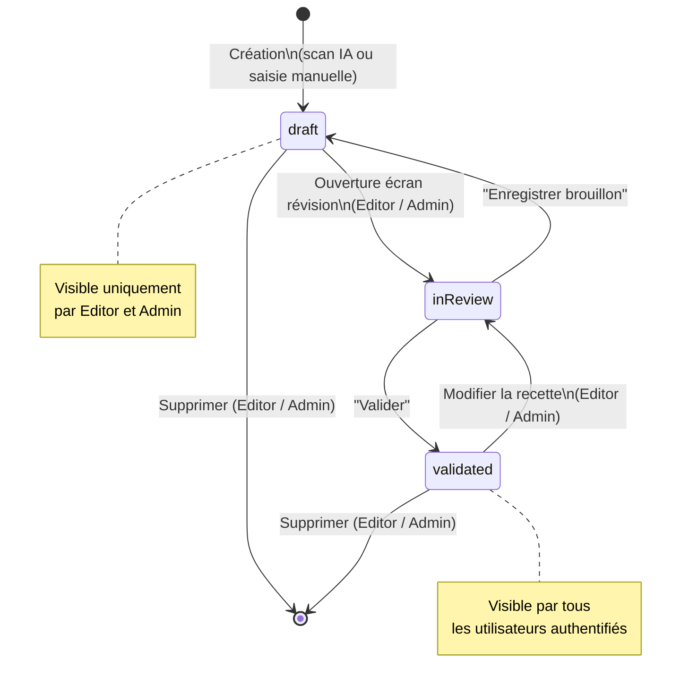
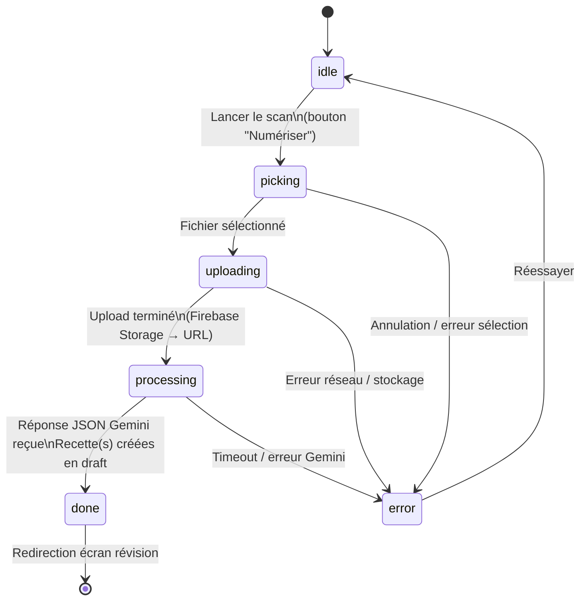
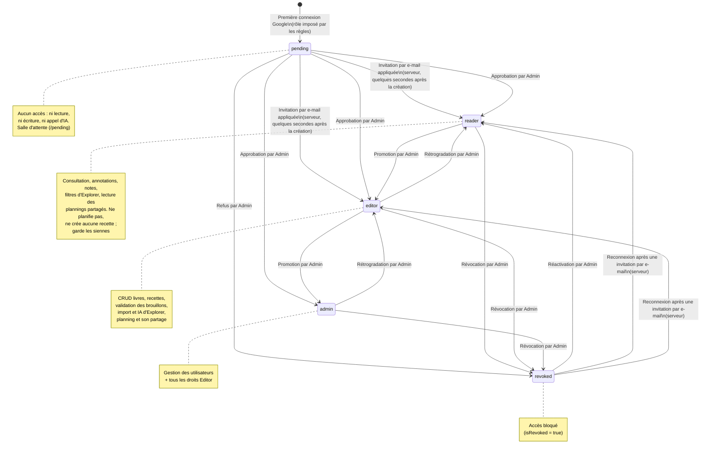
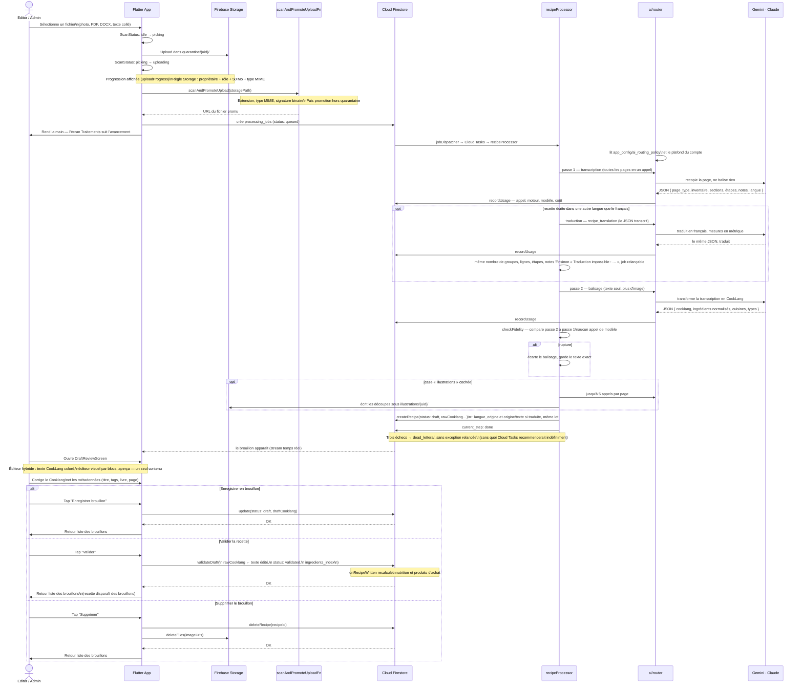

# Spécifications Fonctionnelles — Kass'dalle
## Livre de Cuisine Digital (Flutter + Firebase)

> Version : 2.3 — 19 août 2026

> **Ce document décrit l'état actuel de l'application.** Ce qui a changé d'une version à
> l'autre se lit dans [CHANGELOG.md](CHANGELOG.md), où 143 sections « Mise à jour
> release » ont été déplacées telles quelles.

## 1. Contexte et Objectif

**Kass'dalle** est une application privée à usage familial permettant de digitaliser une collection personnelle de livres de cuisine physiques et de notes d'ateliers culinaires (ex : Sasasa, recettes du terroir belge). L'application transforme des photos de pages de recettes en fiches numériques structurées, consultables et interactives, grâce à l'IA de reconnaissance visuelle (Gemini Vision) et au format de balisage Cooklang.

L'application est destinée à un cercle familial restreint :
- quelques personnes peuvent **modifier** et enrichir le contenu ;
- tous les membres authentifiés peuvent **consulter** et **annoter** leurs recettes et celles, non privées, des membres de leurs groupes familiaux ;
- un administrateur gère les accès.

---

## 2. Plateformes Cibles

| Plateforme | Usage principal | Particularités |
|---|---|---|
| **Android** | Scan, saisie, consultation | Accès caméra pour la capture des recettes, et import de fichier. **Seule cible mobile construite et distribuée** — l'APK est servi par le déploiement web |
| **iOS** | — | **Déclaré, jamais construit.** Le projet Xcode et l'entrée Firebase existent ; il manque `GoogleService-Info.plist`, le schéma d'URL de connexion Google, les deux descriptions d'usage caméra et photothèque, et le `Podfile`. Voir `TechnicalRequirements.md` § 12 |
| **Web** | Consultation, correction, gestion, **et scan** | La caméra fonctionne (`PlatformUtils.hasCameraSupport` vaut vrai sur le web), et l'import de fichier suit le même pipeline que sur Android. Attestation par reCAPTCHA Enterprise |
| **Desktop (Windows)** | Consultation, correction, gestion | Identique au Web ; fenêtre redimensionnable. macOS n'est pas construit. **App Check n'y fonctionne pas** : passer l'attestation en *exigé* prive le desktop de l'IA |

Les plateformes construites partagent le même backend Firebase et la même codebase Flutter. **Le scan n'est pas réservé au mobile** : la caméra fonctionne aussi sur le web par `getUserMedia`, et l'import de fichier est disponible partout.

**Ce qui change n'est pas la plateforme, c'est la largeur.** Toutes les routes — y compris l'administration complète — sont ouvertes sur mobile. La bascule se fait sur trois seuils (`PlatformUtils`) : navigation latérale ou barre basse à 800 px, présentation compacte du détail à 700 px, raccourci galerie à 900 px. Un navigateur de bureau rétréci passe donc en présentation compacte, et un mobile en paysage large peut recevoir la présentation étendue. Aucune fonctionnalité n'est réservée à un format : la présentation compacte réorganise, elle ne retire pas. Dépendent réellement de la plateforme, et d'elle seule : la caméra (mobile et web), la mise à jour par APK et le lien de téléchargement de l'APK (Android natif / grand écran), le partage du PDF (feuille de partage sur mobile, téléchargement dans le navigateur), les raccourcis clavier, sans effet là où il n'y a pas de clavier, et le pavé d'écriture au stylet (4.5), ouvert par un stylet posé sur un champ de texte libre — Android 14 et plus, et iPad. Une seule fonctionnalité dépend des deux à la fois, plateforme et largeur : le zoom du texte de la recette (4.4), proposé sur l'APK Android en présentation étendue — la tablette posée sur le plan de travail.

---

## 3. Authentification et Rôles

### 3.1 Connexion

L'authentification est exclusivement basée sur **Google Sign-In** (Firebase Auth). Aucune création de compte par email/mot de passe n'est prévue.

- À la première ouverture, l'utilisateur est invité à se connecter avec son compte Google.
- **Une adresse ouverte sans session est retenue.** La page de connexion la reçoit dans `?next=` et l'ouvre une fois la connexion faite ; c'est ce qui ramène sur la recette le lien d'un événement Google Calendar. Seule une route interne de l'application est acceptée : une adresse vers un autre site, `/login` ou `/pending` est ignorée, et l'utilisateur arrive sur l'accueil. L'accueil seul ne produit pas de `?next=`. Un compte en attente va dans la salle d'attente, quelle que soit l'adresse demandée.
- **Un compte neuf naît en attente (`pending`) et n'accède à rien.** Il voit une salle d'attente qui affiche son adresse et l'invite à la communiquer ; l'écran se referme de lui-même dès qu'un rôle lui est attribué.
- **Le rôle n'est jamais choisi par l'application.** Les règles Firestore imposent `pending` à la création, et seul un Admin le change ensuite.
- **Exception : le compte invité par e-mail.** Si un Admin a invité l'adresse Google du compte neuf (3.3) et que l'invitation est active, le serveur (`applyEmailInvitation`) lui donne à sa première connexion le rôle de l'invitation et l'ajoute aux membres du groupe choisi, sans invitation de groupe à accepter. C'est le serveur qui décide, sur l'adresse vérifiée du compte **Auth** ; le client ne lit pas les invitations et ne peut pas se donner de rôle. Le compte naît toujours `pending` : la salle d'attente s'affiche le temps que le serveur réponde (quelques secondes), puis se referme seule. L'adresse doit être celle de l'invitation, comparée sans casse et, pour Gmail, sans points ni suffixe `+…` ; une autre adresse reste en attente d'un rôle donné à la main.
- **Exception : le compte révoqué invité par e-mail.** Si un Admin a invité l'adresse Google d'un compte révoqué (3.3), le compte reste révoqué jusqu'à ce que son titulaire se reconnecte sous cette adresse. À cette connexion, le serveur (`applyRevokedInvitation`) rétablit l'accès avec le rôle de l'invitation, et lui envoie une invitation au groupe choisi, qu'il accepte dans Groupes familiaux : un compte révoqué n'entre jamais directement dans un groupe. Mêmes conditions que pour un compte neuf : adresse **Auth** vérifiée, invitation active qui vise ce compte-là, Admin du dernier envoi encore administrateur et non révoqué. L'écran « Votre accès a été révoqué » ajoute : « Vous avez reçu une invitation ? Reconnectez-vous avec le compte Google de l'adresse invitée. » Une session encore ouverte ne déclenche rien seule : le bouton « Continuer avec Google » ouvre une nouvelle connexion (le choix du compte Google s'affiche toujours, sur toutes les plateformes). L'écran reste affiché quelques secondes, le temps que le serveur réponde et que la session prenne le nouveau rôle, puis se referme seul. Un autre compte de même adresse n'en profite jamais. Le groupe choisi n'invite le compte que si l'Admin de l'invitation en est encore propriétaire ou membre ; sinon le rôle est rendu seul, et la liste des invitations le signale. Si un Admin rétablit le compte à la main (onglet Comptes) avant cette connexion, l'invitation est annulée par le serveur avec le motif « Accès rétabli à la main : invitation sans objet. » : elle ne pourra pas rétablir le compte après une nouvelle révocation. Une invitation envoyée ou renvoyée après ce rétablissement reste active, comme celle d'un compte révoqué de nouveau entre-temps.
- **Le compte fondateur** (`china.fred.75@gmail.com`) est le seul administrateur d'origine : le déclencheur serveur `enforceFounderRole` lui rend le rôle `admin` en vérifiant l'adresse du compte **Auth**, jamais celle écrite dans le document. L'adresse doit être **vérifiée** et la connexion passer par **Google**, côté serveur comme dans les règles Firestore (v0.23.48). Il rétablit aussi ce rôle s'il est rabaissé ou révoqué — un administrateur adoubé ne peut pas mettre dehors celui qui l'a nommé.

### 3.2 Rôles

| Rôle | Accès |
|---|---|
| **Admin** | Tout : gestion des utilisateurs, des rôles, des livres, des recettes, des annotations. Lit les livres et recettes privés de tous, et agit sur le contenu d'autrui comme son créateur : modifier, supprimer, changer une couverture ou une illustration. Peut promouvoir d'autres utilisateurs en Admin ou Editor. Planifie, et choisit dans Préférences du planning les groupes qui voient son planning, en lecture seule. Voit les plannings que les membres de ses groupes partagent avec lui. |
| **Editor** | Création de livres et de recettes, rangées dans **ses** livres ; modification et suppression de **ses propres** livres et recettes, couvertures et illustrations comprises. Il ne modifie ni ne supprime le livre ou la recette d'un autre, et ne lit pas leur contenu privé. Relit les brouillons partagés des autres, sans les modifier. Validation de ses brouillons IA. Import d'une page, d'un livre entier et d'une recette depuis un lien (4.6), y compris depuis une page « Sur le web » d'Explorer, le bandeau au retour du navigateur et « Partager vers Kass'Dalle » sur Android. Saisie manuelle et copie d'une recette. Dans Explorer (5.5), « Chercher avec l'IA » et « Imaginer 3 recettes ». Peut annoter. Planifie, et choisit dans Préférences du planning les groupes qui voient son planning, en lecture seule. Voit les plannings que les membres de ses groupes partagent avec lui. |
| **Reader** | Consultation, annotation, notation, export PDF. **Il ne planifie pas** : ni repas, ni cycle, ni préférences de planning, ni conseil de conservation. Il garde sa liste de courses personnelle, qu'il remplit depuis un repas, une période ou une fiche recette (5.10). Ces gestes lui sont masqués, et `/planning/batch`, `/planning/config` et `/planning/staples` le renvoient au planning avec « Planification réservée aux éditeurs ». **Il lit les plannings partagés** avec un groupe dont il est membre, en lecture seule, chaque repas marqué du prénom de son propriétaire ; une recette qu'il ne peut pas lire s'affiche par son titre, avec « Recette non partagée ». Ses repas antérieurs restent lisibles et supprimables. **Il ne crée aucune recette** : ni saisie manuelle (4.3), ni copie d'une recette d'un autre membre, ni recette conçue par l'IA (Explorer, planning), ni import (`/scan`, lien 4.6). Ces gestes lui sont masqués. **Ses recettes existantes restent à lui** : il les modifie, les valide et les supprime comme avant. Il ne touche ni aux livres, ni aux recettes d'autrui, ni à ce qui produit une image. Dans Explorer, il garde la liste, les filtres et « Chercher sur le web » : il voit les pages trouvées et les ouvre dans le navigateur intégré (Android, iOS) ou dans son navigateur, sans bouton « Importer ». « Chercher avec l'IA » ne lui est pas proposé, ni le bandeau d'import au retour du navigateur. S'il ouvre `/scan` par un lien, l'écran lui dit que l'import est réservé aux éditeurs ; s'il partage un lien vers Kass'Dalle sur Android, une boîte « Import réservé aux éditeurs » le lui dit. |
| **Pending** | Rien. Ni livre, ni recette, ni référentiel, ni appel d'IA. C'est l'état par défaut d'un compte qui vient d'être créé. |

> Le compte d'un membre — adresse, rôle, révocation — ne se lit que par son titulaire et par un Admin (v0.23.14). Les autres membres, Reader compris, voient son **profil public** : son nom et la couverture de ses recettes libres. Un nom que le profil ne fournit pas encore s'affiche « Membre » — le seul nom de remplacement de l'application ; une section devient alors « Livres d'un membre » ou « Recettes libres d'un membre ». Un nom, préféré ou Google, compte au plus 60 caractères.

> On ne lit les livres et recettes non privés d'un autre compte que s'il partage au moins un groupe familial avec soi (v0.23.19) ; leurs annotations, leurs notes et leur texte d'origine suivent. Un compte hors de mes groupes ne voit rien de moi, et je ne vois rien de lui. Un Admin lit tout.

> Règle de propriété (v0.23.8) : **on ne modifie que son propre contenu.** Un livre ou une recette se modifie, se supprime ou change d'image par son créateur seulement — quel que soit son rôle — ou par un Admin. Un livre ou une recette **privé** ne se lit que par son créateur et par un Admin. Les écrans masquent les gestes de modification sur le contenu d'autrui ; les règles Firestore et les Cloud Functions les refusent de toute façon.

> Règle de sécurité clé : être connecté ne donne aucun accès. Tout ce qui est partagé — livres, recettes, annotations, référentiels, grille tarifaire — exige un compte **nommé et non révoqué** (`isApproved()` dans `firestore.rules`). La révocation vaut pour tous les rôles, Admin compris, côté règles comme côté Cloud Functions.

### 3.3 Gestion des utilisateurs (Admin)

Un écran dédié (Web / Desktop / Mobile) permet à l'Admin de :
- voir la liste des utilisateurs connectés au moins une fois, **les comptes en attente en tête**, précédés d'un bandeau qui les compte ;
- attribuer ou modifier un rôle (Pending → Reader, Reader → Editor, Editor → Admin) — l'attribution d'un premier rôle **est** l'approbation ;
- révoquer l'accès d'un utilisateur ;
- **inviter un proche par e-mail** avant qu'il ait un compte, ou dont il a révoqué le compte : son adresse Google, un rôle (Lecteur par défaut, ou Éditeur ; jamais Administrateur), un groupe familial dont l'Admin est propriétaire ou membre (obligatoire), et un message modifiable. Le serveur envoie l'e-mail depuis le compte Gmail de l'application, au nom de l'Admin (« {Admin} via Kass'Dalle », réponse vers son adresse). À la première connexion sous cette adresse, le compte reçoit le rôle et entre dans le groupe (3.1). Une invitation expire trente jours après son dernier envoi ; un renvoi repousse l'échéance. Vingt envois par Admin et par jour au plus, créations et renvois compris. Une seule invitation en attente par adresse. Une adresse qui a déjà un compte est refusée, sauf un compte révoqué : compte actif, « Cette adresse a déjà un compte ({rôle}). Changez son rôle dans l'onglet Comptes, et invitez-le depuis le groupe. » ; compte en attente, « Ce compte attend déjà un rôle. », avec le bouton « Lui donner le rôle (sans groupe) » qui applique le rôle choisi comme l'onglet Comptes, et la mention que l'ajout au groupe passe par l'invitation de groupe dans Groupes familiaux (l'arrivée automatique dans le groupe est réservée aux comptes neufs) ; fondateur, refus. **Compte révoqué** : l'invitation est acceptée et le compte reste révoqué ; l'e-mail dit « Connecte-toi avec le compte Google {adresse} : ton accès sera rétabli, et l'invitation au groupe « {groupe} » t'attendra dans Groupes familiaux. » À sa reconnexion sous cette adresse, l'accès est rétabli avec le rôle de l'invitation, et une invitation de groupe l'attend (3.1, 5.7). Le renvoi d'une invitation exige que le compte visé n'ait pas changé : un compte révoqué rétabli entre-temps à la main, ou une adresse passée d'aucun compte à un compte, donnent « Le compte de cette adresse a changé depuis l'invitation. Annulez-la, puis invitez de nouveau. » Une adresse que Gmail refuse définitivement (boîte inexistante) annule l'invitation : elle passe dans l'historique, Annulée, avec le motif « Adresse refusée par Gmail : … ». Une invitation dont l'Admin du dernier envoi n'est plus administrateur, ou a été révoqué, ne donne plus de rôle : le compte reste en attente d'une décision à la main. Seul l'Admin encore membre du groupe peut renvoyer une invitation ; un groupe supprimé la rend impossible à renvoyer (« Ce groupe n'existe plus. »).

---

## 4. Parcours Utilisateur

### 4.1 Gestion d'un Livre

**Qui :** Editor ou Admin.

1. L'utilisateur crée un nouveau livre via un formulaire.
2. Il saisit :
   - Titre du livre
   - Auteur(s)
   - Année de publication (optionnel)
   - Langue principale des recettes (liste déroulante)
   - Tags/thèmes associés au livre (ex : Terroir belge, Pâtisserie)
     Les tags qui commencent par « __ » sont réservés aux livres système (`__libres`, `__kassdale_ia`, `__secretes`, `__web`) : le formulaire refuse l'enregistrement avec le message « Les tags qui commencent par « __ » sont réservés ».
3. Il peut scanner ou importer une photo de la couverture (mobile : caméra ou galerie ; web/desktop : import de fichier).
4. Le livre est enregistré et apparaît dans la bibliothèque.

Creation automatique via scan de couverture :
- L'utilisateur peut photographier ou importer la page de garde.
- L'IA extrait les champs structures du livre (titre, auteur, sous-titre, editeur, serie, annee, langue, ISBN, description, tags).
- Un brouillon livre est cree avec statut `draft`.
- L'utilisateur valide ensuite ce brouillon depuis l'ecran d'edition du livre via l'action "Valider le livre".

Création à partir d'un PDF ou d'un EPUB (« Ajouter à partir d'un PDF ou d'un EPUB », dans la feuille « Ajouter un livre ») :
- L'utilisateur choisit un fichier PDF, EPUB ou Word, jusqu'à **300 Mo**. Sur mobile et desktop le fichier part depuis le disque sans être chargé en mémoire ; sur le web il passe par la mémoire du navigateur.
- Le serveur contrôle le fichier, l'ouvre et **le lit avant tout import** : l'écran affiche le nombre de pages (PDF) ou de caractères (EPUB, Word), le nombre d'imports que le livre va créer, et un **coût estimé**. Rien n'est facturé avant le bouton « Lancer l'import » ; « Annuler » supprime le fichier envoyé.
- **Quitter l'écran pendant l'envoi est bloqué par une question.** Tant que le livre est en cours d'envoi, de contrôle ou de lecture, ou lu et en attente du feu vert, un retour, la navigation du bas ou du menu latéral et Ctrl+K ouvrent une boîte « Envoi du livre en cours » (ou « Import du livre non lancé ») avec deux boutons : « Continuer » reste sur l'écran, « Annuler l'import » coupe l'envoi, supprime le fichier déjà arrivé et quitte. Le retour du navigateur web n'est pas couvert. La mise en file du job, qui prend une seconde, n'est pas bloquée.
- Le coût estimé est le coût par import **mesuré** sur les derniers livres importés de l'utilisateur, multiplié par le nombre d'imports. Sans livre déjà importé, l'écran retombe sur la moyenne des 15 dernières pages scannées, et sur rien avant 3 pages : il dit alors que l'estimation est impossible et n'affiche jamais une valeur par défaut.
- **Chaque import a un plafond de dépense, fixé avant son départ.** L'écran propose un montant — l'estimation plus la moitié, ou 0,50 $ par import sans estimation —, en euros quand un taux de change est connu, en dollars sinon (l'aide le signale : « taux de change indisponible : montants en dollars »). Le bouton « Lancer l'import » reste grisé tant que le montant n'est pas supérieur à zéro. Quand l'import atteint ce plafond, les imports restants s'arrêtent en erreur avec le message « Plafond de cet import atteint ». Relancer un import depuis la file « Brouillons & Traitements » relève le plafond d'un palier de la même taille : relancer est le geste par lequel on accepte de dépenser davantage. Le plafond ne dépasse pas 4 € par tranche du livre, convertis en dollars au taux de la facture ; sans taux connu, le maximum vaut 4 $ par tranche. L'écran affiche ce maximum sous le champ (« maximum … € ») et refuse un montant plus haut : le bouton reste grisé avec le message « Au plus … € (… € par tranche) », en dollars sans taux. Les relances ouvrent ensuite le plafond palier par palier.
- Le livre est créé depuis le fichier. Un EPUB donne titre, auteur, éditeur, année, langue, ISBN, description et couverture sans appel d'IA. Un PDF est lu par l'IA sur sa première page, comme une couverture scannée ; sa couverture est l'image JPEG de la première page quand le PDF en embarque une, sinon le livre se crée sans couverture.
- Le contenu est découpé en tranches de 3 pages (PDF) ou d'environ 6 000 caractères (EPUB, Word), avec une page de contexte à la suite pour terminer la dernière recette entamée. Chaque tranche devient un import de page ordinaire : ses recettes arrivent une à une dans les **brouillons**, rattachées au nouveau livre.
- Depuis le menu d'un livre existant, « Importer un livre complet » suit le même chemin et rattache les recettes à ce livre.
- Chaque import est facturé et soumis au plafond quotidien d'IA, en plus du plafond de l'import. Quand l'un ou l'autre est atteint, les imports restants passent en erreur et se relancent, le lendemain ou après relèvement du plafond, depuis la file « Brouillons & Traitements » (sélection multiple, « Relancer »).
- Un import qui échoue après la lecture de la page ne relit pas la page à la relance : la transcription réussie est gardée sur le traitement, et seule la suite est refaite.
- Sont refusés avec un message clair : un PDF chiffré, un EPUB sans texte (pages en images), un livre qui demanderait plus de 400 imports.

**Modification / Suppression :** accessible via le détail du livre, à son créateur et à un Admin. La suppression demande une confirmation : « Supprimer aussi » supprime les recettes, « Détacher les recettes » en fait des recettes libres. Le créateur n'agit que sur ses propres recettes ; un Admin agit sur toutes. Les pages ajoutées par d'autres membres sont conservées et détachées : elles deviennent des recettes libres de leurs auteurs, privées si le livre l'était.

---

### 4.2 Capture d'une Recette (caméra : mobile et web — import de fichier : partout)

**Qui :** Editor ou Admin.

**Étape 1 — Sélection de la source**
- L'utilisateur sélectionne le livre source depuis la bibliothèque (ou crée un nouveau livre à la volée).
- Il indique optionnellement le numéro de page dans le livre.

**Étape 2 — Capture photo**
- L'utilisateur prend une ou plusieurs photos de la page de recette via la caméra intégrée.
- L'interface propose un outil de recadrage et de correction de perspective avant envoi.
- Il est possible d'ajouter plusieurs images pour une recette qui s'étale sur plusieurs pages.

Comportement asynchrone :
- Chaque import cree un job de traitement IA en file d'attente.
- L'utilisateur peut lancer un second scan pendant qu'un premier est encore en cours.
- Les brouillons generes apparaissent automatiquement a la fin de chaque job.

**Étape 3 — Traitement IA (pipeline asynchrone)**
- Les images sont déposées dans la **quarantaine** (`quarantine/{uid}/`), inspectées côté serveur — type MIME, signature binaire, taille — puis promues. Aucune image ne rejoint un dossier publié sans être passée par la modération.
- Le client crée un job dans `processing_jobs/` et n'attend rien : `jobDispatcher` le met en file Cloud Tasks, `recipeProcessor` déroule le pipeline.
- **Le moteur n'est pas figé dans le code** : chaque poste est routé vers Gemini ou Claude selon `app_config/ai_routing_policy`, modifiable depuis *Admin › Moteur d'IA* sans déploiement. Par défaut, Gemini.
- **Le texte est lu en deux passes, jamais en une.** Un seul appel qui transcrivait *et* restructurait perdait la transcription au profit de la mise en forme : ingrédients fusionnés, précisions déplacées, énumérations abrégées.
  - **Passe 1 — transcription.** Un appel rend le **type** de la page (`recipe`, `ingredient_note`, `technique`, `equipment`, `other`, `no_recipe`) et son contenu **recopié** en JSON : sections d'ingrédients ligne à ligne, sections d'étapes phrase par phrase, notes typées, chapeau de la recette. Aucune balise. Toutes les pages d'un même scan partent dans le **même** appel.
  - **Traduction, seulement pour une recette écrite dans une autre langue.** La passe 1 rend la langue de chaque recette (code ISO 639-1), lue sur les **étapes** et non sur le titre ou les noms d'ingrédients : une recette française qui parle de « cheesecake » ou de « wok » reste en `fr`. Dans le doute, elle écrit `fr`. La passe 1 recopie dans la langue de la page et ne traduit rien. Si la langue n'est pas `fr`, un appel de plus (poste `recipe_translation`) traduit le texte transcrit en français et convertit les mesures en métrique : solides mesurés en volume en grammes, liquides en millilitres, °F en °C arrondis à 5 °C, pouces en centimètres. Les valeurs américaines s'appliquent par défaut, les britanniques si la source l'est. Un ingrédient sans équivalent garde son nom, suivi d'un équivalent courant entre parenthèses. Du code vérifie ensuite que la traduction garde la forme de l'original — mêmes nombres de groupes, de lignes, d'étapes et de notes, aucun titre, ligne, étape ou note vidé ; sinon le traitement échoue avec « Traduction impossible : … » et se relance depuis la file. Le balisage, le contrôle de fidélité, les tags et la nutrition travaillent sur la traduction. Pour un livre entier, le plafond de l'import est vérifié avant chaque traduction. Une relance après un échec du balisage ne refait pas la traduction. Le texte d'avant traduction est conservé avec la recette (voir 4.4).
  - **Passe 2 — balisage.** Un second appel, sur du texte seul, produit le **Cooklang**, la liste normalisée (`nom`, `qte`, `unite`, `note`, `section`), les cuisines et les types de plat.
  - **Une recette écrite en prose garde sa liste d'ingrédients.** Certains livres n'en donnent pas : « faites revenir un oignon avec deux gousses d'ail » et rien d'autre. La passe 2 construit alors la liste depuis les étapes, et n'y met une quantité que si la phrase la donne. Si elle rend quand même une liste vide, le serveur la dérive du texte balisé avant d'enregistrer. Une recette sans liste n'a ni liste de courses, ni planification, ni nutrition.
  - **Contrôle de fidélité, sans appel supplémentaire.** Du code compare la passe 2 à la passe 1 — disparitions, fusions, titres de section raccourcis, précisions perdues. Une *rupture* écarte le balisage et conserve le texte exact, non balisé. Un *avertissement* laisse passer et s'affiche sur le brouillon.
- **La lecture d'une page ne se fait jamais par un OCR local.** Le choix est motivé dans `TechnicalRequirements.md` § 7 et § 8 : un OCR rend un flux de caractères sans structure, et il faudrait de toute façon un appel de modèle derrière pour la reconstruire.
- **Les illustrations coûtent jusqu'à cinq appels de plus par page**, et seulement si la case a été cochée à l'import.
- L'étape courante du job (`current_step`) est affichée dans l'écran *Traitements*. Un import complet prend de quelques dizaines de secondes à quelques minutes ; l'utilisateur peut en lancer un second pendant ce temps.
- Après trois échecs, le job part en `dead_letters/`, d'où un administrateur le relance depuis *Admin › File d'échecs*.

**Étape 4 — Écran de Révision (Split View)**
- L'éditeur (`HybridRecipeEditor`) offre **trois modes**, permutables par une barre de bascule :
  - **Texte** : champ monospace en CookLang brut, avec coloration syntaxique en direct.
  - **Visuel** : éditeur WYSIWYG par blocs, où ingrédients, ustensiles et minuteurs sont des pastilles cliquables.
  - **Aperçu** : le rendu de la recette tel qu'il sera lu.
- **Les trois modes partagent le même contrôleur de texte**, qui est la vérité. Basculer est instantané et ne perd rien : le mode visuel analyse le CookLang en blocs, chaque bloc garde sa ligne source, et la recomposition rejoint les lignes source telles quelles.
- Sur écran étroit, les modes s'empilent en onglets ; sur grand écran, l'aperçu peut rester à côté.
- Un bouton **"Voir l'original"** (icône scanner) est toujours présent dans la barre d'actions :
  - Si le fichier source est une image (jpg/png) : affiche une visionneuse plein écran zoomable.
  - Si le fichier est un PDF ou un DOCX : ouvre le document dans le navigateur ou le lecteur système.
  - Sur mobile (vue en onglets), un onglet dédié **"Original"** affiche l'image directement dans l'écran.
- Le document source est **lié à vie à la recette** : il ne peut jamais être dissocié ni supprimé tant que la recette existe.
- Il complète / corrige les métadonnées suggérées par Gemini : titre, tags, numéro de page.
- Deux actions disponibles :
  - **Enregistrer en brouillon** (`draft`) : la recette est sauvegardée mais pas marquée comme validée.
  - **Valider** : la recette passe au statut `validated`.

---

### 4.3 Saisie Manuelle d'une Recette (Web / Desktop / Mobile)

**Qui :** Editor ou Admin. Le Reader ne crée pas de recette : le bouton de création lui est masqué.

Pour les recettes sans photo source (recettes mémorisées, recettes tapées manuellement) :
- L'utilisateur accède à un formulaire de création de recette.
- Il saisit directement le contenu en Cooklang dans l'éditeur avec rendu split view.
- Les métadonnées sont saisies manuellement.
- Un bouton **"Mettre en forme avec l'IA"** permet de coller un texte brut (texte web, note, etc.) et de le convertir en CookLang. **Le texte collé emprunte exactement la même chaîne que la page scannée** : transcription, puis balisage, puis contrôle de fidélité. Seule l'entrée de la passe 1 diffère — du texte au lieu d'une image. Le passage par un appel unique perdait la liste d'ingrédients, qui se dissolvait dans les étapes.
- Le nombre de recettes trouvées dans le texte est rendu à l'écran : une seule est reprise, et l'utilisateur doit l'apprendre plutôt que de découvrir la seconde absente.
- **Un texte collé dans une autre langue est traduit**, comme une page scannée (4.2). L'écran l'annonce : « Traduit de l'anglais, mesures converties. Le texte collé reste consultable comme document original. » Le texte d'origine n'est pas stocké une seconde fois avec la recette : le texte collé, conservé comme fichier source, en tient lieu.
- **Le texte original collé est automatiquement conservé** : il est uploadé sur Firebase Storage et attaché à la recette comme fichier source. Le bouton de téléchargement de l'original apparaît ensuite dans l'en-tête de la recette, comme pour un scan.
- Si l'IA n'est pas utilisée (saisie CookLang directe), aucun fichier source n'est attaché.
- Un bouton **« Lien »** ouvre l'import d'une recette depuis une adresse web (4.6).

---

### 4.4 Consultation d'une Recette

**Qui :** Tout compte nommé (Reader, Editor, Admin) qui voit la recette : la sienne, celle
d'un compte qui partage au moins un groupe avec lui si elle n'est pas privée, toutes pour un
Admin. Les annotations d'une recette sont visibles par tous ceux qui voient cette recette ;
celles d'une recette privée, par son créateur et un Admin seulement — et par leur auteur.

1. L'utilisateur navigue dans la bibliothèque (vue par livre ou vue globale).
2. La liste d'un livre ne porte ni filtre ni champ de recherche : chercher et filtrer se font depuis l'écran **Explorer** (5.5).
3. Il clique sur une recette et accède à la fiche détaillée. **Sa présentation dépend de la largeur, pas de la plateforme** : au-dessus de 700 px (`PlatformUtils.compactDetailBreakpoint`), cinq onglets — *Préparer*, *Nutrition*, *Dressage*, *Communauté*, *Photos* ; en dessous, une page continue (`MobileUnifiedBody`) qui enchaîne les mêmes contenus sans onglets. La présentation compacte réorganise, elle ne retire rien.
   - **En-tête** : titre, livre source, page, langue, tags. Il reste hors onglets, comme la barre d'actions.
   - **Portions** : affichées sous forme de chip (ex : « 4 portions ») si renseignées dans les métadonnées CookLang (`>> portions: 4`). Ce champ est également stocké comme donnée structurée dans Firestore (`portions: int?`).
   - **Durées** : « Prép. 20 min », « Cuisson 25 min » et « Repos … » s'affichent en puces quand la recette les donne (métadonnées CookLang `>> temps_preparation:`, `>> temps_cuisson:`). Une recette qui ne donne pas sa préparation ou sa cuisson reçoit une **durée estimée par l'IA** : la puce garde la même icône et s'écrit « ≈ Prép. 20 min » ou « ≈ Cuisson 25 min ». Son infobulle dit « Estimé par l'IA », le lecteur d'écran lit « Préparation environ 20 minutes, estimée ». Sous les puces, en petit : « Durées estimées par l'IA, absentes de la recette d'origine. » Une durée lue dans la recette — dans son texte ou dans ses champs — passe toujours avant l'estimation, sur la fiche comme dans Explorer : quand l'auteur saisit sa durée, la puce perd son « ≈ » et la mention disparaît. L'estimation ne s'écrit pas dans le texte de la recette ; personne ne la corrige à la main, on saisit la vraie durée à la place. Le rendu est le même pour un Reader, un Editor et un Admin.
   - **Ingrédients** : liste structurée extraite du Cooklang, avec quantités et unités bien formatées. Chaque ingrédient est stocké dans Firestore sous forme d'objet `{ name, qty, unit }` (champ `ingredients`).
   - **Allergènes** : un bloc « Allergènes » se place sous la liste des ingrédients — dans l'onglet *Préparer* sur grand écran, dans la page continue sur téléphone. Il nomme, parmi les quatorze allergènes majeurs de l'UE, ceux que contiennent les ingrédients, sous forme de pastilles. Un appui sur une pastille ouvre la feuille « Ingrédients en cause », qui liste les ingrédients de la recette porteurs de cet allergène. Le bloc suit l'état de l'analyse (voir 5.9, « Allergènes ») ; une recette qui n'a jamais été analysée n'affiche pas de bloc. Sous le bloc, toujours visible avec lui : « Liste indicative établie par IA. Elle ne remplace pas la lecture des emballages. » Le rendu est le même pour un Reader, un Editor et un Admin.
   - **Instructions** : étapes numérotées, avec mise en valeur des ingrédients et du matériel (rendu Cooklang interactif).
   - **Taille du texte** : sur l'APK Android en présentation étendue, deux boutons de la barre — réduire, agrandir — zooment l'onglet *Préparer* (ingrédients, étapes, puces) par paliers : 100, 125, 150, 175 et 200 %. Le zoom s'ajoute à la taille de police du système, il ne la remplace pas. Il est mémorisé sur l'appareil (`SharedPreferences`, clé `recipe_text_zoom`), pas dans le compte : il dépend de l'écran et de la distance de lecture, pas de la personne. Les autres onglets, la barre et les feuilles ouvertes depuis la fiche gardent leur taille.
   - **Document original** : bouton "Voir l'original" (icône scanner) toujours visible dans la barre d'actions. Ouvre l'image en plein écran zoomable ou le PDF dans le navigateur.
   - **Source** : une recette importée depuis un lien (4.6) affiche « Source : <site> », le nom du site, en lien vers la page d'origine. L'adresse complète s'affiche aussi et se copie. Quand la page nomme l'auteur de la recette dans ses données structurées, une ligne « Par <auteur> » s'affiche au-dessus du lien, sauf quand l'auteur annoncé est le site lui-même. Tout lecteur de la recette la voit. Une recette sans source n'affiche rien. La source est posée par l'import et ne se saisit pas à la main. La copie d'une recette importée garde sa source.
   - **Recette traduite** : une recette traduite à l'import porte la mention « Traduit de l'anglais » (ou de la langue lue ; « Traduit d'une autre langue » pour une langue absente de la table d'une trentaine de langues). Sur grand écran, la mention suit le livre et sa page, sur la même ligne sous le titre, et une icône de traduction « Voir le texte d'origine (anglais) » s'ajoute à la barre d'actions. Sur téléphone, la mention se place dans la rangée d'actions et sert de bouton. Les deux ouvrent la vue **« Texte d'origine, avant traduction »** : une feuille à 90 % de la hauteur sur téléphone, une fenêtre de 640 px de large sur grand écran. Elle montre titre, chapeau, ingrédients, étapes et notes tels que la page les écrivait. Le texte se sélectionne, suit le zoom de lecture de la recette, s'écrit de droite à gauche pour l'arabe, l'hébreu et le persan, et emploie les glyphes de sa langue. La vue affiche un état de chargement, un état d'erreur, et « Texte d'origine indisponible » quand le document manque. Tout lecteur de la recette la voit. Une recette non traduite ne montre rien de tout cela. Le texte d'origine n'entre pas dans la recherche. Une copie de la recette n'emporte ni la mention ni le texte d'origine.
   - **Photos** : sur grand écran, un onglet **Photos** — placé après Communauté — montre les illustrations de la recette en grille, ouvre chacune en plein écran, et laisse un éditeur en ajouter ou en supprimer. Elles restent aussi visibles en vignettes dans le bandeau de l'onglet Préparer, et en vignettes sur mobile, qui n'a pas d'onglets.
   - **Annotations** : section en bas de fiche pour consulter et ajouter des notes personnelles.
   - **Notes de la famille** : sous « Ma note », une ligne repliée « Famille : 7 / 10 · 2 notes » donne la moyenne et le nombre de notes. Dépliée, elle liste chaque membre avec son nom, sa date de note et sa note, la plus récente en tête. **Seules comptent les notes des membres qui partagent au moins un groupe avec moi**, plus la mienne : ma note entre dans la moyenne et le nombre, mais n'est pas répétée dans la liste. Un membre sorti de mes groupes, ou dont le compte a été supprimé, disparaît de la liste et de la moyenne. Une note à 0 compte. Sans note d'un autre membre, la ligne dit « Aucun autre membre n'a encore noté cette recette. » Une lecture en panne affiche « Notes de la famille indisponibles », jamais une moyenne. Au moment de noter, un rappel dit : « Votre note est visible des membres qui ont accès à cette recette. » Les notes des autres ne pèsent pas sur mes propositions de planning : seule ma note y compte.

---

### 4.5 Annotation d'une Recette

**Qui :** Tout utilisateur authentifié (Reader, Editor, Admin).

- Chaque recette dispose d'une section d'annotations visible en bas de la fiche.
- Un utilisateur peut ajouter une annotation de type :
  - `note`, affiché **« Remarque »** : observation personnelle
  - `tip`, affiché **« Astuce »** : conseil de préparation
  - `correction` : signalement d'une erreur dans la recette numérisée
- L'annotation affiche le nom de l'auteur et la date.
- Le dialogue d'annotation rappelle en tête la note chiffrée de l'utilisateur
  (« Ma note ») avec un raccourci vers le sélecteur 0–10. C'est un raccourci :
  la note reste stockée dans `recipe_ratings`, jamais dans l'annotation.
- Un utilisateur peut modifier ou supprimer **ses propres** annotations.
- Un Admin peut modifier ou supprimer n'importe quelle annotation. Un Editor, comme un
  Reader, ne touche qu'aux siennes.
- **Écriture au stylet** : un stylet posé sur le champ de l'annotation ouvre un pavé
  d'écriture — un grand champ, toute la largeur, tout l'espace au-dessus du clavier — où
  l'écriture manuscrite du système est convertie en texte ; *Terminé* le referme. Le champ du
  pavé et celui du dialogue sont le même texte. Le même pavé sert aux autres champs de texte
  libre : description d'un livre, contraintes du planning, instructions d'amélioration d'un
  brouillon, texte d'une image à générer, modification d'une recette générée, envie culinaire
  d'Explorer. L'éditeur de recette n'en fait pas partie. Le pavé ne s'ouvre que là où le
  système convertit l'écriture : Android 14 et plus avec un clavier compatible, et iPad.
  Ailleurs, et sous le doigt, le champ reste un champ ordinaire.

---

### 4.6 Import d'une Recette depuis un Lien (tous les clients)

**Qui :** Editor ou Admin. Le Reader n'importe pas : les points d'entrée lui sont masqués.

**Points d'entrée.** Six chemins ouvrent la même boîte « Importer depuis un lien » :
- « Importer depuis un lien », dans **Explorer** (5.5) ;
- **« Importer »** sur une page de la section « Sur le web » d'Explorer (5.5), adresse
  posée ;
- le **bandeau d'Explorer au retour du navigateur** (5.5) : « Vous avez trouvé une recette ?
  Importez-la. » ;
- **« Partager vers Kass'Dalle »**, sur Android : depuis le navigateur ou une autre
  application, le menu de partage du téléphone propose Kass'Dalle ;
- le bouton placé sous « Saisie manuelle » dans l'écran **Import** (`/scan`) ;
- le bouton **« Lien »** de l'éditeur de la saisie manuelle (`/recipes/new`).

**Partager vers Kass'Dalle (Android).** Le partage ouvre l'application, ou la ramène au
premier plan, et la boîte s'ouvre par-dessus l'écran courant, avec la première adresse web
du texte partagé déjà posée dans le champ. Rien ne part avant « Importer ». Sur téléphone,
le champ n'a pas le focus, pour que le clavier ne cache pas l'adresse ; au bureau et sur le
web en grand écran, il l'a, et Entrée envoie.
- Utilisateur non connecté : la connexion d'abord, puis la boîte s'ouvre.
- Partage reçu pendant le démarrage : il attend que le compte soit lu, puis la boîte (ou le
  refus du Reader) s'affiche. Un Editor ne voit jamais le refus pendant ce temps.
- Reader : une boîte « Import réservé aux éditeurs » dit « Importer une recette ou un livre
  est réservé aux éditeurs et aux administrateurs. Demandez à un administrateur de vous
  nommer éditeur. », avec « Fermer ».
- Partage sans adresse web : le message « Ce partage ne contient pas d'adresse web. ».
- iOS, le web et Windows ne reçoivent pas de partage.

**Étape 1 — Coller l'adresse.** L'utilisateur colle l'adresse d'une page web. Avant tout envoi, trois contrôles ont lieu :
- **Adresse valide et publique.** Une adresse mal formée, ou qui ne désigne pas une page publique sur internet, est refusée avec un message. Rien n'est lancé.
- **Plafond de 10 imports par lien par jour et par compte.** Pour le compte fondateur, ce plafond est multiplié, comme ses autres plafonds d'IA. L'écran affiche le nombre d'imports restants du jour. Plafond atteint : l'import est refusé, et l'écran dit qu'il sera de nouveau possible le lendemain.
- **Doublon dans ses propres recettes.** Si l'une de ses recettes vient déjà de cette adresse — comparée après normalisation de l'adresse —, l'écran le dit et propose deux choix : ouvrir la recette existante, ou importer quand même. Les recettes des autres membres ne comptent pas.

**Étape 2 — Traitement en tâche de fond.** L'import est asynchrone, comme un scan (4.2). Un traitement apparaît dans « Brouillons & Traitements » (5.4) et l'utilisateur peut continuer à se servir de l'application. Le serveur :
1. lit la page ;
2. cherche d'abord les données structurées de recette que la page publie (format schema.org/Recipe). Cette lecture se fait sans IA. La recette trouvée est ensuite mise en forme en CookLang ;
3. à défaut de données structurées, envoie le texte de la page dans la même chaîne que le texte collé (4.3) : transcription, balisage, contrôle de fidélité ;
4. traduit la recette en français, mesures en métrique, si la page n'est pas en français (même règle qu'en 4.2) ;
5. si la page porte plusieurs recettes, ne garde que la première. La tuile du traitement dans « Brouillons & Traitements » le dit : « N recettes trouvées sur la page : seule la première a été reprise. »

**Échecs affichés sur la tuile du traitement.** Chaque cas a son message et ses actions :
- **Le site bloque la lecture.** La tuile propose « Ouvrir la page » et « Coller le texte ». « Coller le texte » ouvre la saisie manuelle (4.3) vide, avec l'adresse de la page rappelée en haut de l'écran.
- **La page ne contient pas de recette**, ou une recette trop longue pour être reprise. Rien n'est créé. La tuile propose « Ouvrir la page » et « Coller le texte ».
- **La page n'existe pas ou plus.** La tuile propose « Ouvrir la page ».
- **Le lien est refusé** (adresse non publique). Aucune action.
- **Délai dépassé.** La tuile propose « Relancer ». Après deux relances, la tuile le dit et propose « Ouvrir la page » et « Coller le texte » à la place.
- **Incident sans cause précise.** La tuile affiche le message d'erreur et propose « Ouvrir la page » et « Relancer ». Après deux relances, « Coller le texte » remplace « Relancer ».

Un import par lien se relance **deux fois au plus** : chaque relance refait des appels d'IA facturés, hors du plafond quotidien d'imports.

**Étape 3 — Le brouillon.** La recette arrive en **brouillon** (`draft`), à relire et valider comme les autres (4.2, étape 4) :
- Elle est rangée dans le livre **« Mes recettes du web »**. C'est un livre système, comme « Mes recettes libres » : il se renomme mais ne se supprime pas (§6). Il est créé avec les autres livres système, à l'ouverture de la bibliothèque, pour un Editor ou un Admin, avec sa couverture par défaut (image « From the web »). Un Reader le reçoit à l'approbation de son compte, avec les trois autres livres système, sans l'utiliser : il n'importe pas. Il est **privé** : seuls son propriétaire et un Admin le lisent. Ses recettes ont sa confidentialité ; les déplacer dans un livre partagé les rend visibles du groupe.
- La photo principale de la page est reprise comme illustration, après modération (5.11). Tant que la modération n'a pas rendu son verdict, la recette est créée sans photo ; la photo s'ajoute quand la modération l'accepte. Refusée, elle ne s'ajoute jamais.
- Le texte de la page est joint comme document original : « Voir l'original » l'ouvre, comme pour un texte collé.
- La recette garde l'adresse de la page comme **source**, affichée sur la fiche (4.4).

**Coût.** La lecture des données structurées n'appelle aucun modèle ; la mise en forme qui suit est facturée. Une page sans données structurées est facturée comme un texte collé. La traduction, quand elle a lieu, et la modération de la photo s'ajoutent. Chaque appel compte dans le plafond quotidien d'IA du compte, en plus du plafond de 10 imports par lien.

---

## 5. Modules Fonctionnels

### 5.1 Module Bibliothèque (tous les clients)

- Vue en grille des livres avec couverture, titre, auteur et compteur de recettes.
- Si l'utilisateur appartient à un ou plusieurs groupes familiaux, la bibliothèque est divisée en sections :
  - **Mes livres** : tous les livres de l'utilisateur connecté (validés et brouillons).
  - **Livres de [Prénom]** : une section par membre de mes groupes, affichant uniquement ses livres validés et non privés. Un compte qui ne partage aucun groupe avec moi n'y apparaît pas.
- Chaque section dispose d'un toggle pour la masquer/afficher.
- **Rangement au glisser-déposer** : dans « Mes livres », maintenir une couverture puis la déposer
  sur une autre la met à sa place. L'emplacement visé s'éclaire pendant le déplacement, et la
  grille ne se réorganise qu'au lâcher — les voisines ne dansent pas sous le doigt. L'ordre est
  enregistré et retrouvé à la session suivante, sur tous les appareils. C'est un choix de **lecteur** : il ne modifie pas les livres, que toute la
  famille partage, et ne change donc rien à ce que voient les autres membres. Un livre créé après
  coup se range à la fin, un livre supprimé disparaît sans laisser de trou.
- Accès à la liste des recettes d'un livre.
- Vue globale "Toutes les recettes" (sans filtre de livre).

### 5.2 Module Scan (caméra : mobile et web — import de fichier : partout)

- Accès caméra natif sur mobile, `getUserMedia` sur le web ; l'import de fichier (photo, PDF, DOCX, texte collé) et l'import depuis un lien (4.6) sont disponibles sur les quatre plateformes. Le bouton d'import par lien est placé sous « Saisie manuelle ».
- **Sur mobile, toute prise de vue passe par le scanner du système.** Android expose
  ML Kit Document Scanner, iOS expose VisionKit : les deux cherchent les coins sur le flux vidéo,
  avec un modèle entraîné, et rendent une image déjà cadrée et redressée. Cela vaut pour les pages
  de recette et la couverture à l'import, et pour chaque bouton « Prendre une photo » ailleurs :
  relecture d'un brouillon, détail d'une recette, recette générée, formulaire de livre. L'appareil
  photo nu n'est plus ouvert que là où le scanner n'existe pas. La couverture scannée à l'import
  part directement en file, sans passer par l'atelier de retouche.
- **Sur le web, aucune de ces API n'existe.** L'atelier de retouche garde la main et propose un
  cadre calculé sur une seule prise. Il est annoncé pour ce qu'il est : « Cadre suggéré — vérifiez
  les coins et corrigez-les », ou « Aucun cadre reconnu — placez les quatre coins ». Un cadrage
  automatique qui a l'air d'un résultat, alors qu'il n'a rien trouvé, fait perdre plus de temps
  qu'un point de départ annoncé.
- Recadrage et correction de perspective avant envoi.
- **Mode multi-pages** : après sélection de la première image, l'utilisateur entre en mode "Pages en attente". Il peut ajouter d'autres pages (fichier ou caméra) avant de lancer l'analyse globale. Toutes les pages partent dans un **seul** appel multi-part, chez le moteur routé pour le poste.
- **Extraction automatique d'illustrations** : l'IA identifie les photographies culinaires **sur chaque page** du scan, les découpe, et les propose comme illustrations de la recette.
  - **Six étapes par page**, détaillées dans les diagrammes de séquence : pré-contrôle (la page porte-t-elle des images ?), cadrage, mise à plat par homographie, remise à l'endroit, repérage des zones, découpe. Le pré-contrôle arrête la chaîne sur une page sans photo — une page de recette sur deux — et les quatre appels suivants n'ont pas lieu.
  - **Une découpe est écrite directement sous `illustrations/{uid}/`, sans quarantaine ni Cloud Vision.** Le fichier source est déjà passé par le scan de sécurité à l'envoi, et la découpe est un JPEG produit par Sharp trois lignes plus haut. La modération garde son rôle sur les images qu'une personne **envoie** depuis l'application ; une découpe d'un scan déjà accepté n'en est pas une.
  - **Une panne d'extraction ne fait jamais échouer un import.** La chaîne journalise et rend une liste vide ; la recette est déjà transcrite quand elle s'exécute.
  - **Le compte affiché est celui de ce que la page porte, pas de ce qu'on en a tiré.** Le bandeau de relecture peut annoncer « trois photos repérées, à extraire à la main » alors que rien n'a été extrait.
  - **Quand une page porte plusieurs recettes, chacune reçoit sa propre copie des photos.** Elles se partageaient le même fichier : invisible tant que supprimer une illustration se contente d'oublier son adresse, mais le jour où l'on supprime vraiment le fichier, la première suppression viderait l'image de l'autre recette sans un mot. La modération, elle, n'a lieu qu'une fois — c'est la même image.
- **Progression affichée** : sous le titre d'un traitement, une rangée de petites icônes, une par
  étape. Les étapes faites sont colorées, les suivantes en gris. Une **seconde ligne** porte
  l'icône de l'étape en cours et son libellé complet : « Lecture de la page par l'IA… ». Les deux
  côte à côte sur une seule ligne faisaient trop de choses à lire d'un coup.
  - Les deux lignes sont posées **sous** la tuile, sur toute la largeur de la carte. Dans la
    colonne du sous-titre, elles n'avaient que la place laissée par les boutons de droite, et le
    libellé s'y coupait.
  - Le nombre d'étapes dépend du travail : **trois** pour une couverture de livre (envoi, lecture,
    écriture), **sept** pour une page de recette (envoi, lecture, analyse, photos, balisage,
    ingrédients, écriture), **sept** pour un import par lien (page, lecture, analyse, balisage,
    ingrédients, écriture, photo).
  - Une recette écrite dans une autre langue passe par une étape de plus, la traduction, avec son
    icône : avant l'analyse pour une page scannée, après l'analyse pour un lien. L'icône apparaît
    quand la traduction commence et reste jusqu'à la fin de l'import. Une recette française n'a
    pas cette icône.
  - Les séquences viennent des branchements du pipeline serveur, pas d'une
    liste plausible : afficher sept étapes pour une couverture promettrait un travail qui n'a pas
    lieu.
  - La phrase complète s'affichait auparavant sous le titre. Sur un téléphone étroit, et dès que la
    police du système est agrandie, elle se coupait une lettre par ligne.

#### Barre d'une recette sur téléphone

Deux lignes. Le titre occupe la première, sur deux lignes de texte au besoin. Toutes les actions
occupent la seconde, en icônes : note, annotations, document source, retouche par l'IA, copie en
brouillon, changement de couverture, détachement du livre, modification, export PDF, suppression. Un Reader n'a pas la copie en brouillon. Sur une recette traduite, la mention « Traduit de l'… » s'y ajoute en tête et ouvre le texte d'origine.

Il n'y a plus de menu « … ». Il cachait huit actions derrière un geste et un temps d'attente, et
privait le titre de la place dont il manquait.

### 5.3 Module Révision et Édition (tous les clients)

- Éditeur hybride à trois modes — texte CookLang coloré, éditeur visuel par blocs à pastilles, aperçu — partageant un seul contenu.
- Barre d'outils d'insertion : ingrédient, ustensile, minuteur, section, image, métadonnée.
- Page d'aide CookLang accessible depuis l'éditeur.
- Visualisation du scan original.
- Gestion des métadonnées (titre, tags, page, langue, statut).
- Edition directe des champs structures recette (portions, difficulte, temps, ingredients structures) en brouillon.
- Validation explicite des brouillons livre crees par IA.
- Sur Web / Desktop : accessible pour modifier des recettes existantes (pas de nouveau scan).
- **Le sous-titre d'un brouillon dit d'où il vient** — issu d'un scan, conçu par l'IA, saisi à la main, copie de travail — d'après ce que son créateur a écrit à la création. Un document antérieur à cette information n'est pas présenté comme un scan : sans fichier source ni recette source, l'écran dit que l'origine n'est pas renseignée.
- **Relire une traduction.** Un brouillon traduit porte la même mention « Traduit de l'anglais » que la fiche (4.4). Sur grand écran, une icône de traduction (« Afficher le texte d'origine » / « Masquer le texte d'origine »), ou un appui sur la mention, ouvre un panneau de 360 px à droite de l'éditeur, à partir d'une fenêtre de 1 150 px de large : on compare la traduction à la page pendant qu'on la corrige. Dans une fenêtre plus étroite, la mention et l'icône ouvrent la même feuille ou la même fenêtre que la fiche.
- **Un brouillon conçu par l'IA pour le planning arrive avec sa liste d'ingrédients**, ses temps et ses parts, lus dans le texte CookLang à l'enregistrement. Un ancien brouillon enregistré sans liste la retrouve à l'ouverture, lue dans le même texte.

### 5.4 Module Traitements IA (tous les clients)

- Liste des traitements recents avec statut (`queued`, `processing`, `done`, `error`).
- **Une ligne porte le titre lu par l'IA dès que la page est transcrite**, à la place du nom du
  fichier scanné, qui reste accessible par « Voir le document ». Entre la lecture et
  l'enregistrement du brouillon, le balisage et la normalisation durent jusqu'à sept minutes ; un
  traitement en erreur après la lecture garde ainsi le nom de sa recette. Une page à plusieurs
  recettes les nomme toutes, un scan de couverture porte le titre du livre.
- **Une ligne de traitement se distingue d'un brouillon par sa couleur.** Tant que le traitement
  est en file ou en cours, sa ligne porte un fond teinté et un liseré à gauche dans la couleur
  secondaire, celle de sa puce et de son icône. En erreur ou rejeté, la couleur d'erreur. Un
  brouillon garde le fond de la liste.
- Indicateur de traitements actifs visible dans la zone Brouillons.
- **Sélection multiple.** Le bouton « Sélectionner » de la barre du haut, ou un appui long sur
  une ligne, fait apparaître une case sur chaque ligne. « Tout sélectionner » coche ce qui est
  affiché. En vue Groupe familial ou Tous les utilisateurs, la case d'une section coche les
  éléments d'une personne ; une section repliée sort de la sélection. Une barre en bas propose
  trois actions, avec le nombre d'éléments que chacune touche : **Valider** (les brouillons
  cochés), **Relancer** (les traitements cochés en erreur ou rejetés), **Supprimer** (tout ce qui
  est coché). Les trois demandent confirmation ; Relancer le rappelle parce que chaque import
  relancé est facturé à nouveau. Le lot avance élément par élément avec une barre de progression.
  Un échec n'arrête pas les suivants : il est compté dans le compte rendu.
- **Un lot ne valide pas ce que personne n'a relu.** Un brouillon qui porte une réserve de
  fidélité, ou qui n'a pas de contenu, reste de côté, et le compte rendu le dit. Valider efface la
  réserve : cela se fait brouillon par brouillon, depuis l'écran de relecture, où le bandeau la
  montre. L'action « Valider » d'une seule ligne suit la même règle.
- Navigation directe vers les brouillons recettes ou le brouillon livre cree a la fin du traitement.
- **Vue Admin** : l'admin voit tous les traitements de tous les utilisateurs. Un filtre par utilisateur (dropdown) permet de restreindre l'affichage. Chaque tuile affiche le nom du propriétaire du traitement.

### 5.5 Module Explorer (tous les clients)

Écran dédié `/search`, intitulé **Explorer**. Il sert d'abord à parcourir et filtrer la
bibliothèque, sur l'appareil, sans IA. Quatre actions vont plus loin, chacune sur un bouton :
« Chercher avec l'IA », « Imaginer 3 recettes », « Chercher sur le web » et « Importer depuis
un lien » (4.6). Aucune ne part toute seule : ni à la frappe, ni sur Entrée.

| Action | Qui | Appel d'IA |
|---|---|---|
| Liste, champ de texte, filtres, tri | tous les rôles | aucun |
| **Chercher avec l'IA** | Editor, Admin | un appel par appui |
| **Imaginer 3 recettes** | Editor, Admin | trois appels, plus un par doublon rejoué |
| **Chercher sur le web** | tous les rôles | un appel par appui, hors cache ; 50 recherches par jour et par compte |
| **Voir sur Google** (dans « Sur le web ») | tous les rôles | aucun |
| **Importer depuis un lien**, « Importer » d'une page web, bandeau au retour du navigateur | Editor, Admin | voir 4.6 |

**À l'ouverture**, l'écran montre la liste des recettes du périmètre : « Mes recettes »,
« Ma famille », « Mes brouillons ». Rien n'est envoyé à l'IA.

**Le champ « Titre, ingrédient, envie… » filtre la liste à chaque frappe**, sans IA. Il
cherche dans le titre, les étiquettes (cuisines, thèmes, occasions, types de plat) et les
ingrédients principaux de la recette. Les accents et la casse ne comptent pas.

- **Un mot tapé correspond au début d'un mot de la recette** : « blanq » trouve
  « blanquette » ; « bla » ne trouve plus « sablé », où « bla » n'est pas au début d'un
  mot. Tous les mots tapés doivent correspondre.
- **Les petits ingrédients ne sont pas lus** : sel, poivre, épices et herbes dosés à la
  pincée, huile, beurre, vinaigre, eau, persil, ciboulette, coriandre, basilic, menthe,
  sucre, farine, ail, oignon — formes au pluriel et composées comprises (« huile d'olive »,
  « gousse d'ail », « oignons »). « poivre blanc » n'est donc plus trouvé par « bla » : le
  poivre est un petit ingrédient, lu seulement s'il est dans le titre. Un mot tapé qui en
  nomme un n'est cherché que dans les titres, et une ligne grise le dit avec le mot tel
  qu'il a été tapé : « « Sésame » n'est cherché que dans les titres. ». Le
  filtre « Sans l'ingrédient » n'est pas concerné : il lit tous les ingrédients.
- **Trois sections, dans cet ordre**, quand du texte est tapé. Une recette va dans la
  première où tous les mots se trouvent :
  1. **Dans le titre (N)** — tous les mots dans le titre ;
  2. **Par cuisine, type ou thème (N)** — tous les mots dans le titre et les étiquettes,
     sans être tous dans le titre (« coréen » : « Bibimbap », de cuisine coréenne) ;
  3. **Dans les ingrédients principaux (N)** — un mot au moins n'est que dans les
     ingrédients. Chaque ligne dit lequel : « Avec : lait de coco ». Cette section est
     **repliée** quand l'une des deux premières a des résultats, ouverte sinon.

  Une section vide n'a pas d'en-tête. Chaque en-tête se replie ou s'ouvre d'un appui, au
  clavier comme au doigt ; cet état tient tant que le texte ne change pas et n'est pas
  retenu. Le tri choisi s'applique dans chaque section ; l'ordre des sections ne change
  pas. Le nombre « N recettes » compte toutes les sections, repliées comprises, comme
  « Voir N recettes » de la feuille des filtres.
- **Sans texte**, la liste est simple, sans section.

**Les filtres.** Quatre sont visibles :

| Filtre | Ce qu'il retient |
|---|---|
| **Recettes** | le périmètre : Mes recettes, Ma famille, Mes brouillons |
| **Type de plat** | les types de plat de la recette |
| **Temps total** | préparation + cuisson, sous une durée choisie |
| **Cuisine** | les cuisines de la recette |

« Plus de filtres » ouvre les autres : rôle dans le repas, protéine, féculent, difficulté,
thème ou occasion, sans l'ingrédient, sans allergène, livre, auteur, note minimale, calories
par portion maximum.

- **Chaque valeur affiche le nombre de recettes** qu'elle retient.
- **Deux filtres différents se cumulent** : une recette doit les satisfaire tous.
  **Plusieurs valeurs d'un même filtre s'additionnent** : « Italienne » et « Française »
  retiennent les recettes de l'une ou de l'autre cuisine.
- **Les deux filtres d'exclusion font exception.** « Sans l'ingrédient » et « Sans
  allergène » écartent toute recette qui contient l'une des valeurs cochées : « sans gluten »
  et « sans lait » écartent ce qui contient du gluten, et ce qui contient du lait.
- **Temps total** : préparation plus cuisson. Le temps de repos n'y entre pas. Si une seule
  des deux durées est renseignée, elle sert de temps total. Une recette sans durée — ni
  préparation, ni cuisson — est écartée dès qu'un temps est choisi, et l'écran le dit :
  « 12 recettes sans durée écartées ».
- **Compter les durées estimées** : un interrupteur sous « Temps total », coché par défaut.
  Coché, une durée estimée par l'IA (4.4, « Durées ») remplace une durée absente, dans le
  filtre comme dans le tri « Plus rapides » ; une durée lue dans la recette passe toujours
  avant. Décoché, seules les durées lues comptent, et l'écran dit combien de recettes
  l'estimation aurait retenues : « 3 recettes à durée estimée écartées ». Le réglage fait
  partie de la préférence du lecteur ; « Effacer tout » ne le change pas.
- **Durée sur une ligne de la liste** : « ⏱ 45 min » pour une durée lue, « ⏱ ≈ 45 min,
  estimé » quand la préparation ou la cuisson vient de l'estimation. La ligne affiche
  l'estimation que l'interrupteur soit coché ou non.
- **Sans allergène** : s'appuie sur l'analyse décrite en 5.9. Une recette dont l'analyse est
  incomplète, ou qui n'a jamais été analysée, est écartée : rien ne permet de dire qu'elle
  ne contient pas l'allergène. L'écran le dit, comme pour le temps : « 8 recettes sans
  analyse d'allergènes écartées ». Le filtre reste indicatif, comme le bloc de la fiche.
- **Calories par portion maximum** : le total de la recette divisé par son nombre de parts,
  calculé à l'affichage. Rien n'est écrit dans la recette. Une recette sans nutrition ou sans
  nombre de parts est écartée dès que ce filtre est actif.
- **Note minimale** : la note du lecteur sur 10.
- **Auteur** : le membre qui a créé la recette.

- **Limite connue des nombres affichés** : le nombre placé sur une valeur de filtre
  (« Plat (40) ») est compté sur les recettes des sources choisies, sans tenir compte des
  autres filtres. Combinée à d'autres filtres, la valeur peut donc mener à moins de résultats
  que ce nombre.

**Le tri** : « Mieux notées » par défaut, « Plus rapides » (temps total croissant, durées
estimées comprises quand l'interrupteur « Compter les durées estimées » est coché ; les
recettes sans durée en fin de liste), « Plus récentes », « Titre ».

**Filtres et tri sont une préférence du lecteur**, enregistrée sous son compte, comme le
rangement de la bibliothèque. Il les retrouve à la prochaine ouverture, sur tout appareil. Le
texte du champ n'est pas retenu. Rien n'est écrit dans les recettes.

**Chercher avec l'IA** (Editor, Admin). Le bouton envoie la demande écrite dans le champ, avec
les recettes que retiennent les filtres. Le filtre du texte ne s'applique pas à cet envoi :
le texte sert de demande. Chaque recette est résumée — identifiant, titre, livre, vingt
premiers ingrédients de l'index, thèmes, cuisines, difficulté, statut — et le lot part dans
un seul appel.

- Le moteur rend les identifiants retenus, classés par pertinence, chacun avec sa **raison**
  en une phrase. Ils s'affichent en tête de la liste, sous « Choisies par l'IA », la raison
  sous le titre, marquée du robot (§6, « Deux icônes, deux sens »). Le reste de la liste suit,
  sous « Vos recettes » sans texte, en sections avec du texte.
- Quand rien ne correspond, le moteur rend une **reformulation** plutôt qu'une liste vide.
- **Les notes du lecteur entrent dans la demande.** Les recettes qu'il a notées partent avec
  leur note sur 10, et le prompt donne la clé de lecture : 8 ou plus, il aime beaucoup ; 5 à
  7, il apprécie ; 4 ou moins, il n'aime pas. Quand un goût se dégage, le moteur le formule à
  part.
- **Un texte ou un filtre modifié après la réponse** affiche au-dessus des recettes choisies
  le bandeau « Recherche ou filtres modifiés depuis la demande. », avec l'action « Relancer ».
  Rien ne repart sans appui.

**Imaginer 3 recettes** (Editor, Admin). Le bouton demande trois propositions à partir du
texte du champ, chacune par un angle différent, en parallèle. Chaque proposition porte son
libellé de variante et sa justification. Une proposition en double est rejouée une fois, en
lui interdisant les titres déjà rendus ; si le doublon persiste, elle est abandonnée.

- L'utilisateur enregistre les propositions qu'il veut. Chacune devient un **brouillon**
  dans « Mes créations Kass'Dalle ✨ », à relire et valider comme un import (4.2, étape 4).
  Une proposition enregistrée porte « Brouillon enregistré » et ouvre ce brouillon : elle ne
  s'enregistre pas une seconde fois.
- Quitter l'Explorer, ou l'écran d'une proposition, avec des propositions non enregistrées
  demande confirmation : « Quitter sans enregistrer ? », « Rester » ou « Quitter ». La
  question est posée au retour comme à un changement d'écran par la navigation.

**Chercher sur le web** (tous les rôles). Le bouton cherche sur Google des pages de recettes
pour le texte du champ, et les affiche dans Explorer, section **« Sur le web »**, sous les
sections de l'IA et au-dessus des recettes de la bibliothèque. La liste défile jusqu'à la
section.
- Sans texte, rien ne part : le champ prend le focus et dit « Écrivez ce que vous cherchez
  sur le web. ». Au-delà de 200 caractères, la recherche est refusée : la section « Sur le
  web » affiche « La recherche dépasse 200 caractères. », sans « Réessayer ». Le filtre de
  la bibliothèque, qui lit le même champ, n'a pas de limite. Le bouton n'est inactif que
  pendant une recherche en cours.
- Jusqu'à **8 pages**, chacune sur une carte : l'icône d'un globe, titre, site réel de la
  page, extrait. **Les recettes en français passent d'abord** : Google est interrogé en
  français, sur des sites francophones (France, Belgique, Suisse, Québec…), et une page en
  anglais ne vient qu'en complément, quand il y a moins de huit pages en français. Les pages
  en français sont en tête de liste, puis celles dont la langue n'est pas déclarée, puis
  celles dans une autre langue ; dans chaque groupe, l'ordre de Google est gardé. Aucune
  page n'est écartée pour sa langue. Aucune photo de la page n'est affichée, sur aucune plateforme : la charger
  depuis l'appareil donnerait l'adresse IP du lecteur au site, et montrerait une image qui
  n'est pas passée par la modération (même règle que les images extérieures, 5.11 « Seules
  les images de l'application s'affichent »). Les vidéos et les
  réseaux sociaux (YouTube, TikTok, Instagram, Facebook, Pinterest) sont exclus ; une même
  page n'apparaît qu'une fois.
- **Ouvrir** (tous les rôles), ou toucher la carte : sur Android et iOS, la page s'ouvre dans
  le navigateur intégré, au-dessus de l'application ; le retour arrière ramène à Explorer,
  la liste au même endroit. Sans navigateur intégré sur l'appareil, elle s'ouvre dans le
  navigateur. Sur le web, elle s'ouvre dans un nouvel onglet, et sur Windows dans le
  navigateur. Sur le web, le titre est un lien (clic du milieu, menu du navigateur),
  sans arrêt de focus de plus que la carte ; sur un ordinateur, le clic droit propose
  « Ouvrir dans le navigateur », « Copier le lien » (« Lien copié. ») et « Importer ».
- **Importer** (Editor, Admin) ouvre la boîte « Importer depuis un lien » (4.6), adresse
  posée ; il n'ouvre pas la page. Une fois l'import envoyé, la carte affiche « Import
  envoyé ». Le bouton est le même pour toutes les pages, qu'elles décrivent leur recette de
  façon structurée ou non. Un Reader ne voit pas « Importer ».
- Sous les cartes, le bloc « Suggestions de recherche » de Google, tel que Google le rend —
  sur Android, iOS, le web et Windows ; sous Windows sans le composant WebView2 de
  Microsoft, les requêtes lancées par Google en puces. Un lien du bloc s'ouvre comme une
  carte : navigateur intégré sur Android et iOS, navigateur ailleurs. Puis « Vidéos et
  réseaux sociaux exclus. » et **Voir sur Google**, qui ouvre — dans le navigateur intégré
  sur Android et iOS, dans le navigateur ailleurs — la recherche Google du texte
  suivi de « recette », sans appel d'IA. Ce pied reste affiché quand aucune page n'est
  trouvée et après une erreur.
- Sous le titre de la section : « « texte » · Il vous reste N recherches aujourd'hui. ». Une
  recherche déjà faite par un membre dans les sept derniers jours est servie sans nouvel
  appel et n'est pas décomptée : « Recherche déjà faite, non décomptée. ».
- **50 recherches par jour et par compte.** Au-delà, une carte le dit : « Vous avez fait vos
  50 recherches web d'aujourd'hui. Le compteur repart demain. », avec « Voir sur Google ».
  Quand il ne reste aucune recherche, « Il ne vous reste aucune recherche aujourd'hui. »
  s'affiche aussi sous le bouton — pour le Reader sur téléphone et sur grand écran ;
  l'Editor sur téléphone la lit dans « Aller plus loin ». Le bouton reste actif : une
  recherche déjà faite par un membre peut encore être servie.
- **Budget d'IA du jour atteint** (plafonds quotidiens de dépense, 5.6) : une carte du même genre,
  « Le budget d'IA du jour est atteint. La recherche web revient demain. », avec « Voir sur
  Google », sans « Réessayer ».
- Une recherche qui échoue avant que le moteur ait répondu (moteur indisponible ou saturé)
  ne compte pas : la section affiche le message du serveur et « Réessayer ». Une réponse du
  moteur qui ne contient aucune recherche a été facturée : elle compte. Hors connexion :
  « Connexion perdue » et « Réessayer ». Une requête refusée par le serveur affiche son
  message, sans « Réessayer ».
- Aucune page trouvée : « Aucune page de recette trouvée », en un encart resserré, suivi du
  pied avec « Voir sur Google ». Le texte
  a changé depuis la recherche : « Recherche modifiée depuis la demande. », avec « Relancer ».
  « Effacer » ferme la section. Rien n'est enregistré : la section disparaît avec l'écran.

**Au retour du navigateur** (Editor, Admin), après « Ouvrir » sur une carte ou « Voir sur
Google », Explorer affiche un bandeau qui propose d'importer la recette. Il se pose sous
la liste des résultats, hors d'elle.
- Sur grand écran, en bas de la colonne des résultats : « Vous avez trouvé une recette ?
  Importez-la. », l'adresse abrégée s'il y en a une, le bouton et la croix « Fermer ».
- Sur téléphone, au-dessus de la barre du bas, sur une seule ligne : « Une recette
  trouvée ? », le bouton et la croix ; un texte trop long est tronqué. Il est masqué tant
  que le clavier est ouvert.
- Il ne s'affiche que si la liste garde au moins 120 px de hauteur à côté de lui, mesuré
  sur sa hauteur réelle (texte agrandi, petit écran, fenêtre basse, paysage). Sur grand
  écran, si la version complète ne tient pas, la version sur une ligne du téléphone la
  remplace ; si aucune ne tient, il reste masqué, et revient quand la place le permet. Un
  bandeau masqué ne reçoit pas le focus du clavier : Tab ne s'y arrête pas.
- La liste ne défile pas au retour, sauf dans un cas : si le bandeau recouvre la carte
  qu'on vient d'ouvrir, la liste défile juste assez pour que le bas de cette carte se
  trouve au-dessus du bandeau.
- La phrase est lue par le lecteur d'écran à l'apparition du bandeau au retour. Sur iOS,
  où le bandeau est posé dès l'ouverture, elle n'est pas annoncée.
- Sur iOS, la page ouverte depuis une carte ou par « Voir sur Google » s'affiche au-dessus
  d'Explorer sans le quitter : le bandeau est posé dès l'ouverture, sans annonce, et se voit
  à la fermeture de la page.
- Après « Ouvrir » sur une carte, le bandeau porte l'adresse de cette page, avec « Importer
  ce lien » ; le presse-papiers n'est pas lu.
- Après « Voir sur Google », sur Android et Windows, le presse-papiers est lu au retour.
  S'il contient une adresse web, le bandeau la montre en abrégé
  (« marmiton.org/recettes/blanq… ») avec « Importer ce lien » ; sinon il propose « Coller
  le lien ».
- Sur le web et iOS, le presse-papiers n'est pas lu au retour : « Coller le lien » le lit au
  moment de l'appui.
- Le bouton ouvre la boîte « Importer depuis un lien » (4.6), adresse posée s'il y en a
  une, champ vide sinon. Rien ne part avant « Importer ».
- Le bandeau disparaît à la croix « Fermer », quand l'import est envoyé, ou en quittant
  Explorer. « Annuler » dans la boîte le laisse. Une nouvelle ouverture du navigateur le
  réarme. Le navigateur n'a pas pu s'ouvrir : pas de bandeau. Un Reader ne le voit jamais.

**Disposition.** Sur téléphone, une barre en bas porte « Chercher avec l'IA » et « Aller plus
loin », qui ouvre les autres actions, dont « Chercher sur le web » (« Jusqu'à 8 pages de
recettes, affichées ici. », suivi du nombre de recherches restantes quand il est connu). Sur
grand écran, les filtres occupent un panneau à gauche et la liste le reste de la largeur ;
« Chercher sur le web » est dans la rangée des actions, « Importer depuis un lien » est un
bouton texte en fin de rangée. Un Reader ne voit ni « Chercher avec l'IA », ni
« Imaginer 3 recettes », ni « Importer depuis un lien », ni la source « Mes brouillons » : sa
barre du bas porte directement « Chercher sur le web ». « Chercher avec l'IA » est inactif
pendant un classement en cours et quand les filtres ne retiennent aucune recette ;
« Imaginer 3 recettes » l'est pendant une rédaction en cours.

**Les autres listes de recettes ne filtrent pas.** Ni la bibliothèque, ni la liste d'un
livre, ni la vue « toutes les recettes » ne portent de champ de recherche ou de filtre :
chercher se fait ici.

**Ce qui est écarté de la liste et de l'envoi à l'IA** : les recettes d'un livre privé d'un
autre membre, et toute recette d'un compte qui ne partage aucun groupe avec le lecteur
(§3.2). Un Admin lit tout.

---

### 5.6 Module Administration (Admin uniquement)

L'accueil d'administration range **quatorze entrées en quatre groupes** — Gestion,
Comptabilité, Monitoring, Laboratoire. Un cinquième groupe, **Outils**, porte le
téléchargement de l'APK ; il est masqué dans l'application Android ou iOS native.
Les quatorze entrées sont ouvertes sur mobile : rien n'est réservé au grand écran.

**Gestion**

- **Gestion des utilisateurs** : deux onglets, « Comptes (n) » et « Invitations (n) » (n invitations en attente), et un bouton flottant « Inviter par e-mail » sur les deux.
  - **Comptes** : liste, attribution de rôle, révocation, nom préféré. Les comptes en attente sont mis en tête, sous un bandeau qui les compte — l'attribution d'un premier rôle *est* l'approbation. Elle crée les quatre livres système du compte, Reader compris.
  - **Inviter par e-mail** (`/admin/users/invite`) : adresse (« L'adresse du compte Google qu'il utilisera pour se connecter. »), rôle Lecteur / Éditeur avec une ligne d'aide (Lecteur : « Consulte, note, planifie. Ne crée pas de recette. » ; Éditeur : « Crée et importe ses propres recettes. »), groupe obligatoire (présélectionné s'il n'y en a qu'un ; pendant le chargement, champ désactivé « Chargement des groupes… » ; lecture en échec, « Groupes illisibles » avec Réessayer ; sans groupe, « Vous n'appartenez à aucun groupe. Créez-en un dans Groupes familiaux. », le bouton « Ouvrir Groupes familiaux », et l'envoi est impossible), message prérempli de 500 caractères au plus, dont le nom du groupe suit le choix tant qu'il n'a pas été retouché ; vidé, l'e-mail part sans message personnel. Le bouton « Envoyer l'invitation » est actif dès qu'un groupe existe ; au clic, une adresse vide (« Saisissez une adresse e-mail. »), mal formée (« Adresse e-mail invalide. ») ou un groupe non choisi (« Choisissez un groupe. ») s'affichent sous leur champ. Entrée dans l'adresse et Ctrl/Cmd+S envoient aussi. Un aperçu de l'e-mail se replie sous le formulaire sur téléphone et occupe une colonne à droite sur grand écran ; il suit chaque frappe. Pendant l'envoi le bouton affiche « Envoi… » et les champs sont désactivés. Quitter l'écran avec une saisie demande confirmation. Quand l'adresse saisie est celle d'un compte révoqué, l'aide sous l'adresse devient « Ce compte est révoqué. Son accès sera rétabli à sa prochaine connexion avec cette adresse. », celle du groupe « Il devra accepter l'invitation au groupe dans Groupes familiaux. », et l'aperçu montre le pied du compte révoqué (la comparaison se fait sans casse ; une autre écriture d'une adresse Gmail n'est reconnue qu'après l'envoi). Succès : « Invitation envoyée à …. », ou « Invitation envoyée à … — accès rétabli à sa prochaine connexion. » pour un compte révoqué, retour sur l'onglet Invitations. E-mail non parti : « E-mail non envoyé. L'invitation est enregistrée : renvoyez-la depuis la liste, ou copiez le lien. » Les refus du serveur s'affichent sous l'adresse ; un doublon propose « Renvoyer l'invitation », dont le succès affiche « Invitation renvoyée à …. » (ou « … — accès rétabli à sa prochaine connexion. » pour un compte révoqué). L'e-mail porte l'objet « {Admin} t'invite dans « {Groupe} » sur Kass'Dalle », le message, un bouton « Ouvrir Kass'Dalle », le lien de l'APK Android, l'adresse Google à utiliser, la date d'expiration et la signature de l'Admin.
  - **Invitations** : « En attente (n) » puis « Historique », les plus récentes d'abord. Chaque ligne : l'adresse, puis une puce de statut — En attente, Acceptée, Expirée, Annulée, Envoi échoué — suivie de « Lecteur · {groupe} · envoyée le jj/mm, expire le jj/mm » (acceptée : « Lecteur · {groupe} · par {nom}, le jj/mm », suivi de « · accès rétabli » pour un compte révoqué revenu, de « · pas invité au groupe, complet (50 invitations en attente) : invitez-le depuis Groupes familiaux quand une place se libère » si le groupe avait déjà 50 invitations en attente, et de « · pas invité au groupe (l'invitant n'en fait plus partie) : invitez-le depuis Groupes familiaux » si l'Admin de l'invitation n'en était plus membre ; en attente, expirée ou en échec pour un compte révoqué, la ligne finit par « · compte révoqué » ; annulée : « Lecteur · {groupe} »), la raison de l'échec sous un envoi échoué ou sous une invitation annulée par le serveur (adresse refusée par Gmail, ou, pour un compte révoqué rétabli autrement, « Accès rétabli à la main : invitation sans objet. » ou « Accès rétabli par une autre invitation : invitation sans objet. »), et, quand une action est possible, un menu « Actions » : Renvoyer (en attente, expirée, échec ; succès « Invitation renvoyée à …. », ou « … — accès rétabli à sa prochaine connexion. » pour un compte révoqué), Annuler l'invitation (en attente, échec ; confirmation « Annuler l'invitation de … ? » — « Le lien ne donnera plus de rôle. L'e-mail déjà reçu ne peut pas être repris. »), Copier le lien (l'adresse de l'application ; seulement quand l'invitation peut être renvoyée). Sans invitation : « Aucune invitation envoyée ». Lecture en échec : « Invitations illisibles », avec Réessayer.
- **Référentiels** : KPIs du référentiel nutrition, enrichissement des unités et des ingrédients, politique de calcul (seuils d'affichage, repli, priorité des sources), garnitures simples. Quatre écrans en dépendent : ingrédients, unités, politique, garnitures. L'écran *Ingrédients nutrition* montre aussi les allergènes de chaque ingrédient — « estimé par l'IA », « vérifié par l'admin » ou « non examiné » — et les corrige par quatorze cases à cocher (voir 5.9, « Allergènes »).
- **Backfills** : dix reprises sur l'existant, rangées en trois sections, chacune avec son nombre. **Récurrents** (5) — ils ont du travail à chaque nouvelle recette ou nouvel ingrédient : reprendre la nutrition, enrichir les unités et les ingrédients des référentiels, analyser les allergènes, classer le rôle des recettes dans un repas, recalculer les produits d'achat. **Ponctuels à lancer** — ils reprennent un fonds antérieur une fois : renseigner la protéine et le féculent des plats, estimer les durées absentes des recettes, reprendre le sel des ingrédients, poser les contraintes de variété par défaut dans le planning des autres comptes (contraintes vides : texte posé ; contraintes écrites : texte ajouté à la suite, rien n'est effacé ; le compte de l'administrateur n'est pas modifié), créer les livres système manquants de chaque compte lecteur, éditeur ou administrateur (un livre déjà présent, même renommé, n'est pas recréé). **Ponctuels terminés** — en bas, grisés, dépliés par défaut, section masquée si vide. L'ordre est fixe dans chaque section. Toute écriture ponctuelle sur un ensemble de documents vit ici, avec un compte rendu chiffré ; l'écran d'un référentiel montre et corrige, il ne lance pas d'opération de masse.
  - **Tuile.** Icône, titre, puce « IA » (facturé) ou « Sans IA », une phrase de description. Pour un récurrent, la ligne « Programmation : Tous les dimanches à 3 h », « Lun., mer. et ven. à 3 h », « Tous les jours à 5 h » ou « Non programmé ». Puis l'état du dernier passage, icône et texte, lu en direct : « Jamais lancé. », « Terminé — dim. 11/10 à 03:02, programmé · 38 classées, 0 restante », « Incomplet — … · reprise à 04:00 », « Incomplet — plafond de dépense atteint · reprise demain à 03:00 », « En erreur — … : <message> », « En cours depuis 03:00 (programmé) » avec une barre de progression, ou « En erreur — passage interrompu » quand un passage n'a pas rendu la main après dix minutes. Heures de Paris. Si le dernier passage a laissé des éléments à revoir, le lien « Voir les N à revoir » reste sur la tuile. Pendant la lecture, les tuiles affichent « … » pour l'état et la programmation, et les ponctuels restent réunis sous un seul en-tête « Ponctuels » jusqu'à ce que l'état dise lesquels sont terminés. Un état illisible affiche « Impossible de lire l'état des backfills. » avec « Réessayer », les tuiles disent « État inconnu » (« Programmation : inconnue ») et « Lancer » reste actif.
  - **Lancer.** « Lancer » ouvre une confirmation qui dit ce que fait le passage, s'il appelle l'IA, et combien de documents il traite au plus. « Reprendre la nutrition » rappelle que le passage manuel lève les deux garde-fous du passage programmé (vingt heures entre deux tentatives, cinq essais). Pendant le passage, la tuile affiche « Passage en cours » à la place de « Lancer » ; le reste de l'écran reste utilisable et un autre backfill peut être lancé. À la fin, la bannière donne le compte rendu chiffré. Deux passages du même backfill ne tournent jamais ensemble : le second reçoit « Un passage de « X » est déjà en cours. Son résultat s'affichera sur sa tuile. » Les confirmations des backfills qui appellent l'IA disent toutes « Appels d'IA facturés. »
  - **Programmer un récurrent.** « Programmer » ouvre une feuille du bas sur téléphone, un dialogue sur web et desktop : interrupteur « Passage programmé », jours (« Tous les jours » ou lun. à dim.), heure de 0 h à 23 h (« Heure de Paris »), résumé « Tous les dimanches à 3 h. Prochain passage : dimanche 18 octobre à 3 h. » Un encadré dit le coût : « Ce passage appelle l'IA et est facturé », suivi du nombre de documents qu'un passage traite au plus, propre à chaque backfill (par exemple, pour « Rôle des recettes dans un repas » : « Chaque passage traite au plus 40 recettes »), puis « S'il reste du travail, il reprend l'heure suivante, jusqu'à la fin ou jusqu'au plafond de dépense quotidien », avec le lien « Régler le plafond (sans enregistrer) » vers Dépense par utilisateur, inactif pendant l'enregistrement ; ou, sans IA, « Aucun appel d'IA : ce passage n'est pas facturé » et le même nombre de documents. Une erreur d'enregistrement s'affiche dans le contrôle, au-dessus des boutons, et le contrôle reste ouvert ; il ne se ferme pas pendant l'enregistrement. Sans jour coché, « Enregistrer » reste inactif (« Choisissez au moins un jour. »). Ctrl/Cmd+S enregistre, Échap ferme. Le passage programmé est imputé au plafond quotidien de base de l'administrateur qui a enregistré la programmation, sans la marge propre à son compte ; « Reprendre la nutrition » reste imputée au propriétaire de chaque recette. Arrêté par le plafond, un passage reprend au prochain créneau programmé. Si l'auteur de la programmation n'est plus administrateur, le passage ne part pas et la tuile affiche « En erreur — … : L'auteur de la programmation n'est plus administrateur. » ; un administrateur le reprogramme. Sans réglage, « Reprendre la nutrition » passe tous les jours à 5 h : la tuile affiche « Tous les jours à 5 h (par défaut) », et « Programmer » part de ce réglage. « Enrichir unités et ingrédients » et « Reprendre le sel des ingrédients » réécrivent les mêmes valeurs : l'un refuse de partir pendant que l'autre tourne.
  - **Ponctuel terminé.** Un ponctuel dont un passage finit sans aucun reste est marqué terminé par le serveur : « « Durées estimées » est terminé : rangé en bas de la liste. » Le menu ⋮ (« Plus d'actions », ou clic droit sur web et desktop) propose « Marquer comme terminé » et, une fois terminé, « Remettre à lancer », chacun avec confirmation. Pendant un passage, l'entrée est inactive et s'intitule « Marquer comme terminé (passage en cours) ». Quand tous les ponctuels sont terminés, la section « Ponctuels à lancer (0) » dit « Tous les ponctuels sont terminés. » La tuile terminée dit « Terminé le 10/10/2026 en v0.23.30 — à retirer du code (automatique) » ou « (marqué à la main) », puis « Dernier passage — … », et garde « Relancer quand même », avec une confirmation qui rappelle qu'un nouveau passage ne traitera que ce qui aurait été ajouté depuis.
  - **Disposition.** Téléphone : une colonne, actions en bas de tuile. Web et desktop (à partir de 800 px) : deux colonnes par section, en-têtes pleine largeur, élévation de la tuile au survol.
  - **Éléments à revoir.** Le compte rendu de chaque backfill nomme les éléments que le passage n'a pas pu traiter : éléments en erreur et éléments incomplets, réunis dans une seule liste. Quand il y en a, l'icône de la bannière passe à l'avertissement et un lien s'affiche sous le message : « Voir l'élément à revoir », « Voir les 56 à revoir », ou « Voir les 100 premiers sur 240 à revoir » au-delà de cent. Le lien ouvre une feuille « À revoir — {nom du backfill} » : une ligne par élément, son nom et la raison (« Pas de réponse de l'IA », « Lot en échec : … », « Recette incomplète : beurre, farine non examinés », « Valeurs nutritionnelles introuvables »…), triées par raison puis par nom, regroupées par nature (« Ingrédients », « Unités », « Recettes », « Comptes ») dès que deux natures sont présentes. Toucher un ingrédient ou une unité l'ouvre dans son référentiel, toucher une recette ouvre sa fiche ; un compte du planning n'ouvre rien. « Copier la liste » copie une ligne « nom — raison » par élément. Si le serveur compte des éléments sans les nommer, le message le dit : « Détail indisponible pour cette opération. » La liste du dernier passage reste sur la tuile jusqu'au passage suivant ; celle de la bannière disparaît à sa fermeture. Mêmes écrans sur téléphone, web et desktop.
  - **Durées estimées** demande à l'IA la préparation et la cuisson des recettes qui n'en donnent pas, huit recettes par appel, cent soixante au plus par passage. Elle est facturée. Une recette dont les deux durées sont lues, ou qui porte déjà une estimation pour son texte actuel, n'est ni redemandée ni refacturée : relancer ne coûte que les recettes restantes. Le compte rendu donne les recettes estimées, celles que l'IA n'a pas su estimer, les ignorées et celles en erreur ; la liste « à revoir » nomme chaque recette non estimée avec sa raison (« Pas de réponse de l'IA pour cette recette », « L'IA n'a estimé aucune durée », « Lot en échec : … », « Écriture refusée : … »), et toucher une ligne ouvre sa fiche. Un second lancement pendant qu'un passage tourne ne fait rien et l'écran le dit : « Un passage est déjà en cours ». L'administrateur la lance une fois après le déploiement qui introduit les durées estimées ; les recettes écrites ensuite sont estimées à leur écriture.
  - **Allergènes** se déroule en deux phases. Phase 1 : chaque ingrédient du référentiel encore non examiné reçoit sa liste d'allergènes par l'IA ; elle est facturée, et ne touche ni un ingrédient déjà examiné ni une liste vérifiée par l'admin. Phase 2 : toutes les recettes reçoivent l'union des allergènes de leurs ingrédients, sans appel d'IA. Le compte rendu donne, pour chaque phase, les nombres de documents traités, ignorés et en erreur. L'administrateur la lance une fois après le déploiement qui introduit les allergènes, puis après chaque correction faite dans *Ingrédients nutrition*.
- **Moteur d'IA** : quel moteur — Gemini ou Claude — sert quel poste, poste par poste, et le budget de réflexion de chacun. La politique vit dans Firestore : une bascule prend effet en moins d'une minute, sans déploiement.
  - **Configurations de routage**, dans l'écran *Moteur d'IA* (ce n'est pas une entrée de l'accueil) : les sept réglages de cet écran s'enregistrent sous un nom, se rechargent, se renomment, se mettent à jour et se suppriment. Charger remplit le formulaire et affiche d'abord l'écart — combien de postes changent de moteur, lesquels changent de modèle — ; le routage ne bouge qu'à l'enregistrement. Le chargement est un remplacement : un poste que la configuration ne nomme pas repart au moteur par défaut. La configuration **« Haute performance »** est créée au premier affichage à partir du réglage déjà en place, pour qu'essayer autre chose ne le fasse pas perdre.
- **Modération des images** : journal de ce que la modération a laissé passer, refusé, mis en attente ou n'a pas pu juger ; décision humaine sur les images en attente ; relance des images sans verdict.
- **Attestation de l'application (App Check)** : trois modes — désactivé, observation, exigé. Le passage en *exigé* est refusé depuis un client non attesté, pour que l'interrupteur ne s'enferme pas lui-même.

**Comptabilité**

- **Coûts de l'application** : dépense d'IA par poste, par processus, par moteur et par compte, sur la période choisie ; coûts d'infrastructure GCP par service ; réconciliation mensuelle entre l'estimé et le facturé. Le tableau se trie par ses en-têtes et se filtre par le libellé du poste.
- **Dépense par utilisateur** : la même dépense vue par compte et par service. Le détail d'un compte se lit **par poste** ou **par processus** — dans ce second cas chaque processus porte le total de ses postes et se déplie d'un clic —, se trie par coût, par nombre d'appels ou par nom, et se filtre sur les trois libellés à la fois : compte, processus, poste. Un filtre qui ne retient qu'une partie des postes d'un processus déplie le groupe et n'y affiche que le total de ce qui reste. La période du tableau se choisit par les mêmes puces que les autres écrans — ce mois, 3, 6, 12 mois, depuis le début — plus **une journée précise** : elle vaut alors pour le tableau entier, comptes, processus et postes compris, et non plus pour les seules barres de plafond. Sur une journée, deux bornes horaires — depuis, jusqu'à — choisies en heure locale restreignent le tableau à une partie du jour, pour lire ce qu'un changement fait à la dépense sans attendre le lendemain ; les barres de plafond comptent toujours la journée entière. Une journée est lue sur la ligne d'appel, seule source qui porte l'heure ; si elle est trop chargée pour être lue en entier, l'écran dit que les montants affichés sont plus bas que la dépense réelle. S'y ajoutent les **plafonds quotidiens** — deux limites par compte et par jour, en euros et en nombre d'appels. La seconde protège pendant une panne de grille tarifaire, quand plus rien n'est chiffré. Une alerte mensuelle est vérifiée chaque matin. Les comptes s'affichent sous leur nom ; `system` — les appels lancés sans personne derrière, enrichissement du référentiel et tâches planifiées — se nomme « Tâches automatiques ». La journée regardée se choisit : flèches jour par jour, ou calendrier, sans jamais dépasser aujourd'hui. Sur une journée close, l'écran dit que les barres se rapportent au plafond en vigueur aujourd'hui, pas forcément celui qui s'appliquait alors.
- **Grille tarifaire** : le prix de chaque modèle, sur son propre écran. Elle vivait au bas de *Moteur d'IA*, après quarante-cinq postes, et rien n'annonçait sa présence. Sa place est à côté des montants qu'elle produit.

**Monitoring**

- **Rapports d'erreurs** : ce que le client Flutter a remonté — étape, type d'exception, message, pile tronquée, version de l'application, contexte.
- **Dead Letter Queue** : jobs d'import abandonnés après trois tentatives, avec leur motif — relance ou purge.
- **Qualité des données** : diagnostic en lecture seule des référentiels nutrition, quatre anomalies — ingrédients sans produit d'achat, nutrition incomplète ou échouée, sel implausible (plus de 100 g pour 100 g de produit), unités de mesure non confirmées. Un compteur exhaustif par catégorie, un échantillon cliquable qui ouvre l'écran du référentiel concerné, recherche préremplie. Aucune écriture : contrairement aux backfills, cet écran ne corrige rien.
- **Journaux (Cloud Logging)** : explorateur filtré par sévérité, `correlationId`, `scanId`, `jobId`, `userId` ou texte libre. `DEBUG` est masqué par défaut. La lecture se fait à **trois niveaux**, chacun portant son coût, additionné depuis le niveau du dessous :
  1. **le scan** — photographier une page de livre déroule quatre traitements côté serveur (contrôle du fichier, import, détection d'illustrations page par page, nutrition et courses après écriture) ; ils tiennent sous un seul titre, avec le total de ce que ce scan a coûté ;
  2. **l'appel** — chaque appel de modèle, nommé par son poste et suivi de son montant ;
  3. **la ligne** — le prompt, la fin de l'appel, le texte rendu, et le détail complet.

  Un montant inconnu — grille tarifaire en panne au moment de l'appel — s'affiche « sans montant » et n'est jamais compté comme zéro. Sans taux de change du jour, les montants restent en dollars.

**Laboratoire**

- **Bac à sable** : expériences réservées à l'administrateur. Rien de ce qui y vit n'est promis à l'utilisateur et une expérience peut disparaître d'une version à l'autre ; le module ne fait partie d'aucune release.

**Outils**

- **Télécharger l'APK Android** : le paquet servi par le même déploiement Firebase Hosting.

### 5.6 bis Mise à jour de l'application Android

L'application n'est pas distribuée par le Play Store. Elle se met à jour elle-même.

Au lancement, elle compare sa version à celle de l'APK publié. Si le serveur est plus
récent, une fenêtre annonce la version disponible et le poids du téléchargement.

Le parcours se déroule sans quitter l'application :

1. **Autorisation** — au premier passage, Android demande l'accord d'installer des
   applications inconnues. La fenêtre ouvre le réglage, l'utilisateur revient et poursuit.
   L'autorisation est demandée avant le téléchargement : refuser après quatre-vingt-dix
   mégaoctets transférés les perdrait.
2. **Téléchargement** — barre de progression, poids reçu sur poids total, bouton d'annulation
   qui arrête le transfert et efface le fichier.
3. **Installation** — l'écran de confirmation du système s'ouvre. Il reste obligatoire :
   aucune installation silencieuse n'existe hors magasin.

Quand l'installation directe échoue, la fenêtre propose le téléchargement par le navigateur.
« Plus tard » ferme la fenêtre ; elle reviendra au prochain lancement tant que la mise à jour
n'est pas installée.

Une version publiée sans son APK — un déploiement web seul — n'est jamais annoncée aux
téléphones : ils continuent de voir la dernière version réellement téléchargeable.

Ce parcours n'existe que sur l'application Android native. Le web se met à jour au
rechargement. iOS n'autorise aucune installation hors App Store.

### 5.7 Module Groupes Familiaux (tous les clients)

- Un utilisateur peut créer un ou plusieurs groupes familiaux (avec un nom de 60 caractères au plus). Un groupe compte 50 invitations en attente au plus.
- Le créateur est propriétaire du groupe. Il peut renommer ou supprimer le groupe.
- **On entre dans un groupe en acceptant une invitation** (v0.23.19). Le propriétaire n'ajoute personne : il invite. Être membre ouvre ses livres et recettes non privés aux autres membres, et les leurs à lui ; ce choix appartient à celui qui entre.
- **Exception : l'invitation par e-mail d'un Admin** (3.3). Un compte **neuf** qui se connecte pour la première fois sous une adresse invitée devient membre du groupe de l'invitation sans rien accepter : il a accepté en suivant le lien de l'e-mail et en se connectant. Un compte qui existe déjà n'est jamais ajouté ainsi ; il reçoit une invitation de groupe ordinaire. C'est le cas du compte révoqué invité par e-mail : à sa reconnexion, le serveur l'ajoute aux invitations en attente du groupe (sauf s'il en est déjà membre ou invité, ou si le groupe a déjà 50 invitations en attente), et il accepte ou refuse comme toute invitation. Si le groupe a été supprimé entre-temps, le rôle est donné quand même, sans groupe.
- Invitation : dans « Gérer les membres », le propriétaire cherche une personne (champ « Nom ou adresse e-mail complète ») — nom préféré ou nom du compte Google, parmi les comptes nommés ; un compte en attente n'apparaît pas — et l'invite d'un appui sur « Inviter dans le groupe ». Un message confirme « Invitation envoyée à … ». Une recherche sans résultat le dit : « Aucun membre trouvé pour « … ». Cherchez par nom, ou par adresse e-mail complète. Un compte en attente de validation n'apparaît qu'une fois validé. » Une personne déjà membre ou déjà invitée n'est pas proposée : « Les personnes trouvées pour « … » sont déjà membres ou invitées. »
- Recherche par adresse e-mail : dès que la saisie contient « @ », la recherche par nom s'arrête. Une adresse incomplète affiche « Saisissez l'adresse e-mail complète. » ; une adresse complète affiche « Validez la saisie ou appuyez sur la flèche pour chercher cette adresse. » et une flèche « Chercher cette adresse ». La recherche part à la validation (Entrée) ou à la flèche, jamais à chaque frappe ; pendant qu'elle tourne, l'aide devient « Recherche en cours… ». Elle passe par le serveur, réservée au propriétaire du groupe, et ne trouve qu'un compte dont l'adresse est **exactement** celle saisie (majuscules et espaces de bord ignorés ; ni points ni suffixe « + » ignorés). Le compte trouvé s'affiche comme un résultat par nom — nom, nom Google complet, « Inviter dans le groupe » — sans son adresse. Aucun compte, ou un compte en attente ou révoqué : « Aucun compte pour cette adresse. Un compte en attente de validation n'apparaît qu'une fois validé. » Un compte trouvé déjà membre ou invité : « Ce compte est déjà membre du groupe ou invité. » Dix recherches par adresse et par jour au plus ; au-delà, « Trop de recherches aujourd'hui. Réessayez demain. » s'affiche en rouge à la place de l'aide, la flèche disparaît et la validation ne relance plus rien tant que la feuille reste ouverte ; la recherche par nom reste possible. Un groupe supprimé entre-temps affiche « Ce groupe n'existe plus. », et un compte qui n'en est plus propriétaire « Seul le propriétaire du groupe peut y inviter quelqu'un. » (messages du serveur) ; tout autre échec, réseau compris, affiche « Recherche impossible. Réessayez. ». Ces messages s'affichent au même endroit, en rouge. Les adresses des autres comptes restent illisibles par les membres (v0.23.14) : seule la correspondance exacte rend un compte.
- Invitations en attente : le propriétaire les voit sous la liste des membres, « Invitations en attente (n) », chacune marquée « Invitation envoyée », et peut l'annuler (« Annuler l'invitation »). La tuile du groupe dit « 3 membre(s) · 1 invitation(s) en attente ».
- Invitation reçue : un badge apparaît sur le chip du compte et sur « Groupes familiaux » dans le menu du compte. L'écran Groupes affiche « Invitations reçues » en tête, une carte par groupe : son nom, son nombre de membres, le nom de celui qui invite, et deux boutons. « Accepter » ouvre la confirmation « Rejoindre « X » ? », qui dit que les membres verront mes livres et recettes, sauf ceux rendus privés, que je verrai les leurs, et que je pourrai quitter le groupe à tout moment. « Refuser » part sans confirmation : un refus n'expose rien, et le propriétaire peut réinviter. Sans groupe ni invitation, l'écran dit : « Créez un groupe, ou attendez qu'un proche vous invite dans le sien. Ses invitations apparaîtront ici. »
- Liste des membres : le nom, et en dessous le nom Google complet quand il diffère — comme dans la recherche. Aucune adresse.
- Retrait de membres : le propriétaire peut retirer n'importe quel membre, après une confirmation qui nomme le membre. Un membre autre que le propriétaire peut quitter le groupe (« Quitter le groupe », qui échouait avant la v0.23.19). Le propriétaire reste membre de son groupe : il le supprime, il ne le quitte pas.
- **Sortir d'un groupe vaut suppression pour ce groupe.** Le membre sorti ne lit plus les livres et recettes du groupe, et le groupe ne lit plus les siens. Il garde ses propres livres et recettes.
- Les membres ajoutés directement par un propriétaire avant la v0.23.19 restent membres.
- **Un Editor ou un Admin peut partager son planning avec ses groupes**, en lecture seule (voir 5.8, « Partager son planning »). Le partage se coche groupe par groupe ; entrer dans un groupe ne partage pas son planning. Seuls les membres du groupe le lisent, pas les invités.
- Accès depuis le menu compte (icône en haut à droite) → "Groupes familiaux".
- Une fois membre d'un groupe, les livres et recettes validés et non privés des autres membres deviennent visibles dans la bibliothèque et les recettes libres, organisés par sections. **Seuls les membres de mes groupes** : un compte nommé qui n'en partage aucun avec moi ne lit rien de moi, et je ne lis rien de lui. Les règles Firestore l'imposent, y compris à un compte qui interroge la base directement. Un Admin lit tout.

#### Ce qu'un groupe partage, et ce qu'il ne partage pas

**Tout est partagé, sauf ce qui est privé.** Un livre scanné, un livre saisi à la
main et « Mes créations Kass'Dalle » suivent exactement le même chemin : validé et
non privé, il est visible des membres de mes groupes. L'origine du livre n'entre
pas dans le calcul.

**Un livre se rend privé depuis son formulaire**, à la création comme à la
modification : un interrupteur « Livre privé ». Le créateur en devient alors le
seul lecteur, avec les Admins. Les règles Firestore l'imposent depuis la v0.23.8 :
un compte qui interroge la base directement ne lit pas davantage que ce que montrent
les écrans, annotations et notes comprises. Le basculement annonce ce qu'il emporte — « les 34 recettes de ce
livre disparaîtront de la bibliothèque, de la recherche et du planning des membres
de vos groupes » — parce qu'une case cochée qui retire trente recettes à quatre
personnes doit se mesurer avant, pas après. Un cadenas marque la vignette dans la
bibliothèque.

**« Mes Recettes Secrètes » est le seul livre dont l'interrupteur est verrouillé.**
C'est le refuge : s'il peut redevenir public d'une case décochée, il cesse d'en
être un. Les deux autres livres système basculent librement.

**La confidentialité vaut partout, pas seulement dans la bibliothèque.** Les
recettes d'un livre privé sont écartées d'Explorer et du générateur
de menus. Elles y remontaient : ces deux écrans chargeaient les recettes validées
des membres sans jamais regarder le livre porteur, et proposaient donc les recettes
secrètes des autres — la recherche dans son corpus, le planning jusque dans les
menus qu'il composait.

**Il n'existe pas de partage nominatif.** Un livre est partagé avec les membres de
ses groupes, ou privé. Il n'y a pas de troisième état.

**Ce que la confidentialité ne couvre pas encore** : les images. Un scan, une
illustration ou une couverture reste lisible par tout compte de la famille qui en
possède l'adresse. Ces adresses portent un jeton qui ne se devine pas, et un livre
devenu privé n'apparaît plus sur aucun écran d'où les découvrir — mais une adresse
déjà transmise continue de fonctionner.

### 5.8 Module Planning des Repas (tous les clients)

- Écran dédié "Planning des repas" accessible depuis la navigation principale (5e entrée, icône calendrier).
- **Seuls l'Editor et l'Admin planifient.** Créer, modifier ou replanifier un repas, composer un cycle, régler les préférences du planning et ses garnitures et demander un conseil de conservation leur sont réservés. Le Reader ne voit ces gestes ni sur l'écran du planning, ni sur la fiche recette (pas de « Planifier »), ni dans les préférences (ni « Préférences du planning », ni « Mes garnitures »). `/planning/batch`, `/planning/config` et `/planning/staples` le renvoient à `/planning` avec « Planification réservée aux éditeurs ». Les règles Firestore refusent la création et la modification d'un repas par un Reader, et le serveur refuse ses demandes de suggestions et de conseil de conservation. Les courses lui restent ouvertes : « Ajouter aux courses » sur un repas, « Ajouter la période aux courses » et « Mes courses » dans le planning, « Ajouter aux courses » sur la fiche d'une recette (voir 5.10).
- **Les repas antérieurs d'un Reader restent à lui.** « Mon planning » figure dans son sélecteur tant qu'il lui reste au moins un repas dans les 90 derniers jours, décoché par défaut. Un planning partagé montre les 90 derniers jours et la suite. Sur ces repas, les seules actions sont « Ajouter aux courses » (repas à venir) et « Supprimer ». Rien n'est migré.
- **Partager son planning.** Dans Préférences du planning, la section « Partager mon planning » liste les groupes dont l'Editor ou l'Admin est membre, ceux dont il est propriétaire compris : une case par groupe, avec le sous-titre « N membres », aucune cochée par défaut. Le texte d'aide dit : « Les membres des groupes cochés voient vos repas, sans pouvoir les modifier. Ils ne voient ni vos courses, ni vos préférences. » Le choix s'enregistre avec le bouton « Enregistrer » ; quitter l'écran avec un choix non enregistré demande confirmation. Sans groupe, la section dit « Vous ne faites partie d'aucun groupe familial. » avec le bouton « Voir les groupes familiaux » ; avec des invitations en attente, elle dit « Vous avez N invitation(s) en attente. » avec le même bouton.
- **Qui lit un planning partagé.** Les membres des groupes cochés, tous rôles confondus, en lecture seule. Un invité qui n'a pas encore accepté ne lit rien. Le partage n'est pas réciproque : partager mon planning ne m'ouvre pas celui des autres. Un compte révoqué ou en attente ne lit aucun planning d'autrui ; il garde la lecture et la suppression de ses propres repas. Un propriétaire qui n'est plus Editor ni Admin — rétrogradé en Reader, révoqué — ne partage plus rien : ses groupes cochés sont conservés, et le partage reprend s'il redevient Editor. Un groupe supprimé cesse de compter.
- **Plannings affichés.** Un sélecteur liste « Mon planning », puis « Planning de <prénom> » pour chaque planning partagé avec moi (« Membre » faute de nom). Par défaut, l'Editor et l'Admin voient leur planning seul : les plannings partagés avec eux sont décochés, y compris ceux reçus plus tard. Le Reader voit par défaut tous les plannings partagés avec lui. Le choix est retenu sur l'appareil. Sur un **téléphone**, une puce sous la barre de titre (« Plannings : Moi, Marie », « Plannings : Moi, Marie, +2 ») ouvre une feuille de cases avec « Fermer » ; elle n'apparaît pas pour un Editor à qui personne ne partage de planning. Sur **grand écran**, une carte « Plannings affichés » se place au-dessus du calendrier, cases visibles.
- **Une seule liste par jour.** Mes repas d'abord, puis ceux des autres par ordre alphabétique du prénom, par heure pour chacun. Dès qu'un autre planning est affiché, chaque repas porte en première ligne le prénom de son propriétaire, lu « Repas de Marie » par le lecteur d'écran. Les pastilles du calendrier comptent les repas de tous les plannings affichés (« 3 repas, 2 personnes »).
- **Un repas d'autrui se lit, il ne se modifie pas.** Ni menu, ni heure modifiable, ni retrait d'un composant, ni export vers Google Calendar ; ni justification du choix, ni origine du plat. Seule action : l'icône « Ajouter aux courses », qui met ses produits dans **mon** panier. Un appui ouvre la fiche recette pour les parts du repas, sans rien écrire. Une recette que je ne peux pas lire — privée, brouillon, livre non partagé, auteur hors de mes groupes, supprimée — s'affiche par son titre, avec un cadenas et « Recette non partagée » (infobulle « Son auteur ne l'a pas partagée avec vous ») ; elle ne s'ouvre pas. L'entrée, le dessert et un accompagnement qui est une recette suivent la même règle. Ouverte par un lien, la fiche d'une telle recette dit « Recette non partagée » — « Son auteur ne l'a pas partagée avec vous. » Le partage d'un planning n'ouvre aucune recette en plus.
- **« Exporter le planning » ne porte que sur mes repas.** Il est masqué au Reader, et quand aucun de mes repas n'est affiché. **Les courses portent sur tous les plannings affichés**, pour tous les rôles (voir 5.10). Un jour libre dit « Rien de prévu pour vous » avec « Choisir une recette », placé avant les repas des autres ; pour un Reader, « Rien de prévu », sans bouton.
- **Un planning illisible ne masque pas les autres.** Chaque planning affiché se lit à part. Si la lecture de l'un échoue, un bandeau dit « Le planning de Marie n'a pas pu être lu. » avec « Réessayer », et les autres restent affichés. Pendant que les plannings partagés arrivent, l'Editor voit déjà ses repas, avec une barre de progression sous le sélecteur. Un planning qui cesse d'être partagé quitte le sélecteur, et un message le dit une fois : « Le planning de Marie n'est plus partagé avec vous. »
- **États vides.** Reader sans groupe : « Vous ne faites partie d'aucun groupe familial. » — « Rejoignez le groupe de votre famille pour voir ses plannings. », avec « Voir les groupes familiaux ». Reader membre d'un groupe où personne ne partage : « Aucun planning n'est partagé avec vous. » — « Un membre de votre groupe peut partager le sien depuis les préférences de son planning. », sans bouton. Tous les plannings décochés : « Aucun planning affiché. », avec « Choisir les plannings ». L'invitation à générer un nouveau planning ne s'adresse qu'à l'Editor et à l'Admin.
- **Les notes restent celles de la recette.** Un membre note une recette vue dans un planning partagé comme toute autre recette. Sa note ne pèse pas sur les suggestions du propriétaire du planning : seule la note de celui qui planifie compte.
- **Un seul écran : le calendrier en haut, la période choisie en dessous.** La période par défaut compte sept jours à partir du jour de démarrage du cycle, réglé dans Préférences du planning (vendredi par défaut). À l'ouverture, c'est celle qui contient aujourd'hui : rien n'est retenu d'une ouverture à l'autre.
- **Le calendrier va du lundi au dimanche.** La période choisie y est surlignée d'une bande continue, arrondie à son premier et à son dernier jour, qui passe d'une ligne à l'autre quand elle chevauche deux semaines. Le jour courant est entouré. **Un appui sur un jour choisit la période par défaut qui le contient.** Les jours des mois voisins s'affichent atténués sur la première et la dernière ligne.
- **Une période libre se choisit de deux façons** : un appui long sur un jour en fait le début — un bandeau « Du ven. 9 oct. — touchez le dernier jour » s'affiche avec « Annuler », le mois se déplie et les flèches changent de mois — puis l'appui suivant en fixe la fin ; ou « Choisir des dates… » (menu ⋮ sur téléphone, sous le mois sur grand écran) ouvre le sélecteur de plage du système. Une fin touchée avant le début inverse les bornes ; un seul jour est une période. Une période dure 31 jours au plus : au-delà, rien n'est appliqué et l'écran le dit. Son en-tête donne ses dates et sa longueur (« Du lun. 28 sept. au lun. 5 oct. », « 8 jours ») ; les flèches la décalent de sa longueur. « Nouveau planning » reste calé sur le prochain cycle.
- **Sur un téléphone, le calendrier s'ouvre replié** : un en-tête (« Cette semaine », « Semaine prochaine », « Semaine dernière » ou « Semaine du 23 octobre », puis « ven. 9 – jeu. 15 oct. ») et les lignes de la grille qui contiennent la période, avec leurs pastilles. Les flèches et un balayage passent à la période voisine ; un appui sur un jour de la période amène la liste sur ce jour, un appui sur un jour hors de la période choisit la sienne. Un appui sur l'en-tête déplie le mois, avec sa légende ; choisir une période le replie. Le calendrier ne retient pas son état d'une ouverture à l'autre.
- **Sur grand écran (web, Windows)**, le mois reste déplié dans une colonne de gauche et la période s'affiche à droite.
- Le bouton « Revenir à aujourd'hui » ramène à la période par défaut en cours. Les cases font 48 pixels de côté, la cible tactile minimale.
- Les pastilles se lisent dans des champs stockés, jamais dans une règle rejouée : pleine pour un repas avec recette, pâle pour un créneau vide, creuse pour un **jour de préparation** — ce jour-là on cuisine, même si l'on ne sert rien. Trois pastilles au plus par case, le surplus est annoncé par un « +n ».
- La navigation vers le passé s'arrête à deux ans : au-delà, l'historique n'est pas lu, et un mois vide faute de chargement ressemblerait à un mois sans repas. Les repas de plus de quatre-vingt-dix jours sont lus à la demande, mois par mois.
- **La période affiche tous ses jours, jours vides compris** : un jour libre à venir propose à l'Editor et à l'Admin de choisir une recette, posée à l'heure de ce jour de semaine et pour les parts prévues ce jour-là. Un jour qui porte la préparation d'un plat servi plus tard l'annonce sous « À préparer ce jour-là ».
- Chaque entrée affiche l'heure (cliquable pour modifier, sur mes repas), le titre de la recette et la durée totale.
- Navigation directe vers la fiche recette en appuyant sur un repas.
- Menu contextuel sur chacun de mes repas : « Autre suggestion », « Changer la recette », « Replanifier », « Ajouter un accompagnement » (repas avec recette), « Remettre à blanc », « Conservation et réchauffage » (repas avec recette), « Exporter vers Calendar », « Supprimer ».
- **« Replanifier »** déplace le repas à une autre date, choisie dans un calendrier, et garde son heure. Le jour de préparation suit du même nombre de jours, pour que la conservation calculée reste juste. Le calendrier s'ouvre sur la date du repas et va jusqu'à deux ans devant.
- **Le sélecteur de recette ne propose que des plats** : les pages de type technique, matériel ou note d'ingrédient en sont écartées, du sélecteur comme du corpus envoyé à l'IA. Une icône de filtre en bout de recherche ouvre deux groupes de puces — type de plat, cuisine — lus dans les étiquettes du corpus lui-même, avec le nombre de recettes derrière chacune ; on peut en cocher plusieurs, et les filtres actifs se retirent d'un appui sous la recherche. Le même sélecteur sert au planning et à la composition d'un cycle.
- **« Générer avec l'IA » suit « Saisir un nom libre » dans le sélecteur du planning** : une consigne écrite — « un plat léger sans viande, prêt en 30 min » —, et l'IA rend trois idées de repas, chacune avec une phrase et des durées estimées ; ce qui est tapé dans la recherche sert de première consigne. On retouche la consigne et on relance pour en avoir trois autres : les idées déjà affichées ne reviennent pas. **Appuyer sur une idée rédige sa recette**, comme « Conception IA » de Nouveau planning, et l'enregistre **en brouillon** dans « Mes créations Kass'Dalle ✨ », à relire et valider comme les autres brouillons ; le repas pointe vers elle, la fiche s'ouvre d'un appui, les ingrédients entrent dans les courses. Les préférences générales et les contraintes du jour cadrent la rédaction. Deux postes : « Idées de repas (planning) » par consigne ou relance, « Concept de recette (planning) » par idée retenue.
- **Toute recette conçue par l'IA dans le planning s'enregistre en brouillon** dans « Mes créations Kass'Dalle ✨ » : « Générer avec l'IA » du sélecteur, la source « Conception IA » de Nouveau planning, et « Concevoir avec l'IA » sur un créneau. Le repas pointe vers ce brouillon ; ses ingrédients entrent dans les courses.
- **Une recette écartée d'un repas ne revient pas** : « Changer la recette », « Remettre à blanc » et une nouvelle suggestion retiennent la recette remplacée, et elle n'est plus proposée pour ce repas, ni par l'IA ni par Kass'Dalle. Pendant la composition d'un cycle, choisir ou demander une autre recette sur un créneau écarte de même celle en place, et ces écarts suivent le repas à la validation. Quand tout le corpus a été écarté, l'écran le dit au lieu de proposer à nouveau. Le sélecteur manuel masque les recettes écartées derrière une puce « Écartées » qu'on peut déplier, et « Tout régénérer » écarte de même tout ce qui était en place.
- Bouton d'export vers Google Calendar sur chaque repas, **sous la même icône partout** : liste, barre de l'écran, menus, créneaux du nouveau planning, feuille de planification. Elle reste distincte de l'icône du calendrier de l'écran, qui sert à voir. Sur un téléphone, le bouton « Nouveau planning » se réduit à son icône dès qu'on fait défiler la liste, se masque pendant qu'on descend et revient quand on remonte ; la liste se prolonge sous lui, pour atteindre l'export du dernier repas. Sur grand écran, il est dans la barre de l'écran.
- **Sur un créneau du nouveau planning, l'icône enregistre aussi le repas** : l'événement est posé dans le calendrier, puis le repas entre au planning avec le même contenu, sans attendre « Valider ». Le créneau porte une coche « Déjà au planning ». « Valider » met ensuite ce repas à jour sous le même identifiant au lieu d'en créer un second, et ne le compte pas parmi les repas « déjà présents » qu'il propose de remplacer. Si l'événement est créé mais que l'enregistrement du repas échoue, l'écran le dit tel quel, et « Valider » le rattrape.
- **« Valider » pose aussi les événements dans Google Calendar**, un par repas enregistré, avec une seule demande d'autorisation ; les repas déjà posés depuis leur créneau n'y retournent pas. Le planning est enregistré quoi qu'il arrive au calendrier : une autorisation refusée ou un événement en échec se lit dans le message de confirmation, avec le compte des événements créés.
- **Un événement dure la durée par défaut des préférences** (Préférences du planning › Google Calendar), depuis tous les points d'export : dans le calendrier, le repas est le moment où l'on mange, pas celui où l'on prépare. Les temps de la recette servent au rappel, posé avant le repas, et à la durée affichée dans la liste du planning.
- Export global vers Google Calendar (tous les repas du planning courant en un clic).
- **Chaque événement porte, en première ligne de sa description, le lien direct vers sa recette** : il ouvre la fiche dans le client web, pour les parts prévues au planning et, si le plat se cuisine à l'avance, avec le couple de dates qui fait parler la fiche de conservation. Ouvert sans session, le lien passe par la page de connexion puis atterrit sur la recette demandée, et non sur l'accueil. La planification depuis une fiche recette y ajoute, comme avant, les temps et la liste des ingrédients.
- Suppression d'un repas avec dialogue de confirmation.
- Affichage atténué des repas passés.
- Alimentation en temps réel via un stream Firestore.
- **Batch planning** : bouton "Nouveau planning" pour générer un cycle complet de repas, proposé par Kass'Dalle et l'IA, ou choisi à la main créneau par créneau.
  - Sur **grand écran**, la demande de suggestions est un bouton nommé — *Planifier avec l'IA*, qui annonce le nombre de créneaux vides — posé juste au-dessus de *Valider le planning*. Sur **mobile**, elle reste une icône dans la barre de titre, faute de place. Les deux ouvrent le même menu : compléter les créneaux vides, ou « Tout régénérer ».
  - **Disposition.** Sur **grand écran**, un panneau de 320 px à gauche porte le bandeau du cycle (« 16 → 22 oct. · 7/7 repas »), l'avis éventuel, le champ « Consignes du cycle » ouvert, et en pied, toujours visibles, *Planifier avec l'IA* et *Valider le planning (N repas)* ; il n'y a plus de barre en bas d'écran. Les créneaux occupent toute la largeur restante, en autant de colonnes qu'il faut pour qu'aucune carte ne dépasse 560 px, sans qu'une carte descende sous 340 px, dans l'ordre de lecture ligne par ligne ; « Ajouter un jour » est la dernière carte. Sur **téléphone**, le bandeau du cycle reste en haut, les consignes sont repliées en tête de liste sous le titre « Consignes du cycle · N règles » (une règle par ligne non vide, « aucune » sans consigne) et défilent avec les créneaux ; *Valider le planning* est seul en bas d'écran.
  - **Une carte par créneau.** Elle montre le jour et l'heure (un bouton qui ouvre le choix de l'heure), le titre de la recette (un appui ouvre la fiche), les repères « conçue par l'IA » et « déjà au planning », puis une ligne de résumé : parts, durée, maximum de préparation (« 45 min max »), accompagnement, format quand il n'est pas « Plat seul », « jour de préparation » ou « réchauffage ». Les **avertissements** restent visibles sur la carte : « Entrée : à choisir », « Dessert : à choisir », « À préparer le … ». Un créneau vide affiche « Choisir une recette ». Le reste vit dans le pli **Détails** : contraintes du jour (modifiables, ou résumées quand elles sont verrouillées ; « Réchauffage » n'apparaît que s'il est demandé), entrée, accompagnement et dessert avec *Changer* et *Retirer*, conseil de conservation, origine du choix, et le redimensionnement seulement s'il a eu lieu. Le pli est **déplié d'office quand le créneau porte un avertissement**, replié sinon ; une fois ouvert ou fermé à la main, il reste comme l'utilisateur l'a laissé tant que la recette ne change pas.
  - **Actions d'un créneau.** *Autre suggestion* (⟳) reste visible. Le menu ⋮ « Plus d'actions » porte *Changer de recette*, *Ajouter au calendrier et au planning*, *Retirer la recette* et *Supprimer ce jour* ; un clic droit sur la carte ouvre le même menu sur desktop et sur le web. Sur un créneau qui porte une recette, *Retirer la recette* et *Supprimer ce jour* demandent confirmation (« Retirer la recette ? » ou « Supprimer ce jour ? », boutons *Annuler* et *Retirer* ou *Supprimer*) ; un créneau vide part sans question.
  - **Quitter sans valider** : tant que *Valider le planning* a des repas à écrire, quitter l'écran (retour, navigation) demande « Quitter sans valider ? » ; *Rester* garde l'écran, *Quitter sans valider* abandonne le cycle. Sur desktop et sur le web, **Ctrl+S** (Cmd+S) valide le planning.
  - **La question « où chercher des recettes ? » est posée dans les deux cas**, pour le cycle entier comme pour un créneau isolé : mes recettes validées, mes brouillons, celles de la famille, et faut-il inventer quand rien ne convient. C'est le même choix, donc la même feuille. **Et dans quels livres** : la feuille propose ensuite les livres qui portent au moins une recette candidate, tous cochés par défaut ; décocher un livre l'écarte de la recherche, pour les deux sources comme pour les brouillons. Le choix — sources et livres — est **une préférence de lecteur**, comme le rangement de la bibliothèque : il retrouve chacun à sa prochaine ouverture de l'écran, sur n'importe quel appareil, pas seulement pendant la session en cours.
  - **Ce que le planning contient déjà est repris à l'ouverture.** Un jour du cycle qui porte déjà un repas — le premier de la journée, avec ou sans recette liée — s'affiche rempli, avec son heure, ses parts, son accompagnement, son entrée et son dessert, et le repère « Déjà au planning ». L'IA le contourne et le compte dans la variété du cycle ; le compteur de créneaux vides ne compte que les jours réellement libres. *Valider le planning* ne réécrit pas un repas repris tant qu'on ne l'a pas modifié sur l'écran, et n'en propose donc ni le remplacement ni le doublon : la confirmation dit combien de repas déjà au planning restent tels quels. Modifier un repas repris — autre recette, autre heure, autre accompagnement — le met à jour sous son identifiant. Un second repas le même jour n'a pas de créneau : il reste dans le planning, et la confirmation le signale comme tout repas que l'écran ne représente pas.
  - **Reprendre une semaine passée** : une icône d'historique dans la barre de titre ouvre la liste des semaines qui portent des repas — chacune avec ses plats — et la semaine choisie remplit les créneaux vides, jour de semaine pour jour de semaine, sans appel à l'IA. Un créneau déjà rempli reste tel quel, une recette déjà posée dans le cycle n'est pas reposée, une recette disparue est comptée et dite. Les semaines que recouvre le cycle en composition ne sont pas proposées.
- **Kass'Dalle présélectionne, l'IA choisit.** Le serveur trie les recettes avant tout appel de modèle. L'IA ne reçoit plus tout le corpus : elle reçoit, pour chaque créneau, **5 plats candidats**, et 3 entrées et 3 desserts quand le format du jour en demande. Elle choisit parmi eux et ne rend que des identifiants. La justification affichée est écrite par le serveur, à partir de faits vérifiables. Une recette hors de la liste du créneau est refusée par le serveur, et le créneau reçoit le premier candidat de sa liste.
  - **Ce qui n'est jamais proposé** sur un créneau : une recette dont le rôle ne convient pas au format du repas ; une recette dont la préparation dépasse le maximum du jour ; une recette avec un temps de repos de quatre heures ou plus, quand le créneau tombe aujourd'hui (impossible de la commencer la veille) ; une recette écartée de ce créneau ; une recette déjà posée dans le cycle ; une recette que l'utilisateur a notée 3/10 ou moins.
  - **La fenêtre de variété s'applique toujours** (ci-dessous).
  - **Ce qui donne la priorité.** Une recette non servie dans les 90 derniers jours passe en premier ; sa justification dit « pas servie ces 3 derniers mois ». Ensuite, plus le dernier service est ancien, plus elle a de chances d'être proposée. La note personnelle compte aussi : de 4 à 6 sur 10, la chance de la recette est divisée par deux ; à 8 ou plus, elle est multipliée par 1,5. Une note de 7, ou pas de note, ne change rien. Seule la note de l'utilisateur qui planifie compte, pas celle des autres membres de la famille. Les sources — mes recettes, brouillons, famille — ne donnent aucun avantage.
  - **Une recette notée 3/10 ou moins** n'est plus proposée, ni par l'IA ni par Kass'Dalle. Elle reste dans le sélecteur : on peut toujours la choisir à la main.
  - **Un plat refusé récemment est proposé moins souvent** pendant 21 jours après le dernier refus : sa chance est divisée par deux, et par quatre à partir de 3 refus du même plat dans cette période. Ce facteur se multiplie avec celui de la note. Le plat n'est pas exclu. Ce qui compte comme un refus est décrit plus bas, dans « Mémoire des refus ».
  - **Le tirage est mélangé.** Les candidats sont tirés au hasard, en tenant compte de ces priorités. Deux générations avec les mêmes réglages ne rendent pas la même semaine. Les 5 plats d'un créneau couvrent au moins trois protéines différentes quand le corpus le permet. Un plat qui a le même féculent, ou la même protéine, que la veille ou le lendemain a deux fois moins de chances d'être tiré ; il n'est pas exclu. Un plat de cuisine étrangère (asiatique, indienne, orientale, des Amériques, africaine, italienne ou européenne) a deux fois moins de chances par plat de la même famille déjà prévu dans le cycle : une deuxième asiatique est moitié moins probable, une troisième quatre fois moins. La cuisine française et les recettes sans cuisine indiquée ne sont jamais pénalisées. La protéine et le féculent se lisent dans la recette (voir « Protéine et féculent d'un plat » plus bas). Une recette qui ne les porte pas encore garde l'ancien indice : la protéine se lit dans le type de plat (viande, volaille, poisson, fruits de mer, végétarien), et une recette sans indice compte comme une protéine à part. Le planning fonctionne donc avant comme après la reprise des recettes existantes.
  - **Petit corpus.** Quand un créneau n'a plus de candidat, Kass'Dalle relâche d'abord la règle « déjà posée dans le cycle », puis la fenêtre de variété. La justification dit alors que la recette revient. Les autres règles ne se relâchent jamais. Un créneau qui reste sans candidat est conçu par l'IA si la source « Conception IA » est cochée (dans la limite ci-dessous), sinon il reste vide et l'écran le dit.
  - **Un cycle compte 31 jours au plus.** « Ajouter un jour » s'arrête là et l'écran affiche « Un cycle compte 31 jours au plus. »
  - **Une liste classée de 15 plats** par créneau est gardée par l'écran avec le résultat de la génération. Elle sert à « Autre suggestion ».
- **« Autre suggestion » n'appelle pas l'IA.** Sur un créneau de Nouveau planning, elle pose la recette suivante de la liste classée du créneau, en sautant celles qui sont écartées ou posées sur un autre créneau. La réponse est immédiate et rien n'est facturé. La recette remplacée est écartée du créneau. Quand le créneau n'a pas de liste — rempli à la main, repris du planning, ou dont le format ou la préparation maximale ont changé —, Kass'Dalle la recalcule, toujours sans IA. Le menu d'un repas du planning porte la même action, sous le même nom « Autre suggestion » (elle s'appelait « Suggestion IA »), avec le même fonctionnement. Sur un créneau vide de Nouveau planning, « Proposer une recette » pose le premier candidat de la liste, sans IA.
  - **Liste épuisée** : l'écran le dit et propose « Choisir une recette », et « Concevoir avec l'IA » si la source « Conception IA » est cochée. Seule cette conception est facturée.
- **Mémoire des refus.** Une recette écartée d'un créneau ne revient pas sur ce créneau (voir « Une recette écartée d'un repas ne revient pas »). Elle est aussi retenue comme refus pendant 21 jours, pour toutes les générations suivantes et sur tous les créneaux.
  - **Comptent comme un refus** : une recette proposée par l'IA ou par Kass'Dalle, ou conçue par l'IA, puis remplacée par « Autre suggestion », « Changer la recette », une conception ou « Tout régénérer ». Dans Nouveau planning, les refus sont enregistrés à « Valider le planning » : un cycle abandonné ne laisse aucun refus, et une recette écartée puis reprise dans le cycle n'est pas comptée. Sur un repas du planning, le refus est enregistré au remplacement.
  - **Ne comptent pas comme un refus** : une recette choisie à la main puis remplacée ; les créneaux remplacés par « Réessayer avec l'IA » après une panne de l'IA ; « Remettre à blanc » d'un repas ; le retrait d'une recette d'un créneau de Nouveau planning ; la suppression d'un repas.
  - **Effet** : le plat est proposé moins souvent (chance divisée par deux, par quatre à partir de 3 refus), jamais exclu. Il reste dans le sélecteur et se choisit à la main comme les autres. Il n'est pas masqué derrière la puce « Écartées », qui ne concerne que le repas en cours.
  - **Chaque compte a sa mémoire**, enregistrée sous son compte. Rien n'est écrit dans la recette partagée. Un refus d'un membre de la famille ne change rien aux propositions des autres membres.
  - **21 jours après son dernier refus**, un plat sort de la mémoire. Un nouveau refus le fait revenir avec un compte de 1. Un refus daté de plus d'un jour dans le futur (horloge du téléphone déréglée) est ignoré.
  - **« Oublier mes refus »**, dans les préférences du planning (voir « Préférences du planning »), efface toute la mémoire du compte. Les repas déjà planifiés ne changent pas.
- **Chaque plat dit d'où il vient**, sous son titre : « Choisie par l'IA », « Choisie par Kass'Dalle », « Conçue par l'IA » ou « Choisie par vous ». Un choix fait par le programme n'est jamais présenté comme un choix de l'IA. La justification donne des faits vérifiables : la protéine (celle posée sur la recette quand elle existe), la durée, la contrainte du jour, la fraîcheur, et « refusée récemment » quand le plat est dans la mémoire des refus. Exemple : « volaille · 35 min, sous les 40 min du mardi · pas servie ces 3 derniers mois ». L'origine reste sur le repas planifié après « Valider le planning ».
- **Le coût d'une génération est plafonné.**
  - **0,50 € au plus par génération**, conceptions automatiques comprises. Si l'appel risque de dépasser ce montant, il n'a pas lieu : Kass'Dalle remplit les créneaux, et un bandeau dit « Cette génération aurait coûté plus de 0,50 € en IA. Kass'Dalle a choisi les plats selon vos contraintes. Rien n'a été facturé. »
  - **2 conceptions IA au plus par génération** pour les créneaux restés sans candidat. Une conception lancée à la main sur un créneau n'entre pas dans ce compte ; le plafond quotidien du compte s'y applique.
  - **Si l'IA ne répond pas**, ou si sa réponse est illisible, Kass'Dalle remplit chaque créneau avec le premier candidat de sa liste. Un bandeau dit « L'IA n'a pas répondu. Kass'Dalle a choisi les plats selon vos contraintes. » et propose « Réessayer avec l'IA ».
  - **Plafond quotidien du compte atteint** : même chose. Kass'Dalle remplit les créneaux au lieu d'afficher une erreur, et le bandeau dit « Votre plafond d'IA du jour est atteint. Kass'Dalle a choisi les plats selon vos contraintes. Rien n'a été facturé. »
- **Le nombre de parts ne guide plus le choix.** L'application signale elle-même une recette écrite pour un autre nombre de parts que celui du jour (« Écrite pour 4 parts, servie pour 6. »). Les quantités sont recalculées à l'affichage. Rien n'est écrit dans la recette.
- **Chaque génération est consignée sous le compte de l'utilisateur** : recettes proposées par créneau, origine, durée, coût. Ce journal sert à mesurer la répétition et le coût. Il n'apparaît pas dans l'application ; un administrateur peut le lire. Il est effacé au bout de six mois.
- **Chaque compte planifie pour lui-même.** Ses repas servis, ses notes, ses écarts, ses refus et son journal ne valent que pour lui. Deux membres de la famille peuvent recevoir la même recette la même semaine. Seuls l'`editor` et l'`admin` planifient ; partager son planning n'y change rien, un membre qui le lit n'y écrit rien.
- **Fenêtre de variété** : un plat servi dans les N semaines qui précèdent le cycle n'est pas reproposé, N de 0 à 4 dans les préférences (2 par défaut, 0 désactive). Elle vaut pour le cycle entier, pour un créneau isolé, pour « Autre suggestion » et pour « Changer la recette » dans le planning. Le retrait se fait **avant** la présélection, tant qu'il reste au moins autant de recettes que de créneaux à remplir ; au-delà, les plats récents ne reviennent que par le relâchement décrit plus haut, et la justification le dit. L'IA reçoit aussi les derniers repas servis, pour enchaîner sans répéter la protéine ni le féculent de la veille. Le message de fin dit combien de plats récents ont été écartés.
- **Préférences du planning** (Editor et Admin) : accès depuis l'icône engrenage — nombre de repas par cycle, jour de démarrage, heure par défaut, fenêtre de variété, contraintes quotidiennes et globales en langage naturel, choix du calendrier Google cible, groupes qui voient mon planning (« Partager mon planning », voir plus haut). Un compte qui n'a jamais réglé ses contraintes globales part de règles de variété par défaut (protéines, féculents et cuisines alternés d'un jour à l'autre, majorité de cuisine française), modifiables librement.
  - **Plats refusés récemment** : une ligne de la section « Paramètres du cycle », sous « Ne pas reproposer un plat récent ». Le sous-titre dit « N plats proposés moins souvent pendant 21 jours », « Aucun plat refusé ces 21 derniers jours », « Chargement… » pendant la lecture, ou « Effacement… » pendant l'effacement. Si la lecture échoue, le sous-titre dit « Liste des refus illisible » et le bouton devient *Réessayer*, qui relance la lecture.
  - Le bouton **« Oublier mes refus »** figure sous le sous-titre quand au moins un plat est refusé. Il demande confirmation : « Oublier vos refus ? » — « Les N plats que vous avez écartés pourront revenir dès la prochaine génération. Vos repas déjà planifiés ne changent pas. » — *Annuler* / *Oublier*.
  - L'effacement est immédiat. Il ne dépend pas du bouton *Enregistrer* des préférences. Succès : « Refus oubliés : N plats peuvent revenir. » Échec : « Les refus n'ont pas été effacés. », avec *Réessayer*.
- **Garnitures simples** : riz, pâtes, salade verte, yaourt — ce qui accompagne un plat sans avoir de recette, avec la part par personne (125 g de pâtes sèches, 70 g de riz cru, un yaourt). Un **référentiel de base** est tenu par un administrateur dans *Admin › Référentiels › Garnitures simples* : il y crée, modifie, désactive ou supprime une garniture, et une garniture désactivée n'est plus proposée à personne. Chaque Editor ou Admin en tient **sa copie** dans *Préférences › Mes garnitures* : une quantité à sa main, une garniture masquée, une garniture à soi — rien de tout cela ne change quoi que ce soit pour les autres membres, et une correction du référentiel continue de s'appliquer à ce qu'on n'a pas retouché. Ce référentiel prépare la composition d'un repas — un plat et son accompagnement — et la liste de courses qui en découle.
- **Rôle d'une recette dans un repas** : chaque recette porte, une fois classée, son rôle — plat, accompagnement, entrée, dessert ou snack —, ce qu'elle apporte déjà (protéine, féculent, légume) et, pour un plat à qui il manque l'un des deux derniers, deux ou trois accompagnements classiques. Le modèle le reconnaît une seule fois, par quatre chemins : à l'import (même passe que le balisage), au bouton « Suggérer les tags » de l'éditeur, **à l'écriture de toute recette qui n'a pas encore de rôle** — création manuelle sans « Suggérer », recette conçue par l'IA, copie d'une recette non classée —, ou par la reprise *Admin › Backfills › Rôle des recettes dans un repas* pour l'existant, quarante recettes par passage. Le classement à l'écriture est fait par le serveur (`onRecipeWritten`), un appel de modèle sur le rôle seul, facturé sous le poste « Rôle des recettes (à l'écriture) » ; une page qui n'est pas une recette n'en reçoit pas. C'est ce que le planning lit pour composer un plat et son accompagnement. Une recette « pas sûre » reste sans rôle plutôt que mal classée, et la reprise repasse dessus. **Le rôle se voit et se corrige** : la fiche l'affiche dans sa section Catégorisation (« Rôle dans un repas : Plat »), et le panneau de métadonnées — relecture d'un import, correction d'une recette, création à la main — le propose dans une liste à cinq valeurs ; « Non classé » le retire, et le serveur le redemande au modèle dès l'enregistrement, comme pour toute recette sans rôle.
- **Protéine et féculent d'un plat** : un plat ou un accompagnement porte aussi sa protéine principale — bœuf, porc, volaille, agneau, poisson, fruits de mer, œuf, végétarien ou légumineuses — et son féculent principal — pâtes, riz, pommes de terre, semoule, pain ou sans féculent. Le modèle les pose dans le même appel que le rôle dans un repas, à l'import comme ailleurs : aucun appel de plus ; le prompt grossit d'environ 400 jetons. Une entrée, un dessert ou un snack n'en reçoit pas. Une réponse hors de ces listes laisse le champ non renseigné ; elle n'est jamais rangée dans une valeur voisine. Ces deux valeurs décrivent la recette : elles vivent dans la recette partagée, comme le rôle, et non sous le compte d'un lecteur. La fiche les affiche dans sa section Catégorisation (« Protéine principale », « Féculent principal »). **Elles se corrigent à la main** dans le panneau de métadonnées — relecture d'un import, correction d'une recette, création à la main —, bloc Catégorisation : deux listes déroulantes, « Protéine principale » et « Féculent principal », juste sous « Rôle dans un repas ». Elles n'apparaissent que si le rôle choisi est plat ou accompagnement. La disposition est la même sur téléphone, web et desktop. Comme le reste du panneau, elles sont réservées au créateur de la recette ou à un administrateur. Chaque liste commence par « Non renseigné », suivi des valeurs ci-dessus. Sous chaque liste, une aide dit « Laissé à Non renseigné, il sera proposé par l'IA. » « Non renseigné » efface la valeur et rend la recette à la reprise : au prochain passage de *Protéine et féculent des plats*, le modèle propose une valeur. Pour un plat sans viande, on choisit « Végétarien » ; pour un plat sans féculent, « Sans féculent ». Si le rôle passe à entrée, dessert ou snack, les deux valeurs restent dans le formulaire tant que rien n'est enregistré ; l'enregistrement les efface. « Suggérer les tags » remplit aussi les deux listes, et une modification à la main faite ensuite l'emporte. **Une valeur posée à la main n'est jamais remplacée par le modèle**, ni à l'import, ni au classement à l'écriture, ni par la reprise. Le planning s'en sert pour varier les protéines et les féculents du cycle (voir « Le tirage est mélangé »). **Les recettes existantes** les reçoivent par la reprise *Admin › Backfills › Protéine et féculent des plats*, réservée à l'administrateur. Elle ne traite que les plats et accompagnements qu'elle n'a pas encore examinés, quarante par passage, avec la bannière de progression et le compte rendu habituels : examinées, traitées, déjà traitées, ignorées, sans réponse, échecs. Une recette examinée n'est plus questionnée à la relance, même quand la réponse était hors des listes ; seules une recette restée sans réponse et une recette remise à « Non renseigné » à la main sont reprises. La reprise n'écrit que les valeurs absentes : une protéine ou un féculent déjà posés ne sont pas remplacés. Elle ne réécrit ni le rôle dans un repas, ni ce que la recette apporte, ni les autres tags : ces valeurs ont pu être corrigées à la main. Elle est facturée sous un poste d'IA à part, quelques centimes pour toute la base. L'administrateur la lance une fois, après le déploiement qui introduit ces champs, puis à la demande pour les recettes remises à « Non renseigné ». Les droits ne changent pas : un `reader` ou un `editor` corrige ces valeurs sur les recettes dont il est le créateur, comme le reste du panneau, et ne lance pas la reprise.
- **Un repas, c'est un plat et son accompagnement.** Quand le plat choisi n'apporte pas de féculent ou de légume, le **programme** lui pose un accompagnement — jamais le modèle au moment du planning : d'abord parmi les accompagnements classiques du plat (« blanquette » suggère riz, pommes vapeur), en préférant une recette d'accompagnement du corpus quand elle existe (les frites maison plutôt que les frites surgelées), sinon une garniture de la famille qui manque, par rang. Le même accompagnement ne revient pas deux jours de suite quand un autre est possible, ni deux fois dans le cycle tant qu'il en reste. Chaque créneau de « Nouveau planning » montre son accompagnement, la raison en infobulle, et permet de le changer ou de le retirer d'un appui — un choix fait à la main n'est plus recalculé tant que le plat ne change pas. « Changer la recette » et « Autre suggestion » dans le planning, et la pose d'une recette sur un jour libre, recomposent l'accompagnement de la même façon. Une garniture est **figée** dans le repas — nom, part par personne, produit de courses — : le repas dit ce qu'on a décidé ce jour-là, même si le référentiel change ensuite. Un plat complet, une entrée, un dessert, une recette non classée ne reçoivent rien. **Dans la liste du planning, un accompagnement qui est une recette s'ouvre d'un appui** : icône de livre, titre souligné, fiche ouverte pour les parts du repas. Une garniture reste un texte avec sa part par personne. La tuile entière, elle, ouvre le plat.
- **Le format du repas se règle par jour de la semaine, et se corrige par créneau.** Plat seul (le défaut), plat et dessert, entrée et plat, entrée, plat et dessert, ou repas léger (entrée, snack ou petit plat, sans dessert). Le réglage vit dans les préférences, sous chaque jour, à côté de l'heure et des parts ; un jour qui n'en a pas suit le plat seul et ne stocke rien. Dans le nouveau planning, chaque créneau peut prendre un autre format, le temps du cycle. Quand le format le demande, l'entrée et le dessert viennent **du même appel** que le plat — parmi trois entrées et trois desserts candidats, classés entrée ou dessert, une fois chacun dans le cycle — et se changent ou se retirent depuis le créneau, comme l'accompagnement. Un mot « dessert » dans une contrainte en langage naturel n'ouvre plus un créneau de dessert : seul le format compte.
- **Chaque jour de la semaine peut porter sa propre heure de repas**, à côté du temps de préparation et des parts. Un jour qui n'en a pas suit l'heure par défaut, et ne stocke rien. **Changer l'heure par défaut ramène tous les jours à elle** — l'écran annonce combien de jours personnalisés seront remis à l'heure avant de le faire.

### 5.9 Module Nutrition (tous les clients)

- Valeurs nutritionnelles calculées à partir des ingrédients de la recette, d'un référentiel partagé (`nutrition_ingredients`, `nutrition_units`) et de l'IA quand le référentiel ne sait pas.
- **Les valeurs affichées sont dérivées, jamais stockées pour un lecteur** : les calories par portion valent le total divisé par le nombre de parts choisi. Changer ce nombre ne touche pas la recette partagée.
- Un ingrédient que le référentiel ignore est estimé plutôt qu'ignoré : une approximation signalée vaut mieux qu'un ingrédient qui disparaît du calcul.
- **Un assaisonnement sans quantité se pèse à la pincée.** « sel, poivre » en fin de liste n'écrit ni nombre ni unité, et « une pincée de sel » s'écrit le plus souvent « sel, pincée ». Ces lignes sortaient du calcul entier — deux « ? » et une couverture partielle pour un demi-gramme sans calories. Épices, herbes séchées et mélanges secs sont désormais comptés pour une pincée ; les herbes fraîches en bouquet, non, un bouquet pesant trente grammes. Une pastille le dit sur la ligne concernée.
- **Le sel affiché était deux fois trop élevé, sur toute l'application.** Le sel et le sodium d'un ingrédient décrivent la même chose dans deux unités ; ils étaient additionnés au lieu d'être réconciliés. Le sel de table valait 200 g pour 100 g, une portion d'ailes de poulet annonçait deux jours d'apport recommandé. Corrigé — le sodium fait foi —, et les profils déjà écrits se réparent depuis *Admin › Backfills*, « Reprendre le sel des ingrédients ».
- **Un zéro n'est plus écrit « - ».** Le référentiel n'enregistre pas les valeurs nulles ; l'écran traduisait leur absence par un tiret, qui se lit « on ne sait pas ». Le sel affichait ainsi sept inconnues pour sept zéros certains. Le tiret ne reste que là où aucun profil n'existe.
- **Calculer ou recalculer est réservé au créateur de la recette et à un Admin.** Le calcul s'enregistre sur la recette partagée. Les autres membres voient la nutrition enregistrée, sans bouton ; sans nutrition, l'onglet dit que le calcul se fait à l'enregistrement de la recette et que seuls son créateur et un administrateur peuvent le relancer.
- La politique de calcul — seuils d'affichage, priorité des sources, repli — se règle depuis l'administration.

#### Allergènes

- **Quatorze allergènes, ceux de la réglementation européenne** : gluten, crustacés, œuf, poisson, arachide, soja, lait, fruits à coque, céleri, moutarde, sésame, sulfites, lupin, mollusques. Les traces (« peut contenir ») ne sont pas signalées : elles dépendent du fabricant, pas de l'ingrédient.
- **L'analyse se fait par ingrédient, dans le référentiel nutritionnel.** Chaque ingrédient de `nutrition_ingredients` reçoit sa liste d'allergènes, estimée par l'IA. Un ingrédient examiné une fois ne l'est plus : la liste sert à toutes les recettes qui l'emploient, de tous les comptes.
- **Règle de prudence.** En cas de doute, l'allergène est signalé. Un produit composé (pâte feuilletée, sauce soja, bouillon) est jugé dans sa forme du commerce habituelle : la pâte feuilletée contient du gluten et du lait, même si une version sans existe.
- **La recette reçoit l'union des allergènes de ses ingrédients**, recalculée par le serveur à chaque écriture de la recette. Personne ne la saisit à la main. Le résultat vit dans la recette partagée, comme la nutrition : il décrit la recette, pas un lecteur, et ne dépend pas du nombre de parts.
- **Une analyse est complète quand tous les ingrédients de la recette ont été examinés.** Sinon, elle est incomplète ; l'écran ne liste pas les ingrédients non examinés.
- **Ce qu'affiche la fiche**, sous les ingrédients :

  | État | Affichage |
  |---|---|
  | Recette jamais analysée | rien (pas de bloc) |
  | Incomplète, au moins un allergène | « Analyse des allergènes incomplète : certains ingrédients n'ont pas encore été examinés. » puis les pastilles |
  | Incomplète, aucun allergène | « Analyse des allergènes incomplète : aucun allergène trouvé parmi les ingrédients déjà examinés. » |
  | Complète, aucun allergène | « Aucun allergène majeur détecté. » |
  | Complète, au moins un allergène | les pastilles |

  Dans les quatre derniers cas, l'avertissement « Liste indicative établie par IA. Elle ne remplace pas la lecture des emballages. » accompagne le bloc.
- **La feuille « Ingrédients en cause »** s'ouvre d'un appui sur une pastille. Elle liste les ingrédients de la recette qui portent cet allergène.
- **Correction par l'administrateur.** Dans *Admin › Référentiels › Ingrédients nutrition*, chaque ingrédient porte une ligne « Allergènes : … (estimé par l'IA) » ou « (vérifié par l'admin) », ou « Allergènes : non examiné ». L'administrateur corrige la liste par quatorze cases à cocher ; la ligne passe alors à « vérifié par l'admin », et une liste vérifiée n'est plus remplacée par l'IA. Une correction ne recalcule pas les recettes déjà écrites : l'administrateur relance le backfill « Allergènes ».
- **Les recettes existantes** reçoivent leurs allergènes par *Admin › Backfills › Allergènes*, réservé à l'administrateur (voir 5.6).
- Un Reader ou un Editor lit les allergènes sur toute recette qu'il voit. Il ne les corrige pas, ni sur sa recette ni dans le référentiel.

### 5.10 Module Liste de courses (tous les clients)

- **Un panier personnel, le même sur tous mes appareils.** Chaque compte a une seule liste de courses, enregistrée à son nom et synchronisée en temps réel : une case cochée sur le téléphone l'est aussitôt sur l'ordinateur. Personne d'autre ne la lit, administrateur compris. Elle n'expire plus : elle reste jusqu'à ce que je la vide ou que je la remplace.
- **Les produits vont toujours dans le panier de celui qui ajoute**, quel que soit le planning dont vient le repas. Ajouter le repas de Marie remplit ma liste, pas la sienne. Les quantités suivent les parts du repas ; rien n'est écrit dans la recette ni dans le repas.
- **Trois façons d'ajouter, pour tous les rôles, Reader compris :**
  - « Ajouter aux courses » sur un repas : entrée du menu ⋮ (icône chariot +) ; sur un repas en lecture seule, sans menu, une icône avec l'infobulle « Ajouter aux courses » ; sur grand écran, la même icône sur toutes les tuiles, à côté de l'export Calendar. L'action est absente, pas grisée, sur un repas passé, sur un plat dont la recette ne se lit pas (cadenas) et sur un repas libre sans accompagnement.
  - « Ajouter la période aux courses » : sur grand écran, une icône de la barre du planning ; sur téléphone, une entrée du menu ⋮. Elle couvre les repas **à venir** de la période lue — la semaine du cycle, ou la période libre choisie —, dans **tous les plannings affichés** (cochés). Elle n'apparaît que si un repas à venir est affiché.
  - « Ajouter aux courses » sur la fiche d'une recette, pour les parts affichées.
- **Ajouter ou remplacer.** Panier vide : les produits sont ajoutés directement. Panier non vide : une boîte s'ouvre à chaque ajout. Titre : « Votre liste contient déjà 18 articles ». Texte pour un repas ou une recette : « « Poulet basquaise » apporte 9 articles. Ajouter les fusionne avec votre liste. Remplacer efface la liste actuelle. » Pour une période : « 12 repas à venir apportent 41 articles. », puis le décompte par planning quand les repas viennent de plusieurs plannings (« 5 de Mon planning, 7 du planning de Marie. »), puis les deux mêmes phrases. Boutons : « Annuler », « Remplacer », « Ajouter ».
  - Après « Ajouter » (ou un ajout direct) : « 9 articles ajoutés aux courses. », avec « Voir » qui ouvre la liste.
  - Après « Remplacer » : « Liste remplacée : 9 articles. », avec « Annuler » qui rend la liste précédente.
  - Une recette introuvable ou illisible dans une période ne disparaît pas sans un mot : « Recette introuvable, ingrédients non comptés : … ».
  - La liste compte 300 articles au plus ; un ajout qui la dépasserait est refusé avec un message, sans rien écrire.
- **« Mes courses »** : une icône chariot dans la barre du planning, sur téléphone comme sur grand écran, avec une pastille du nombre d'articles non cochés. Elle ouvre la liste : une feuille sur téléphone, une fenêtre de 560 px au plus sur grand écran. Titre « Mes courses », sous-titre « 18 articles · 5 cochés ». Le menu ⋮ propose « Retirer les articles cochés » et « Vider la liste » ; vider demande confirmation (« Vider la liste de courses ? » — « Les 18 articles seront retirés, sur tous vos appareils. », « Annuler » / « Vider »). Une case qui n'a pas pu être enregistrée reprend son état, avec « La case n'a pas pu être enregistrée. » Une case cochée hors ligne part au retour du réseau.
- **États de la liste.** Pendant la lecture, un indicateur de chargement. Lecture impossible : « Votre liste de courses n'a pas pu être lue. », avec « Réessayer ». Liste vide : « Votre liste de courses est vide. » — « Ajoutez un repas depuis le planning, ou une recette depuis sa fiche. »
- **La liste d'avant la mise à jour est reprise.** La liste locale d'un appareil (version précédente, valable le jour même) est recopiée dans le panier au premier lancement si celui-ci est vide, puis effacée de l'appareil. Un panier déjà rempli depuis un autre appareil fait foi.
- Elle connaît les brouillons et les recettes des autres membres du groupe, pas seulement les recettes validées de l'utilisateur.
- **Les accompagnements comptent** : une garniture (riz, salade verte) entre pour sa part par personne multipliée par les parts du repas, sous son produit de courses — la purée s'achète en pommes de terre —, et se fond dans la ligne d'une recette qui demande le même produit ; une recette d'accompagnement entre avec ses ingrédients, à l'échelle du repas.
- **Une ligne par produit.** Les quantités s'additionnent quand la conversion est exacte — kilo et grammes, litre et millilitre — et restent côte à côte sinon : « 400 ml + 250 g de lait de coco », « 2 kg + 6 pommes de terre ». Aucune densité ni poids moyen inventé : ce qui est affiché est vrai. Singulier et pluriel, casse et accents ne font pas deux produits.
- **Le produit acheté, pas l'ingrédient.** « Beurre fondu » s'achète en beurre, « jaune d'œuf » en œufs : le référentiel des ingrédients porte, pour chacun, le produit qu'on achète. Un ingrédient neuf le reçoit automatiquement dès son import — un appel de modèle, pour lui seul, à l'écriture de la recette qui l'introduit. Les ingrédients antérieurs l'ont reçu d'un rattrapage unique, terminé et retiré le 5 octobre 2026. Il se corrige à la main dans *Admin › Référentiels › Ingrédients*. Le nom n'est pas inventé deux fois pour le même achat : quand le produit proposé correspond à un ingrédient déjà connu, son nom exact est repris. « Recalculer les produits d'achat », dans *Admin › Backfills*, reprend toutes les recettes sans appel de modèle après un changement de règle de regroupement.
- **Chaque ligne dit d'où elle vient, et pour combien** : « Curry de poulet (400 ml) · Riz au lait de coco (250 g) ». Depuis une recette, son titre.
- Les lignes sont rangées par rayon.
- **Envoi vers Google Tasks** : les rayons deviennent des tâches, les articles des sous-tâches cochables. Seuls les articles non cochés partent.

### 5.11 Module Modération des images (tous les clients — revue réservée à l'Admin)

- **Toute image passe par la quarantaine**, puis par Cloud Vision, avant d'être publiée. Les quatre portes qui publiaient en direct — couverture de livre, illustration de recette, illustration de brouillon, couverture de recette libre — sont fermées en écriture côté Storage.
- **Deux exceptions assumées, toutes deux côté serveur.** Les illustrations découpées dans un scan par le pipeline d'import et les images produites par l'IA (illustration de recette, visuel de dressage) sont écrites en direct sous `illustrations/{uid}/`, avec les droits de l'Admin SDK. Pour les premières, le fichier source est déjà passé par le scan de sécurité à l'envoi et la découpe est un JPEG que le serveur vient d'encoder ; pour les secondes, aucune personne n'a choisi l'image. Ce qui reste modéré, c'est tout ce qu'une personne **envoie** depuis l'application.
- Trois issues : **approuvée** (le cas courant, quelques secondes), **refusée** (jamais publiée, motif annoncé, image conservée pour un administrateur), **à revoir** (attend une décision humaine).
- Le contexte culinaire l'emporte sur la violence ; le contenu sexuel explicite ne bénéficie d'aucun contexte.
- **Pas de repli** : moteur injoignable, l'image attend et l'écran le dit. Publier par défaut modérerait pour rien ; refuser par défaut accuserait à tort.
- **Chaque analyse compte dans le plafond quotidien d'IA du compte** (une image, un appel). Plafond atteint : l'image n'est ni analysée ni publiée, et l'écran affiche « Quota atteint — Le service a atteint sa limite pour aujourd'hui. Réessayez plus tard. », le message de tout plafond atteint côté serveur ; il ne dit pas que la cause est le plafond d'IA du compte. Une photo de page importée par lien est alors laissée de côté ; la recette est créée sans photo.
- La revue vit dans *Admin › Modération*, et montre aussi bien ce qui est passé que ce qui a été bloqué.
- **Seules les images de l'application s'affichent** (v0.23.13). Une image dont l'adresse ne pointe pas vers le stockage de l'application — photo de recette, couverture de livre, image insérée dans le texte d'une recette, visuel de dressage — n'est pas chargée : l'écran montre l'image de repli habituelle, sur toutes les plateformes, et l'export PDF part sans elle. Dans un éditeur, l'image insérée affiche « Image extérieure : importez-la depuis la galerie ». Une telle vignette ne s'ouvre pas en grand, et l'atelier de retouche ne la télécharge pas (« Cette image ne vient pas de Kass'Dalle : elle n'est pas téléchargée. »). Les images de l'ancien stockage du projet restent affichées. Ces images n'ont pas été modérées. Exception, décidée par l'utilisateur : la photo de profil du compte Google reste affichée.

### 5.12 Module Export PDF (tous les clients)

- Export d'une recette en PDF mis en forme, avec ses photos, ses badges et ses minuteurs.
- Sur mobile, le PDF part dans la feuille de partage du système ; sur web et desktop, il se télécharge.
- **Un dialogue demande ce que le document emporte en plus de la méthode** : les
  photos, les remarques, les astuces, les corrections, les valeurs
  nutritionnelles, et sous elles le détail par ingrédient. Chaque réglage est
  mémorisé d'un export à l'autre.
- **Le dialogue ne propose que ce qui existe.** Une recette sans astuce n'affiche
  pas la case correspondante ; une recette sans rien de plus n'ouvre aucun
  dialogue. Le détail par ingrédient est subordonné aux valeurs
  nutritionnelles : décochées, il ne part pas.
- Les valeurs nutritionnelles imprimées reprennent l'onglet Nutrition : par
  portion (pour les parts affichées), recette entière, pour 100 g quand le
  calcul est complet, couverture, fiabilité et avertissements. Le détail par
  ingrédient reprend le tableau des apports, lignes hors total et huile
  absorbée comprises, avec sa légende.
- Le détail par ingrédient part **décoché par défaut** : c'est un tableau de
  diagnostic, pas une fiche de cuisine.
- **Export de tous mes livres** : dans la Bibliothèque, l'icône PDF de la barre
  du haut exporte, en une opération, les livres dont l'utilisateur est le
  créateur — un PDF par livre, au format de l'export d'un livre, réunis dans un
  seul fichier `Bibliotheque_AAAA-MM-JJ.zip`. Les livres des groupes n'y entrent
  pas. Une confirmation annonce le nombre de livres ; une fenêtre suit
  l'avancement livre par livre et permet d'annuler. Un livre sans page validée
  est ignoré, un livre dont le PDF échoue est compté en erreur sans arrêter les
  autres, et le compte rendu donne les trois nombres. Deux livres de même titre
  deviennent `Titre.pdf` et `Titre (2).pdf`. Sur le web l'archive se
  télécharge ; sur Android, iOS et Windows, un dialogue « Enregistrer sous »
  demande où la poser.

---

## 6. Règles Métier

| Règle | Détail |
|---|---|
| Accès conditionnel | Toute consultation requiert une authentification Google active. |
| Accès conditionnel (2) | Un compte connecté mais non nommé (`pending`) n'accède à rien. L'approbation est le geste par lequel un Admin lui donne son premier rôle. Exception : un compte neuf dont l'adresse Google correspond à une invitation par e-mail active reçoit le rôle de l'invitation à sa première connexion, décidé par le serveur. De même, un compte révoqué invité par e-mail retrouve l'accès, avec le rôle de l'invitation, à sa reconnexion sous cette adresse. |
| Premier admin | Le compte **fondateur** — l'adresse `china.fred.75@gmail.com`, vérifiée sur le compte Auth par le déclencheur `enforceFounderRole` — est administrateur, et le reste. Tous les autres administrateurs procèdent d'une nomination. La règle précédente (« le premier UID enregistré reçoit `admin` ») était appliquée **par le client** : elle laissait n'importe qui créer son document avec `role: "admin"`. |
| Autorité sur le fondateur | Seul le fondateur peut modifier son propre rôle ou sa révocation, et son compte ne peut pas être supprimé. Sans cette réserve, un administrateur adoubé pouvait destituer celui qui l'avait nommé. |
| Conservation du scan | L'image ou le fichier source (PDF/image) est toujours conservé dans Firebase Storage et lié à vie à la recette (`sourceFileUrl`). Il ne peut pas être supprimé tant que la recette existe. |
| Brouillons visibles | Les recettes en statut `draft` sont visibles par leur propriétaire. Un Editor voit aussi en lecture seule les brouillons **partagés** des membres de ses groupes, via le toggle 👥 dans l'écran Brouillons ; un Admin voit tous les brouillons partagés ; un Reader ne voit que les siens. Un brouillon d'un livre privé n'est visible que par son créateur et un Admin. |
| Isolation des données | Chaque utilisateur possède ses propres livres et recettes (champ `created_by`). Un livre ou une recette non privé d'un autre compte ne se lit que si ce compte partage au moins un groupe familial avec le lecteur ; ses annotations, ses notes et son texte d'origine suivent la recette (v0.23.19). Un compte hors de mes groupes ne lit rien de moi, et je ne lis rien de lui. Un membre sorti d'un groupe est traité comme un compte supprimé pour ce groupe ; il garde ses propres documents. L'Admin lit tout. Les règles Firestore l'imposent, pas seulement les écrans. |
| Entrée dans un groupe | On n'entre dans un groupe qu'en acceptant une invitation de son propriétaire. Personne n'ajoute directement un membre : sans cette règle, ajouter un inconnu à son propre groupe suffisait pour lire ses livres. Exception : la première connexion d'un compte **neuf** sous une adresse invitée par e-mail par un Admin le fait entrer dans le groupe de l'invitation (le serveur l'ajoute ; l'Admin est propriétaire ou membre de ce groupe). Un compte révoqué invité par e-mail reçoit à sa reconnexion une invitation de groupe à accepter, jamais une entrée directe. |
| Invitation par e-mail | Rôle Lecteur ou Éditeur, jamais Administrateur. Groupe obligatoire. Une seule invitation en attente par adresse. Trente jours de validité depuis le dernier envoi. Vingt envois par Admin et par jour. Refusée pour une adresse qui a déjà un compte actif ou en attente, ou celle du fondateur. Acceptée pour un compte révoqué : accès rétabli à sa reconnexion sous cette adresse, invitation de groupe à accepter. Une invitation annulée, expirée ou acceptée ne donne plus de rôle. |
| Validation exclusive | Seul le propriétaire d'un brouillon peut le valider ou le supprimer. Cette règle est enforced à la fois dans l'UI (boutons masqués) et dans le dépôt (vérification Firestore avant écriture). |
| Copie cross-utilisateur | Un Editor ou un Admin membre d'un groupe peut copier une recette ou un brouillon d'un autre membre. La copie d'une recette validée hérite du statut `validated`. La copie d'un brouillon crée un brouillon indépendant (`draft`). Dans les deux cas la copie n'hérite pas des images. Un Reader ne copie pas : copier crée une recette. |
| Création de recette réservée | Seuls l'Editor et l'Admin créent une recette, quel que soit le chemin : saisie manuelle, copie, recette conçue par l'IA (Explorer « Imaginer 3 recettes », planning « Générer avec l'IA », « Conception IA » et « Concevoir avec l'IA »), import. Les gestes sont masqués au Reader. Ses recettes existantes restent à lui : il les modifie, les valide et les supprime. |
| Recette conçue par l'IA en brouillon | Une recette imaginée dans Explorer ou générée depuis le sélecteur du planning s'enregistre en brouillon dans « Mes créations Kass'Dalle ✨ ». Il en va de même pour la source « Conception IA » de Nouveau planning et pour « Concevoir avec l'IA ». Personne n'a encore relu ce que le modèle a écrit. |
| Import réservé | Importer une recette ou un livre (`/scan`), importer une recette depuis un lien (4.6), et relancer un import, est réservé à l'Editor et à l'Admin. Les règles Firestore refusent le traitement créé ou relancé par un Reader. Joindre un fichier source à sa propre recette reste permis au Reader. |
| Explorer filtre sans IA | La liste, le champ de texte, les filtres et le tri d'Explorer travaillent sur l'appareil, sans appel d'IA. Un appel n'a lieu que sur un bouton : « Chercher avec l'IA » ou « Imaginer 3 recettes », réservés à l'Editor et à l'Admin. Les filtres et le tri choisis sont une préférence du lecteur, sous son compte ; rien n'est écrit dans les recettes. |
| Durée estimée, jamais confondue avec une durée lue | Une recette sans durée de préparation ou de cuisson reçoit une estimation de l'IA à son écriture, ou par le backfill « Durées estimées ». L'estimation vit à part du texte de la recette, est écrite par le serveur seul, et s'affiche toujours précédée de « ≈ ». Une durée donnée par la recette passe avant elle ; saisir la vraie durée retire l'estimation. Le planning et les courses n'emploient que les durées lues. |
| Planning réservé, partage en lecture seule | Seuls l'Editor et l'Admin planifient. Chacun choisit les groupes qui voient son planning ; leurs membres, tous rôles confondus, le lisent sans le modifier. Un propriétaire qui n'est plus Editor ni Admin ne partage plus rien, et retrouve ses partages s'il le redevient. Un planning partagé n'ouvre aucune recette en plus : une recette illisible s'affiche par son titre, « Recette non partagée ». |
| Annotations non modifiables par autrui | Un Reader ou un Editor ne peut modifier/supprimer que ses propres annotations ; un Admin peut toutes les modifier. |
| On ne modifie que son contenu | Un livre ou une recette ne se modifie, ne se supprime et ne change de couverture ou d'illustration que par son créateur ou un Admin — Editor compris. Le créateur d'un document est fixé à sa création et ne change plus. Les écrans le suivent recette par recette : dans le livre d'un autre, seules mes pages portent leurs actions ; dans la file des brouillons, le brouillon d'un autre ne se valide, ne se supprime ni ne se sélectionne, et sa ligne ouvre la relecture, où « Copier comme mon brouillon » existe pour un Editor ou un Admin. Ouvrir par un lien l'écran de modification du contenu d'un autre affiche « Seul le créateur peut modifier ce livre » (ou « cette recette ») avec un bouton de retour, avant toute saisie. En mode sélection, une page ou un brouillon d'un autre est grisé et ne réagit pas. |
| Suppression d'un livre | Le créateur ne supprime ou ne détache que ses recettes ; un Admin agit sur toutes, et la boîte le lui dit (« pour tous leurs auteurs »). La boîte s'ouvre aussitôt et annonce les pages ajoutées par d'autres membres (« Au moins 2 pages ajoutées par d'autres membres seront conservées » ; sans chiffre pour un livre privé), et le message de fin dit ce qui reste. À la suppression, le serveur détache ces pages : aucune ne garde le lien vers un livre disparu, et celles d'un livre privé restent privées. Un échec affiche « La suppression du livre a échoué. Réessayez. » |
| Export PDF d'un livre | Tout lecteur d'un livre l'exporte, depuis le menu « Plus d'options » de la liste du livre. Tout utilisateur exporte d'un coup ses propres livres, un PDF par livre dans un ZIP, depuis la Bibliothèque. « Modifier le livre » et « Supprimer le livre » n'y apparaissent qu'à son créateur et à un Admin. |
| Conseils et calculs écrits sur la recette | Le conseil de dressage, le conseil de conservation, le visuel d'une étape et le calcul de nutrition s'enregistrent sur la recette, que lisent tous ceux qui la voient. Seuls son créateur et un Admin les demandent ou les relancent ; le serveur refuse les autres comptes, recette partagée comprise. Les autres membres lisent les conseils et la nutrition déjà enregistrés. Quand rien n'est enregistré, l'écran le dit en une ligne au lieu d'offrir un bouton : « Aucun conseil de dressage pour cette recette. Seuls son créateur et un administrateur peuvent en demander un. », « Pas encore de conseil de réchauffage pour ce plat : son créateur peut le demander. », « Aucune donnée nutritionnelle calculée. Le calcul se fait à l'enregistrement de la recette ; seuls son créateur et un administrateur peuvent le relancer. ». Le conseil de conservation exige en plus le rôle Editor, comme le reste du planning. Les visuels d'étape du dressage exigent en plus le rôle Editor : un Reader créateur de sa recette demande et régénère le conseil, sans visuels (« Les visuels d'étape sont réservés aux éditeurs. »). Le calcul automatique de la nutrition à l'enregistrement d'une recette continue pour toutes. |
| Badge « Recettes à valider » | Dans un livre, ne compte que les brouillons que le lecteur peut valider : les siens, tous pour un Admin. |
| Confidentialité d'une recette | Une recette a toujours la confidentialité de son livre : elle est posée à la création, au déplacement et à la validation, et les règles refusent une recette partagée dans un livre privé. Une recette sans livre garde la sienne. |
| Ranger dans ses propres livres | On ne crée, ne déplace ni n'importe une recette que dans **ses** livres ; un Admin range partout. Le choix du livre ne propose que les livres de l'utilisateur ; un Admin voit aussi ceux des autres, sauf leurs livres système. Quand on modifie une page rangée dans le livre d'un autre, ce livre reste proposé en tête, avec la mention « Livre d'un autre membre » : en choisir un autre déplace la page. Les pages déjà rangées dans le livre d'un autre y restent, et se modifient sans changer de livre. |
| Privé = créateur seul | Un livre ou une recette privé ne se lit que par son créateur et un Admin, y compris ses annotations et ses notes. |
| Multi-pages | Une recette peut avoir plusieurs images sources (scan multi-pages). |
| Toute recette a un livre | Il n'y a plus de recette orpheline : sans choix, elle rejoint « Mes recettes libres » ; conçue par l'IA, elle rejoint « Mes créations Kass'Dalle ». La règle est posée à l'entonnoir de création, pas dans un écran. |
| Les livres système ne se suppriment pas | « Mes recettes libres », « Mes créations Kass'Dalle », « Mes recettes secrètes » et « Mes recettes du web » se **renomment** — c'est leur tag interne qui les identifie, pas leur titre — mais ne se suppriment ni depuis l'écran, ni depuis le code, ni depuis les Security Rules. Ce sont les destinations par défaut : les perdre laisserait la règle ci-dessus sans issue. « Mes recettes du web » est créé avec les autres livres système, à l'ouverture de la bibliothèque, pour un Editor ou un Admin, avec sa couverture par défaut (« From the web ») ; les quatre livres système sont aussi créés à l'approbation de tout compte, Reader compris, et la reprise *Admin › Backfills › Livres système des comptes* les pose aux comptes approuvés avant la v0.23.50. Un Reader ne les renomme pas : les règles réservent la modification d'un livre à un Editor ou un Admin. Il reste privé à son propriétaire (4.6). |
| Deux icônes, deux sens | Le **robot** marque ce qu'une machine a produit — une raison de recherche, une valeur estimée, une recette conçue, le pourquoi d'un repas. Les **étoiles** et la **baguette** sont des verbes : générer, suggérer, affiner. Les confondre laisse l'utilisateur devant une étoile sans savoir si elle annonce un bouton ou un constat. |
| Une contrainte d'ensemble se donne à chaque appel | Le choix parmi les recettes existantes se fait en un seul appel pour tout le cycle. La **conception** d'une recette, elle, se fait un créneau à la fois. Une consigne qui porte sur la semaine — la variété — n'a de sens que si chaque conception voit ce que le cycle contient déjà. Sept appels indépendants respectant chacun « fais varier » rendent sept fois le même réflexe. |
| Adapter ne modifie jamais l'originale | Une recette est un document partagé : plusieurs membres la lisent et la cuisinent en même temps, chacun pour un nombre de parts différent. Redimensionner se fait sur une **dérivée** (rien de stocké, tout recalculé à l'affichage), à défaut sur une **copie attachée** à son porteur, jamais dans le document commun. Un état propre à une personne — parts choisies, liste de courses — vit sous `users/{uid}/…`. Le symptôme d'une violation est silencieux : chacun écrase le résultat de l'autre, sans erreur. |
| Aucune image *envoyée* n'est publiée sans modération | Les dossiers publiés sont fermés en écriture aux **clients** côté Storage. La seule porte ouverte à un client est la quarantaine, suivie d'un verdict ; une image sans verdict attend, ni publiée ni refusée. Ce que le client déclare de l'origine d'une image ne la dispense pas d'analyse : seule une couverture livrée avec l'application, reconnue à son empreinte, passe sans analyse. Le serveur écrit en direct dans deux cas nommés en 5.11 — découpes d'un scan déjà accepté, images produites par l'IA. |
| Pas de repli sur une valeur plausible | Grille tarifaire illisible, taux de change absent : on affiche la panne ou l'unité d'origine, jamais une constante figée dans le code. Un coût manquant se voit ; un coût faux ne se voit pas. Les appels passés pendant une panne de grille sont enregistrés **sans montant**, comptés à part. |
| Plafond de dépense par compte | Deux limites par compte et par jour, en euros **et** en nombre d'appels — la seconde protège pendant une panne de grille, quand plus rien n'est chiffré. Le refus arrive avant la dépense, et les appels en cours comptent déjà : une rafale d'appels simultanés ne dépasse plus la limite d'appels. Un compte a au plus dix appels d'IA lancés depuis l'écran en cours à la fois ; au-delà, l'appel attend jusqu'à vingt secondes, puis est refusé avec « Trop d'appels d'IA en cours pour ce compte. Réessayez dans un instant ». Un import de livre et les calculs qu'il déclenche ne sont pas soumis à cette limite, mais comptent dans les plafonds du jour. Un import coupé par le plafond part directement en dead letter, sans réessayer. |
| Traduire sans écraser l'original | Une recette importée dans une autre langue est enregistrée en français, mesures en métrique. Son texte d'avant traduction est gardé à côté, en lecture seule : personne ne le modifie depuis l'application, et il disparaît avec la recette. Seul le serveur traduit, à l'import ; on ne retraduit pas une recette existante, et on ne choisit pas une autre langue cible que le français. Une page qui n'est pas une recette (technique, note d'ingrédient) n'est pas traduite. |
| Allergènes : prudence et indication | Les quatorze allergènes majeurs de l'UE sont estimés par l'IA, ingrédient par ingrédient, dans le référentiel nutritionnel. En cas de doute, l'allergène est signalé ; un produit composé est jugé dans sa forme du commerce habituelle. Les traces ne sont pas signalées. La recette porte l'union de ses ingrédients, calculée par le serveur à l'écriture, jamais saisie à la main. L'écran dit quand l'analyse est incomplète et rappelle toujours que la liste est indicative et ne remplace pas la lecture des emballages. Seul un Admin corrige un ingrédient ; la correction atteint les recettes au prochain passage du backfill « Allergènes ». |
| Aucun catch silencieux | Toute erreur est journalisée — `logError` côté Functions, `ErrorReportService` côté Flutter — y compris quand le code retourne ensuite un résultat dégradé. C'est la règle la plus stricte du projet, et la CI la fait respecter. |

---

## 7. Périmètre — ce qui est livré, ce qui reste

### Livré
- Authentification Google, sas d'entrée `pending`, rôles et révocation
- CRUD livres et recettes, groupes familiaux
- Import (photo, PDF, DOCX, texte collé, lien vers une page web) → CookLang, par un pipeline asynchrone ; la source d'une recette importée depuis un lien s'affiche sur sa fiche
- Import d'un lien depuis une page « Sur le web » d'Explorer, depuis le bandeau au retour du navigateur, et par « Partager vers Kass'Dalle » sur Android
- Traduction en français, mesures en métrique, d'une recette importée dans une autre langue ; texte d'origine consultable sur la fiche et pendant la relecture
- Import d'un livre entier depuis un PDF, un EPUB ou un Word — nouveau livre ou livre existant —, avec coût estimé avant le départ et plafond de dépense par import
- Écran de révision split view, rendu interactif CookLang, mode lecture livre
- Explorer : liste filtrée sur l'appareil (texte rangé en sections — titre, cuisine, type ou thème, ingrédients principaux —, type de plat, temps total, cuisine, allergènes, calories par portion…), tri, « Chercher avec l'IA », « Imaginer 3 recettes » en brouillon, « Chercher sur le web » (jusqu'à 8 pages de recettes trouvées par Google, à ouvrir ou à importer)
- Durées estimées par l'IA pour les recettes qui n'en donnent pas : « ≈ » sur la fiche et dans la liste d'Explorer, comptées dans le filtre « Temps total » et le tri « Plus rapides » si le lecteur le veut
- Annotations, notes personnelles
- Planning des repas + intégration Google Calendar, conseils de conservation
- Partage de son planning avec ses groupes, en lecture seule ; lecture des plannings partagés par le Reader
- Liste de courses personnelle, synchronisée sur tous les appareils, remplie depuis un repas, une période ou une recette, envoyée dans Google Tasks (rayons en tâches, articles en sous-tâches cochables)
- Nutrition calculée depuis un référentiel partagé, dérivée du nombre de parts choisi
- Allergènes : les quatorze allergènes majeurs de l'UE, estimés par l'IA pour chaque ingrédient du référentiel, affichés sur la fiche recette, corrigés par l'administrateur
- Export PDF d'une recette, partagé ou téléchargé selon la plateforme
- Illustrations : extraction depuis un scan, retouche, génération, conseil de dressage
- Routage multi-fournisseur Gemini / Claude, piloté depuis l'administration
- Comptabilité des coûts d'IA par poste, moteur et compte, plafonds quotidiens, réconciliation mensuelle
- Modération de toutes les images par Cloud Vision, avec journal de revue
- Qualité des données : diagnostic en lecture seule des référentiels nutrition (Admin)
- Attestation App Check (web, Android)
- Plateformes : Android, Web, Windows desktop

### Reste à faire

| Sujet | Pourquoi ce n'est pas fait | Complexité |
|---|---|---|
| **Mode hors-ligne** | Aucune persistance locale n'est activée. La cuisine est précisément l'endroit où le réseau manque. | Moyenne |
| **Partage externe (lien public)** | Rien ne sort aujourd'hui du cercle authentifié. Demande une décision sur ce qu'un lien expose, et pour combien de temps. | Faible |
| **Minuteur interactif depuis CookLang** | Les durées sont analysées et affichées ; rien ne décompte. Demande des notifications locales. | Faible |
| **Attestation du client Windows** | Sa seule voie serait un jeton de débogage, c'est-à-dire un secret partagé dans un binaire distribué. Limite assumée, non contournable par une exemption de plateforme. | — |
| **Régimes et allergènes** | Le filtre « Sans allergène » d'Explorer porte sur les quatorze allergènes. Reste à trancher le lien entre un régime et un allergène : « sans lactose » équivaut-il à « sans lait » ? | Faible |
| **Allergènes : surcharge par recette** | Aujourd'hui, seul l'ingrédient se corrige, dans le référentiel. Une recette dont l'ingrédient est une variante sans allergène (pâte sans gluten) ne peut pas le dire. | Moyenne |
| **Allergènes dans l'export PDF** | Le PDF d'une recette n'emporte pas le bloc « Allergènes ». | Faible |
| **Lien de « Ingrédients en cause » vers le référentiel** | Depuis la feuille, un administrateur ne peut pas ouvrir directement l'ingrédient pour le corriger. | Faible |
| **Application iOS** | Le projet existe et n'a jamais été construit : il manque cinq éléments de configuration, un poste macOS et un compte développeur. Rien ne bloque techniquement, personne n'en a eu besoin. | Moyenne |

---

## 8. Diagrammes d'états et de séquence

### 8.1 États d'une recette (`ReviewStatus`)

Une recette passe par trois états définis dans l'enum `ReviewStatus` : `draft`, `inReview`, `validated`.

### 8.2 États du processus de scan (`ScanStatus`)

Le scan est le process d'acquisition d'un fichier image, de son envoi vers Firebase Storage puis de son analyse par Gemini. Ces états sont gérés dans `ScanState`.

### 8.3 États d'un utilisateur (`UserRole` + `isRevoked`)

---

### 8.4 Diagramme de séquence — Import et validation d'une recette

Ce diagramme couvre le flux complet depuis la sélection du fichier jusqu'à la validation de la
recette. **Le client ne parle à aucun moteur d'IA** : il dépose un fichier et écoute un document.

Le détail des six étapes d'extraction des illustrations vit dans les diagrammes de séquence,
séquence 12.

---

## 9. Annexe — Modération des images (spécification détaillée)

Le module de modération est résumé en 5.11. Cette annexe en donne la spécification
complète : les états, les seuils, l'écran de revue, et ce qui n'est pas modéré.

> **Implémentée.** Moteur : **Google Cloud Vision** (SafeSearch + labels). Cette
> section remplace `Future devs/moderation_images_prompt.md`, dont elle révise
> deux décisions.
>
> **Prérequis d'exploitation** : l'API Cloud Vision doit être activée sur le
> projet Google Cloud. Tant qu'elle ne l'est pas, aucune image n'obtient de
> verdict : elles attendent, ce qui est le comportement voulu — mais elles ne se
> publient pas.

### Pourquoi

Une image publiée est vue par toute la famille, enfants compris, et rien ne l'examine
aujourd'hui. Le risque n'est pas l'intrus — Storage n'accepte que des comptes nommés et
approuvés — c'est l'erreur ordinaire : la mauvaise photo dans la galerie, un appareil
prêté, une session restée ouverte. Et une image ne se retire pas comme un mot : quand on
la supprime, elle a déjà été vue.

### Ce qui existe, et ce qui manque

- **La quarantaine existe déjà**, mais pour le seul import de scans : le fichier atterrit
  dans une zone privée, le serveur le regarde, puis le promeut. Ce qu'il regarde est le
  **format** — extension, type MIME, signature binaire. Jamais le contenu.
- **Quatre portes publient une image sans passer par là** : la couverture d'un livre,
  l'illustration d'une recette, les illustrations extraites d'un scan, la couverture d'une
  recette libre. Ce sont elles, et non l'import, qui mettent une image sous les yeux de la
  famille.
- **Tant qu'elles restent ouvertes, modérer l'import ne protège de rien.** Les faire
  passer par la quarantaine est le vrai chantier ; l'analyse du contenu vient après.

### Trois états, et le doute ne publie pas

| État | Ce qui se passe |
|---|---|
| **Approuvée** | Publiée, en quelques secondes. C'est le cas de presque toutes les images. |
| **Refusée** | Jamais publiée. L'envoyeur l'apprend, avec le motif — et l'image est **conservée**, lisible des seuls administrateurs. |
| **À revoir** | Reste en attente jusqu'à la décision d'un administrateur. |

### Le contexte culinaire l'emporte sur la violence

Une découpe de poulet, une volaille entière, un couteau sur une planche : c'est de la
cuisine. **Violence détectée + contexte culinaire fort = approuvée**, directement, sans
file d'attente.

C'est un arbitrage assumé, et il se défend des deux côtés : une file qui se remplit de
photos de viande n'est pas relue, elle est expédiée d'un clic — et la relecture ne vaut
alors plus rien pour les cas qui la méritaient. À l'inverse, faire attendre un
administrateur pour publier une photo de rôti, c'est une panne pour celui qui l'a
envoyée. Reste en revue ce qui est violent **sans** contexte culinaire : là, on ne sait
pas, et ne pas savoir n'autorise pas à publier.

**Le contenu sexuel explicite ne bénéficie d'aucun contexte** : refus direct, sans file
d'attente. Aucune recette n'en a besoin.

**Une scène de violence certaine, sans contexte culinaire, est refusée elle aussi** — et
pour ce motif-là, pas un autre. L'envoyer en revue obligerait un administrateur à la
regarder pour conclure ce que les signaux disaient déjà.

**Le suggestif ne refuse jamais seul.** « Explicite » et « suggestif » sont deux choses :
une épaule nue, un maillot de bain, un débardeur déclenchent le second en permanence. Les
confondre revient à refuser une famille au barbecue — et, sur une photo de violence où
quelqu'un porte un débardeur, à annoncer un motif sexuel pour une scène qui n'en est pas
une. Le suggestif marqué fait au plus passer l'image en revue.

### Ce que voit celui qui envoie

- **Approuvée** — rien ne change pour lui, hormis quelques secondes d'attente. C'est le
  cas courant, et il doit rester invisible.
- **À revoir** — l'image apparaît en attente, à sa place, avec la mention de ce qui est
  attendu. Ni échec, ni disparition : une image qui s'évanouit sans un mot est pire qu'un
  refus.
- **Refusée** — dit franchement, avec le motif.
- **Moteur en panne** — l'image reste en attente et l'écran le dit. **Pas de repli** :
  publier par défaut, c'est modérer pour rien ; refuser par défaut, c'est accuser à tort.
  C'est la règle qui vaut déjà pour la grille tarifaire.

### La revue — Administration › Modération

**Les administrateurs seuls** décident. Un editor publie des images ; il ne peut pas être
son propre arbitre.

**L'écran montre toutes les images, pas seulement les refusées.** Une page qui ne
montrerait que les rejets ne dirait rien du plus important : ce que la modération laisse
passer. On y voit les approuvées, les refusées, celles en attente de décision et celles
qu'aucun verdict n'a pu atteindre — filtrables par état et par date. C'est un **journal**,
pas une corbeille.

**Sous chaque image, la lecture est écrite en français.** Ce que le moteur a vu ne
s'affiche jamais brut : chaque critère porte son libellé (contenu adulte, suggestif,
violence, médical, montage) et son palier (très peu probable → très probable), et la
décision porte sa phrase — *« refusée : contenu sexuel explicite »*, *« approuvée :
contexte culinaire reconnu malgré une alerte de violence »*, *« à revoir : violence sans
contexte culinaire »*, *« sans verdict : moteur injoignable »*. Un administrateur doit
pouvoir dire pourquoi une image a été refusée sans ouvrir le code.

**Une image se voit, sinon elle ne se juge pas.** Une image **à revoir** s'affiche
d'office : on ne demande à personne de trancher sur une photo qu'il n'a pas vue. Le
dossier de quarantaine, où elle attend, est lisible par l'administrateur en plus de son
envoyeur — sans quoi le seul écran qui compte se décidait sur des scores.

**Une image refusée se voit aussi, à la demande.** Elle est conservée sous
`rejected/`, que seul un administrateur peut lire, et l'écran la montre **à la
demande** — un clic, pas d'office : parcourir un journal ne doit pas exposer sans
prévenir ce qui a été jugé impubliable.

La supprimer était le premier réflexe, et c'était une erreur. Sans l'image, on ne
peut pas dire si le refus était fondé, et une modération qu'on ne peut pas évaluer
ne se corrige jamais. Ce sont surtout les **faux refus** qu'on a besoin de voir :
une photo de rôti prise pour une scène violente ne se découvre pas dans des
scores, elle se découvre en regardant la photo.

Aucun lien n'est stocké : l'écran lit le fichier avec les droits de celui qui le
consulte. Retirer le rôle administrateur retire l'accès dans la seconde, ce qu'un
lien de téléchargement déjà émis ne permettrait pas.

**Approuver** publie ; **Refuser** demande un motif — c'est ce que lira l'envoyeur. Le
**journal des décisions est conservé** : qui, quand, quoi, pourquoi. Une décision de
modération sans trace n'est pas une décision, c'est une humeur.

### Le badge

**L'entrée Administration porte le nombre d'images en attente de décision**, comme
l'entrée Brouillons porte celui des brouillons. Il disparaît à zéro, et ne compte que les
images qui attendent réellement quelqu'un — pas le journal entier.

Ce n'est pas un ornement : personne n'ouvre une file d'attente pour vérifier qu'elle est
vide. Sans badge, une image en attente y reste des semaines, et la modération devient une
suppression lente.

### La modération se voit dans les comptes

Elle n'est pas un service à part : elle entre dans la comptabilité existante, aux trois
endroits où l'on regarde déjà la dépense.

- **Coûts de l'application** — la modération apparaît comme un poste de dépense à part
  entière, mois par mois, à côté de l'extraction ou de la nutrition. Son moteur est nommé,
  comme Gemini et Claude le sont.
- **Dépense par utilisateur** — on voit combien d'images chaque compte a fait analyser, et
  ce que cela a coûté. C'est la seule façon de repérer un envoi massif.
- **Elle consomme le plafond quotidien du compte** (v0.23.48). Chaque image analysée
  compte pour un appel, et son coût pour sa part en euros. Elle en était exclue : un compte
  pouvait alors faire analyser des images sans limite en rappelant la publication en boucle
  (audit sécurité). Plafond atteint, l'image n'est pas publiée et l'écran affiche
  « Quota atteint — Le service a atteint sa limite pour aujourd'hui. Réessayez plus tard. », le message de tout plafond atteint côté serveur ; il ne dit pas que la cause est le plafond d'IA du compte ; la publication redevient possible le lendemain, ou dès qu'un administrateur
  relève le plafond. La relance des images en attente, réservée à l'administrateur, n'y est
  pas soumise.
- **Le quota offert est une ligne, pas un silence.** Le fournisseur offre mille unités par
  mois ; à notre volume, la facture réelle sera nulle la plupart du temps. Le coût brut
  reste affiché, et le quota apparaît en déduction. Un mois à zéro euro doit se lire comme
  *« mille unités offertes ont couvert la dépense »*, pas comme *« rien n'a été analysé »*.

### Le moteur figure au choix des moteurs d'IA

Le poste apparaît dans *Admin › Moteur d'IA* comme les trente et un autres, avec un seul
choix possible aujourd'hui — **Google Cloud Vision** — et la raison affichée. Ce n'est pas
décoratif : le jour où un second moteur devient acceptable, il se sélectionne depuis cet
écran, sans déploiement. Un poste absent de cette table est un poste qu'il faudra
redéployer pour faire bouger.

### Ce qui n'est pas modéré

- **Les images produites par l'IA** — dressage, couvertures générées. Elles sortent d'un
  moteur qui applique déjà ses propres garde-fous ; les repasser au contrôle double le
  coût pour rien. **Décision prise : elles ne passent pas** — à condition que le serveur
  les produise lui-même. Une image que l'appareil envoie en se disant « produite par l'IA »
  (illustration retouchée sur l'appareil) est analysée comme une autre depuis la v0.23.8.
- **Les couvertures livrées avec l'application** (livres système), reconnues à l'empreinte
  du fichier, pas à ce que l'appareil en dit.

La version publiée est celle qui a été analysée : réécrire le fichier après l'analyse fait
échouer la publication.
- **Le texte** — titres, étapes, annotations. Autre sujet, autres outils.
- **Les images déjà en ligne.** La modération ne vaut que pour ce qui arrive après elle.
  Reprendre l'existant est un backfill, à décider séparément — l'écran Backfills existe.

### Le coût, en un mot

Le volume est familial : quelques dizaines d'images par mois, quand le fournisseur en
offre mille. Le coût réel sera **nul la plupart des mois**. Ce qui se paie ici n'est pas
l'analyse, c'est la latence à l'envoi et le travail de relecture — deux raisons de plus
pour que la file reste courte.

