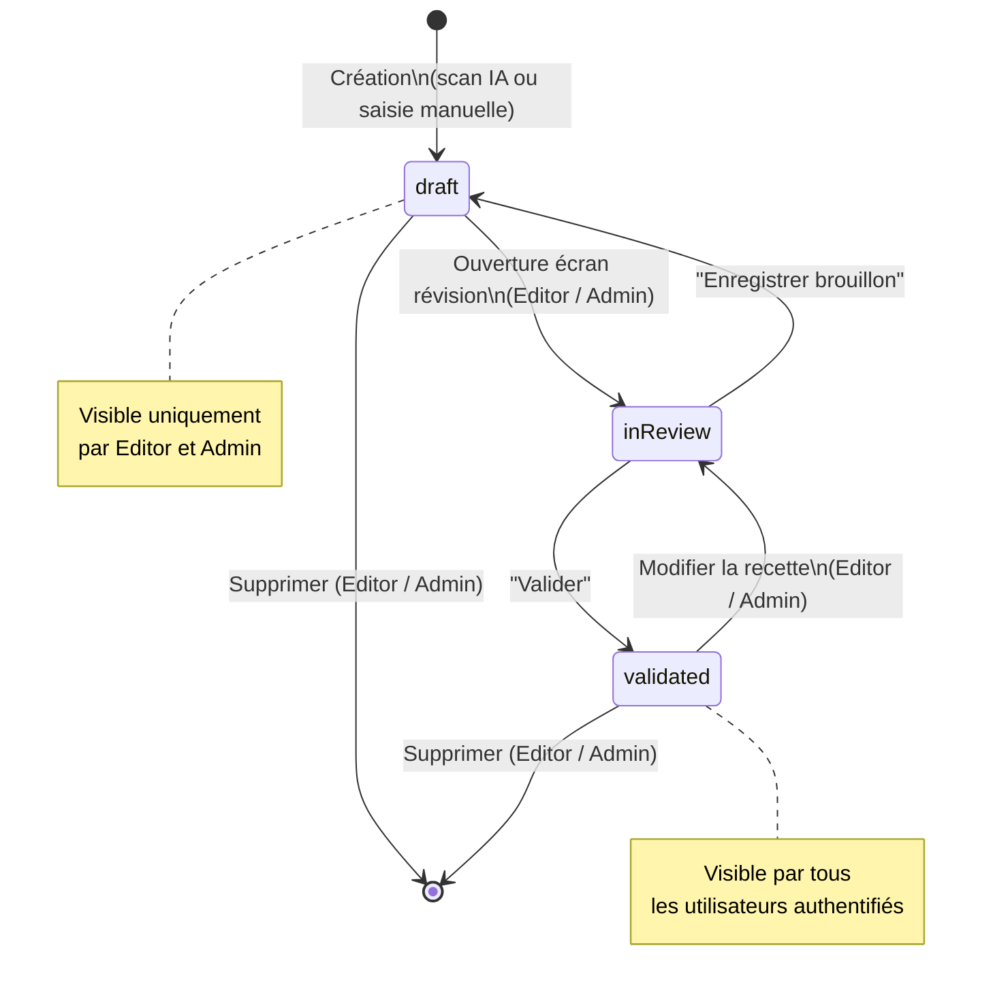
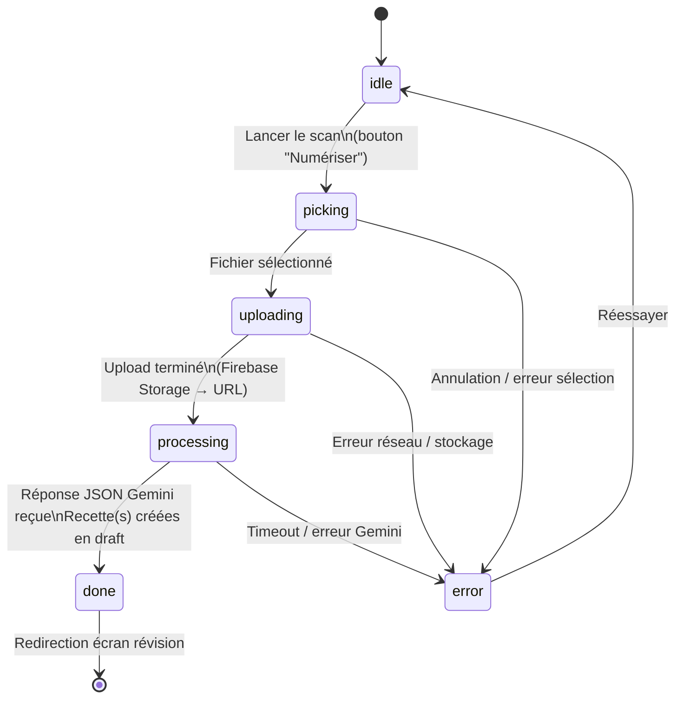
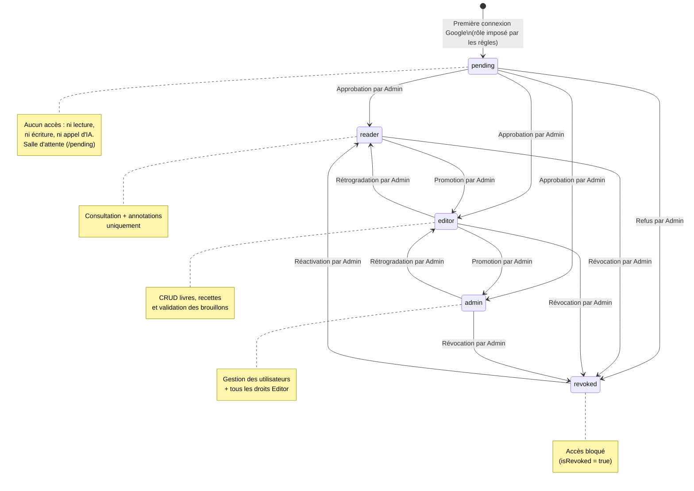
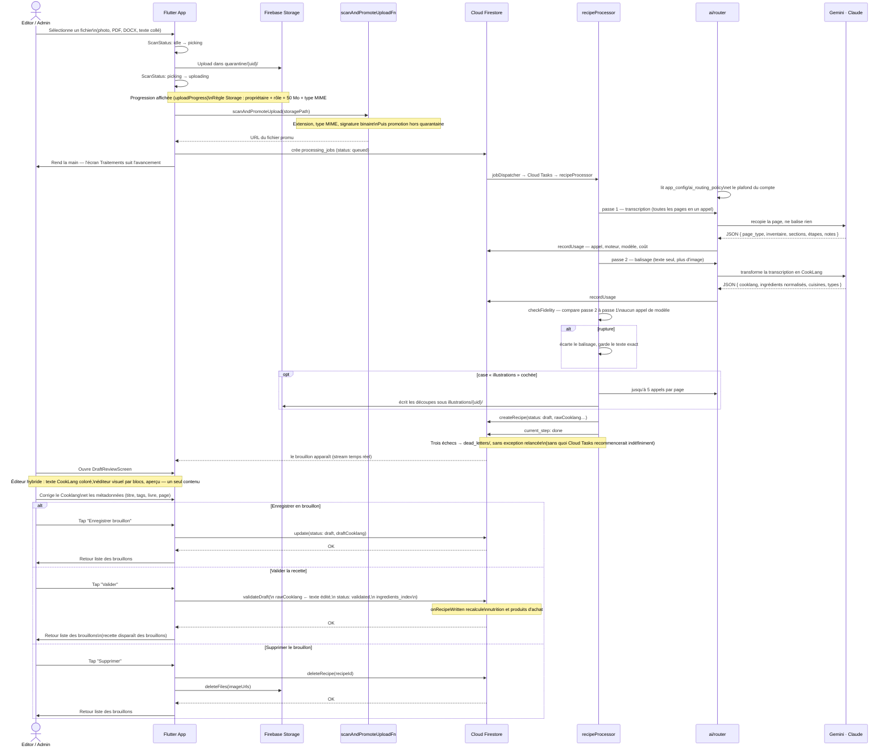

# Spécifications Fonctionnelles — Kass'dalle
## Livre de Cuisine Digital (Flutter + Firebase)

> Version : 2.3 — 19 août 2026

> **Ce document décrit l'état actuel de l'application.** Ce qui a changé d'une version à
> l'autre se lit dans [CHANGELOG.md](CHANGELOG.md), où 143 sections « Mise à jour
> release » ont été déplacées telles quelles.

## 1. Contexte et Objectif

**Kass'dalle** est une application privée à usage familial permettant de digitaliser une collection personnelle de livres de cuisine physiques et de notes d'ateliers culinaires (ex : Sasasa, recettes du terroir belge). L'application transforme des photos de pages de recettes en fiches numériques structurées, consultables et interactives, grâce à l'IA de reconnaissance visuelle (Gemini Vision) et au format de balisage Cooklang.

L'application est destinée à un cercle familial restreint :
- quelques personnes peuvent **modifier** et enrichir le contenu ;
- tous les membres authentifiés peuvent **consulter** et **annoter** les recettes ;
- un administrateur gère les accès.

---

## 2. Plateformes Cibles

| Plateforme | Usage principal | Particularités |
|---|---|---|
| **Android** | Scan, saisie, consultation | Accès caméra pour la capture des recettes, et import de fichier. **Seule cible mobile construite et distribuée** — l'APK est servi par le déploiement web |
| **iOS** | — | **Déclaré, jamais construit.** Le projet Xcode et l'entrée Firebase existent ; il manque `GoogleService-Info.plist`, le schéma d'URL de connexion Google, les deux descriptions d'usage caméra et photothèque, et le `Podfile`. Voir `TechnicalRequirements.md` § 12 |
| **Web** | Consultation, correction, gestion, **et scan** | La caméra fonctionne (`PlatformUtils.hasCameraSupport` vaut vrai sur le web), et l'import de fichier suit le même pipeline que sur Android. Attestation par reCAPTCHA Enterprise |
| **Desktop (Windows)** | Consultation, correction, gestion | Identique au Web ; fenêtre redimensionnable. macOS n'est pas construit. **App Check n'y fonctionne pas** : passer l'attestation en *exigé* prive le desktop de l'IA |

Les plateformes construites partagent le même backend Firebase et la même codebase Flutter. **Le scan n'est pas réservé au mobile** : la caméra fonctionne aussi sur le web par `getUserMedia`, et l'import de fichier est disponible partout.

**Ce qui change n'est pas la plateforme, c'est la largeur.** Toutes les routes — y compris l'administration complète — sont ouvertes sur mobile. La bascule se fait sur trois seuils (`PlatformUtils`) : navigation latérale ou barre basse à 800 px, présentation compacte du détail à 700 px, raccourci galerie à 900 px. Un navigateur de bureau rétréci passe donc en présentation compacte, et un mobile en paysage large peut recevoir la présentation étendue. Aucune fonctionnalité n'est réservée à un format : la présentation compacte réorganise, elle ne retire pas. Dépendent réellement de la plateforme, et d'elle seule : la caméra (mobile et web), la mise à jour par APK et le lien de téléchargement de l'APK (Android natif / grand écran), le partage du PDF (feuille de partage sur mobile, téléchargement dans le navigateur), les raccourcis clavier, sans effet là où il n'y a pas de clavier, et le pavé d'écriture au stylet (4.5), ouvert par un stylet posé sur un champ de texte libre — Android 14 et plus, et iPad. Une seule fonctionnalité dépend des deux à la fois, plateforme et largeur : le zoom du texte de la recette (4.4), proposé sur l'APK Android en présentation étendue — la tablette posée sur le plan de travail.

---

## 3. Authentification et Rôles

### 3.1 Connexion

L'authentification est exclusivement basée sur **Google Sign-In** (Firebase Auth). Aucune création de compte par email/mot de passe n'est prévue.

- À la première ouverture, l'utilisateur est invité à se connecter avec son compte Google.
- **Un compte neuf naît en attente (`pending`) et n'accède à rien.** Il voit une salle d'attente qui affiche son adresse et l'invite à la communiquer ; l'écran se referme de lui-même dès qu'un rôle lui est attribué.
- **Le rôle n'est jamais choisi par l'application.** Les règles Firestore imposent `pending` à la création, et seul un Admin le change ensuite.
- **Le compte fondateur** (`china.fred.75@gmail.com`) est le seul administrateur d'origine : le déclencheur serveur `enforceFounderRole` lui rend le rôle `admin` en vérifiant l'adresse du compte **Auth**, jamais celle écrite dans le document. Il rétablit aussi ce rôle s'il est rabaissé ou révoqué — un administrateur adoubé ne peut pas mettre dehors celui qui l'a nommé.

### 3.2 Rôles

| Rôle | Accès |
|---|---|
| **Admin** | Tout : gestion des utilisateurs, des rôles, des livres, des recettes, des annotations. Peut promouvoir d'autres utilisateurs en Admin ou Editor. |
| **Editor** | Création, modification et suppression de livres et de recettes. Validation des brouillons IA. Peut annoter. |
| **Reader** | Consultation, annotation, notation, planning, export PDF. **Crée, modifie et valide ses propres recettes** : `firestore.rules` autorise la création et la mise à jour par le créateur, quel que soit son rôle. Il ne touche ni aux livres, ni aux recettes d'autrui, ni à ce qui produit une image. |
| **Pending** | Rien. Ni livre, ni recette, ni référentiel, ni appel d'IA. C'est l'état par défaut d'un compte qui vient d'être créé. |

> Règle de sécurité clé : être connecté ne donne aucun accès. Tout ce qui est partagé — livres, recettes, annotations, référentiels, grille tarifaire — exige un compte **nommé et non révoqué** (`isApproved()` dans `firestore.rules`). La révocation vaut pour tous les rôles, Admin compris, côté règles comme côté Cloud Functions.

### 3.3 Gestion des utilisateurs (Admin)

Un écran dédié (Web / Desktop / Mobile) permet à l'Admin de :
- voir la liste des utilisateurs connectés au moins une fois, **les comptes en attente en tête**, précédés d'un bandeau qui les compte ;
- attribuer ou modifier un rôle (Pending → Reader, Reader → Editor, Editor → Admin) — l'attribution d'un premier rôle **est** l'approbation ;
- révoquer l'accès d'un utilisateur.

---

## 4. Parcours Utilisateur

### 4.1 Gestion d'un Livre

**Qui :** Editor ou Admin.

1. L'utilisateur crée un nouveau livre via un formulaire.
2. Il saisit :
   - Titre du livre
   - Auteur(s)
   - Année de publication (optionnel)
   - Langue principale des recettes (liste déroulante)
   - Tags/thèmes associés au livre (ex : Terroir belge, Pâtisserie)
3. Il peut scanner ou importer une photo de la couverture (mobile : caméra ou galerie ; web/desktop : import de fichier).
4. Le livre est enregistré et apparaît dans la bibliothèque.

Creation automatique via scan de couverture :
- L'utilisateur peut photographier ou importer la page de garde.
- L'IA extrait les champs structures du livre (titre, auteur, sous-titre, editeur, serie, annee, langue, ISBN, description, tags).
- Un brouillon livre est cree avec statut `draft`.
- L'utilisateur valide ensuite ce brouillon depuis l'ecran d'edition du livre via l'action "Valider le livre".

**Modification / Suppression :** accessible via le détail du livre. La suppression d'un livre demande une confirmation explicite car elle entraîne la dissociation des recettes liées (les recettes ne sont pas supprimées, elles deviennent "sans livre").

---

### 4.2 Capture d'une Recette (caméra : mobile et web — import de fichier : partout)

**Qui :** Editor ou Admin.

**Étape 1 — Sélection de la source**
- L'utilisateur sélectionne le livre source depuis la bibliothèque (ou crée un nouveau livre à la volée).
- Il indique optionnellement le numéro de page dans le livre.

**Étape 2 — Capture photo**
- L'utilisateur prend une ou plusieurs photos de la page de recette via la caméra intégrée.
- L'interface propose un outil de recadrage et de correction de perspective avant envoi.
- Il est possible d'ajouter plusieurs images pour une recette qui s'étale sur plusieurs pages.

Comportement asynchrone :
- Chaque import cree un job de traitement IA en file d'attente.
- L'utilisateur peut lancer un second scan pendant qu'un premier est encore en cours.
- Les brouillons generes apparaissent automatiquement a la fin de chaque job.

**Étape 3 — Traitement IA (pipeline asynchrone)**
- Les images sont déposées dans la **quarantaine** (`quarantine/{uid}/`), inspectées côté serveur — type MIME, signature binaire, taille — puis promues. Aucune image ne rejoint un dossier publié sans être passée par la modération.
- Le client crée un job dans `processing_jobs/` et n'attend rien : `jobDispatcher` le met en file Cloud Tasks, `recipeProcessor` déroule le pipeline.
- **Le moteur n'est pas figé dans le code** : chaque poste est routé vers Gemini ou Claude selon `app_config/ai_routing_policy`, modifiable depuis *Admin › Moteur d'IA* sans déploiement. Par défaut, Gemini.
- **Le texte est lu en deux passes, jamais en une.** Un seul appel qui transcrivait *et* restructurait perdait la transcription au profit de la mise en forme : ingrédients fusionnés, précisions déplacées, énumérations abrégées.
  - **Passe 1 — transcription.** Un appel rend le **type** de la page (`recipe`, `ingredient_note`, `technique`, `equipment`, `other`, `no_recipe`) et son contenu **recopié** en JSON : sections d'ingrédients ligne à ligne, sections d'étapes phrase par phrase, notes typées, chapeau de la recette. Aucune balise. Toutes les pages d'un même scan partent dans le **même** appel.
  - **Passe 2 — balisage.** Un second appel, sur du texte seul, produit le **Cooklang**, la liste normalisée (`nom`, `qte`, `unite`, `note`, `section`), les cuisines et les types de plat.
  - **Une recette écrite en prose garde sa liste d'ingrédients.** Certains livres n'en donnent pas : « faites revenir un oignon avec deux gousses d'ail » et rien d'autre. La passe 2 construit alors la liste depuis les étapes, et n'y met une quantité que si la phrase la donne. Si elle rend quand même une liste vide, le serveur la dérive du texte balisé avant d'enregistrer. Une recette sans liste n'a ni liste de courses, ni planification, ni nutrition.
  - **Contrôle de fidélité, sans appel supplémentaire.** Du code compare la passe 2 à la passe 1 — disparitions, fusions, titres de section raccourcis, précisions perdues. Une *rupture* écarte le balisage et conserve le texte exact, non balisé. Un *avertissement* laisse passer et s'affiche sur le brouillon.
- **La lecture d'une page ne se fait jamais par un OCR local.** Le choix est motivé dans `TechnicalRequirements.md` § 7 et § 8 : un OCR rend un flux de caractères sans structure, et il faudrait de toute façon un appel de modèle derrière pour la reconstruire.
- **Les illustrations coûtent jusqu'à cinq appels de plus par page**, et seulement si la case a été cochée à l'import.
- L'étape courante du job (`current_step`) est affichée dans l'écran *Traitements*. Un import complet prend de quelques dizaines de secondes à quelques minutes ; l'utilisateur peut en lancer un second pendant ce temps.
- Après trois échecs, le job part en `dead_letters/`, d'où un administrateur le relance depuis *Admin › File d'échecs*.

**Étape 4 — Écran de Révision (Split View)**
- L'éditeur (`HybridRecipeEditor`) offre **trois modes**, permutables par une barre de bascule :
  - **Texte** : champ monospace en CookLang brut, avec coloration syntaxique en direct.
  - **Visuel** : éditeur WYSIWYG par blocs, où ingrédients, ustensiles et minuteurs sont des pastilles cliquables.
  - **Aperçu** : le rendu de la recette tel qu'il sera lu.
- **Les trois modes partagent le même contrôleur de texte**, qui est la vérité. Basculer est instantané et ne perd rien : le mode visuel analyse le CookLang en blocs, chaque bloc garde sa ligne source, et la recomposition rejoint les lignes source telles quelles.
- Sur écran étroit, les modes s'empilent en onglets ; sur grand écran, l'aperçu peut rester à côté.
- Un bouton **"Voir l'original"** (icône scanner) est toujours présent dans la barre d'actions :
  - Si le fichier source est une image (jpg/png) : affiche une visionneuse plein écran zoomable.
  - Si le fichier est un PDF ou un DOCX : ouvre le document dans le navigateur ou le lecteur système.
  - Sur mobile (vue en onglets), un onglet dédié **"Original"** affiche l'image directement dans l'écran.
- Le document source est **lié à vie à la recette** : il ne peut jamais être dissocié ni supprimé tant que la recette existe.
- Il complète / corrige les métadonnées suggérées par Gemini : titre, tags, numéro de page.
- Deux actions disponibles :
  - **Enregistrer en brouillon** (`draft`) : la recette est sauvegardée mais pas marquée comme validée.
  - **Valider** : la recette passe au statut `validated`.

---

### 4.3 Saisie Manuelle d'une Recette (Web / Desktop / Mobile)

**Qui :** tout compte nommé. Un `reader` crée et valide ses propres recettes.

Pour les recettes sans photo source (recettes mémorisées, recettes tapées manuellement) :
- L'utilisateur accède à un formulaire de création de recette.
- Il saisit directement le contenu en Cooklang dans l'éditeur avec rendu split view.
- Les métadonnées sont saisies manuellement.
- Un bouton **"Mettre en forme avec l'IA"** permet de coller un texte brut (texte web, note, etc.) et de le convertir en CookLang. **Le texte collé emprunte exactement la même chaîne que la page scannée** : transcription, puis balisage, puis contrôle de fidélité. Seule l'entrée de la passe 1 diffère — du texte au lieu d'une image. Le passage par un appel unique perdait la liste d'ingrédients, qui se dissolvait dans les étapes.
- Le nombre de recettes trouvées dans le texte est rendu à l'écran : une seule est reprise, et l'utilisateur doit l'apprendre plutôt que de découvrir la seconde absente.
- **Le texte original collé est automatiquement conservé** : il est uploadé sur Firebase Storage et attaché à la recette comme fichier source. Le bouton de téléchargement de l'original apparaît ensuite dans l'en-tête de la recette, comme pour un scan.
- Si l'IA n'est pas utilisée (saisie CookLang directe), aucun fichier source n'est attaché.

---

### 4.4 Consultation d'une Recette

**Qui :** Tout utilisateur authentifié (Reader, Editor, Admin).

1. L'utilisateur navigue dans la bibliothèque (vue par livre ou vue globale).
2. La liste d'un livre ne porte ni filtre ni champ de recherche : chercher se fait depuis l'écran **Recherche** dédié (5.5).
3. Il clique sur une recette et accède à la fiche détaillée. **Sa présentation dépend de la largeur, pas de la plateforme** : au-dessus de 700 px (`PlatformUtils.compactDetailBreakpoint`), cinq onglets — *Préparer*, *Nutrition*, *Dressage*, *Communauté*, *Photos* ; en dessous, une page continue (`MobileUnifiedBody`) qui enchaîne les mêmes contenus sans onglets. La présentation compacte réorganise, elle ne retire rien.
   - **En-tête** : titre, livre source, page, langue, tags. Il reste hors onglets, comme la barre d'actions.
   - **Portions** : affichées sous forme de chip (ex : « 4 portions ») si renseignées dans les métadonnées CookLang (`>> portions: 4`). Ce champ est également stocké comme donnée structurée dans Firestore (`portions: int?`).
   - **Ingrédients** : liste structurée extraite du Cooklang, avec quantités et unités bien formatées. Chaque ingrédient est stocké dans Firestore sous forme d'objet `{ name, qty, unit }` (champ `ingredients`).
   - **Instructions** : étapes numérotées, avec mise en valeur des ingrédients et du matériel (rendu Cooklang interactif).
   - **Taille du texte** : sur l'APK Android en présentation étendue, deux boutons de la barre — réduire, agrandir — zooment l'onglet *Préparer* (ingrédients, étapes, puces) par paliers : 100, 125, 150, 175 et 200 %. Le zoom s'ajoute à la taille de police du système, il ne la remplace pas. Il est mémorisé sur l'appareil (`SharedPreferences`, clé `recipe_text_zoom`), pas dans le compte : il dépend de l'écran et de la distance de lecture, pas de la personne. Les autres onglets, la barre et les feuilles ouvertes depuis la fiche gardent leur taille.
   - **Document original** : bouton "Voir l'original" (icône scanner) toujours visible dans la barre d'actions. Ouvre l'image en plein écran zoomable ou le PDF dans le navigateur.
   - **Photos** : sur grand écran, un onglet **Photos** — placé après Communauté — montre les illustrations de la recette en grille, ouvre chacune en plein écran, et laisse un éditeur en ajouter ou en supprimer. Elles restent aussi visibles en vignettes dans le bandeau de l'onglet Préparer, et en vignettes sur mobile, qui n'a pas d'onglets.
   - **Annotations** : section en bas de fiche pour consulter et ajouter des notes personnelles.

---

### 4.5 Annotation d'une Recette

**Qui :** Tout utilisateur authentifié (Reader, Editor, Admin).

- Chaque recette dispose d'une section d'annotations visible en bas de la fiche.
- Un utilisateur peut ajouter une annotation de type :
  - `note`, affiché **« Remarque »** : observation personnelle
  - `tip`, affiché **« Astuce »** : conseil de préparation
  - `correction` : signalement d'une erreur dans la recette numérisée
- L'annotation affiche le nom de l'auteur et la date.
- Le dialogue d'annotation rappelle en tête la note chiffrée de l'utilisateur
  (« Ma note ») avec un raccourci vers le sélecteur 0–10. C'est un raccourci :
  la note reste stockée dans `recipe_ratings`, jamais dans l'annotation.
- Un utilisateur peut modifier ou supprimer **ses propres** annotations.
- Un Admin ou Editor peut supprimer n'importe quelle annotation.
- **Écriture au stylet** : un stylet posé sur le champ de l'annotation ouvre un pavé
  d'écriture — un grand champ, toute la largeur, tout l'espace au-dessus du clavier — où
  l'écriture manuscrite du système est convertie en texte ; *Terminé* le referme. Le champ du
  pavé et celui du dialogue sont le même texte. Le même pavé sert aux autres champs de texte
  libre : description d'un livre, contraintes du planning, instructions d'amélioration d'un
  brouillon, texte d'une image à générer, modification d'une recette générée, envie culinaire
  de la recherche. L'éditeur de recette n'en fait pas partie. Le pavé ne s'ouvre que là où le
  système convertit l'écriture : Android 14 et plus avec un clavier compatible, et iPad.
  Ailleurs, et sous le doigt, le champ reste un champ ordinaire.

---

## 5. Modules Fonctionnels

### 5.1 Module Bibliothèque (tous les clients)

- Vue en grille des livres avec couverture, titre, auteur et compteur de recettes.
- Si l'utilisateur appartient à un ou plusieurs groupes familiaux, la bibliothèque est divisée en sections :
  - **Mes livres** : tous les livres de l'utilisateur connecté (validés et brouillons).
  - **Livres de [Prénom]** : une section par membre du groupe, affichant uniquement ses livres validés.
- Chaque section dispose d'un toggle pour la masquer/afficher.
- **Rangement au glisser-déposer** : dans « Mes livres », maintenir une couverture puis la déposer
  sur une autre la met à sa place. L'emplacement visé s'éclaire pendant le déplacement, et la
  grille ne se réorganise qu'au lâcher — les voisines ne dansent pas sous le doigt. L'ordre est
  enregistré et retrouvé à la session suivante, sur tous les appareils. C'est un choix de **lecteur** : il ne modifie pas les livres, que toute la
  famille partage, et ne change donc rien à ce que voient les autres membres. Un livre créé après
  coup se range à la fin, un livre supprimé disparaît sans laisser de trou.
- Accès à la liste des recettes d'un livre.
- Vue globale "Toutes les recettes" (sans filtre de livre).

### 5.2 Module Scan (caméra : mobile et web — import de fichier : partout)

- Accès caméra natif sur mobile, `getUserMedia` sur le web ; l'import de fichier (photo, PDF, DOCX, texte collé) est disponible sur les quatre plateformes.
- **Sur mobile, toute prise de vue passe par le scanner du système.** Android expose
  ML Kit Document Scanner, iOS expose VisionKit : les deux cherchent les coins sur le flux vidéo,
  avec un modèle entraîné, et rendent une image déjà cadrée et redressée. Cela vaut pour les pages
  de recette et la couverture à l'import, et pour chaque bouton « Prendre une photo » ailleurs :
  relecture d'un brouillon, détail d'une recette, recette générée, formulaire de livre. L'appareil
  photo nu n'est plus ouvert que là où le scanner n'existe pas. La couverture scannée à l'import
  part directement en file, sans passer par l'atelier de retouche.
- **Sur le web, aucune de ces API n'existe.** L'atelier de retouche garde la main et propose un
  cadre calculé sur une seule prise. Il est annoncé pour ce qu'il est : « Cadre suggéré — vérifiez
  les coins et corrigez-les », ou « Aucun cadre reconnu — placez les quatre coins ». Un cadrage
  automatique qui a l'air d'un résultat, alors qu'il n'a rien trouvé, fait perdre plus de temps
  qu'un point de départ annoncé.
- Recadrage et correction de perspective avant envoi.
- **Mode multi-pages** : après sélection de la première image, l'utilisateur entre en mode "Pages en attente". Il peut ajouter d'autres pages (fichier ou caméra) avant de lancer l'analyse globale. Toutes les pages partent dans un **seul** appel multi-part, chez le moteur routé pour le poste.
- **Extraction automatique d'illustrations** : l'IA identifie les photographies culinaires **sur chaque page** du scan, les découpe, et les propose comme illustrations de la recette.
  - **Six étapes par page**, détaillées dans les diagrammes de séquence : pré-contrôle (la page porte-t-elle des images ?), cadrage, mise à plat par homographie, remise à l'endroit, repérage des zones, découpe. Le pré-contrôle arrête la chaîne sur une page sans photo — une page de recette sur deux — et les quatre appels suivants n'ont pas lieu.
  - **Une découpe est écrite directement sous `illustrations/{uid}/`, sans quarantaine ni Cloud Vision.** Le fichier source est déjà passé par le scan de sécurité à l'envoi, et la découpe est un JPEG produit par Sharp trois lignes plus haut. La modération garde son rôle sur les images qu'une personne **envoie** depuis l'application ; une découpe d'un scan déjà accepté n'en est pas une.
  - **Une panne d'extraction ne fait jamais échouer un import.** La chaîne journalise et rend une liste vide ; la recette est déjà transcrite quand elle s'exécute.
  - **Le compte affiché est celui de ce que la page porte, pas de ce qu'on en a tiré.** Le bandeau de relecture peut annoncer « trois photos repérées, à extraire à la main » alors que rien n'a été extrait.
  - **Quand une page porte plusieurs recettes, chacune reçoit sa propre copie des photos.** Elles se partageaient le même fichier : invisible tant que supprimer une illustration se contente d'oublier son adresse, mais le jour où l'on supprime vraiment le fichier, la première suppression viderait l'image de l'autre recette sans un mot. La modération, elle, n'a lieu qu'une fois — c'est la même image.
- **Progression affichée** : sous le titre d'un traitement, une rangée de petites icônes, une par
  étape. Les étapes faites sont colorées, les suivantes en gris. Une **seconde ligne** porte
  l'icône de l'étape en cours et son libellé complet : « Lecture de la page par l'IA… ». Les deux
  côte à côte sur une seule ligne faisaient trop de choses à lire d'un coup.
  - Les deux lignes sont posées **sous** la tuile, sur toute la largeur de la carte. Dans la
    colonne du sous-titre, elles n'avaient que la place laissée par les boutons de droite, et le
    libellé s'y coupait.
  - Le nombre d'étapes dépend du travail : **trois** pour une couverture de livre (envoi, lecture,
    écriture), **sept** pour une page de recette (envoi, lecture, analyse, photos, balisage,
    ingrédients, écriture). Les séquences viennent des branchements du pipeline serveur, pas d'une
    liste plausible : afficher sept étapes pour une couverture promettrait un travail qui n'a pas
    lieu.
  - La phrase complète s'affichait auparavant sous le titre. Sur un téléphone étroit, et dès que la
    police du système est agrandie, elle se coupait une lettre par ligne.

#### Barre d'une recette sur téléphone

Deux lignes. Le titre occupe la première, sur deux lignes de texte au besoin. Toutes les actions
occupent la seconde, en icônes : note, annotations, document source, retouche par l'IA, copie en
brouillon, changement de couverture, détachement du livre, modification, export PDF, suppression.

Il n'y a plus de menu « … ». Il cachait huit actions derrière un geste et un temps d'attente, et
privait le titre de la place dont il manquait.

### 5.3 Module Révision et Édition (tous les clients)

- Éditeur hybride à trois modes — texte CookLang coloré, éditeur visuel par blocs à pastilles, aperçu — partageant un seul contenu.
- Barre d'outils d'insertion : ingrédient, ustensile, minuteur, section, image, métadonnée.
- Page d'aide CookLang accessible depuis l'éditeur.
- Visualisation du scan original.
- Gestion des métadonnées (titre, tags, page, langue, statut).
- Edition directe des champs structures recette (portions, difficulte, temps, ingredients structures) en brouillon.
- Validation explicite des brouillons livre crees par IA.
- Sur Web / Desktop : accessible pour modifier des recettes existantes (pas de nouveau scan).
- **Le sous-titre d'un brouillon dit d'où il vient** — issu d'un scan, conçu par l'IA, saisi à la main, copie de travail — d'après ce que son créateur a écrit à la création. Un document antérieur à cette information n'est pas présenté comme un scan : sans fichier source ni recette source, l'écran dit que l'origine n'est pas renseignée.
- **Un brouillon conçu par l'IA pour le planning arrive avec sa liste d'ingrédients**, ses temps et ses parts, lus dans le texte CookLang à l'enregistrement. Un ancien brouillon enregistré sans liste la retrouve à l'ouverture, lue dans le même texte.

### 5.4 Module Traitements IA (tous les clients)

- Liste des traitements recents avec statut (`queued`, `processing`, `done`, `error`).
- **Une ligne porte le titre lu par l'IA dès que la page est transcrite**, à la place du nom du
  fichier scanné, qui reste accessible par « Voir le document ». Entre la lecture et
  l'enregistrement du brouillon, le balisage et la normalisation durent jusqu'à sept minutes ; un
  traitement en erreur après la lecture garde ainsi le nom de sa recette. Une page à plusieurs
  recettes les nomme toutes, un scan de couverture porte le titre du livre.
- **Une ligne de traitement se distingue d'un brouillon par sa couleur.** Tant que le traitement
  est en file ou en cours, sa ligne porte un fond teinté et un liseré à gauche dans la couleur
  secondaire, celle de sa puce et de son icône. En erreur ou rejeté, la couleur d'erreur. Un
  brouillon garde le fond de la liste.
- Indicateur de traitements actifs visible dans la zone Brouillons.
- Navigation directe vers les brouillons recettes ou le brouillon livre cree a la fin du traitement.
- **Vue Admin** : l'admin voit tous les traitements de tous les utilisateurs. Un filtre par utilisateur (dropdown) permet de restreindre l'affichage. Chaque tuile affiche le nom du propriétaire du traitement.

### 5.5 Module Recherche (tous les clients)

Écran dédié `/search`. **Ce n'est pas une recherche plein texte.** La bibliothèque
n'est pas interrogée par mots-clés : les recettes accessibles sont résumées, envoyées
au moteur, et c'est lui qui décide lesquelles répondent à la demande.

**Quatre portées**, en puces de choix — l'écran annonce ce que chacune déclenche :

| Portée | Ce qui part |
|---|---|
| **Tout** | la bibliothèque, trois idées d'IA et une ouverture web, en parallèle |
| **Bibliothèque** | uniquement les recettes accessibles |
| **IA** | trois propositions à comparer |
| **Web** | une requête Google optimisée, rien d'autre |

**Trois cases de périmètre**, hors portée *Web* : « Mes recettes », « Ma famille »,
« Mes brouillons ».

**La piste bibliothèque.** Chaque recette est résumée — identifiant, titre, livre,
vingt premiers ingrédients de l'index, thèmes, cuisines, difficulté, statut — et le
lot part dans un seul appel. Le moteur rend les identifiants retenus, **classés par
pertinence**, chacun avec sa **raison** en une phrase. Une raison affichée peut se
discuter ; un classement muet, non. Quand rien ne correspond, il rend une
**reformulation** plutôt qu'une liste vide.

**Les notes de l'utilisateur entrent dans la demande.** Les recettes qu'il a notées
partent avec leur note sur 10, et le prompt donne la clé de lecture : ≥ 8 aime
beaucoup, 5–7 apprécie, ≤ 4 n'aime pas. Quand un goût se dégage, le moteur le formule
dans `preference_insight`, affiché à part.

**La piste IA** produit **trois** propositions, chacune par un angle différent, en
parallèle. Chaque proposition porte son **libellé de variante** et sa
**justification**. Une proposition en double est **rejouée une fois**, en lui
interdisant les titres déjà rendus ; si le doublon persiste, elle est abandonnée
plutôt que répétée. Une proposition retenue s'enregistre en recette, qui rejoint
« Mes créations Kass'Dalle ».

**La piste web ne lit pas le web.** Elle demande au moteur une requête mieux
formulée, y ajoute le mot « recette », et rend un lien Google. L'utilisateur va
chercher lui-même. Rien n'est téléchargé, rien n'est analysé.

**Les listes de recettes ne filtrent pas.** Ni la bibliothèque, ni la liste d'un
livre, ni la vue « toutes les recettes » ne portent de champ de recherche ou de
filtre : chercher se fait ici.

**Ce qui est écarté du corpus** : les recettes d'un livre privé d'un autre membre.
Elles y remontaient, la recherche chargeant les recettes validées des membres sans
regarder le livre porteur.

---

### 5.6 Module Administration (Admin uniquement)

L'accueil d'administration range **treize entrées en cinq groupes**. Toutes sont
ouvertes sur mobile : rien n'est réservé au grand écran.

**Gestion**

- **Gestion des utilisateurs** : liste, attribution de rôle, révocation, nom préféré. Les comptes en attente sont mis en tête, sous un bandeau qui les compte — l'attribution d'un premier rôle *est* l'approbation.
- **Référentiels** : KPIs du référentiel nutrition, enrichissement des unités et des ingrédients, politique de calcul (seuils d'affichage, repli, priorité des sources), garnitures simples. Quatre écrans en dépendent : ingrédients, unités, politique, garnitures.
- **Backfills** : reprises ponctuelles sur l'existant — nutrition, confidentialité des recettes, sel des ingrédients, rattachement des recettes orphelines, semis des garnitures simples, rôle des recettes dans un repas. Toute écriture ponctuelle sur un ensemble de documents vit ici, avec une bannière de progression et un compte rendu chiffré ; l'écran d'un référentiel montre et corrige, il ne lance pas d'opération de masse.
- **Moteur d'IA** : quel moteur — Gemini ou Claude — sert quel poste, poste par poste, et le budget de réflexion de chacun. La politique vit dans Firestore : une bascule prend effet en moins d'une minute, sans déploiement.
- **Configurations de routage** : les sept réglages de cet écran s'enregistrent sous un nom, se rechargent, se renomment, se mettent à jour et se suppriment. Charger remplit le formulaire et affiche d'abord l'écart — combien de postes changent de moteur, lesquels changent de modèle — ; le routage ne bouge qu'à l'enregistrement. Le chargement est un remplacement : un poste que la configuration ne nomme pas repart au moteur par défaut. La configuration **« Haute performance »** est créée au premier affichage à partir du réglage déjà en place, pour qu'essayer autre chose ne le fasse pas perdre.
- **Modération des images** : journal de ce que la modération a laissé passer, refusé, mis en attente ou n'a pas pu juger ; décision humaine sur les images en attente ; relance des images sans verdict.
- **Attestation de l'application (App Check)** : trois modes — désactivé, observation, exigé. Le passage en *exigé* est refusé depuis un client non attesté, pour que l'interrupteur ne s'enferme pas lui-même.

**Comptabilité**

- **Coûts de l'application** : dépense d'IA par poste, par processus, par moteur et par compte, sur la période choisie ; coûts d'infrastructure GCP par service ; réconciliation mensuelle entre l'estimé et le facturé. Le tableau se trie par ses en-têtes et se filtre par le libellé du poste.
- **Dépense par utilisateur** : la même dépense vue par compte et par service. Le détail d'un compte se lit **par poste** ou **par processus** — dans ce second cas chaque processus porte le total de ses postes et se déplie d'un clic —, se trie par coût, par nombre d'appels ou par nom, et se filtre sur les trois libellés à la fois : compte, processus, poste. Un filtre qui ne retient qu'une partie des postes d'un processus déplie le groupe et n'y affiche que le total de ce qui reste. La période du tableau se choisit par les mêmes puces que les autres écrans — ce mois, 3, 6, 12 mois, depuis le début — plus **une journée précise** : elle vaut alors pour le tableau entier, comptes, processus et postes compris, et non plus pour les seules barres de plafond. Sur une journée, deux bornes horaires — depuis, jusqu'à — choisies en heure locale restreignent le tableau à une partie du jour, pour lire ce qu'un changement fait à la dépense sans attendre le lendemain ; les barres de plafond comptent toujours la journée entière. Une journée est lue sur la ligne d'appel, seule source qui porte l'heure ; si elle est trop chargée pour être lue en entier, l'écran dit que les montants affichés sont plus bas que la dépense réelle. S'y ajoutent les **plafonds quotidiens** — deux limites par compte et par jour, en euros et en nombre d'appels. La seconde protège pendant une panne de grille tarifaire, quand plus rien n'est chiffré. Une alerte mensuelle est vérifiée chaque matin. Les comptes s'affichent sous leur nom ; `system` — les appels lancés sans personne derrière, enrichissement du référentiel et tâches planifiées — se nomme « Tâches automatiques ». La journée regardée se choisit : flèches jour par jour, ou calendrier, sans jamais dépasser aujourd'hui. Sur une journée close, l'écran dit que les barres se rapportent au plafond en vigueur aujourd'hui, pas forcément celui qui s'appliquait alors.
- **Grille tarifaire** : le prix de chaque modèle, sur son propre écran. Elle vivait au bas de *Moteur d'IA*, après quarante-cinq postes, et rien n'annonçait sa présence. Sa place est à côté des montants qu'elle produit.

**Monitoring**

- **Rapports d'erreurs** : ce que le client Flutter a remonté — étape, type d'exception, message, pile tronquée, version de l'application, contexte.
- **Dead Letter Queue** : jobs d'import abandonnés après trois tentatives, avec leur motif — relance ou purge.
- **Journaux (Cloud Logging)** : explorateur filtré par sévérité, `correlationId`, `scanId`, `jobId`, `userId` ou texte libre. `DEBUG` est masqué par défaut. La lecture se fait à **trois niveaux**, chacun portant son coût, additionné depuis le niveau du dessous :
  1. **le scan** — photographier une page de livre déroule quatre traitements côté serveur (contrôle du fichier, import, détection d'illustrations page par page, nutrition et courses après écriture) ; ils tiennent sous un seul titre, avec le total de ce que ce scan a coûté ;
  2. **l'appel** — chaque appel de modèle, nommé par son poste et suivi de son montant ;
  3. **la ligne** — le prompt, la fin de l'appel, le texte rendu, et le détail complet.

  Un montant inconnu — grille tarifaire en panne au moment de l'appel — s'affiche « sans montant » et n'est jamais compté comme zéro. Sans taux de change du jour, les montants restent en dollars.

**Laboratoire**

- **Bac à sable** : expériences réservées à l'administrateur. Rien de ce qui y vit n'est promis à l'utilisateur et une expérience peut disparaître d'une version à l'autre ; le module ne fait partie d'aucune release.

**Outils**

- **Télécharger l'APK Android** : le paquet servi par le même déploiement Firebase Hosting.

### 5.6 bis Mise à jour de l'application Android

L'application n'est pas distribuée par le Play Store. Elle se met à jour elle-même.

Au lancement, elle compare sa version à celle de l'APK publié. Si le serveur est plus
récent, une fenêtre annonce la version disponible et le poids du téléchargement.

Le parcours se déroule sans quitter l'application :

1. **Autorisation** — au premier passage, Android demande l'accord d'installer des
   applications inconnues. La fenêtre ouvre le réglage, l'utilisateur revient et poursuit.
   L'autorisation est demandée avant le téléchargement : refuser après quatre-vingt-dix
   mégaoctets transférés les perdrait.
2. **Téléchargement** — barre de progression, poids reçu sur poids total, bouton d'annulation
   qui arrête le transfert et efface le fichier.
3. **Installation** — l'écran de confirmation du système s'ouvre. Il reste obligatoire :
   aucune installation silencieuse n'existe hors magasin.

Quand l'installation directe échoue, la fenêtre propose le téléchargement par le navigateur.
« Plus tard » ferme la fenêtre ; elle reviendra au prochain lancement tant que la mise à jour
n'est pas installée.

Une version publiée sans son APK — un déploiement web seul — n'est jamais annoncée aux
téléphones : ils continuent de voir la dernière version réellement téléchargeable.

Ce parcours n'existe que sur l'application Android native. Le web se met à jour au
rechargement. iOS n'autorise aucune installation hors App Store.

### 5.7 Module Groupes Familiaux (tous les clients)

- Un utilisateur peut créer un ou plusieurs groupes familiaux (avec un nom libre).
- Le créateur est propriétaire du groupe. Il peut renommer ou supprimer le groupe.
- Invitation de membres : recherche d'utilisateurs par nom ou email (parmi les comptes existants). Ajout en un clic.
- Retrait de membres : le propriétaire peut retirer n'importe quel membre. Un non-propriétaire peut quitter le groupe.
- Accès depuis le menu compte (icône en haut à droite) → "Groupes familiaux".
- Une fois membre d'un groupe, les livres et recettes validés des autres membres deviennent visibles dans la bibliothèque et les recettes libres, organisés par sections.

#### Ce qu'un groupe partage, et ce qu'il ne partage pas

**Tout est partagé, sauf ce qui est privé.** Un livre scanné, un livre saisi à la
main et « Mes créations Kass'Dalle » suivent exactement le même chemin : validé et
non privé, il est visible des membres de mes groupes. L'origine du livre n'entre
pas dans le calcul.

**Un livre se rend privé depuis son formulaire**, à la création comme à la
modification : un interrupteur « Livre privé ». Le créateur en devient alors le
seul lecteur. Le basculement annonce ce qu'il emporte — « les 34 recettes de ce
livre disparaîtront de la bibliothèque, de la recherche et du planning des membres
de vos groupes » — parce qu'une case cochée qui retire trente recettes à quatre
personnes doit se mesurer avant, pas après. Un cadenas marque la vignette dans la
bibliothèque.

**« Mes Recettes Secrètes » est le seul livre dont l'interrupteur est verrouillé.**
C'est le refuge : s'il peut redevenir public d'une case décochée, il cesse d'en
être un. Les deux autres livres système basculent librement.

**La confidentialité vaut partout, pas seulement dans la bibliothèque.** Les
recettes d'un livre privé sont écartées de la recherche familiale et du générateur
de menus. Elles y remontaient : ces deux écrans chargeaient les recettes validées
des membres sans jamais regarder le livre porteur, et proposaient donc les recettes
secrètes des autres — la recherche dans son corpus, le planning jusque dans les
menus qu'il composait.

**Il n'existe pas de partage nominatif.** Un livre est partagé avec les membres de
ses groupes, ou privé. Il n'y a pas de troisième état.

**Ce que la confidentialité ne couvre pas encore** : les images. Un scan, une
illustration ou une couverture reste lisible par tout compte de la famille qui en
possède l'adresse. Ces adresses portent un jeton qui ne se devine pas, et un livre
devenu privé n'apparaît plus sur aucun écran d'où les découvrir — mais une adresse
déjà transmise continue de fonctionner.

### 5.8 Module Planning des Repas (tous les clients)

- Écran dédié "Planning des repas" accessible depuis la navigation principale (5e entrée, icône calendrier).
- **Deux onglets, deux lectures des mêmes repas** : *Liste* — l'affichage chronologique groupé par journée — et *Calendrier* — la grille du mois.
- **Onglet Calendrier** : une **bande de trois mois** occupant le tiers haut de l'écran — le mois courant au centre, le précédent et le suivant à ses côtés en plus petit. Les jours porteurs de repas sont surlignés, chacun montrant une pastille par repas ; un appui ouvre l'agenda du jour, **en bas**, avec les mêmes actions que dans la liste. Trois pastilles au plus par case, le surplus est annoncé par un « +n ».
- **La bande ne déborde jamais de la hauteur qu'on lui donne** : la taille d'une case se déduit de la hauteur reçue *et* de la largeur restante, jamais d'une seule des deux. Une grille qui prend toute la largeur disponible produit des cases de deux cents pixels — un mois qui ne tient plus dans l'écran n'est plus un calendrier.
- Sur un écran trop étroit pour trois mois entiers, seul le mois central s'affiche : un mois tronqué se lit moins bien que pas de mois du tout, et les flèches suffisent à y aller.
- Les pastilles se lisent dans des champs stockés, jamais dans une règle rejouée : pleine pour un repas avec recette, pâle pour un créneau vide, creuse pour un **jour de préparation** — ce jour-là on cuisine, même si l'on ne sert rien.
- La navigation vers le passé s'arrête là où s'arrête l'historique chargé (quatre-vingt-dix jours) : un mois vide faute de chargement ressemblerait à un mois sans repas.
- **La liste se lit semaine par semaine** : une barre de puces au-dessus, une par semaine de planning — sept jours à partir du jour de démarrage du cycle —, la semaine en cours sélectionnée à l'ouverture, les semaines passées en retrait, et une puce « Tout » qui rend la lecture continue d'avant, groupée par journée. Sur grand écran, deux flèches avancent ou reculent d'une semaine, au-delà des repas existants s'il le faut, pour planifier la semaine prochaine. Les sept jours s'affichent, jours vides compris : un jour libre à venir propose de choisir une recette, posée à l'heure de ce jour de semaine et pour les parts prévues ce jour-là.
- Chaque entrée affiche l'heure (cliquable pour modifier), le titre de la recette et la durée totale.
- Navigation directe vers la fiche recette en appuyant sur un repas.
- Menu contextuel sur chaque repas : "Changer la recette", "Vider le créneau", "Supprimer".
- **Le sélecteur de recette ne propose que des plats** : les pages de type technique, matériel ou note d'ingrédient en sont écartées, du sélecteur comme du corpus envoyé à l'IA. Une icône de filtre en bout de recherche ouvre deux groupes de puces — type de plat, cuisine — lus dans les étiquettes du corpus lui-même, avec le nombre de recettes derrière chacune ; on peut en cocher plusieurs, et les filtres actifs se retirent d'un appui sous la recherche. Le même sélecteur sert au planning et à la composition d'un cycle.
- **« Générer avec l'IA » suit « Saisir un nom libre » dans le sélecteur du planning** : une consigne écrite — « un plat léger sans viande, prêt en 30 min » —, et l'IA rend trois idées de repas, chacune avec une phrase et des durées estimées ; ce qui est tapé dans la recherche sert de première consigne. On retouche la consigne et on relance pour en avoir trois autres : les idées déjà affichées ne reviennent pas. **Appuyer sur une idée rédige sa recette**, comme « Conception IA » de Nouveau planning, et l'enregistre **validée** dans « Mes créations Kass'Dalle ✨ » ; le repas pointe vers elle, la fiche s'ouvre d'un appui, les ingrédients entrent dans les courses. Les préférences générales et les contraintes du jour cadrent la rédaction. Deux postes : « Idées de repas (planning) » par consigne ou relance, « Concept de recette (planning) » par idée retenue.
- **Une recette écartée d'un repas ne revient pas** : « Changer la recette », « Vider le créneau » et une nouvelle suggestion retiennent la recette remplacée, et l'IA ne la repropose plus pour ce repas. Pendant la composition d'un cycle, choisir ou demander une autre recette sur un créneau écarte de même celle en place, et ces écarts suivent le repas à la validation. Quand tout le corpus a été écarté, l'écran le dit au lieu de proposer à nouveau. Le sélecteur manuel masque les recettes écartées derrière une puce « Écartées » qu'on peut déplier, et « Tout regénérer » écarte de même tout ce qui était en place.
- Bouton d'export vers Google Calendar sur chaque repas, **sous la même icône partout** : liste, barre de l'écran, menus, créneaux du nouveau planning, feuille de planification. Elle reste distincte de l'icône de l'onglet Calendrier, qui sert à voir. La liste se prolonge sous le bouton « Nouveau planning », pour atteindre l'export du dernier repas.
- Export global vers Google Calendar (tous les repas du planning courant en un clic).
- **Chaque événement porte, en première ligne de sa description, le lien direct vers sa recette** : il ouvre la fiche dans le client web, pour les parts prévues au planning et, si le plat se cuisine à l'avance, avec le couple de dates qui fait parler la fiche de conservation. Ouvert sans session, le lien passe par la page de connexion puis atterrit sur la recette demandée, et non sur l'accueil. La planification depuis une fiche recette y ajoute, comme avant, les temps et la liste des ingrédients.
- Suppression d'un repas avec dialogue de confirmation.
- Affichage atténué des repas passés.
- Alimentation en temps réel via un stream Firestore.
- **Batch planning** : bouton "Nouveau planning" pour générer un cycle complet de repas, avec suggestion IA ou assignation manuelle par créneau.
  - Sur **grand écran**, la demande de suggestions est un bouton nommé — *Planifier avec l'IA*, qui annonce le nombre de créneaux vides — posé juste au-dessus de *Valider le planning*. Sur **mobile**, elle reste une icône dans la barre de titre, faute de place. Les deux ouvrent le même menu : compléter les créneaux vides, ou tout regénérer.
  - **La question « où chercher des recettes ? » est posée dans les deux cas**, pour le cycle entier comme pour un créneau isolé : mes recettes validées, mes brouillons, celles de la famille, et faut-il inventer quand rien ne convient. C'est le même choix, donc la même feuille.
  - **Reprendre une semaine passée** : une icône d'historique dans la barre de titre ouvre la liste des semaines qui portent des repas — chacune avec ses plats — et la semaine choisie remplit les créneaux vides, jour de semaine pour jour de semaine, sans appel à l'IA. Un créneau déjà rempli reste tel quel, une recette déjà posée dans le cycle n'est pas reposée, une recette disparue est comptée et dite. Les semaines que recouvre le cycle en composition ne sont pas proposées.
- **Fenêtre de variété** : un plat servi dans les N semaines qui précèdent le cycle n'est pas reproposé, N de 0 à 4 dans les préférences (2 par défaut, 0 désactive). Elle vaut pour le cycle entier, pour un créneau isolé et pour « Changer la recette » dans le planning. Le retrait se fait **avant** l'appel, dans la liste des candidats, tant qu'il reste au moins autant de recettes que de créneaux à remplir ; au-delà, les plats récents restent proposables et l'IA est priée de ne les prendre qu'en dernier recours. L'IA reçoit aussi les derniers repas servis, pour enchaîner sans répéter la protéine ni le féculent de la veille. Le message de fin dit combien de plats récents ont été écartés.
- **Configuration des préférences** : accès depuis l'icône engrenage — nombre de repas par cycle, jour de démarrage, heure par défaut, fenêtre de variété, contraintes quotidiennes et globales en langage naturel, choix du calendrier Google cible.
- **Garnitures simples** : riz, pâtes, salade verte, yaourt — ce qui accompagne un plat sans avoir de recette, avec la part par personne (125 g de pâtes sèches, 70 g de riz cru, un yaourt). Un **référentiel de base** est tenu par un administrateur dans *Admin › Référentiels › Garnitures simples* : une liste de vingt-cinq entrées se sème depuis *Admin › Backfills* (« Semer les garnitures simples ») sans jamais écraser une valeur corrigée, et une garniture désactivée n'est plus proposée à personne. Chacun en tient **sa copie** dans *Préférences › Mes garnitures* : une quantité à sa main, une garniture masquée, une garniture à soi — rien de tout cela ne change quoi que ce soit pour les autres membres, et une correction du référentiel continue de s'appliquer à ce qu'on n'a pas retouché. Ce référentiel prépare la composition d'un repas — un plat et son accompagnement — et la liste de courses qui en découle.
- **Rôle d'une recette dans un repas** : chaque recette porte, une fois classée, son rôle — plat, accompagnement, entrée, dessert ou snack —, ce qu'elle apporte déjà (protéine, féculent, légume) et, pour un plat à qui il manque l'un des deux derniers, deux ou trois accompagnements classiques. Le modèle le reconnaît une seule fois : à l'import (même passe que le balisage), au bouton « Suggérer les tags » de l'éditeur, ou par la reprise *Admin › Backfills › Rôle des recettes dans un repas* pour l'existant, quarante recettes par passage. C'est ce que le planning lit pour composer un plat et son accompagnement. Une recette « pas sûre » reste sans rôle plutôt que mal classée, et la reprise repasse dessus. **Le rôle se voit et se corrige** : la fiche l'affiche dans sa section Catégorisation (« Rôle dans un repas : Plat »), et le panneau de métadonnées — relecture d'un import, correction d'une recette, création à la main — le propose dans une liste à cinq valeurs ; « Non classé » le retire, et la reprise le redemandera au modèle.
- **Un repas, c'est un plat et son accompagnement.** Quand le plat choisi n'apporte pas de féculent ou de légume, le **programme** lui pose un accompagnement — jamais le modèle au moment du planning : d'abord parmi les accompagnements classiques du plat (« blanquette » suggère riz, pommes vapeur), en préférant une recette d'accompagnement du corpus quand elle existe (les frites maison plutôt que les frites surgelées), sinon une garniture de la famille qui manque, par rang. Le même accompagnement ne revient pas deux jours de suite quand un autre est possible, ni deux fois dans le cycle tant qu'il en reste. Chaque créneau de « Nouveau planning » montre son accompagnement, la raison en infobulle, et permet de le changer ou de le retirer d'un appui — un choix fait à la main n'est plus recalculé tant que le plat ne change pas. « Changer la recette » et « Suggestion IA » dans le planning, et la pose d'une recette sur un jour libre, recomposent l'accompagnement de la même façon. Une garniture est **figée** dans le repas — nom, part par personne, produit de courses — : le repas dit ce qu'on a décidé ce jour-là, même si le référentiel change ensuite. Un plat complet, une entrée, un dessert, une recette non classée ne reçoivent rien.
- **Le format du repas se règle par jour de la semaine, et se corrige par créneau.** Plat seul (le défaut), plat et dessert, entrée et plat, entrée, plat et dessert, ou repas léger (entrée, snack ou petit plat, sans dessert). Le réglage vit dans les préférences, sous chaque jour, à côté de l'heure et des parts ; un jour qui n'en a pas suit le plat seul et ne stocke rien. Dans le nouveau planning, chaque créneau peut prendre un autre format, le temps du cycle. Quand le format le demande, l'entrée et le dessert viennent **du même appel** que le plat — parmi les recettes classées entrée ou dessert, une fois chacune dans le cycle — et se changent ou se retirent depuis le créneau, comme l'accompagnement. Un mot « dessert » dans une contrainte en langage naturel n'ouvre plus un créneau de dessert : seul le format compte.
- **Chaque jour de la semaine peut porter sa propre heure de repas**, à côté du temps de préparation et des parts. Un jour qui n'en a pas suit l'heure par défaut, et ne stocke rien. **Changer l'heure par défaut ramène tous les jours à elle** — l'écran annonce combien de jours personnalisés seront remis à l'heure avant de le faire.

### 5.9 Module Nutrition (tous les clients)

- Valeurs nutritionnelles calculées à partir des ingrédients de la recette, d'un référentiel partagé (`nutrition_ingredients`, `nutrition_units`) et de l'IA quand le référentiel ne sait pas.
- **Les valeurs affichées sont dérivées, jamais stockées pour un lecteur** : les calories par portion valent le total divisé par le nombre de parts choisi. Changer ce nombre ne touche pas la recette partagée.
- Un ingrédient que le référentiel ignore est estimé plutôt qu'ignoré : une approximation signalée vaut mieux qu'un ingrédient qui disparaît du calcul.
- **Un assaisonnement sans quantité se pèse à la pincée.** « sel, poivre » en fin de liste n'écrit ni nombre ni unité, et « une pincée de sel » s'écrit le plus souvent « sel, pincée ». Ces lignes sortaient du calcul entier — deux « ? » et une couverture partielle pour un demi-gramme sans calories. Épices, herbes séchées et mélanges secs sont désormais comptés pour une pincée ; les herbes fraîches en bouquet, non, un bouquet pesant trente grammes. Une pastille le dit sur la ligne concernée.
- **Le sel affiché était deux fois trop élevé, sur toute l'application.** Le sel et le sodium d'un ingrédient décrivent la même chose dans deux unités ; ils étaient additionnés au lieu d'être réconciliés. Le sel de table valait 200 g pour 100 g, une portion d'ailes de poulet annonçait deux jours d'apport recommandé. Corrigé — le sodium fait foi —, et les profils déjà écrits se réparent depuis *Admin › Backfills*, « Reprendre le sel des ingrédients ».
- **Un zéro n'est plus écrit « - ».** Le référentiel n'enregistre pas les valeurs nulles ; l'écran traduisait leur absence par un tiret, qui se lit « on ne sait pas ». Le sel affichait ainsi sept inconnues pour sept zéros certains. Le tiret ne reste que là où aucun profil n'existe.
- La politique de calcul — seuils d'affichage, priorité des sources, repli — se règle depuis l'administration.

### 5.10 Module Liste de courses (tous les clients)

- Construite depuis les repas **à venir** du planning : une liste qui reprend les courses de repas déjà mangés ne sert à rien.
- Elle connaît les brouillons et les recettes des autres membres du groupe, pas seulement les recettes validées de l'utilisateur.
- **Les accompagnements comptent** : une garniture (riz, salade verte) entre pour sa part par personne multipliée par les parts du repas, sous son produit de courses — la purée s'achète en pommes de terre —, et se fond dans la ligne d'une recette qui demande le même produit ; une recette d'accompagnement entre avec ses ingrédients, à l'échelle du repas. Chaque ligne dit d'où elle vient.
- Les ingrédients sont fusionnés en produits d'achat et rangés par rayon.
- **Envoi vers Google Tasks** : les rayons deviennent des tâches, les articles des sous-tâches cochables. Seuls les articles non cochés partent.

### 5.11 Module Modération des images (tous les clients — revue réservée à l'Admin)

- **Toute image passe par la quarantaine**, puis par Cloud Vision, avant d'être publiée. Les quatre portes qui publiaient en direct — couverture de livre, illustration de recette, illustration de brouillon, couverture de recette libre — sont fermées en écriture côté Storage.
- **Deux exceptions assumées, toutes deux côté serveur.** Les illustrations découpées dans un scan par le pipeline d'import et les images produites par l'IA (illustration de recette, visuel de dressage) sont écrites en direct sous `illustrations/{uid}/`, avec les droits de l'Admin SDK. Pour les premières, le fichier source est déjà passé par le scan de sécurité à l'envoi et la découpe est un JPEG que le serveur vient d'encoder ; pour les secondes, aucune personne n'a choisi l'image. Ce qui reste modéré, c'est tout ce qu'une personne **envoie** depuis l'application.
- Trois issues : **approuvée** (le cas courant, quelques secondes), **refusée** (jamais publiée, motif annoncé, image conservée pour un administrateur), **à revoir** (attend une décision humaine).
- Le contexte culinaire l'emporte sur la violence ; le contenu sexuel explicite ne bénéficie d'aucun contexte.
- **Pas de repli** : moteur injoignable, l'image attend et l'écran le dit. Publier par défaut modérerait pour rien ; refuser par défaut accuserait à tort.
- La revue vit dans *Admin › Modération*, et montre aussi bien ce qui est passé que ce qui a été bloqué.

### 5.12 Module Export PDF (tous les clients)

- Export d'une recette en PDF mis en forme, avec ses photos, ses badges et ses minuteurs.
- Sur mobile, le PDF part dans la feuille de partage du système ; sur web et desktop, il se télécharge.
- **Un dialogue demande ce que le document emporte en plus de la méthode** : les
  photos, les remarques, les astuces, les corrections, les valeurs
  nutritionnelles, et sous elles le détail par ingrédient. Chaque réglage est
  mémorisé d'un export à l'autre.
- **Le dialogue ne propose que ce qui existe.** Une recette sans astuce n'affiche
  pas la case correspondante ; une recette sans rien de plus n'ouvre aucun
  dialogue. Le détail par ingrédient est subordonné aux valeurs
  nutritionnelles : décochées, il ne part pas.
- Les valeurs nutritionnelles imprimées reprennent l'onglet Nutrition : par
  portion (pour les parts affichées), recette entière, pour 100 g quand le
  calcul est complet, couverture, fiabilité et avertissements. Le détail par
  ingrédient reprend le tableau des apports, lignes hors total et huile
  absorbée comprises, avec sa légende.
- Le détail par ingrédient part **décoché par défaut** : c'est un tableau de
  diagnostic, pas une fiche de cuisine.

---

## 6. Règles Métier

| Règle | Détail |
|---|---|
| Accès conditionnel | Toute consultation requiert une authentification Google active. |
| Accès conditionnel (2) | Un compte connecté mais non nommé (`pending`) n'accède à rien. L'approbation est le geste par lequel un Admin lui donne son premier rôle. |
| Premier admin | Le compte **fondateur** — l'adresse `china.fred.75@gmail.com`, vérifiée sur le compte Auth par le déclencheur `enforceFounderRole` — est administrateur, et le reste. Tous les autres administrateurs procèdent d'une nomination. La règle précédente (« le premier UID enregistré reçoit `admin` ») était appliquée **par le client** : elle laissait n'importe qui créer son document avec `role: "admin"`. |
| Autorité sur le fondateur | Seul le fondateur peut modifier son propre rôle ou sa révocation, et son compte ne peut pas être supprimé. Sans cette réserve, un administrateur adoubé pouvait destituer celui qui l'avait nommé. |
| Conservation du scan | L'image ou le fichier source (PDF/image) est toujours conservé dans Firebase Storage et lié à vie à la recette (`sourceFileUrl`). Il ne peut pas être supprimé tant que la recette existe. |
| Brouillons visibles | Les recettes en statut `draft` sont visibles uniquement par leur propriétaire (si Editor/Admin). Les brouillons d'un groupe sont visibles en lecture seule via le toggle 👥 dans l'écran Brouillons. |
| Isolation des données | Chaque utilisateur possède ses propres livres et recettes (champ `created_by`). La visibilité cross-utilisateur est contrôlée exclusivement par l'appartenance aux groupes familiaux. |
| Validation exclusive | Seul le propriétaire d'un brouillon peut le valider ou le supprimer. Cette règle est enforced à la fois dans l'UI (boutons masqués) et dans le dépôt (vérification Firestore avant écriture). |
| Copie cross-utilisateur | Tout membre d'un groupe peut copier une recette ou un brouillon d'un autre membre. La copie d'une recette validée hérite du statut `validated`. La copie d'un brouillon crée un brouillon indépendant (`draft`). Dans les deux cas la copie n'hérite pas des images. |
| Annotations non modifiables par autrui | Un Reader ne peut modifier/supprimer que ses propres annotations. |
| Multi-pages | Une recette peut avoir plusieurs images sources (scan multi-pages). |
| Toute recette a un livre | Il n'y a plus de recette orpheline : sans choix, elle rejoint « Mes recettes libres » ; conçue par l'IA, elle rejoint « Mes créations Kass'Dalle ». La règle est posée à l'entonnoir de création, pas dans un écran. |
| Les livres système ne se suppriment pas | « Mes recettes libres », « Mes créations Kass'Dalle » et « Mes recettes secrètes » se **renomment** — c'est leur tag interne qui les identifie, pas leur titre — mais ne se suppriment ni depuis l'écran, ni depuis le code, ni depuis les Security Rules. Ce sont les destinations par défaut : les perdre laisserait la règle ci-dessus sans issue. |
| Deux icônes, deux sens | Le **robot** marque ce qu'une machine a produit — une raison de recherche, une valeur estimée, une recette conçue, le pourquoi d'un repas. Les **étoiles** et la **baguette** sont des verbes : générer, suggérer, affiner. Les confondre laisse l'utilisateur devant une étoile sans savoir si elle annonce un bouton ou un constat. |
| Une contrainte d'ensemble se donne à chaque appel | L'IA conçoit les plats **un créneau à la fois**. Une consigne qui porte sur la semaine — la variété — n'a de sens que si chaque appel voit ce que les autres ont déjà produit. Sept appels indépendants respectant chacun « fais varier » rendent sept fois le même réflexe. |
| Adapter ne modifie jamais l'originale | Une recette est un document partagé : plusieurs membres la lisent et la cuisinent en même temps, chacun pour un nombre de parts différent. Redimensionner se fait sur une **dérivée** (rien de stocké, tout recalculé à l'affichage), à défaut sur une **copie attachée** à son porteur, jamais dans le document commun. Un état propre à une personne — parts choisies, liste de courses — vit sous `users/{uid}/…`. Le symptôme d'une violation est silencieux : chacun écrase le résultat de l'autre, sans erreur. |
| Aucune image *envoyée* n'est publiée sans modération | Les dossiers publiés sont fermés en écriture aux **clients** côté Storage. La seule porte ouverte à un client est la quarantaine, suivie d'un verdict ; une image sans verdict attend, ni publiée ni refusée. Le serveur écrit en direct dans deux cas nommés en 5.11 — découpes d'un scan déjà accepté, images produites par l'IA. |
| Pas de repli sur une valeur plausible | Grille tarifaire illisible, taux de change absent : on affiche la panne ou l'unité d'origine, jamais une constante figée dans le code. Un coût manquant se voit ; un coût faux ne se voit pas. Les appels passés pendant une panne de grille sont enregistrés **sans montant**, comptés à part. |
| Plafond de dépense par compte | Deux limites par compte et par jour, en euros **et** en nombre d'appels — la seconde protège pendant une panne de grille, quand plus rien n'est chiffré. Le refus arrive avant la dépense ; un import coupé par le plafond part directement en dead letter, sans réessayer. |
| Aucun catch silencieux | Toute erreur est journalisée — `logError` côté Functions, `ErrorReportService` côté Flutter — y compris quand le code retourne ensuite un résultat dégradé. C'est la règle la plus stricte du projet, et la CI la fait respecter. |

---

## 7. Périmètre — ce qui est livré, ce qui reste

### Livré
- Authentification Google, sas d'entrée `pending`, rôles et révocation
- CRUD livres et recettes, groupes familiaux
- Import (photo, PDF, DOCX, texte collé) → CookLang, par un pipeline asynchrone
- Écran de révision split view, rendu interactif CookLang, mode lecture livre
- Recherche assistée par IA — bibliothèque, propositions, requête web — annotations, notes personnelles
- Planning des repas + intégration Google Calendar, conseils de conservation
- Liste de courses des repas à venir, envoyée dans Google Tasks (rayons en tâches, articles en sous-tâches cochables)
- Nutrition calculée depuis un référentiel partagé, dérivée du nombre de parts choisi
- Export PDF d'une recette, partagé ou téléchargé selon la plateforme
- Illustrations : extraction depuis un scan, retouche, génération, conseil de dressage
- Routage multi-fournisseur Gemini / Claude, piloté depuis l'administration
- Comptabilité des coûts d'IA par poste, moteur et compte, plafonds quotidiens, réconciliation mensuelle
- Modération de toutes les images par Cloud Vision, avec journal de revue
- Attestation App Check (web, Android)
- Plateformes : Android, Web, Windows desktop

### Reste à faire

| Sujet | Pourquoi ce n'est pas fait | Complexité |
|---|---|---|
| **Mode hors-ligne** | Aucune persistance locale n'est activée. La cuisine est précisément l'endroit où le réseau manque. | Moyenne |
| **Partage externe (lien public)** | Rien ne sort aujourd'hui du cercle authentifié. Demande une décision sur ce qu'un lien expose, et pour combien de temps. | Faible |
| **Minuteur interactif depuis CookLang** | Les durées sont analysées et affichées ; rien ne décompte. Demande des notifications locales. | Faible |
| **Attestation du client Windows** | Sa seule voie serait un jeton de débogage, c'est-à-dire un secret partagé dans un binaire distribué. Limite assumée, non contournable par une exemption de plateforme. | — |
| **Application iOS** | Le projet existe et n'a jamais été construit : il manque cinq éléments de configuration, un poste macOS et un compte développeur. Rien ne bloque techniquement, personne n'en a eu besoin. | Moyenne |

---

## 8. Diagrammes d'états et de séquence

### 8.1 États d'une recette (`ReviewStatus`)

Une recette passe par trois états définis dans l'enum `ReviewStatus` : `draft`, `inReview`, `validated`.

### 8.2 États du processus de scan (`ScanStatus`)

Le scan est le process d'acquisition d'un fichier image, de son envoi vers Firebase Storage puis de son analyse par Gemini. Ces états sont gérés dans `ScanState`.

### 8.3 États d'un utilisateur (`UserRole` + `isRevoked`)

---

### 8.4 Diagramme de séquence — Import et validation d'une recette

Ce diagramme couvre le flux complet depuis la sélection du fichier jusqu'à la validation de la
recette. **Le client ne parle à aucun moteur d'IA** : il dépose un fichier et écoute un document.

Le détail des six étapes d'extraction des illustrations vit dans les diagrammes de séquence,
séquence 12.

---

## 9. Annexe — Modération des images (spécification détaillée)

Le module de modération est résumé en 5.11. Cette annexe en donne la spécification
complète : les états, les seuils, l'écran de revue, et ce qui n'est pas modéré.

> **Implémentée.** Moteur : **Google Cloud Vision** (SafeSearch + labels). Cette
> section remplace `Future devs/moderation_images_prompt.md`, dont elle révise
> deux décisions.
>
> **Prérequis d'exploitation** : l'API Cloud Vision doit être activée sur le
> projet Google Cloud. Tant qu'elle ne l'est pas, aucune image n'obtient de
> verdict : elles attendent, ce qui est le comportement voulu — mais elles ne se
> publient pas.

### Pourquoi

Une image publiée est vue par toute la famille, enfants compris, et rien ne l'examine
aujourd'hui. Le risque n'est pas l'intrus — Storage n'accepte que des comptes nommés et
approuvés — c'est l'erreur ordinaire : la mauvaise photo dans la galerie, un appareil
prêté, une session restée ouverte. Et une image ne se retire pas comme un mot : quand on
la supprime, elle a déjà été vue.

### Ce qui existe, et ce qui manque

- **La quarantaine existe déjà**, mais pour le seul import de scans : le fichier atterrit
  dans une zone privée, le serveur le regarde, puis le promeut. Ce qu'il regarde est le
  **format** — extension, type MIME, signature binaire. Jamais le contenu.
- **Quatre portes publient une image sans passer par là** : la couverture d'un livre,
  l'illustration d'une recette, les illustrations extraites d'un scan, la couverture d'une
  recette libre. Ce sont elles, et non l'import, qui mettent une image sous les yeux de la
  famille.
- **Tant qu'elles restent ouvertes, modérer l'import ne protège de rien.** Les faire
  passer par la quarantaine est le vrai chantier ; l'analyse du contenu vient après.

### Trois états, et le doute ne publie pas

| État | Ce qui se passe |
|---|---|
| **Approuvée** | Publiée, en quelques secondes. C'est le cas de presque toutes les images. |
| **Refusée** | Jamais publiée. L'envoyeur l'apprend, avec le motif — et l'image est **conservée**, lisible des seuls administrateurs. |
| **À revoir** | Reste en attente jusqu'à la décision d'un administrateur. |

### Le contexte culinaire l'emporte sur la violence

Une découpe de poulet, une volaille entière, un couteau sur une planche : c'est de la
cuisine. **Violence détectée + contexte culinaire fort = approuvée**, directement, sans
file d'attente.

C'est un arbitrage assumé, et il se défend des deux côtés : une file qui se remplit de
photos de viande n'est pas relue, elle est expédiée d'un clic — et la relecture ne vaut
alors plus rien pour les cas qui la méritaient. À l'inverse, faire attendre un
administrateur pour publier une photo de rôti, c'est une panne pour celui qui l'a
envoyée. Reste en revue ce qui est violent **sans** contexte culinaire : là, on ne sait
pas, et ne pas savoir n'autorise pas à publier.

**Le contenu sexuel explicite ne bénéficie d'aucun contexte** : refus direct, sans file
d'attente. Aucune recette n'en a besoin.

**Une scène de violence certaine, sans contexte culinaire, est refusée elle aussi** — et
pour ce motif-là, pas un autre. L'envoyer en revue obligerait un administrateur à la
regarder pour conclure ce que les signaux disaient déjà.

**Le suggestif ne refuse jamais seul.** « Explicite » et « suggestif » sont deux choses :
une épaule nue, un maillot de bain, un débardeur déclenchent le second en permanence. Les
confondre revient à refuser une famille au barbecue — et, sur une photo de violence où
quelqu'un porte un débardeur, à annoncer un motif sexuel pour une scène qui n'en est pas
une. Le suggestif marqué fait au plus passer l'image en revue.

### Ce que voit celui qui envoie

- **Approuvée** — rien ne change pour lui, hormis quelques secondes d'attente. C'est le
  cas courant, et il doit rester invisible.
- **À revoir** — l'image apparaît en attente, à sa place, avec la mention de ce qui est
  attendu. Ni échec, ni disparition : une image qui s'évanouit sans un mot est pire qu'un
  refus.
- **Refusée** — dit franchement, avec le motif.
- **Moteur en panne** — l'image reste en attente et l'écran le dit. **Pas de repli** :
  publier par défaut, c'est modérer pour rien ; refuser par défaut, c'est accuser à tort.
  C'est la règle qui vaut déjà pour la grille tarifaire.

### La revue — Administration › Modération

**Les administrateurs seuls** décident. Un editor publie des images ; il ne peut pas être
son propre arbitre.

**L'écran montre toutes les images, pas seulement les refusées.** Une page qui ne
montrerait que les rejets ne dirait rien du plus important : ce que la modération laisse
passer. On y voit les approuvées, les refusées, celles en attente de décision et celles
qu'aucun verdict n'a pu atteindre — filtrables par état et par date. C'est un **journal**,
pas une corbeille.

**Sous chaque image, la lecture est écrite en français.** Ce que le moteur a vu ne
s'affiche jamais brut : chaque critère porte son libellé (contenu adulte, suggestif,
violence, médical, montage) et son palier (très peu probable → très probable), et la
décision porte sa phrase — *« refusée : contenu sexuel explicite »*, *« approuvée :
contexte culinaire reconnu malgré une alerte de violence »*, *« à revoir : violence sans
contexte culinaire »*, *« sans verdict : moteur injoignable »*. Un administrateur doit
pouvoir dire pourquoi une image a été refusée sans ouvrir le code.

**Une image se voit, sinon elle ne se juge pas.** Une image **à revoir** s'affiche
d'office : on ne demande à personne de trancher sur une photo qu'il n'a pas vue. Le
dossier de quarantaine, où elle attend, est lisible par l'administrateur en plus de son
envoyeur — sans quoi le seul écran qui compte se décidait sur des scores.

**Une image refusée se voit aussi, à la demande.** Elle est conservée sous
`rejected/`, que seul un administrateur peut lire, et l'écran la montre **à la
demande** — un clic, pas d'office : parcourir un journal ne doit pas exposer sans
prévenir ce qui a été jugé impubliable.

La supprimer était le premier réflexe, et c'était une erreur. Sans l'image, on ne
peut pas dire si le refus était fondé, et une modération qu'on ne peut pas évaluer
ne se corrige jamais. Ce sont surtout les **faux refus** qu'on a besoin de voir :
une photo de rôti prise pour une scène violente ne se découvre pas dans des
scores, elle se découvre en regardant la photo.

Aucun lien n'est stocké : l'écran lit le fichier avec les droits de celui qui le
consulte. Retirer le rôle administrateur retire l'accès dans la seconde, ce qu'un
lien de téléchargement déjà émis ne permettrait pas.

**Approuver** publie ; **Refuser** demande un motif — c'est ce que lira l'envoyeur. Le
**journal des décisions est conservé** : qui, quand, quoi, pourquoi. Une décision de
modération sans trace n'est pas une décision, c'est une humeur.

### Le badge

**L'entrée Administration porte le nombre d'images en attente de décision**, comme
l'entrée Brouillons porte celui des brouillons. Il disparaît à zéro, et ne compte que les
images qui attendent réellement quelqu'un — pas le journal entier.

Ce n'est pas un ornement : personne n'ouvre une file d'attente pour vérifier qu'elle est
vide. Sans badge, une image en attente y reste des semaines, et la modération devient une
suppression lente.

### La modération se voit dans les comptes

Elle n'est pas un service à part : elle entre dans la comptabilité existante, aux trois
endroits où l'on regarde déjà la dépense.

- **Coûts de l'application** — la modération apparaît comme un poste de dépense à part
  entière, mois par mois, à côté de l'extraction ou de la nutrition. Son moteur est nommé,
  comme Gemini et Claude le sont.
- **Dépense par utilisateur** — on voit combien d'images chaque compte a fait analyser, et
  ce que cela a coûté. C'est la seule façon de repérer un envoi massif.
- **Mais elle ne consomme pas le plafond quotidien.** Un plafond atteint doit empêcher de
  *dépenser*, jamais de *publier une image légitime* : sinon le contrôle punit celui qu'il
  protège. Elle est comptée et affichée, hors plafond, et l'écran le dit.
- **Le quota offert est une ligne, pas un silence.** Le fournisseur offre mille unités par
  mois ; à notre volume, la facture réelle sera nulle la plupart du temps. Le coût brut
  reste affiché, et le quota apparaît en déduction. Un mois à zéro euro doit se lire comme
  *« mille unités offertes ont couvert la dépense »*, pas comme *« rien n'a été analysé »*.

### Le moteur figure au choix des moteurs d'IA

Le poste apparaît dans *Admin › Moteur d'IA* comme les trente et un autres, avec un seul
choix possible aujourd'hui — **Google Cloud Vision** — et la raison affichée. Ce n'est pas
décoratif : le jour où un second moteur devient acceptable, il se sélectionne depuis cet
écran, sans déploiement. Un poste absent de cette table est un poste qu'il faudra
redéployer pour faire bouger.

### Ce qui n'est pas modéré

- **Les images produites par l'IA** — dressage, couvertures générées. Elles sortent d'un
  moteur qui applique déjà ses propres garde-fous ; les repasser au contrôle double le
  coût pour rien. **Décision prise : elles ne passent pas.**
- **Le texte** — titres, étapes, annotations. Autre sujet, autres outils.
- **Les images déjà en ligne.** La modération ne vaut que pour ce qui arrive après elle.
  Reprendre l'existant est un backfill, à décider séparément — l'écran Backfills existe.

### Le coût, en un mot

Le volume est familial : quelques dizaines d'images par mois, quand le fournisseur en
offre mille. Le coût réel sera **nul la plupart des mois**. Ce qui se paie ici n'est pas
l'analyse, c'est la latence à l'envoi et le travail de relecture — deux raisons de plus
pour que la file reste courte.

