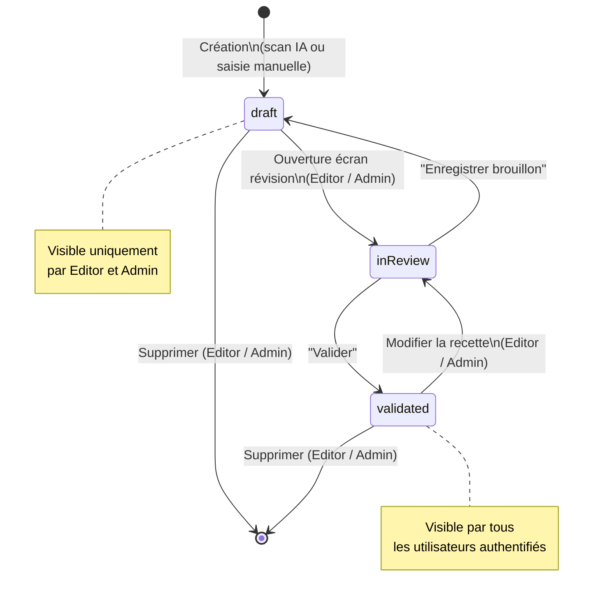
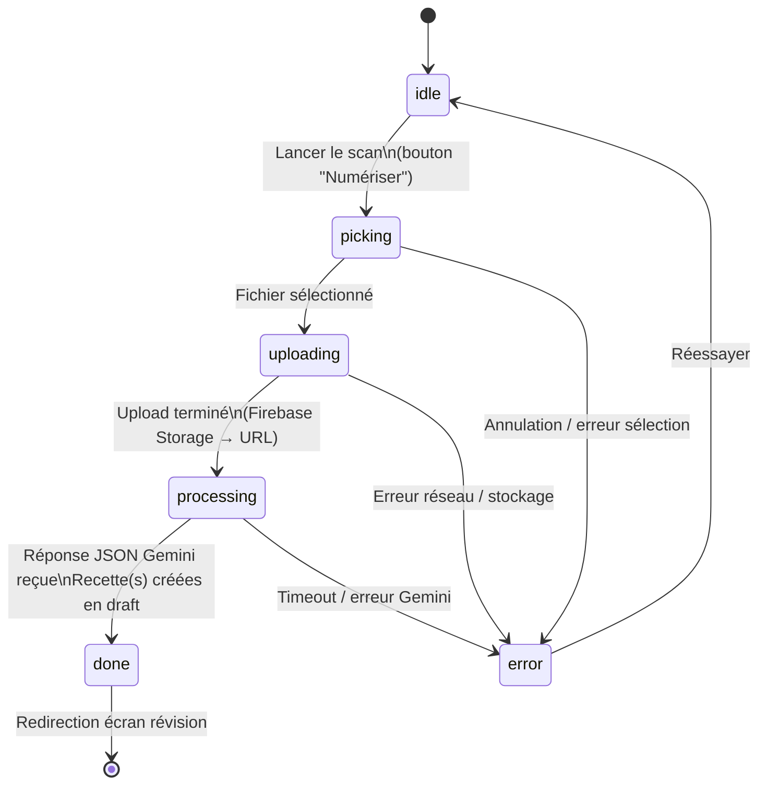
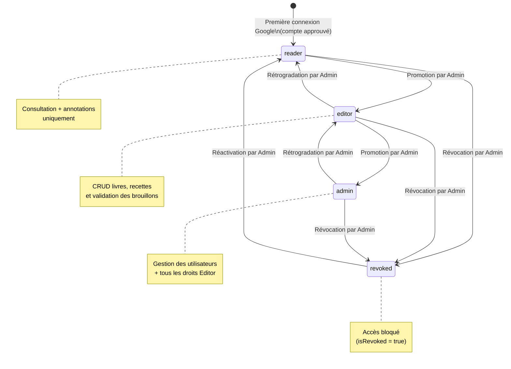
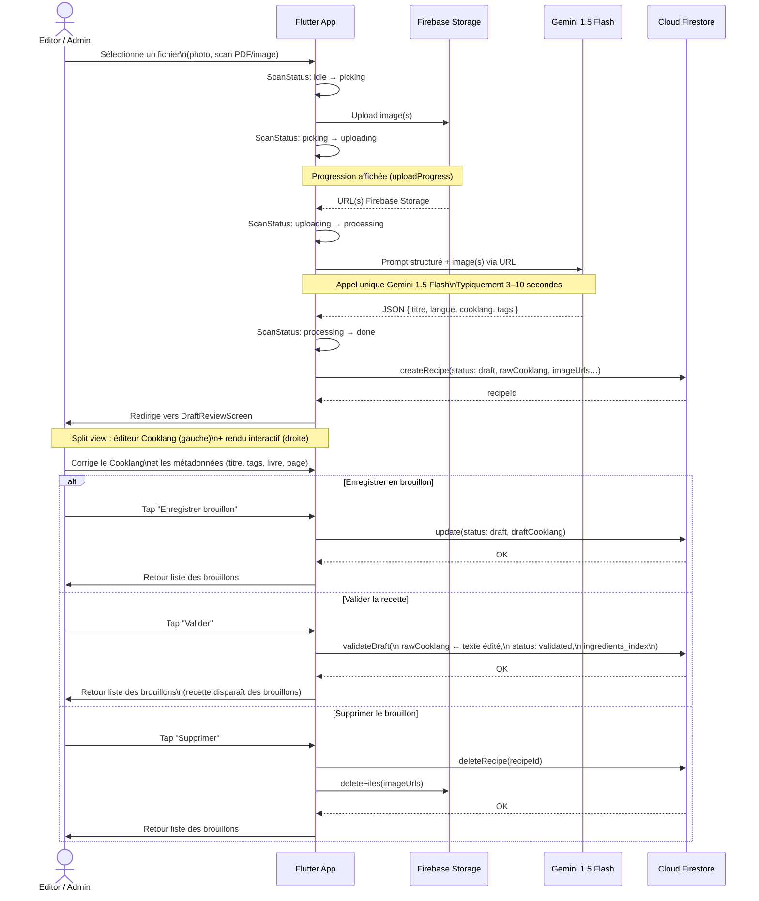

# Spécifications Fonctionnelles — Kass'dalle
## Livre de Cuisine Digital (Flutter + Firebase)

> Version : 2.2 — 2 Juin 2026

### Mise à jour release (13/08/2026 — v0.19.80)

#### Le dressage retourne dans la recette

- **Intégrer à la recette** remplace le bouton de copie : le conseil s'écrit en fin de recette sous une section **Dressage**, visuels compris en images flottantes alternées.
- **Intégrer deux fois ne double rien** : la section précédente est remplacée, y compris ses visuels. Trois régénérations suivies de trois intégrations ne laissent qu'une seule section — celle du dernier conseil.
- **Avec une réserve annoncée** : si vous aviez retouché la section à la main, l'intégration suivante écrase vos modifications. Le dialogue de confirmation le dit explicitement avant d'écrire, et affiche le texte exact qui sera inséré.
- **Une section « Cuisson et dressage » écrite par vous n'est jamais touchée** : seule la section produite par l'IA, au titre exact, est reconnue.
- **Retirer le dressage de la recette** reste disponible dès qu'une section existe.

### Mise à jour release (13/08/2026 — v0.19.79)

#### La bascule vers Claude s'appliquait à moitié

- **Onze postes ignoraient la configuration** : extraction depuis un scan ou un texte, relecture CookLang et Markdown, modification et génération de recette, recherche, couverture de livre, planning, courses, suggestion de tags, conseil de dressage. Choisir Claude — par poste ou par défaut — n'avait aucun effet sur eux : ils continuaient d'être servis par Gemini.
- **Pourquoi c'était invisible** : ces fonctions ne recevaient pas la clé Claude. Pour elles, la clé était donc « absente », situation dans laquelle le routeur sert l'autre moteur sans la signaler comme une panne — c'est le comportement voulu entre le déploiement du code et la création de la clé. Pendant ce temps, l'écran *Moteur d'IA* affirmait que la clé était présente, car il la reçoit, lui.
- **Ce qui change** : ces postes obéissent désormais à la configuration. Un basculement resté sans effet écrit maintenant un **avertissement** dans les logs, avec le nom du poste concerné : le silence est ce qui avait rendu cette panne indéchiffrable.
- **Le reporting de coûts reflétera la bascule** : jusqu'ici, la comptabilité était juste — elle mesurait bien du Gemini — mais elle mesurait un moteur que vous croyiez avoir quitté.

### Mise à jour release (13/08/2026 — v0.19.78)

#### Les générations d'image rejoignent leur traitement dans les logs

- **Un visuel généré n'est plus orphelin** : la ligne de consommation d'une image portait un `correlation_id` nul, si bien qu'elle apparaissait sous « Hors traitement » dans l'écran Cloud Logging, à côté de l'appel qui l'avait pourtant provoquée. Elle est désormais rattachée à son traitement.
- **Le poste nomme le groupe** : le champ `feature` était rangé dans les données annexes du log au lieu du premier niveau — l'écran ne pouvait donc ni l'afficher en titre ni filtrer dessus. Corrigé pour toutes les générations d'image (visuels de dressage et illustrations de recette).
- La comptabilisation elle-même était juste : chaque image reste facturée 0,04 $ sur son poste (« Visuel de montage », « Génération d'image »), et le conseil de dressage au tarif du modèle qui a réellement répondu.

### Mise à jour release (13/08/2026 — v0.19.76)

#### Dressage : une seule génération à la fois

- **Les autres actions sont suspendues pendant qu'un visuel se fabrique** : les boutons des autres étapes, *Regénérer* et *Réinitialiser les visuels* deviennent inertes jusqu'à la fin. Deux générations lancées de front produiraient deux assiettes concurrentes, et la série cesserait de raconter un montage.
- **Les boutons restent visibles, seulement grisés** : les faire disparaître laisserait croire que l'action n'existe pas. *Copier le texte* reste actif — c'est la seule action qui ne touche à rien.

### Mise à jour release (13/08/2026 — v0.19.75)

#### Dressage : les visuels ne peuvent plus être produits dans le désordre

- **Illustrer une étape produit celles qui manquent avant elle** : chaque image se construit sur la précédente ; demander la troisième sans les deux premières donnait une assiette née de rien, sans rapport avec celles qu'on générait ensuite. Un clic sur l'étape 3 génère donc 1, 2 puis 3, dans l'ordre.
- **Le coût est annoncé avant** : quand plus d'un visuel est nécessaire, un dialogue indique combien seront créés et pour quel montant. Le tarif vient de la grille tarifaire du projet, pas d'un chiffre écrit à la main.
- **Seul le dernier visuel peut être refait** : reprendre une étape du milieu laisserait derrière elle des images descendant d'une assiette qui n'existe plus. Les étapes antérieures n'ont plus de bouton.
- **Réinitialiser les visuels** : un bouton en bas de l'onglet efface toute la série pour repartir d'une assiette vide. C'est la seule façon — et une façon explicite — de refaire une étape ancienne. Le conseil et son texte ne sont pas touchés.
- **Une série interrompue reprend où elle s'est arrêtée** : si une génération échoue au milieu, les visuels déjà produits sont conservés et le clic suivant comble le trou.

### Mise à jour release (13/08/2026 — v0.19.74)

#### Dressage : tout se passe dans l'assiette

- **Plus rien à côté du contenant** : le modèle d'image posait spontanément la sauce dans une coupelle à côté de l'assiette, ajoutait une planche, débordait sur la table. Un guide de dressage montre ce qu'il y a *dans* l'assiette ; le reste est du décor de magazine, et il ment sur le geste à reproduire. La consigne est désormais explicite, à la génération comme à la description : un seul contenant, aucun ramequin annexe, une sauce d'accompagnement se pose en touche dans l'assiette.
- **Le visuel de résultat final est supprimé** : puisque chaque image part de la précédente et qu'on demande d'y ajouter quelque chose, un visuel « final » de plus ne pouvait qu'ajouter un objet — c'est ce qu'il faisait. La dernière étape du dressage **est** le résultat, et elle s'illustre comme les autres.

### Mise à jour release (13/08/2026 — v0.19.73)

#### Le dressage a son propre texte

- **Il n'est plus recopié dans la recette** : le dressage n'est pas une étape de cuisson, c'est ce qu'on fait une fois la recette finie. Fondu dans les étapes, il allongeait la recette de gestes qu'on ne lit pas en cuisinant, et une régénération réécrivait un contenu que l'utilisateur avait pu retoucher. Il vit dans son onglet, avec ses visuels.
- **Copier le texte** : un bouton met le dressage complet — intention, contenant, gestes numérotés, pièges, finitions — dans le presse-papier, prêt à être collé ou envoyé.
- **Nettoyage des essais précédents** : sur une recette où le dressage avait été inséré, un bouton **Retirer le dressage de la recette** supprime la section. Une section « Cuisson et dressage » écrite à la main n'est jamais touchée.

### Mise à jour release (13/08/2026 — v0.19.72)

#### Dressage : les visuels se construisent l'un sur l'autre

- **La matière est respectée** : le conseil décrit désormais la consistance de chaque élément (émulsion épaisse qui tient au ruban, purée mate, jus sirupeux), et le générateur d'image a consigne de la tenir. Une anchoïade montée à l'huile ressortait en bouillon : un modèle d'image livré à lui-même peint toutes les sauces en liquide clair.
- **Chaque visuel complète le précédent** : illustrer l'étape 2 part de l'image de l'étape 1 et n'y ajoute que le geste en cours, cadrage et lumière inchangés. Chaque étape était auparavant refabriquée de zéro, ce qui donnait quatre assiettes sans rapport au lieu d'un montage.
- **Toutes les étapes sont illustrables**, y compris les dernières — celles où le dressage se joue vraiment.
- **Le résultat dressé** : un bloc en bas de l'onglet génère le visuel du plat terminé, dans la continuité des étapes déjà illustrées. Il s'insère en pleine largeur à la fin de la section Dressage de la recette.
- **Les visuels accompagnent le texte** : l'image se place en regard du geste plutôt qu'en pleine largeur, et s'agrandit d'un clic. En pleine largeur, elle chassait la consigne hors de l'écran.

### Mise à jour release (13/08/2026 — v0.19.71)

#### Onglet Dressage : un conseil de cette recette, pas du dressage en général

- **Ce qui disparaît** : l'onglet produisait ses conseils sur place, en cherchant des mots-clés dans les noms d'ingrédients. « Persil détecté » donnait « les herbes soulignent le mouvement du dressage ». C'était vrai de tous les plats, donc utile pour aucun.
- **Un conseil demandé, pas subi** : l'onglet s'ouvre sur un bouton **Demander un dressage sur mesure**, avec un champ libre pour le contexte de service (« assiettes creuses », « buffet froid », « à emporter »). Rien n'est appelé tant que l'utilisateur ne le décide pas.
- **Ce que le moteur rend** : le contenant conseillé et pourquoi, l'ordre des gestes de montage nommant les éléments réels de la recette, les pièges propres à ce plat (ce qui détrempe, ce qui fige, ce qui ternit), et ce qui se pose au dernier moment.
- **Refus du passe-partout** : une réponse dont les gestes ne citent aucun ingrédient de la recette est refusée et redemandée. Un conseil générique ne lève aucune erreur et s'affiche parfaitement — c'est pour cela qu'il est détecté à la production, pas à la lecture.
- **Visuels de montage** : sur les dressages complexes, le moteur propose jusqu'à trois étapes à illustrer. L'image montre l'assiette **en cours de montage**, pas le plat fini. Chaque visuel se génère à la demande, étape par étape, jamais en lot (0,04 $ l'image). Réservé aux rôles éditeur et administrateur.
- **Intégration à la recette** : un éditeur peut recopier le conseil dans la recette elle-même, sous une section **Dressage**, visuels compris en images flottantes alternées. Un aperçu du texte exact précède l'écriture ; une seconde intégration remplace la précédente au lieu de l'empiler.
- **Un appel par recette** : le conseil est conservé sur la recette et profite à tous les lecteurs. Un bouton **Regénérer** permet de le refaire, en changeant éventuellement le contexte de service.
- **Moteur nommé, jamais déguisé** : le conseil affiche en pied de page le moteur qui a répondu (Claude ou Gemini) et son modèle. Le poste est basculable depuis *Admin › Moteur d'IA*, sans redéploiement.

### Mise à jour release (12/08/2026 — v0.19.59)

#### Écran « Cloud Logging » : le bruit passe en DEBUG

- **Instrumentation séparée des événements** : « Appel IA démarré », « prompt envoyé à Gemini » et « réponse brute Gemini » sont journalisés en **DEBUG** et non plus en INFO. Un import écrivait une cinquantaine de lignes dont une quinzaine seulement portait une information : l'ouverture d'un appel n'apprend rien que sa clôture ne dise, durée et jetons compris.
- **Chips de sévérité en seuils** : « INFO+ » affiche INFO, WARN et ERROR ; « WARN+ » affiche WARN et ERROR ; « ERROR » les erreurs seules ; « DEBUG seul » isole l'instrumentation ; « Tout » ne filtre rien. L'égalité stricte précédente était un piège — sélectionner INFO masquait les erreurs, c'est-à-dire précisément ce qu'on cherchait.
- **Filtre par défaut : INFO+**. Le détail technique reste à un clic.

### Mise à jour release (12/08/2026 — v0.19.58)

#### Un traitement porte le nom du travail, pas celui d'un appel

- **Une écriture de recette = un traitement** : le recalcul des produits d'achat et la synchronisation nutrition tiraient chacun un identifiant de corrélation aléatoire. L'écran de logs y voyait deux traitements anonymes, sans lien entre eux ni avec l'écriture qui les avait déclenchés. Les deux partagent désormais le `correlationId` posé par `onRecipeWritten` et se lisent comme un seul bloc.
- **Titre du groupe** : le libellé vient d'abord de la racine du `correlationId`, qui nomme le traitement. Le poste (`feature`) n'est plus qu'un repli, et seulement pour les entrées dont l'identifiant est opaque : l'utiliser en titre faisait passer l'import d'une recette pour un « shopping_products_refresh », du nom du premier appel IA qu'il déclenchait.

### Mise à jour release (12/08/2026 — v0.19.57)

#### File de travail : un import, une ligne

- **Le brouillon remplace son traitement dès qu'il existe** : la pipeline d'import publie le brouillon, puis poursuit plusieurs minutes de normalisation des référentiels en arrière-plan. Pendant cette phase, la file de travail affichait deux lignes pour un seul import — le traitement en cours et le brouillon qu'il venait de produire. Le traitement disparaît désormais de la file dès qu'il a créé un brouillon : c'est le brouillon que l'utilisateur ouvre, et lui seul reste affiché. Les jobs en **erreur** ou **rejetés** restent visibles même s'ils ont produit un brouillon, sans quoi la panne disparaîtrait de l'écran.

#### Écran admin « Cloud Logging » : lecture par traitement

- **Regroupement par traitement** : un chip « Par traitement » (activé par défaut) regroupe les entrées partageant un même `correlationId`. Un import, un backfill ou un enrichissement se lit alors comme un bloc unique — replié, avec son libellé, son nombre de messages et sa date — au lieu d'être dispersé dans le flux entre les messages des autres traitements.
- **Ordre de lecture inversé dans le groupe** : le flux global présente le plus récent en premier, mais un traitement se déroule dans le temps : ses messages sont donc affichés du plus ancien au plus récent.
- **Les échecs s'ouvrent d'eux-mêmes** : un groupe contenant au moins une entrée `ERROR` est déplié à l'affichage et porte l'icône et la couleur d'erreur ; un groupe contenant un `WARNING` porte la couleur d'avertissement.
- **Isoler un traitement** : un bouton entonnoir sur l'en-tête du groupe reporte son `correlationId` dans le filtre exact et relance la requête.
- **Libellé lisible** : le groupe s'intitule par le poste fonctionnel (`feature`) quand il est connu, sinon par le module, sinon par la racine du `correlationId` débarrassée de son horodatage. Les entrées sans corrélation sont réunies sous « Hors traitement ».
- Le chip peut être désactivé pour retrouver la liste plate d'origine.

### Mise à jour release (05/07/2026 — v0.18.0)

#### Stabilisation de release multi-plateforme

- **Version applicative harmonisée** : la version affichée dans la documentation produit et les supports d'installation est alignée sur **v0.18.0** pour éviter toute ambiguïté entre web, mobile et desktop.
- **Diffusion cohérente** : la release est préparée pour les trois canaux cibles (mobile Android/iOS, web et desktop Windows) avec le pipeline standard de déploiement.

### Mise à jour release (11/07/2026 — v0.19.18)

#### Gouvernance unifiée des unités ingrédients (éditeur + IA + scan)

- **Source de vérité unique** : la gestion des unités repose sur un référentiel central (`nutrition_units`). Toute unité d'ingrédient saisie, générée par IA ou extraite par scan doit être résolue par ce référentiel avant d'être exploitée pour la nutrition.

- **Règle métier prioritaire** : la composition recette doit d'abord **piocher dans la liste du référentiel**. La création d'une nouvelle unité n'est autorisée qu'en **fallback** si aucune correspondance n'existe après normalisation.

- **Normalisation stricte anti-doublons** : différentes écritures d'une même unité doivent converger vers une forme canonique unique. Exemple attendu : `CAC`, `cac`, `c.C`, `C.c`, `c.a.c` et `cuillère à café` doivent toutes référencer la même unité canonique (`c_a_c`).

- **Fallback contrôlé** : lorsqu'une unité légitime absente du référentiel apparaît (ex: `tige`), elle est ajoutée automatiquement en entrée `unknown/pending_review` et réutilisée ensuite telle quelle (pas de duplication proche).

- **Couverture multi-canaux obligatoire** : ces règles s'appliquent uniformément à :
  - l'éditeur manuel d'ingrédients,
  - la génération de recettes via Gemini,
  - l'extraction/scan OCR,
  - les flux de backfill/recompute nutrition.

- **Traçabilité de résolution** : chaque graphie d'unité rencontrée est conservée dans le référentiel `nutrition_units` (`aliases`, `status`, `source`), avec sa provenance. Elle n'est **pas** recopiée sur chaque ingrédient de chaque recette : une recette ne stocke que ce qu'elle dit (`name`, `qty`, `unit`, `category`), la résolution se recalcule à la demande.

- **Contrôle qualité opérationnel** : l'admin doit pouvoir visualiser les unités inconnues, valider/fusionner les alias, et suivre la baisse des ingrédients non convertibles en nutrition.

### Mise à jour release (04/07/2026 — v0.17.0)

#### Retouche image — expérience unifiée

- **Atelier de retouche unique** : les actions de retouche photo sont regroupées dans un seul écran « Atelier de retouche », avec un parcours cohérent au lieu d'actions dispersées (recadrage d'un côté, couleur de l'autre).
- **Panneaux orientés intention** : l'atelier expose des sections claires côté utilisateur : **Cadre**, **Lumière**, **Détails**, **Presets**.
- **Comparaison avant/après** : l'utilisateur peut comparer l'original et la retouche en appui long (ou via bascule) sans quitter l'écran.
- **Historique immédiat** : l'atelier propose **Annuler / Refaire** pour sécuriser les essais et réduire la peur de se tromper.
- **Presets intelligents** : des presets rapides sont proposés avec une recommandation automatique basée sur l'analyse locale de l'image (lisibilité, naturel, couleurs pop, doux).
- **Point d'entrée simplifié dans les galeries** : dans les onglets photos des écrans d'édition/révision, une seule action **Retoucher** remplace les boutons dispersés Crop/Couleur.

### Mise à jour release (28/06/2026 — v0.15.90)

#### Traçabilité des fichiers rejetés par le scan de sécurité

- **Job au statut « Rejeté »** : lorsqu'un fichier importé (recette, couverture ou document de livre) est bloqué par le scan de sécurité, une entrée est désormais créée dans l'écran « Brouillons & Traitements » avec le statut **Rejeté** (badge rouge). Auparavant, le motif du blocage n'était affiché qu'éphémèrement à l'utilisateur et n'était conservé nulle part de consultable dans l'application.
- **Motif visible** : chaque entrée rejetée affiche le nom du fichier, son type et la **raison du rejet** retournée par le scan (incohérence de format, type non autorisé, signature antivirus, etc.). Le détail est consultable et copiable via un appui long.
- **Actions** : seule l'action **Supprimer** est proposée sur une entrée rejetée (pas de **Relancer**, car re-scanner le même fichier produirait le même rejet). Le fichier source reste en quarantaine et n'est pas exposé.

### Mise à jour release (02/06/2026 — v0.15.31)

#### Sécurité — Corrections de règles et nettoyage

- **Notes de recettes (`recipe_ratings`) — création restreinte** : la règle Firestore `allow create` sur la collection `recipe_ratings` exige désormais que le champ `user_id` du document créé corresponde à l'uid de l'utilisateur connecté (`request.resource.data.user_id == request.auth.uid`). Auparavant, un utilisateur authentifié pouvait créer une note avec l'identifiant d'un autre utilisateur.

- **CORS Cloud Functions restreint** : les fonctions HTTPS Callable (wrappers Gemini et admin) n'acceptent plus toutes les origines (`cors: true`) mais uniquement les domaines Firebase connus : `kassdale-6d948.web.app` et `kassdale-6d948.firebaseapp.com`.

#### Nettoyage — Code mort PWA retiré

- **Suppression du système d'installation PWA programmatique** : les fichiers `web_install.dart`, `web_install_web.dart` et `web_install_stub.dart` ont été supprimés. Ces fichiers exposaient `isPwaInstallAvailable()` et `triggerPwaInstall()` mais n'étaient importés nulle part dans l'UI. La capture de `window._pwaPrompt` dans `index.html` a également été retirée. Chrome gère nativement l'installation PWA via sa bannière `beforeinstallprompt` sans intervention Flutter.

### Mise à jour release (01/06/2026 — v0.15.29)

#### Distribution & Installation de l'application

- **Téléchargement de l'APK depuis le web (Android)** : sur la version web ouverte sur Android, un bandeau ou une vérification automatique au lancement détecte si une mise à jour est disponible. Le téléchargement de l'APK est déclenché via un lien direct servi par Firebase Hosting (`/app-release.apk`) avec les headers HTTP corrects (`Content-Type: application/vnd.android.package-archive`, `Content-Disposition: attachment; filename="kass-dalle.apk"`). Le fichier se télécharge directement dans le dossier Téléchargements du téléphone.

- **Installation PWA (Progressive Web App) native** : sur Chrome Android et Chrome Desktop, le mécanisme standard `beforeinstallprompt` du navigateur est utilisé. L'événement est capturé dans `index.html` **sans** appel à `preventDefault()`, ce qui laisse Chrome afficher sa propre bannière d'installation native. Aucune interface personnalisée n'est imposée — l'utilisateur voit la proposition d'installation standard du navigateur au moment opportun.

#### Export PDF

- **Export d'une recette en PDF imprimable** : depuis la fiche d'une recette validée, un bouton PDF (icône dans l'AppBar) permet d'exporter la recette au format PDF. L'export génère un document paginé avec : entête coloré (orange profond), titre, métadonnées (portions, difficulté, temps), liste des ingrédients, étapes numérotées, et optionnellement les photos de la recette. Un dialogue demande à l'utilisateur s'il souhaite inclure les images avant génération.

- **Positionnement des images dans le PDF** : les images sont positionnées selon leur marqueur dans le texte CookLang (``, ``, ``). Le PDF respecte l'alignement gauche/droite/centré et le pourcentage de largeur déclaré dans le contenu.

- **Snackbar "Ouvrir" après export PDF sur mobile** : après génération et partage du PDF (via la share sheet système Android/iOS), un snackbar succès affiché pendant 8 secondes propose un bouton **OUVRIR** permettant de ré-ouvrir la share sheet avec le même document. Ce bouton n'apparaît que sur les plateformes mobiles natives (non-web) ; sur web, le PDF est déjà dans les Téléchargements du navigateur et aucun bouton supplémentaire n'est affiché.

#### Éditeur de recettes — Mode visuel (WYSIWYG)

- **Éditeur hybride CookLang** : l'éditeur de brouillon propose trois modes via des icônes de toggle : **Texte** (saisie CookLang brute avec coloration syntaxique), **Visuel** (édition bloc-par-bloc WYSIWYG), et **Aperçu** (rendu final de la recette). Le mode peut être changé à tout moment.

- **Édition bloc-par-bloc** : en mode visuel, chaque ligne ou section du CookLang est un bloc cliquable et éditable inline. Les types de blocs supportés : titre, ingrédient (`@nom{quantité}`), ustensile (`#outil{}`), section (`== Titre ==`), étape, conseil/note (`> texte`), commentaire (`-- texte`), image (``).

- **Toolbar d'insertion** : une barre d'outils flottante permet d'insérer au curseur : section, étape, ingrédient, ustensile, conseil, liste, image (avec sélection depuis la galerie du brouillon). Chaque insertion se positionne précisément à la ligne active.

- **Réordonnancement par drag-and-drop** : les blocs peuvent être réordonnés par glisser-déposer dans l'éditeur visuel, modifiant directement l'ordre dans le CookLang sous-jacent.

- **Insertion d'images avec choix de position et largeur** : lors de l'insertion d'une image depuis la galerie, l'utilisateur choisit le positionnement (gauche / droite / après / pleine largeur) et la largeur en pourcentage (5 % à 80 %) via des `ChoiceChip`. Le tag CookLang correspondant est généré automatiquement.

- **Enter pour diviser un bloc** : dans l'éditeur visuel, appuyer sur Entrée dans un bloc le divise en deux blocs distincts. Un bouton de suppression de ligne (icône corbeille) est disponible sur chaque bloc.

#### Éditeur Markdown — Pages non-recette

- **Éditeur Markdown riche** : les pages non-recette (techniques culinaires, méthodes, notes) disposent d'un éditeur Markdown dédié avec toolbar : titres (H1/H2/H3), gras, italique, souligné, listes à puces, insertion d'images avec position (gauche/droite/après) et largeur en %.

- **Sélecteur de type de page** : dans l'éditeur d'un brouillon, un sélecteur permet de qualifier le type de contenu : recette structurée, page de technique, méthode, note ou autre. Ce choix influe sur le rendu affiché (vue recette CookLang vs aperçu Markdown), les champs du formulaire visibles, et le comportement du prompt IA.

- **Aperçu Markdown intégré** : un onglet Aperçu affiche le contenu Markdown rendu typographiquement avec les illustrations intercalées à leurs positions déclarées.

#### Bibliothèque de livres

- **Effet 3D sur les couvertures** : les vignettes de couverture de livres affichent un effet livre 3D avec ombres portées, tranche simulée et vernis. Ce rendu est appliqué à la liste des livres et à l'écran de détail.

- **Livres système avec couvertures par défaut** : les livres système (KassDalle, Recettes libres) disposent de couvertures illustrées par des assets locaux. Si aucune couverture personnalisée n'est définie, l'asset par défaut est utilisé.

- **Filtre de contenu dans un livre** : dans l'écran d'un livre, un `SegmentedButton` permet de filtrer l'affichage : Tout / Recettes / Autre (pages non-recette). Ce filtre remplace l'ancien bouton cyclique.

- **Sélection multiple** : un appui long sur un livre ou une recette libre active le mode sélection multiple. L'AppBar contextuelle propose "Tout sélectionner" et "Supprimer" (avec confirmation). La sélection est limitée aux éléments de l'utilisateur connecté.

#### Planning des repas — Améliorations

- **Préférences planning accessibles depuis le profil** : les préférences de planning (nombre de repas, contraintes, heures) sont accessibles depuis l'écran Profil en plus de l'icône engrenage dans l'écran Planning.

- **Sections repliables dans les préférences** : les sections de configuration du planning (contraintes globales, contraintes par jour) sont repliables pour simplifier l'interface.

- **Justification IA des suggestions** : lors d'une suggestion IA de planning, chaque repas proposé affiche la justification du choix IA (pourquoi cette recette à ce moment).

- **Sélection des sources pour les suggestions** : lors du batch planning, l'utilisateur peut sélectionner quels livres ou sources doivent être utilisés par l'IA pour les suggestions.

#### Écran Explorer (Recherche & Création)

- **Refonte en écran Explorer** : l'écran de recherche est renommé « Explorer » et propose trois actions clairement distinctes : **Chercher** (recherche dans la base), **Créer** (génération IA d'une nouvelle recette), **Web** (recherche web). La saisie du texte et la validation par Enter déclenchent la recherche.

- **Tri par pertinence** : les résultats de recherche sont triés par score de pertinence décroissant.

- **Diff des modifications après raffinement IA** : après un raffinement IA d'une recette, un écran de diff affiche les modifications apportées (ajouts en vert, suppressions en rouge) permettant de valider ou annuler avant sauvegarde.

- **Sauvegarde directe d'une recette générée par IA** : depuis l'écran de génération IA, la sauvegarde d'une recette validée crée directement la recette sans passer par un brouillon intermédiaire, et navigue vers la fiche de la recette créée.

#### Pipeline image — Améliorations qualité

- **Traitement Sharp côté serveur** : avant l'envoi à Gemini pour l'extraction de couverture ou la détection d'illustrations, les images passent par un pré-traitement Sharp (deskew, CLAHE, normalisation des niveaux) côté Cloud Function pour améliorer la lisibilité des scans.

- **Compression mobile** : sur Android/iOS, `flutter_image_compress` est utilisé pour réduire la taille des photos avant upload, avec un plafond configurable. Les thumbnails sont générés au format WebP.

- **Quality gate Gemini** : avant d'envoyer une image à Gemini pour l'analyse, un score de qualité est calculé (netteté, luminosité, contraste). Si le score est insuffisant, un avertissement est affiché à l'utilisateur avant de continuer.

#### Comptabilité & Suivi IA

- **Page Comptabilité** : accessible depuis le menu Admin, cette page présente deux onglets : **GCP** (coûts Cloud Functions, Storage, Tasks issus de BigQuery) et **Gemini** (tableau croisé coûts Gemini par utilisateur × feature × période mensuelle). Chaque ligne du tableau Gemini affiche le nombre d'appels, le volume de tokens et le coût estimé en euros.

- **Suivi usage tokens par feature** : l'écran "Usage IA" affiche un tableau filtrable par période mensuelle, avec une colonne "Période" pour l'agrégation. Un bandeau résume la période active. Une estimation de l'énergie consommée (en Wh) est calculée à partir du nombre total de tokens.

- **Backfill historique améliorations images** : une Cloud Function `backfillEnhanceUsageFn` scanne le Storage et reconstruit les données d'usage des améliorations d'images manquantes. Un bouton "Reconstruire données images" est disponible dans la page Comptabilité (admin).

### Mise à jour release (18/05/2026 — v0.13.62)

- **Architecture serveur pour le traitement IA** : tous les appels Gemini (extraction de recettes, raffinement, recherche, suggestion de planning, génération de recette, polissage Cooklang, extraction de couverture, détection d'illustrations, etc.) sont désormais exécutés côté serveur via des Cloud Functions. La clé API Gemini n'est plus présente sur les clients (web, mobile, desktop) ; elle est stockée dans Google Secret Manager. Conséquences fonctionnelles : les imports volumineux (PDF multi-pages, scans de livres) ne dépendent plus de la connexion du téléphone — l'utilisateur peut fermer l'app, le traitement continue.

- **File d'attente avec traitement parallèle** : les imports de recettes et de couvertures de livres sont mis en file d'attente Cloud Tasks (5 jobs en parallèle, 2 par seconde, 3 tentatives en cas d'échec transitoire). Le statut du job (queued → processing → done/error) est suivi en temps réel sur le mobile via le panneau d'imports. Si un job échoue 3 fois, il est déplacé dans une "Dead Letter Queue" (DLQ) accessible aux administrateurs.

- **Écran admin "Dead Letter Queue"** : accessible depuis l'écran Administration (icône problème). Liste les jobs ayant échoué après 3 tentatives, plus récents d'abord. Pour chaque entrée : raison de l'échec, date, nombre de tentatives, dernier message d'erreur (sélectionnable + copiable), identifiants original_job_id / user_id / correlation_id / file_path / queue_name (avec bouton copier). Deux actions par entrée (avec confirmation) : **Relancer** (recrée un job neuf dans la file ; l'entrée DLQ est marquée comme relancée et conserve l'historique avec le nouveau jobId) et **Supprimer** (suppression définitive). Une entrée déjà relancée affiche l'icône "replay" verte et le bouton Relancer est désactivé.

- **Écran admin "Cloud Logging"** : accessible depuis l'écran Administration (icône terminal). Permet de filtrer les logs structurés du pipeline IA :
  - **Sévérité** (chips) : Tous / INFO / WARN / ERROR / DEBUG.
  - **Fenêtre temporelle** (déroulant) : 15 min / 1 h / 6 h / 24 h / 7 j.
  - **Recherche libre** dans le message.
  - **Filtres exacts** par correlationId, jobId, userId.
  - Chaque entrée est dépliable : labels avec bouton copier par valeur + payload JSON complet en monospace sélectionnable.
  - Affichage avec icône et couleur selon la sévérité, badges pour le module et les identifiants.

- **Suppression de la clé Gemini côté client** : les builds web/mobile/desktop ne nécessitent plus l'argument `--dart-define=GEMINI_API_KEY=...`. Toute fonctionnalité IA passe désormais par les Cloud Functions authentifiées.

### Mise à jour release (17/05/2026 — v0.13.53)

- **Images agrandissables dans l'Aperçu des pages non-recette** : les illustrations affichées dans l'onglet Aperçu d'une page non-recette sont limitées à 280 px de hauteur par défaut. Un tap sur l'image ou sur le bouton fullscreen (visible en bas à droite de chaque photo) permet d'agrandir l'image en pleine hauteur ou de la réduire. Chaque image garde son état agrandi/réduit indépendamment des autres.

- **Suivi de la version d'import (admin)** : lors de chaque import ou scan d'une recette ou page, la version de l'application est enregistrée dans le champ `import_version` du document Firestore de la recette. Dans l'écran de révision d'un brouillon, les administrateurs voient s'afficher en dessous de « Analysé le… » une ligne « Importé avec vX.Y.Z » (icône clé, texte italique). Ce champ est invisible pour les Editors et Readers. Les anciennes recettes importées avant cette version ne possèdent pas ce champ ; la ligne n'est alors pas affichée.

### Mise à jour release (17/05/2026 — v0.13.52)

- **Extraction d'illustration depuis l'original** : dans l'onglet Photos d'un brouillon disposant d'un scan image source, un bouton « Depuis l'original » est affiché à côté du bouton « Ré-extraire ». Ce bouton télécharge le fichier source, ouvre l'outil d'amélioration d'image en mode recadrage et permet au propriétaire de sélectionner manuellement une zone du scan pour l'ajouter comme nouvelle illustration. Le résultat est ajouté à la liste des illustrations sans remplacer les existantes.

- **Suppression directe des illustrations** : l'icône poubelle est désormais visible en permanence sur chaque illustration dans l'onglet Photos, dans la prévisualisation Cooklang et dans l'Aperçu des pages non-recette. Un appui long n'est plus nécessaire. La suppression n'est disponible que pour le propriétaire du brouillon.

- **Icône poubelle unifiée** : l'icône de suppression de photo est harmonisée (`delete_outline`) sur l'ensemble de l'application, en remplacement de l'icône ✕ précédemment utilisée.

### Mise à jour release (17/05/2026 — v0.13.51)

- **Onglet « Aperçu » pour les pages non-recette** : les brouillons de type page de technique culinaire, méthode ou autre contenu textuel non structuré bénéficient d'un onglet « Aperçu » dédié. Cet onglet affiche le texte de la page formaté typographiquement (titres en gras, listes à puces, paragraphes) et intercale chaque illustration à sa position déclarée par un marqueur `[schéma : …]` dans le texte. Le propriétaire peut supprimer chaque illustration directement depuis cet onglet. Pour les brouillons de recettes structurées (avec ingrédients Cooklang), l'Aperçu existant basé sur le rendu Cooklang interactif est conservé.

### Mise à jour release (17/05/2026 — v0.13.50)

- **Correction de navigation après l'éditeur d'image** : fermer ou valider l'outil d'amélioration d'image (recadrage, correction de couleur) depuis un brouillon ramène désormais systématiquement à l'onglet Photos du brouillon, quelle que soit la façon dont l'outil a été ouvert.

- **Correction des icônes Material sur le web (build release)** : les icônes Material Design étaient absentes dans les builds web release en raison du tree-shaking Flutter. Tous les builds web utilisent désormais l'option `--no-tree-shake-icons` pour garantir l'affichage correct de l'ensemble des glyphes.

### Mise à jour release (15/05/2026 — v0.13.35)

- **Refactoring interne (aucun changement fonctionnel)** : nettoyage global de la qualité de code. Toutes les API dépréciées (`withOpacity` → `withValues(alpha:)`) ont été mises à jour, les `debugPrint` retirés du code de production, les avertissements `use_build_context_synchronously` corrigés, et les règles du linter Dart strictement respectées. Résultat : analyse statique propre (0 warning, 0 erreur ; 2 infos inévitables liées à `dart:html` legacy). Aucun comportement visible n'est modifié.

### Mise à jour release (15/05/2026 — v0.13.27)

- **Batch planning hebdomadaire** : depuis l'écran Planning, un bouton "Nouveau planning" ouvre `BatchPlanningScreen`. L'écran génère automatiquement les créneaux du prochain cycle (ex : 7 jours) à partir des préférences configurées. Pour chaque créneau, l'utilisateur peut : laisser l'IA suggérer une recette (bouton ✨), choisir manuellement une recette (icône loupe → picker avec recherche textuelle + suggestion IA), saisir un repas libre (texte libre), ou laisser le créneau vide. Une suggestion IA globale génère d'un coup tout le planning en respectant les contraintes. L'heure de chaque repas est réglable indépendamment via un sélecteur. Un bouton "Enregistrer" ajoute tous les repas non-vides en lot dans Firestore.

- **Configuration du planning (Préférences)** : un écran dédié `PlanningConfigScreen` est accessible depuis l'icône engrenage de l'écran Planning. Il permet de configurer : le nombre de repas par cycle (défaut : 7), le jour de démarrage du cycle (Lundi–Dimanche), l'heure et les minutes par défaut des repas, les contraintes globales en langage naturel (ex : "Pas de poisson deux fois dans la semaine"), et les contraintes par jour de la semaine (durée max de préparation en minutes, flag "batch cooking / réchauffage", note libre). Le calendrier Google cible (parmi les calendriers du compte) peut également être sélectionné depuis cet écran.

- **Export calendrier global** : dans l'écran Planning, un bouton calendrier dans l'AppBar exporte en lot tous les repas visibles vers Google Calendar (calendrier configuré dans les préférences). Chaque repas est créé comme événement individuel. Un bouton calendrier est également disponible sur chaque tuile de repas pour un export individuel.

- **Heure repas cliquable** : dans l'écran Planning, l'heure affichée sur chaque repas est cliquable et ouvre un sélecteur d'heure pour modifier le créneau directement.

- **Changer / vider une recette depuis le planning** : un menu contextuel (kebab) sur chaque tuile de repas propose "Changer la recette" (ouvre le picker) et "Vider le créneau" (supprime la recette sans supprimer le créneau).

- **Liste de courses multi-recettes** : dans la liste de courses (bottom sheet), chaque ingrédient agrégé affiche en sous-titre la ou les recettes sources, permettant de savoir d'où provient chaque quantité.

- **Sélection multiple dans livres et recettes libres** : un appui long sur un livre ou une recette libre active le mode sélection multiple. L'AppBar contextuelle propose "Tout sélectionner" et "Supprimer" (avec confirmation). La sélection est limitée aux éléments de l'utilisateur connecté.

- **Affichage toutes les pages d'un livre** : dans l'écran "Recettes d'un livre", toutes les recettes (pages normales) sont désormais visibles par défaut, sans toggle. Le regroupement par sections reste disponible pour les membres du groupe.

- **Compteur d'énergie estimée (token usage)** : l'écran "Usage IA" affiche désormais une estimation de l'énergie consommée (en Wh) calculée à partir du nombre total de tokens, pour sensibiliser à l'empreinte énergétique des appels IA.

### Mise à jour release (14/05/2026 — v0.13.5)

- **Écran "Planning des repas"** : un nouvel écran est accessible depuis la barre de navigation principale (5e entrée, icône calendrier, entre Recherche et Brouillons). Il affiche la liste chronologique des repas planifiés de l'utilisateur connecté, groupés par date. Chaque repas affiche l'heure, le titre de la recette et la durée totale. Un appui sur un repas ouvre directement la fiche recette associée. Un bouton poubelle permet de supprimer un repas planifié après confirmation. Les repas passés sont affichés en mode atténué (opacité réduite). Si aucun repas n'est planifié, un écran vide avec message explicatif est affiché.
- **Sauvegarde locale en Firestore** : lors de chaque planification depuis la fiche recette (via le bottom sheet Google Calendar), le repas est désormais également sauvegardé dans Firestore (collection `planned_meals`) avec : identifiant utilisateur, identifiant et titre de la recette, date/heure planifiée, durée totale. Cette sauvegarde alimente l'écran Planning en temps réel via un stream Firestore.

### Mise à jour release (13/05/2026 — v0.13.4)

- **Bouton "Planifier" dans la fiche recette** : un bouton avec icône calendrier (`calendar_month_outlined`) apparaît dans l'en-tête de la section Ingrédients de la fiche recette, uniquement si la recette possède des ingrédients structurés. Il s'affiche côte à côte avec le bouton "Liste de courses" existant.
- **Bottom sheet de planification** : un appui sur le bouton Planifier ouvre un bottom sheet permettant de : choisir la date (sélecteur de date, par défaut aujourd'hui), choisir l'heure (sélecteur d'heure, par défaut 19h00), configurer le rappel en minutes (pré-rempli avec le temps de préparation de la recette). La durée est calculée automatiquement à partir des champs `prepTime` et `cookTime` de la recette. Un bouton "Ajouter à Google Calendar" déclenche la création de l'événement.
- **Intégration Google Calendar (API REST OAuth)** : la planification crée un événement "Préparer : [titre]" dans le calendrier Google principal de l'utilisateur, avec description contenant les ingrédients, les temps de préparation/cuisson et un rappel popup configurable. Sur web : OAuth via `FirebaseAuth.signInWithPopup` avec le scope `calendar.events`. Sur mobile/desktop : via `GoogleSignIn.instance.authorizationClient`.

- **Filtre par livre dans la page Brouillons** : dans l'écran "Brouillons", une barre de filtres défilable horizontalement apparaît lorsque les brouillons appartiennent à plusieurs livres différents. Les chips disponibles sont : "Tous" (vue par défaut), "Sans livre" (brouillons non rattachés à un livre), et un chip par livre distinct présent dans la liste. La barre est masquée si tous les brouillons appartiennent au même contexte (zéro ou un seul livre distinct). La sélection d'un chip filtre immédiatement la liste affichée.
- **Suppression d'un livre depuis la liste de ses recettes** : dans l'AppBar de l'écran "Recettes d'un livre", un bouton poubelle apparaît pour les Editors et Admins. Il déclenche un dialogue de confirmation à trois options : Annuler, "Détacher les recettes" (supprime le livre mais conserve toutes les recettes, qui deviennent des recettes libres), "Supprimer aussi les recettes" (supprime le livre ET toutes ses recettes de façon irréversible). Après suppression, l'utilisateur est redirigé vers l'écran d'accueil avec un message de confirmation.

### Mise à jour release (13/05/2026 — v0.12.85)

- **Onglet "Photos" dans le brouillon** : un quatrième onglet "Photos" est disponible dans l'écran de révision des brouillons (`DraftReviewScreen`), visible pour tous. Il affiche les illustrations associées à la recette dans une grille. Le propriétaire peut supprimer individuellement chaque photo. Si la recette possède un fichier source image (scan), un bouton "Extraire les illustrations" (ou "Ré-extraire" si des illustrations existent déjà) permet de lancer l'extraction automatique via l'IA.
- **Bouton IA dans l'AppBar du brouillon** : le propriétaire d'un brouillon dispose d'un bouton ✨ ("Améliorer avec l'IA") dans l'AppBar de l'écran de révision. Un appui ouvre un dialogue permettant de saisir des instructions libres (ex : "Reformate en style Cooklang strict", "Corrige les quantités"). Si la recette a un scan image source, une case à cocher optionnelle "Extraire les illustrations" est proposée. L'IA raffine alors le CookLang + titre + ingrédients selon les instructions, et met à jour le brouillon en place.

### Mise à jour release (13/05/2026 — v0.12.84)

- **Suivi des tokens IA** : chaque appel Gemini (extraction de recette, détection d'illustrations, recherche, génération, raffinement, etc.) est enregistré dans Firestore sous la collection `ai_usage`. Chaque enregistrement contient : uid utilisateur, fonctionnalité (feature), nombre de tokens en entrée/sortie/total, modèle utilisé, et horodatage.
- **Page "Usage IA"** : accessible depuis le menu compte (icône graphique), elle affiche un tableau récapitulatif de la consommation de tokens, filtrable par fonctionnalité. Les Admins peuvent également filtrer par utilisateur et voir la consommation globale de tous les membres. La page affiche le total d'appels, tokens d'entrée, de sortie et total, agrégés par feature.
- **Suppression du cache** : un bouton "Vider le cache" est disponible dans les paramètres, permettant de forcer la recharge des données depuis Firestore.

### Mise à jour release (13/05/2026 — v0.12.83)

- **Illustrations dans le brouillon** : les illustrations extraites par l'IA lors du scan (ou extraites manuellement depuis l'onglet Photos) sont stockées dans Firebase Storage sous `illustrations/{uid}/` et associées à la recette via le champ `image_urls`. Elles sont visibles dans l'onglet Photos du brouillon et persistent après validation.
- **Extraction IA depuis le scan** : depuis l'onglet Photos du brouillon, si la recette possède un scan image source, Gemini détecte automatiquement les zones de photographies culinaires dans l'image, découpe chaque région et l'uploade comme illustration séparée. Les illustrations existantes sont remplacées lors d'une ré-extraction.

### Mise à jour release (13/05/2026 — v0.12.74)

- **Fusion "Brouillons & Traitements" en WorkQueue** : les anciens onglets séparés "Brouillons" et "Traitements" sont fusionnés en une seule vue unifiée `WorkQueueScreen`. Cette vue affiche, dans une liste chronologique, à la fois les jobs de traitement en cours/terminés/en erreur et les brouillons de recettes non validés. Trois modes de filtrage sont disponibles : "Mes éléments" (vue par défaut), "Famille" (éléments des membres du groupe), "Tous" (admin uniquement — tous les utilisateurs). En mode famille et admin, les éléments sont regroupés par propriétaire dans des sections rétractables. La sélection multiple reste disponible pour les actions groupées (valider, réessayer, supprimer).

### Mise à jour release (12/05/2026 — v0.12.67)

- **Détection automatique des coins de document** : à l'ouverture de l'écran de recadrage (amélioration d'image), les 4 coins de la page ou du livre visible sont automatiquement détectés par analyse de gradient (Sobel + régression PCA). Une barre de progression orange apparaît en haut de l'image pendant l'analyse (~0,5 s). L'utilisateur peut ensuite affiner manuellement chaque coin. Un bouton ⊕ permet de relancer la détection à tout moment. Si le document n'est pas détectable (fond homogène, faible contraste), les coins reviennent à la position par défaut.
- **Sélection multiple de brouillons** : dans la liste des brouillons, un appui long sur un brouillon active le mode de sélection multiple. L'AppBar contextuelle affiche le nombre de sélections, avec actions "tout sélectionner", "valider" (✓) et "supprimer" (🗑). La validation nécessite une confirmation par dialogue ; la suppression idem (bouton rouge). Le FAB est masqué en mode sélection. Les brouillons des autres membres du groupe restent non sélectionnables (lecture seule).
- **Correction de la déduplication d'ingrédients** : les apostrophes typographiques (' ') et les caractères accentués français (é, è, ê, à, ç, ù, ô, î, â, û) sont normalisés avant le calcul de la clé d'ingrédient, évitant les doublons comme "tronçon d'asperge" × 2 causés par des apostrophes Unicode différentes retournées par Gemini.

### Mise à jour release (12/05/2026)

- **Téléchargement du scan original** : un bouton de téléchargement est disponible à côté du bouton de prévisualisation dans l'en-tête de toute recette disposant d'un fichier source.
- **Scan multi-pages** : lors de l'import d'une recette, l'utilisateur arrive dans un mode "Pages en attente" plutôt qu'un déclenchement immédiat. Il peut accumuler autant de pages qu'il souhaite (via fichier ou caméra), puis lancer l'analyse de toutes les pages en un seul appel Gemini multi-part.
- **Extraction automatique d'illustrations** : pour les scans image (JPEG/PNG), Gemini détecte automatiquement les zones de photographies culinaires. Chaque zone est découpée et uploadée sur Firebase Storage (`illustrations/`), puis associée à la recette créée.
- **Progression détaillée** : dans l'écran "Traitements", le job affiche l'étape courante ("Extraction du texte…", "Extraction des illustrations…") en italique pendant le traitement.
- **Texte collé conservé comme source** : lorsqu'un utilisateur colle un texte dans l'écran "Nouvelle recette" et le met en forme avec l'IA, le texte original est automatiquement uploadé sur Firebase Storage (`scans/`) et attaché à la recette comme fichier source (`sourceFileUrl`). Le bouton de téléchargement de l'original est alors disponible sur la fiche recette, exactement comme pour un scan.

### Mise à jour release (08/05/2026)

- **Copie cross-utilisateur de recettes/brouillons** : un utilisateur peut copier la recette validée ou le brouillon d'un membre de son groupe dans sa propre collection. La copie d'une recette validée est immédiatement disponible dans les recettes, sans validation nécessaire. La copie d'un brouillon crée un brouillon dans ses brouillons, à valider. La redirection est automatique vers la copie créée.
- **Affichage de l'origine** (auteur + livre) : dans l'AppBar de l'écran brouillon (DraftReviewScreen) et de l'écran détail recette, le nom de l'auteur (icône 👤) et le titre du livre source sont affichés sous le titre si la recette n'appartient pas à l'utilisateur connecté.
- **Protection des validations** : seul le propriétaire d'un brouillon peut le valider ou le supprimer (garde UI + vérification côté dépôt avant écriture). Un non-propriétaire voit uniquement le bouton "Copier".
- **Brouillons des membres du groupe** : l'écran Brouillons propose un toggle 👥 pour afficher les brouillons des membres du groupe, organisés par sections collapsibles par membre.
- **Cover automatique "Mes créations Kass'Dalle ✨"** : le livre IA est créé automatiquement au premier scan. Sa couverture est générée programmatiquement (dart:ui) et uploadée sur Firebase Storage. La migration silencieuse est déclenchée à l'ouverture de la bibliothèque.

### Mise à jour release (03/05/2026)

- Groupes familiaux : chaque utilisateur gère ses propres livres et recettes. Un utilisateur peut créer un groupe familial, y inviter d'autres membres (recherche par nom/email). Une fois dans un groupe, les livres et recettes validés des autres membres sont visibles par sections dans la bibliothèque et dans les recettes libres.
- Bibliothèque : sections "Mes livres" + "Livres de [membre]" avec toggles par section. Chaque section affiche une grille de livres.
- Recettes libres : sections "Mes recettes" + "Recettes de [membre]" avec toggles par section.
- Brouillons : visibles uniquement pour l'utilisateur connecté (inchangé).
- Traitements (admin) : l'admin voit tous les traitements de tous les utilisateurs avec filtre par utilisateur et affichage du propriétaire sur chaque tuile.
- Téléchargement APK : bouton "Télécharger l'APK Android" dans le menu compte, visible uniquement sur web/desktop. Pointe vers la dernière version intégrée au déploiement Firebase Hosting.
- Déploiement web : l'APK est désormais inclus dans chaque déploiement Firebase Hosting (`app-release.apk` servi sur le même domaine).

### Mise a jour release (02/05/2026)

- Ajout d'un mode de scan multi-intentions : recettes, couverture de livre, livre complet.
- Creation de brouillons livre a partir d'une photo de page de garde avec validation explicite.
- Ajout d'un traitement asynchrone en file d'attente : plusieurs imports peuvent etre lances sans attendre la fin du precedent.
- Ajout d'une page "Etat des traitements" pour suivre les scans en cours, termines et en erreur.
- Rattachement automatique des recettes extraites d'un document complet au livre cible, y compris en statut brouillon.
- Ajout/edition des champs structures en brouillon recette : portions, difficulte, temps preparation/cuisson, ingredients structures.
- Ajout/edition des champs structures en brouillon livre : sous-titre, editeur, serie, ISBN, description, tags.

### Mise a jour release (01/05/2026)

- Activation complete du parcours Android Google Sign-In (certificats debug/release et configuration Firebase Android).
- Ajout d'un profil utilisateur detaille (role, permissions, identite, activite, deconnexion).
- Ajout d'un visualiseur de source recette (image zoomable ou ouverture externe PDF/DOCX).
- Stabilisation du flux d'import scan (correction d'un crash Riverpod lors de la fermeture d'ecran).
- Uniformisation des icones applicatives a partir de l'asset `assets/icon.jpg` pour Android, iOS, Web, Windows et macOS.

---

## 1. Contexte et Objectif

**Kass'dalle** est une application privée à usage familial permettant de digitaliser une collection personnelle de livres de cuisine physiques et de notes d'ateliers culinaires (ex : Sasasa, recettes du terroir belge). L'application transforme des photos de pages de recettes en fiches numériques structurées, consultables et interactives, grâce à l'IA de reconnaissance visuelle (Gemini Vision) et au format de balisage Cooklang.

L'application est destinée à un cercle familial restreint :
- quelques personnes peuvent **modifier** et enrichir le contenu ;
- tous les membres authentifiés peuvent **consulter** et **annoter** les recettes ;
- un administrateur gère les accès.

---

## 2. Plateformes Cibles

| Plateforme | Usage principal | Particularités |
|---|---|---|
| **Mobile (iOS / Android)** | Scan, saisie, consultation | Accès caméra pour la capture des recettes; possibilités d'uploader des scans |
| **Web** | Consultation, correction, gestion | Pas de scan caméra ; interface plein écran ; possibilités d'uploader des scans pour suivre le meme process que la version mobile |
| **Desktop (Windows / macOS)** | Consultation, correction, gestion | Identique au Web ; fenêtre redimensionnable |

Les trois plateformes partagent le même backend Firebase et la même codebase Flutter. Seul le module de scan est conditionné à la plateforme mobile.

---

## 3. Authentification et Rôles

### 3.1 Connexion

L'authentification est exclusivement basée sur **Google Sign-In** (Firebase Auth). Aucune création de compte par email/mot de passe n'est prévue.

- À la première ouverture, l'utilisateur est invité à se connecter avec son compte Google.
- Le premier compte qui se connecte sur l'application est automatiquement désigné **Admin**.
- Les connexions suivantes obtiennent par défaut le rôle **Reader** (lecture seule) jusqu'à attribution explicite d'un rôle par un Admin.

### 3.2 Rôles

| Rôle | Accès |
|---|---|
| **Admin** | Tout : gestion des utilisateurs, des rôles, des livres, des recettes, des annotations. Peut promouvoir d'autres utilisateurs en Admin ou Editor. |
| **Editor** | Création, modification et suppression de livres et de recettes. Validation des brouillons IA. Peut annoter. |
| **Reader** | Consultation uniquement. Peut annoter les recettes (notes personnelles) mais ne peut pas modifier le contenu des recettes. |

> Règle de sécurité clé : un **Reader non authentifié** ne peut pas accéder à l'application. L'accès en lecture nécessite une connexion Google active et un compte approuvé dans la base.

### 3.3 Gestion des utilisateurs (Admin)

Un écran dédié (Web / Desktop / Mobile) permet à l'Admin de :
- voir la liste des utilisateurs connectés au moins une fois ;
- attribuer ou modifier un rôle (Reader → Editor, Editor → Admin) ;
- révoquer l'accès d'un utilisateur.

---

## 4. Parcours Utilisateur

### 4.1 Gestion d'un Livre

**Qui :** Editor ou Admin.

1. L'utilisateur crée un nouveau livre via un formulaire.
2. Il saisit :
   - Titre du livre
   - Auteur(s)
   - Année de publication (optionnel)
   - Langue principale des recettes (liste déroulante)
   - Tags/thèmes associés au livre (ex : Terroir belge, Pâtisserie)
3. Il peut scanner ou importer une photo de la couverture (mobile : caméra ou galerie ; web/desktop : import de fichier).
4. Le livre est enregistré et apparaît dans la bibliothèque.

Creation automatique via scan de couverture :
- L'utilisateur peut photographier ou importer la page de garde.
- L'IA extrait les champs structures du livre (titre, auteur, sous-titre, editeur, serie, annee, langue, ISBN, description, tags).
- Un brouillon livre est cree avec statut `draft`.
- L'utilisateur valide ensuite ce brouillon depuis l'ecran d'edition du livre via l'action "Valider le livre".

**Modification / Suppression :** accessible via le détail du livre. La suppression d'un livre demande une confirmation explicite car elle entraîne la dissociation des recettes liées (les recettes ne sont pas supprimées, elles deviennent "sans livre").

---

### 4.2 Capture d'une Recette (Mobile uniquement)

**Qui :** Editor ou Admin.

**Étape 1 — Sélection de la source**
- L'utilisateur sélectionne le livre source depuis la bibliothèque (ou crée un nouveau livre à la volée).
- Il indique optionnellement le numéro de page dans le livre.

**Étape 2 — Capture photo**
- L'utilisateur prend une ou plusieurs photos de la page de recette via la caméra intégrée.
- L'interface propose un outil de recadrage et de correction de perspective avant envoi.
- Il est possible d'ajouter plusieurs images pour une recette qui s'étale sur plusieurs pages.

Comportement asynchrone :
- Chaque import cree un job de traitement IA en file d'attente.
- L'utilisateur peut lancer un second scan pendant qu'un premier est encore en cours.
- Les brouillons generes apparaissent automatiquement a la fin de chaque job.

**Étape 3 — Traitement IA (passe unique Gemini)**
- Les images sont uploadées sur Firebase Storage.
- Un appel unique à **Gemini 1.5 Flash** est déclenché avec un prompt structuré.
- Gemini retourne une réponse JSON contenant :
  - Le titre détecté de la recette
  - La langue détectée
  - Le contenu de la recette formaté directement en **Cooklang**
  - Des suggestions de tags (thèmes, type de cuisine, difficulté, temps de préparation, temps de cuisson)
- Cette étape dure typiquement 3 à 10 secondes. Un indicateur de chargement est affiché.

**Étape 4 — Écran de Révision (Split View)**
- L'utilisateur arrive sur un écran divisé en deux panneaux :
  - **Panneau gauche** : éditeur de texte Cooklang brut (modifiable directement, avec coloration syntaxique basique).
  - **Panneau droit** : rendu interactif en temps réel de la recette (liste d'ingrédients + instructions formatées).
- L'utilisateur peut corriger le Cooklang directement dans le panneau gauche ; le rendu se met à jour en temps réel.
- Un bouton **"Voir l'original"** (icône scanner) est toujours présent dans la barre d'actions :
  - Si le fichier source est une image (jpg/png) : affiche une visionneuse plein écran zoomable.
  - Si le fichier est un PDF ou un DOCX : ouvre le document dans le navigateur ou le lecteur système.
  - Sur mobile (vue en onglets), un onglet dédié **"Original"** affiche l'image directement dans l'écran.
- Le document source est **lié à vie à la recette** : il ne peut jamais être dissocié ni supprimé tant que la recette existe.
- Il complète / corrige les métadonnées suggérées par Gemini : titre, tags, numéro de page.
- Deux actions disponibles :
  - **Enregistrer en brouillon** (`draft`) : la recette est sauvegardée mais pas marquée comme validée.
  - **Valider** : la recette passe au statut `validated`.

---

### 4.3 Saisie Manuelle d'une Recette (Web / Desktop / Mobile)

**Qui :** Editor ou Admin.

Pour les recettes sans photo source (recettes mémorisées, recettes tapées manuellement) :
- L'utilisateur accède à un formulaire de création de recette.
- Il saisit directement le contenu en Cooklang dans l'éditeur avec rendu split view.
- Les métadonnées sont saisies manuellement.
- Un bouton **"Mettre en forme avec l'IA"** permet de coller un texte brut (texte web, note, etc.) et de le convertir automatiquement en CookLang via Gemini.
- **Le texte original collé est automatiquement conservé** : il est uploadé sur Firebase Storage et attaché à la recette comme fichier source. Le bouton de téléchargement de l'original apparaît ensuite dans l'en-tête de la recette, comme pour un scan.
- Si l'IA n'est pas utilisée (saisie CookLang directe), aucun fichier source n'est attaché.

---

### 4.4 Consultation d'une Recette

**Qui :** Tout utilisateur authentifié (Reader, Editor, Admin).

1. L'utilisateur navigue dans la bibliothèque (vue par livre ou vue globale).
2. Il peut filtrer/rechercher par : titre, ingrédient, tag, livre, type de cuisine.
3. Il clique sur une recette et accède à la fiche détaillée :
   - **En-tête** : titre, livre source, page, langue, tags.
   - **Portions** : affichées sous forme de chip (ex : « 4 portions ») si renseignées dans les métadonnées CookLang (`>> portions: 4`). Ce champ est également stocké comme donnée structurée dans Firestore (`portions: int?`).
   - **Ingrédients** : liste structurée extraite du Cooklang, avec quantités et unités bien formatées. Chaque ingrédient est stocké dans Firestore sous forme d'objet `{ name, qty, unit }` (champ `ingredients`).
   - **Instructions** : étapes numérotées, avec mise en valeur des ingrédients et du matériel (rendu Cooklang interactif).
   - **Document original** : bouton "Voir l'original" (icône scanner) toujours visible dans la barre d'actions. Ouvre l'image en plein écran zoomable ou le PDF dans le navigateur.
   - **Annotations** : section en bas de fiche pour consulter et ajouter des notes personnelles.

---

### 4.5 Annotation d'une Recette

**Qui :** Tout utilisateur authentifié (Reader, Editor, Admin).

- Chaque recette dispose d'une section d'annotations visible en bas de la fiche.
- Un utilisateur peut ajouter une annotation de type :
  - `note` : observation personnelle
  - `tip` : conseil de préparation
  - `correction` : signalement d'une erreur dans la recette numérisée
- L'annotation affiche le nom de l'auteur et la date.
- Un utilisateur peut modifier ou supprimer **ses propres** annotations.
- Un Admin ou Editor peut supprimer n'importe quelle annotation.

---

## 5. Modules Fonctionnels

### 5.1 Module Bibliothèque (tous les clients)

- Vue en grille des livres avec couverture, titre, auteur et compteur de recettes.
- Si l'utilisateur appartient à un ou plusieurs groupes familiaux, la bibliothèque est divisée en sections :
  - **Mes livres** : tous les livres de l'utilisateur connecté (validés et brouillons).
  - **Livres de [Prénom]** : une section par membre du groupe, affichant uniquement ses livres validés.
- Chaque section dispose d'un toggle pour la masquer/afficher.
- Accès à la liste des recettes d'un livre.
- Vue globale "Toutes les recettes" (sans filtre de livre).

### 5.2 Module Scan (Mobile uniquement)

- Accès caméra natif.
- Recadrage et correction de perspective avant envoi.
- **Mode multi-pages** : après sélection de la première image, l'utilisateur entre en mode "Pages en attente". Il peut ajouter d'autres pages (fichier ou caméra) avant de lancer l'analyse globale. Toutes les pages sont envoyées en un seul appel Gemini multi-part.
- Déclenchement de l'appel Gemini.
- **Extraction automatique d'illustrations** : pour les scans image, Gemini identifie les photographies culinaires, les découpe et les uploade sur Firebase Storage comme illustrations de la recette.
- **Progression affichée** : l'écran Traitements affiche l'étape courante du traitement en cours.

### 5.3 Module Révision et Édition (tous les clients)

- Éditeur Cooklang brut avec coloration syntaxique basique.
- Rendu interactif Cooklang en temps réel (panneau split).
- Visualisation du scan original.
- Gestion des métadonnées (titre, tags, page, langue, statut).
- Edition directe des champs structures recette (portions, difficulte, temps, ingredients structures) en brouillon.
- Validation explicite des brouillons livre crees par IA.
- Sur Web / Desktop : accessible pour modifier des recettes existantes (pas de nouveau scan).

### 5.6 Module Traitements IA (tous les clients)

- Liste des traitements recents avec statut (`queued`, `processing`, `done`, `error`).
- Indicateur de traitements actifs visible dans la zone Brouillons.
- Navigation directe vers les brouillons recettes ou le brouillon livre cree a la fin du traitement.
- **Vue Admin** : l'admin voit tous les traitements de tous les utilisateurs. Un filtre par utilisateur (dropdown) permet de restreindre l'affichage. Chaque tuile affiche le nom du propriétaire du traitement.

### 5.4 Module Recherche et Filtres (tous les clients)

- Recherche textuelle full-text sur : titre, ingrédients (champ `ingredients_index`).
- Filtres combinables : livre, type de cuisine, thème, difficulté, statut.
- Tri par : date de création, titre alphabétique.

### 5.5 Module Administration (Admin uniquement)

- Gestion des utilisateurs : liste, attribution de rôle, révocation.
- Vue sur les recettes en statut `draft` (brouillons non validés).
- Accès à l'ensemble des annotations de toutes les recettes.

### 5.7 Module Groupes Familiaux (tous les clients)

- Un utilisateur peut créer un ou plusieurs groupes familiaux (avec un nom libre).
- Le créateur est propriétaire du groupe. Il peut renommer ou supprimer le groupe.
- Invitation de membres : recherche d'utilisateurs par nom ou email (parmi les comptes existants). Ajout en un clic.
- Retrait de membres : le propriétaire peut retirer n'importe quel membre. Un non-propriétaire peut quitter le groupe.
- Accès depuis le menu compte (icône en haut à droite) → "Groupes familiaux".
- Une fois membre d'un groupe, les livres et recettes validés des autres membres deviennent visibles dans la bibliothèque et les recettes libres, organisés par sections.

### 5.8 Module Planning des Repas (tous les clients)

- Écran dédié "Planning des repas" accessible depuis la navigation principale (5e entrée, icône calendrier).
- Affichage chronologique des repas planifiés de l'utilisateur, groupés par journée.
- Chaque entrée affiche l'heure (cliquable pour modifier), le titre de la recette et la durée totale.
- Navigation directe vers la fiche recette en appuyant sur un repas.
- Menu contextuel sur chaque repas : "Changer la recette", "Vider le créneau", "Supprimer".
- Bouton calendrier sur chaque repas pour export individuel vers Google Calendar.
- Export global vers Google Calendar (tous les repas du planning courant en un clic).
- Suppression d'un repas avec dialogue de confirmation.
- Affichage atténué des repas passés.
- Alimentation en temps réel via un stream Firestore.
- **Batch planning** : bouton "Nouveau planning" pour générer un cycle complet de repas, avec suggestion IA ou assignation manuelle par créneau.
- **Configuration des préférences** : accès depuis l'icône engrenage — nombre de repas par cycle, jour de démarrage, heure par défaut, contraintes quotidiennes et globales en langage naturel, choix du calendrier Google cible.

---

## 6. Règles Métier

| Règle | Détail |
|---|---|
| Accès conditionnel | Toute consultation requiert une authentification Google active. |
| Premier admin | Le premier UID enregistré dans la collection `users` reçoit automatiquement le rôle `admin`. |
| Conservation du scan | L'image ou le fichier source (PDF/image) est toujours conservé dans Firebase Storage et lié à vie à la recette (`sourceFileUrl`). Il ne peut pas être supprimé tant que la recette existe. |
| Brouillons visibles | Les recettes en statut `draft` sont visibles uniquement par leur propriétaire (si Editor/Admin). Les brouillons d'un groupe sont visibles en lecture seule via le toggle 👥 dans l'écran Brouillons. |
| Isolation des données | Chaque utilisateur possède ses propres livres et recettes (champ `created_by`). La visibilité cross-utilisateur est contrôlée exclusivement par l'appartenance aux groupes familiaux. |
| Validation exclusive | Seul le propriétaire d'un brouillon peut le valider ou le supprimer. Cette règle est enforced à la fois dans l'UI (boutons masqués) et dans le dépôt (vérification Firestore avant écriture). |
| Copie cross-utilisateur | Tout membre d'un groupe peut copier une recette ou un brouillon d'un autre membre. La copie d'une recette validée hérite du statut `validated`. La copie d'un brouillon crée un brouillon indépendant (`draft`). Dans les deux cas la copie n'hérite pas des images. |
| Annotations non modifiables par autrui | Un Reader ne peut modifier/supprimer que ses propres annotations. |
| Multi-pages | Une recette peut avoir plusieurs images sources (scan multi-pages). |

---

## 7. Périmètre V1 / V2

### V1 (présent document)
- Authentification Google + gestion des rôles
- CRUD livres et recettes
- Scan + OCR Gemini → Cooklang (mobile)
- Écran de révision split view
- Rendu interactif Cooklang
- Recherche et filtres
- Annotations
- Planning des repas + intégration Google Calendar
- Liste de courses depuis une recette
- Plateformes : Mobile, Web, Desktop

### V2 (hors périmètre actuel)
- Partage externe d'une recette (lien public, export PDF)
- Mode hors-ligne (cache local des recettes)
- Vue calendrier mensuel du planning

---

## 8. Diagrammes d'états et de séquence

### 8.1 États d'une recette (`ReviewStatus`)

Une recette passe par trois états définis dans l'enum `ReviewStatus` : `draft`, `inReview`, `validated`.

### 8.2 États du processus de scan (`ScanStatus`)

Le scan est le process d'acquisition d'un fichier image, de son envoi vers Firebase Storage puis de son analyse par Gemini. Ces états sont gérés dans `ScanState`.

### 8.3 États d'un utilisateur (`UserRole` + `isRevoked`)

---

### 8.4 Diagramme de séquence — Capture et validation d'une recette

Ce diagramme couvre le flux complet depuis la sélection du fichier jusqu'à la validation de la recette par un Editor ou Admin.

